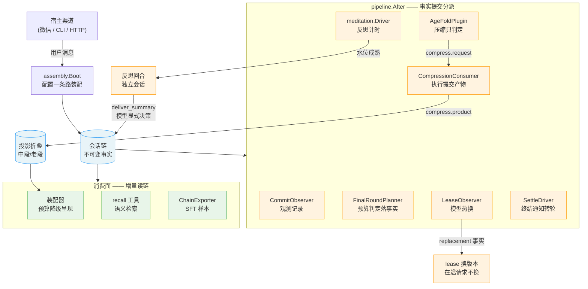
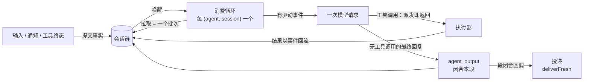
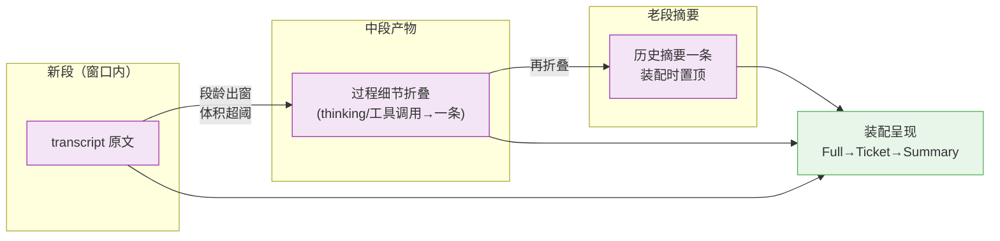

# tagent

事件驱动的 agent 运行时：一切状态皆链上事实，一切行为皆事件响应。Go 单仓（`github.com/SpellingDragon/tagent`）；宿主示例（微信 bot 与 CLI host）位于独立 module。

## 30 秒看懂

- **问题**：长会话 Agent 上下文膨胀、崩溃失忆、外部副作用重复、结果发送途中崩溃永久漏送。
- **做法**：事件链唯一事实源；每会话一个常驻消费循环（慢工具不挡新消息、同会话合批、一问一答即闭合）；三龄段折叠（判定/执行各成事实）＋ `[evt_key]` 票据；tmux 重启重挂；**先交接后销账**的交付义务（崩溃后已生成结果必达，容忍恰一次重投）；责任统一在 task（受理/结算/清偿），执行细节留给适配器；事件完整性门禁。

一分钟版本（问题、架构图、三个关键机制、测试证据、边界）见 [docs/PROJECT.md](docs/PROJECT.md)；十分钟机制导览见 [docs/wiki/mechanism-tour.md](docs/wiki/mechanism-tour.md)。

## 目录地图

模块根只有目录没有 Go 源——每个顶层目录一个职责：

| 目录 | 职责 |
|---|---|
| `assembly/` | **组合根**：宿主装配与会话运行面（`assembly.Boot`/`assembly.Assemble` 的家；host 驱动/交付账本/文档装配/HTTP face 都在此按域分文件） |
| `api/` | 跨包契约：事件类型、config 解码、六端口插件接口 |
| `runtime/` | 执行核心：消费循环与 agent 决策（`runtime/agent`）与 task 责任层（`runtime/task`）——零训练形态、零 features 依赖 |
| `memory/` | 链与投影：事件体、折叠、检索、query 投影 |
| `tool/` | 执行适配器：exec（tmux）、subagent 委派、recall |
| `features/` | 可选能力域：evolution（治理/冥想）、rl（轨迹/训练）、telemetry |
| `cli/`、`examples/`、`tests/`、`golden/`、`scripts/` | 命令行、宿主示例（独立 module）、集成测试、契约黄金集、门禁脚本 |

包边与依赖方向的权威表见 [docs/wiki/README.md](docs/wiki/README.md)。

## 核心设计：三个挂点，一条链

| 挂点 | 语义 | 谁在用 |
|---|---|---|
| **事件 x**（生产） | 不可变事实落链，带来源戳 | 渠道输入、工具调用、通知、冥想注入、模型替换、压缩判定与产物、预算判定 |
| **插件 f(x)**（管线） | 请求路径上的可追溯映射 | 治理门（调用前判定）、呈现器、观测器 |
| **消费 g(x)**（读链） | 一消费多事件，增量读 | 消费循环（每地址一个）、装配器、召回工具、冥想观察面、反思计时、训练导出 |

链是唯一真相：车道与投影都是缓存，崩溃后从链精确重建。

### 请求布局与可见面

一次模型请求由三段构成：**稳定前缀**（声明的 prompt 一条 system、声明的技能正文一条 system、压缩摘要作 user 级注记）、**transcript**、**动态段**（运行时加载的技能正文加 `## Environment` 块，一条 system，是最后一条消息）。稳定内容前置、可变内容收尾——服务端前缀缓存只为末段失效。工具定义走 `Request.Tools`，顺序由 `ToolOrder` 表达（发布代工具在前，运行期后加载工具在后）。

agent 可见的工具、MCP 与技能是配置面的子集，默认等于配置全集；`Run.NarrowFace` 在运行期收窄（`nil` 名单=全集，空名单=该类什么都不给），变更在下一请求边界生效且不重发布绑定。请求的工具表、`ToolOrder`、环境块三行、技能正文与 capture 视图同读这一面：模型读到的名字都可调用，读到的正文都在清单里。

### 事实提交后的统一分派

响应事实提交的行为只有一个形态——`PostCommitObserver` 插件入流，装配处可见、独立文件、零埋点：



### 消费循环与事件驱动

消费不是一个入口一次驱动，而是一个地址一个常驻循环：每个 `(agent, session)` 地址一条消费 goroutine（`runtime/agent/consumer.go` 的 `Consumer.run`），等唤醒 → 拉取已到达的事件 → 按事件类型分派 → 有驱动事件时调用一次模型 → 回到拉取。入口只提交事实并唤醒它——`Host.Invoke` 的用户地址走 `invokeConsumed`（提交输入事实 → `Wake` → 等消费了自己输入的那一段闭合），通知/结算走 `fireNoticeTurn` 的消费分支（`commitNoticeMaterial` → `Wake` → 等段 → settle 记账）。直驱路径（`Loop.Drive` + `awaitSettled`）保留给 `Run.Invoke`、`Run.InjectEvent`（冥想注入）与测试。

三种边界分开：**批次**是这一轮拉到了哪些事件；**模型请求**是模型这一次实际看到了哪些上下文；**turn 是段**——哪些已完成的输入、过程与结论组成一个可折叠段。一个段可跨多个批次与多个模型请求，一个工具任务可跨多个段。

| 边界 | 载体 | 用户看得见的行为 |
|---|---|---|
| 批次 | 消费循环的一次拉取（`pullDriving`：以最后一条 `agent_output` 分界，边界前的驱动事实只驱动不带材料——材料已在前缀，边界后的是新材料） | 慢工具不阻塞新输入：补充消息在下一次拉取就读到，不等工具返回 |
| 模型请求 | 请求快照（`Decision.Request`，`assembly/request.go`） | 同会话合批：不同来源的输入可进同一次请求，来源关联各留 |
| 段 | `agent_output` 事实闭合的投影段（`runtime/agent/consumer.go` `openSegment`/`closeSegment`；边界推进见 `assembly/facts.go` `recordMapped`） | A/B 闭合：对 A 的回答先闭合落链，B 归下一段 |



段的范围身份是 `<session>#cN`，跨工具结果与新输入续轮：已到的结果由 `harvest` 非阻塞配成观察，没到的不等。投递统一走段闭合的回调（`SegmentDelivery` → `assembly/host.go` `deliverClosedSegment` → `deliverFresh`），无论这段是用户入口还是通知驱动出来的——一条回答只出一次。重启不另起驱动者：从链上最后一条 `agent_output` 定位恢复位置（`lastOutputOf`）。

## 会话上下文：滚动边界＋三龄段折叠

当前段走 transcript（in-flight），段闭合（`agent_output` 落链）才把这一段交给投影成为 ended 材料。投影体积达窗口阈值时自动折叠——过程细节塌缩、历史摘要置顶，原文永在链上可回捞：



## 成功语义：先交接后销账

持久化交付承诺一条路径贯穿到底——**已生成的结果不因崩溃而漏送**：

- 结果正文在发送前先以 `owed` 义务落入持久账本（`delivery-fresh-<factKey>` 身份贯穿登记/补交接/恢复三面）；发送成功、回执落盘才销账。
- 崩溃窗口任何一点重启：账本非空 → 恢复补投（发送后崩溃容忍恰一次重投，回执落地是阻止再次投递的唯一凭据）。
- 状态提交全部 checked：持久化成功才发布内存态，失败具名返回（`RefuseDelivery`/`ApproveDelivery`/hold/restore 六点同形）。
- 只有入口地址的正文登记交付义务；headless 地址的结果具名销账（`headless`），重启不会被误推渠道。

## 责任模型：统一停在责任

task 层只回答四个问题——接受了什么工作？谁负责推进到明确结果？结果交给谁？哪一步仍未确认？tmux 退出判定、子 Agent 结束、远程恢复留给执行适配器。验收锚钉死：**接入一个新工具，适配器只需提供执行、取消及恢复证据，宿主零补偿代码、核心零新生命周期状态**（`TestNewToolAdapterNeedsNoHostCompensation`）。

配套纪律：

- 独立写权状态过反事实检验——「删掉后能否从已有记录无歧义算回来」能则删写权改派生（progress 是事实不是状态位）；
- 执行核心零训练形态——`runtime/` 不 import `features/*`，episode/decision 组织在训练侧，实际模型输入调用时固定（Capture）；
- 插件扩展是六个具名端口（call→call / call→ruling / request→environment / fact→observation / fact→view / fact→compression），无组合词汇，见 [docs/EXTENSIONS.md](docs/EXTENSIONS.md)。

## 能力矩阵

| 能力 | 机制 | 配置面 |
|---|---|---|
| **turnkey 装配** | `assembly.Boot(config)`——providers/工具面/存储/冥想/注入面一条路 | 宿主只填 Sender/Approver 端口 |
| **热更新三档** | `/reload`：模型/提示词走新代发布；工具/存储/资源所有权变更具名拒绝要求重启（`ErrHostReloadRestartRequired`）；同指纹一次发布不开新代 | 改 yaml 不重启（一档内） |
| **上下文压缩** | 三龄段折叠三段式（AgeFoldPlugin 只判定提交 `compress.request`；CompressionConsumer 执行提交 `compress.product`；重启按产物重建不重折）＋预算降级两道防线 | `max_tokens`＋`compress_threshold`(0.8)＋`keep_recent_tasks`(2)，缺省全默认 |
| **冥想反思** | 事件驱动计时＋水位门＋防循环闭表（自产戳不触发） | `meditation:` 段，deliver_to 白名单 |
| **语义召回** | embedding 混合检索＋按 key 回捞＋血统追踪 | `memory.engine:` 段 |
| **治理审批** | 调用门（风险分级/审批 Hold/TTL）＋发布门 | `governance:` 段，critical 恒审批 |
| **投递审核** | 发送插件唯一出口，投递前交审核（内容/血统/目标）；hold 批准补投、拒绝留审计 | DeliveryRuler，默认 allow |
| **委派** | 声明面子 agent＋`call_subagent` 运行时组装＋settle 通知回合回传结果（受理回执=裸 `ok`） | agent 引用＋显式源 |
| **per-agent 调优** | 思考开关/强度/温度/看门狗轮数各自独立 | 各 agent 段内声明 |
| **命令执行** | tmux Executor＋三态监控；中间态仅落审计事实（`exec-state:`），不进模型 | `{ kind: tool, id: exec }` |
| **审批闭环** | critical 自动 Hold→登记审批簿→微信下发→批准放行；声明式风险规则 | `governance.risk_rules` |
| **风暴熔断** | 单响应调用量或长上下文超阈→整批挂审批（恰一条请求，摘要只列工具与参数指纹、call ID 单列）；批准=整批按序执行、拒绝/超时/取消=零执行，无审批簿整批 fail-closed 全拒 | `max_calls_per_response`/`long_context_tokens`，0=熔断关 |
| **技能正文** | skill_load 后正文经系统段进下一轮请求 | `skill_dirs` |
| **训练数据** | Capture 轨迹（执行证据单点，含委派 worker 全入册）＋ChainExporter 导出 | 默认记录，零配置 |
| **轨迹捕获预算** | 常驻快照受字节预算约束：超预算最旧快照换出到 `<root>/trajectories/swap`，seal 与导出按需读回且逐字段等价，seal 后整集释放 | `capture_budget_mb`，0=缺省 64 |
| **看门狗收口** | final_round 事件化：FinalRoundPlanner 判定落 `final_round.request` 事实，消费循环读到即收尾轮（读不到本地判定兑底） | 各 agent 自设，缺省无界 |
| **可观测** | `GET /metrics`（Prometheus 计数）＋`telemetry.otel_enabled` OTel 开关 | `telemetry:` 段 |

## 快速开始

需要 Go 1.24.1+。

```bash
go build ./...                          # 构建全部包
go test ./tests/integration/...         # 集成/契约测试
bash scripts/lint.sh                    # 仓库门禁
bash scripts/preflight.sh               # 提交前全量预检（lint+golden+双模块测试+冒烟+事件门三档）
```

事件完整性门（每 MR 三档：`event-integrity-short` 十次独立、`event-integrity-long` 六组合 7200 输入/720 重启、`event-integrity-mutations` 冻结变异）与 `event-integrity-required` 汇总**已落地且远端必跑**；症状锚（受理静默/完成恰一条/失败告知/exec 静默/无 send/投递 hold）走 `event-semantics-symptoms`。判据与 L1/L2/L3 边界见 [`docs/OPERATION.md`](docs/OPERATION.md#event-gates)。

**本地冒烟**（全 mock 资源，纯 CPU/IO——1,142 回合/s）：

```bash
cd examples/wechat-bot
go test -tags smoke ./... -run TestLocalSmoke -count=1 -timeout 30m -v
go test -tags smoke -bench Benchmark -benchtime 30x -run '^$' ./...
```

## 文档导航

| 入口 | 内容 |
|---|---|
| [`docs/GLOSSARY.md`](docs/GLOSSARY.md) | **学习入口**：术语一行一对照 |
| [`docs/EXTENSIONS.md`](docs/EXTENSIONS.md) | **扩展面**：六端口与扩展模块的边界与契约 |
| [`docs/OPERATION.md`](docs/OPERATION.md) | **运维/门禁**：观测/工具链/风险面/事件门 |
| [`docs/api/index.md`](docs/api/index.md) | **API 权威**：源码注释生成（改注释后 `bash scripts/gates/gen_godoc.sh` 重生成，禁止手改） |
| [`docs/wiki/README.md`](docs/wiki/README.md) | 16 篇活契约页（随代码走）+ 历史档案（historical-verbatim） |
| [`openspec/changes/archive/`](openspec/changes/archive/) | 实施台账 |

## 版本与依赖

- **v0.3.0**，pre-release 姿态（无迁移承诺），见 `CHANGELOG.md`。
- 配置装载是**严格解码**：未知键拒绝启动（`unknown field`）。
- `trpc-agent-go` 指向 fork（`replace`，回正条件见 `go.mod` 的 `TODO(upstream)`）。

## 许可证

Apache-2.0，见 [`LICENSE`](LICENSE)。
