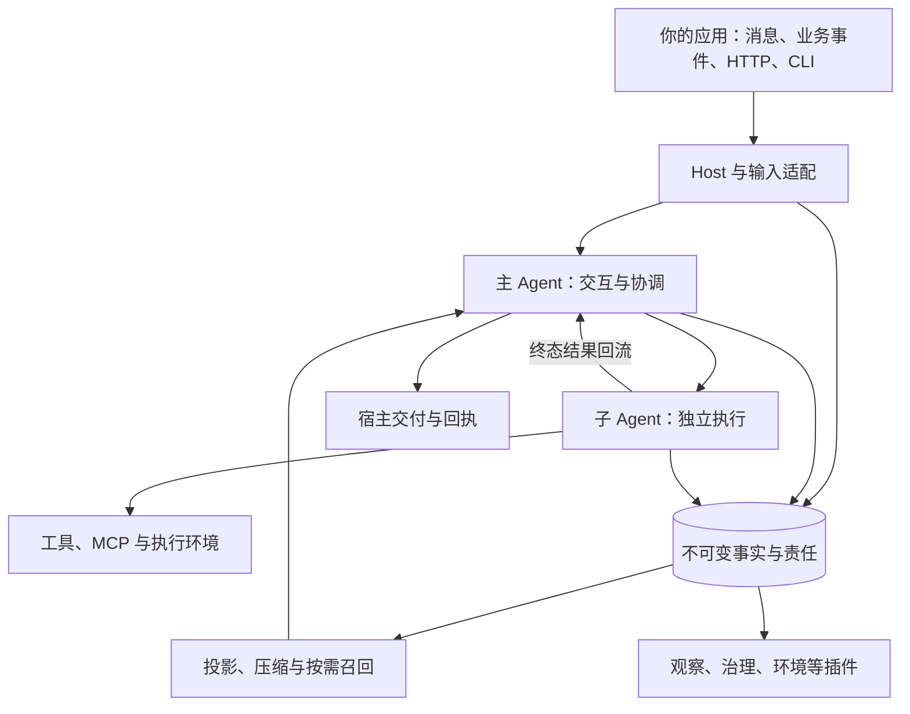

# tagent — 让 Agent 持续推进工作

**A Go AI agent framework for Super-agent systems: event-driven, composable, and built for recoverable work.**

简体中文 | [English](README.en.md)

tagent 是一个事件驱动的 **Go Agent 框架**。用它组合主 Agent 与子 Agent、工具、记忆、治理和宿主，把一次请求扩展为能够跟进后续信息、回流后台结果、跨进程重启继续处理责任的系统。底层基于 `trpc-agent-go`；WeChat bot 和 CLI 是两个宿主示例。

[零凭据运行](#一分钟运行) · [为什么是-super-agent-实践](#为什么是-super-agent-实践) · [架构](#事件驱动与插件架构) · [实测数据](docs/SMOKE-RESULTS.md) · [机制导览](docs/wiki/mechanism-tour.md) · [贡献](CONTRIBUTING.md)

## 可以用它构建什么

| 你想构建的系统 | 怎样组织工作 | 需要接入什么 |
|---|---|---|
| **研发协作助手** | 主 Agent 接待与协调，子 Agent 分别排查、评审、执行工具并回流结果 | 按需接入 Issue、PR、CI 等事件源与交付接口 |
| **个人或团队工作助手** | 持续跟进讨论与任务，保存背景，在需要时形成交付 | 你使用的消息、邮件、日程或业务系统 |
| **研究与知识工作流** | 分开检索、分析、核验和写作，按引用找回历史与原文 | 检索工具、MCP、知识源与产物出口 |
| **运维与长程自动化** | 启动外部工作，观察结果，在重启后继续未清责任 | 命令执行环境、事件观察和外部进程监督 |
| **Agent 实验与训练数据底座** | 固定实际模型请求、记录调用与结果，导出可追溯轨迹 | 你的评测、样本筛选与训练流程 |

这些是框架的组合方向；表中的外部平台连接器并不全部随仓库提供。可以嵌入自己的 Go 应用、实现新的宿主或插件。现成入口见 [CLI host](examples/cli-host/) 与 [WeChat bot](examples/wechat-bot/)。

## 一分钟运行

需要 Go 1.24.1+。先运行无凭据、无外部模型请求的最小宿主：

```bash
git clone https://github.com/SpellingDragon/tagent.git
cd tagent/examples/cli-host
go run . -c "hello"
# mock reply: hello
```

这条路径使用真实公共装配和 Agent 调用链，只把模型替换成本地 mock。切换真实模型、交互式输入和持久档，见 [CLI host 指南](examples/cli-host/README.md)。需要完整工具与渠道装配时，参考 [WeChat 示例配置](examples/wechat-bot/tagent.yaml)，再按自己的场景组合。

## 为什么是 Super-agent 实践

一个助手同时处理多项工作时，用户不应该负责记住每个内部会话、搬运背景和追问遗漏的结果。tagent 提供了把这些系统职责落到代码中的基础：

| Super-agent 思想 | tagent 的实践 | 当前边界 |
|---|---|---|
| **连续**：工作与上下文能接续 | 显式会话归属、主从委派、持久事实、事件投影、原文续读与关系召回 | 跨渠道／话题的业务归属由宿主与插件接线 |
| **高效**：后台工作和交互分工 | 异步任务受理、子 Agent 执行、终态结果回流 | 同会话慢工具期间继续响应、跨来源合批仍在 next 收敛；不能等同于已完整实现全双工 |
| **主动**：环境信息可以激活工作 | 输入扩展、模型判断、工具与子 Agent；反思是另一类输入来源 | 事件源、行动规则与授权由应用组合；反思在本次 next 长冒烟中未通过 |
| **持久**：中断后仍能继续 | 本地事实恢复、执行资源观察、持久交付责任与回执、示例中的外部维护脚本 | 当前主要验证单机可信环境；语义 Watchdog、分布式部署需要另行实现与验证 |

**一种便于理解的组织方式是 main–subagent。** 主 Agent 负责交互与协调，子 Agent 在独立上下文执行具体工作。提示词、工具面和输入归属共同落实分工。已知话题直达原有子会话，可以在宿主／插件中实现；这不等同于默认已经提供完整的话题订阅系统。有关 Super-agent 的公开讨论，参见文末[参考与致谢](#参考与致谢)。

## 事件驱动与插件架构



三个基本动作：**生产事件、通过插件处理、按需消费事实**。历史原文保留在事实层；投影与请求呈现负责给模型恰当的信息。工具完成、任务结算、记忆整理与训练导出可以围绕同一组可追溯记录组合。

扩展使用六个具名端口：调用转换、调用治理、请求环境、事实观察、事实呈现、压缩判定。执行核心与 `features/` 的治理、反思、遥测和训练能力域保持依赖边界。[扩展契约](docs/EXTENSIONS.md) · [术语](docs/GLOSSARY.md)

## 长期运行，真正难在哪里

| 遇到的问题 | tagent 中的机制与取舍 |
|---|---|
| 工具受理了，结果却没有回到后续处理 | 区分受理、任务终态、通知投递与消费；结果走正式回流路径 |
| 后台执行仍拖住新消息，输入被每次调用边界拆开 | next 正在收敛到每会话持续消费；相关红锚公开保留 |
| 历史越来越长，压缩后又需要查原文 | 三龄段折叠、Full／Ticket／Summary 预算呈现、`recall_get` 分段续读与 `recall_trace` |
| 正文已经产生，发送中断后永久漏送 | 发送前记录持久 `owed`，确认后销账，重启补交；存在发送成功但回执未落盘的重复窗口 |
| 异步工作跨越模型／配置更新 | 发起时绑定与在途执行快照；新发布不改写已借用的执行依据 |
| 环境输入与反思反复激活，产生无效工作或打扰 | 输入策略、授权范围、反思水位与节奏、调用治理和交付审核；需要运行证据检验 |
| 进程已死，靠内部逻辑无法自救 | 外部环境监督和恢复信息；进程存活与任务语义进展分别监督 |

记录实际模型请求与工具结果，也能为评测、排查和训练数据导出提供证据；这不表示框架已实现自动在线权重训练。

## 冒烟与吞吐评估

**2026-11-01 实测，开发快照 [`21ba86a`](https://github.com/SpellingDragon/tagent/tree/21ba86a371d1c932aec4d49ee49ee9dadaf832a7)。** 以下是示例宿主台架上的框架执行路径开销：本地 scripted HTTP 模型与替身出站，Go 1.24.1、linux/amd64、GOMAXPROCS=2；每项 30 次、重复 3 次，取 `ns/op` 中位数。不是实际 LLM、WeChat 网络吞吐或全部宿主的性能保证。

| 基准场景 | 中位耗时 | 换算吞吐 |
|---|---:|---:|
| 同步回合：模型回答与交付 | 4.091 ms/op | 244.4 回合/s |
| 委派到终态回流与交付 | 27.053 ms/op | 37.0 次/s |
| 折叠关闭 | 4.489 ms/op | 222.8 回合/s |
| 折叠开启 | 3.218 ms/op | 310.8 回合/s |
| 3 会话并发 | 2.527 ms/op | 395.8 回合/s |
| 10 会话并发 | 3.857 ms/op | 259.3 回合/s |

**验证状态同样公开：** 该快照构建、CLI mock 与 18 组 benchmark 样本通过；长冒烟走过 300 轮主流程、45 次委派回流、15 次审核、文件／长文及历史折叠断言，但随后在反思阶段等待 2 分钟失败，完整测试为 **FAIL**。不能把部分断言通过记作整套通过。最近查到的真实 provider nightly 中 LLM 与 embedding 均为 **SKIPPED**。

[完整口径、原始基准输出、失败位置与复现命令 →](docs/SMOKE-RESULTS.md)。小样本不用于证明压缩更快或并发线性扩展；历史 README 中缺少同口径证据的 1,142 回合/s 不再作为当前数据展示。

## 深入与贡献

| 入口 | 用途 |
|---|---|
| [项目导览](docs/PROJECT.md)、[机制导览](docs/wiki/mechanism-tour.md) | 理解问题、数据流与核心机制 |
| [扩展契约](docs/EXTENSIONS.md)、[API](docs/api/index.md) | 嵌入框架、实现插件与宿主 |
| [WeChat 示例](examples/wechat-bot/)、[CLI 示例](examples/cli-host/) | 两种传输与装配形态 |
| [运行与门禁](docs/OPERATION.md)、[实测报告](docs/SMOKE-RESULTS.md) | 验证、恢复、可观测与当前边界 |
| [贡献指南](CONTRIBUTING.md)、[变更记录](CHANGELOG.md) | 贡献代码、测试、插件和可复现实验 |

目录：`assembly/` 组合根与宿主；`api/` 跨包契约；`runtime/` Agent 与任务责任；`memory/` 事实与投影；`tool/` 执行适配器；`features/` 可选能力；`examples/` 独立 module 示例。

```bash
go build ./...
go test ./tests/integration/... -short -count=1
# 两个 examples 是独立 Go module，需分别验证；完整门禁见 CONTRIBUTING.md。
```

项目处于 pre-release，API、配置与存储格式可能变化；当前以单机可信部署为主，本地持久化的原子替换不等于抗掉电保证。依赖 fork 的范围见 `go.mod`。欢迎贡献新的事件源、宿主、恢复场景与诚实的评测结果。

## 参考与致谢

- 感谢 [tRPC-Agent-Go](https://github.com/trpc-group/trpc-agent-go) 的维护者与贡献者，为 tagent 提供底层框架与工具生态。
- 感谢 DeepSeek Harness 团队公开 [Super-agent 设计探索](https://mp.weixin.qq.com/s/zoS7GlReWPhfCjENGxXCdg)、[DSH 架构文档](https://github.com/deepseek-ai/deepseek-harness/blob/master/docs/architecture.md)和 [dsh-superagent-prototype](https://github.com/deepseek-ai/dsh-superagent-prototype)。这些材料为持续运行的 Agent、事件驱动与插件组合提供了值得学习的讨论和实践。
- 相关探索：[SpellingDragon/dsh-superagent-prototype](https://github.com/SpellingDragon/dsh-superagent-prototype) 是基于上述上游原型的实验 fork。其 `tagent` 分支尝试将调用边界约束、可恢复交付责任和渐进治理（record → warn → enforce）等实践用于原型；运行仍由 DSH 承担，未移植 tagent 运行时。

tagent 是独立维护的项目，以上引用仅供技术阅读参考，不表示与 DeepSeek 存在隶属、合作或背书关系。实际依赖见 [go.mod](go.mod)。

[Apache-2.0](LICENSE)
