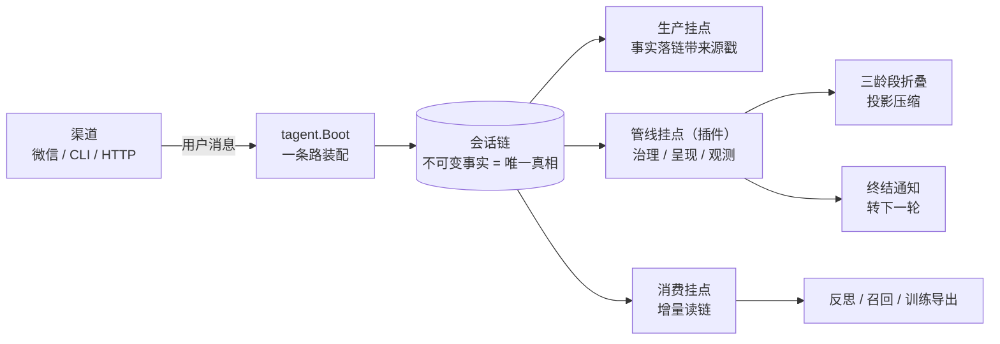

# tagent 一页说明

## 问题

长会话 Agent 的三类结构性故障：

1. **上下文膨胀**——对话越长，请求越大，成本和延迟随轮次线性恶化；
2. **崩溃失忆**——进程重启后任务、通知、账本状态丢失，用户"说过的事"被忘记或重做；
3. **外部副作用重复**——消息重发、命令重跑、同一通知被消费两次。

## 架构

链是唯一真相：投影、车道、缓存都可丢弃，崩溃后从链精确重建。

## 三个关键机制

### 1. 事件链 + 三龄段折叠（解决膨胀且不失忆）

- 每条消息带 `[evt_key]` 票据，链上事实不可变；
- 历史按三龄段（近/中/老）折叠，折叠是**事件的投影形式**——纯内存可丢，重放 WAL 能完成重新折叠；
- 重启恢复按原始事实同形重折，不重排、不重写。

### 2. 执行重挂（解决长任务跨越重启）

- 外部命令跑在 tmux 会话里，宿主重启后重新挂载、继续监视；
- 租约按调用节奏续租，调用返回不终止租约；
- 进程终态以退出证据为准：部分输出不算完成，未知状态不冒充成功。

### 3. 投递动作身份 + 回执（解决副作用重复）

- 每次发送有动作身份；投递成功与消费确认分离，`consume:` 回执先落盘后确认；
- 忙时通知保留并补投（rearm），跨进程不重不漏；
- 模型可见的回执最小化（`ok`），失败才具名（`[send_denied]`）；模型调用真失败时框架直投原始错误给用户，不静默。

## 测试证据

| 层 | 证据 |
|---|---|
| 合同 | `golden/runtime/event_integrity_scenarios.json`：29 个父测试 / 143 个锚，八族事件语义冻结 |
| 每 MR | short 十轮（十份独立 run-id 凭据）+ 症状四锚（受理静默 / 完成恰一条 / 失败告知 / exec 中间态静默） |
| 长程 | 六组合矩阵：7200 输入 / 720 重启，verdict 全 match |
| 变异 | 11 个修复被"故意放回"逐一杀死（`scripts/gates/check_event_integrity_mutations.py`） |
| 门禁 | `scripts/lint.sh` + 三模块 build/vet/test + 合同检查器 + workflow 自测 |

## 边界（主动声明）

- **tmux 不是 sandbox**：执行面没有进程/文件隔离，治理门是策略层而非安全边界；不可信命令不要交给它跑。
- **单机**：无分布式协调、无多实例一致性；存储为单机 localfile tier，跨机高可用不在范围内。
- **无多租户**：一个进程服务一组会话，租户隔离需部署层自行解决。
- **投递语义是"至少一次 + 幂等消费"**，不承诺端到端 exactly-once；有副作用的动作以幂等键约束。
- **模型依赖外部 provider**：内置的只有调用、重试与观测，不含训练与权重。
- 折叠后的历史是投影：原始事实在链上不可变，但读面呈现的是折叠结果。
