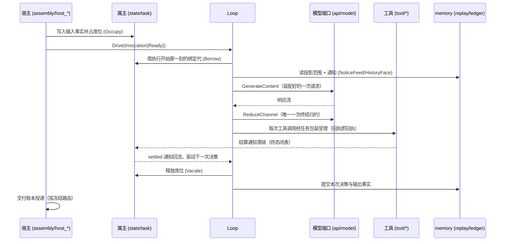

> **本篇是当期契约**：代码注释 `// 契约: docs/wiki/agent/agent-architecture.md#<锚>` 指向本页各节。实现面在 `runtime/agent/`、`runtime/state/`、`runtime/task/`、`memory/{replay,query,ledger}`、`tool/subagent/`、`features/evolution/` 与组合根 `assembly/`。

# tagent 执行核：一条链、三个挂点、六端口

执行核只做三件事：**把一次调用的事件读成一次决策、把这次决策的工具调用按任务受理、把关闭做成真实义务结清**。它自己不持状态——绑定、会话、任务与消费位置都在属主手里，执行核只借、只读、只交还。

三个概念贯穿全篇（与 [storage-concept-map](../../demos/storage-concept-map.html) 同一套词汇）：**链**是身份与因果（轻、可恒重放）；**原文仓**是 blob 字节仓加 ref 引用账目；**账本**记任务迁移、消费回执与交付七态。通知消费账＝席位＋回执＋settle attempt，除此以外的读数一律现算。时间旅行演示见 [storage-time-travel](../../demos/storage-time-travel.html)。

## 一、模块定位：调度事件、做一次决策、按义务关闭

`runtime/agent` 是运行期的**事件调度与单模型决策层**：用 `state` 借给它的那一代绑定驱动一次 invocation 的事件，把子 Agent 调用受理成任务，并靠真实义务结清来关闭一个 agent。包注释把它钉成「own no state of its own」——决策借一代绑定并在整段决策里持有它；每次受受理调用的义务留在任务层；执行面是组合根接上的端口，行为在端口之后。

`Agent` 只有三个方法，形状由 `runtime/agent/skeleton_assert.go` 的编译期断言钉住：

| 方法 | 形状 | 职责 |
|---|---|---|
| `Decide` | `(ctx, Invocation) (Decision, error)` | 驱动一次 invocation 的 ready 事件，产出一次决策 |
| `Delegate` | `(ctx, Delegation) (task.AdmissionReceipt, error)` | 把一次子 Agent 调用受理成任务，只回回执 |
| `Close` | `(ctx, CloseRequest) (DrainReport, error)` | 真实义务结清后关闭，未收敛即报错 |

四条红线（`runtime/agent/agent.go` 原文）：**借代**——MUST take the binding generation effective at the start of the decision and keep it for what it sets in motion；**单点归约**——MUST reduce the model stream to its single terminal through the one reduction entry；**无第二循环**——MUST NOT run a second tool-iteration loop beside the event loop, and MUST NOT judge a terminal on stream mechanics；**回执不是结果**——MUST NOT report a receipt as a result: an admitted call settles only after its own obligations clear.

两条结构性事实：`runtime/`、`api/`、`memory/` 内**没有任何 `features` 的 import**——训练、治理、冥想都是经端口接进来的旁路；执行核里没有框架 Runner，`Loop.Drive` 自己驱动回合（见 §七）。

## 二、核心组件

| 组件 | 所在 | 一句话 |
|---|---|---|
| `Loop` | `runtime/agent/loop.go` | 驱动一次 invocation：借代 → 聚合本范围输入 → 装配一次请求 → 单点归约 → 工具调用过任务包装 → settled 通知回流驱动下一次决策 |
| `Agent`/`Delegator`/关闭闸 | `runtime/agent/{agent,delegate,shutdown}.go` | 决策面、委派账、真实排空的关闭门 |
| 席位 | `runtime/state/occupancy.go` | 每轮决策前占用会话决策席，终结即释放，同址在途 `ErrSlotHeld` |
| 请求面 | `runtime/agent/request_assembly.go` `assembly/request.go` | 按投影装配请求，`RoleOf` 定角色，配对校验 |
| 绑定与代际 | `runtime/state/{binding,publish,retire,lease}.go` | 唯一发布入口、借用四红线、退役释放 |
| 会话与邮箱 | `runtime/state/{session,mailbox,durable,memory}.go` | 会话坐席、`AcceptSeq` 消费位置、`WorkSeat` 待办坐席、`SettleAttempt` 尝试记录 |
| 任务层 | `runtime/task/` | 责任四问的账：受理、状态、通知、交付义务、恢复 |
| 原文与投影 | `memory/replay/` `memory/ledger/` `memory/query/` | 链的重放与滚界、字节仓落盘、只读投影读缝 |
| 组合根 | `assembly/` | 唯一装配与发布点，host 簇按域分文件 |
| 扩展端口 | `api/plugin/` | 两相位、六端口 |
| 旁路 | `features/{evolution,telemetry,rl}` | 治理、冥想、观测、训练数据 |

**2.1 一次驱动的骨架**：借执行开始那一刻的绑定代；聚合**本 invocation 自己**的 ready 输入（同会话两次 invocation 永不并批——各自只聚合自己的输入，各自的决策独立于对方的终结）；装配一次原生请求；经唯一归约入口读出终结；每次工具调用经任务包装受理；settled 通知回流到发起调用的那次 invocation，驱动它的下一次决策，而那一次借的是**它自己开始时**生效的代。`Turn{InvocationID,Decisions,Terminal,Failure,FinalRound}` 是驱动交回的结局：终态只读 `model.Kind`；`Failure` 是失败时宿主可投递的原文，归约没观察到原因就留空，不编一个。

**2.2 三个读写缝**：`Capture` 三方法——`Snapshot` 在请求开始前固定这次决策跑在什么视图上（模型名、提示词版本、可见工具、可见技能，连同当时的请求；**请求被观察，不被改写**）、`Record` 把一次被观察的尝试与产生它的响应一起入账（结局已归约，记录侧共用那一个终结）、`Seal` 关账并报告真实写入者确认过的清单（发现仍在飞的记录是**具名失败**，不是完成的捕获）。`NoticeFeed`（`NoticeBoundary`/`NoticesFrom`）把通知当链上事实的投影增量读，游标永不跨折叠重写保留；`HistoryFace`（`SessionHistory`/`CommitHistory`）分开读会话历史与已提交历史。

**2.3 只读投影读缝**（`memory/query`）：`Reading` 三方法 `Published`/`Sites`/`Tasks` 是**三种语义单位**，不是一个属主一个方法。`Published` 的 agent 清单与租约清单取自同一代，绝不跨两代配对；`Sites` 把站点快照与此刻持有该席位的调用放进同一次读。`Inventory` 从这一个口现读六个维度（agents/sessions/invocations/tasks/notices/leases），视图与计数出自同一次收集；`ReadingSource.Freeze` 产出一份冻结读数与同次收集的逐源水位，`DetailSource` 的 `Order`/`DetailOf` 逐身份作答，`Projection` 的 `Snapshot`/`List`/`Detail`/`Subscribe` **只读冻结读数、绝不回读属主**。四条红线：每次调用都从持有事实的属主现读、逐项如实返回或具名失败；源不可读的维度以具名拒绝回答，绝不以空明细冒充可读；读口不记录、不缓存、不合成（不是第二个真源）；越权对象被排除而非被改写。

## 三、反思与旁路冥想：一个机制，两种观察面

锚名沿用历史上的 curator 说法，概念统一为旁路冥想。机制只有一套：**事件驱动，没有 ticker**——一次反思是对一个新事件的回答，无事发生的进程永不点火；`interval` 是两次点火之间的下限，不是会自己响的时钟；决策席被在途回合占用时让路，重评等待取 `interval` 与节奏下限的较小正数，席随回合终局释放。观察面只改变「读谁」与「反思落在谁的会话」，不改变动作本身：缺省即**自身分区**（回看自己），显式列出他人分区即同构 agent 做旁路冥想，混列同样合法。授权边界：显式观察面必须落在授权读范围内，越界**具名拒绝启动**（`ErrObservationScopeOutOfBounds`），绝不静默裁剪——读得比声明的少会悄悄改变反思看到的东西。

- **谁算「有人在等的交互」**：`hostFacingStamps` 是闭表（`user`/`task`/`reincarnation`/`system_alert`）。表外的戳——自己的反思、整理唤醒、读不出的戳——一律不开新鲜度门。反思输入自带 `LineageReflection="meditation"`，所以 agent 的反思**永不再让它反思自己**。
- **判定五值**（`TickDisposition`）：`fired`（置 pending 并注入）、`pending`（已有在飞的一趟）、`closed`（门未开）、`no-novelty`（观察面内没有新事实）、`rhythm`（节奏门未到）。同一个时刻至多一趟在飞的反思。
- **水位只由消费推进**：注入本身不动水位；被**消费**的反思回合才把水位推到**注入时刻**，由此覆盖让位窗口内的整段事实面（`Watermark`）。让位不动水位，被它覆盖的事实因此不被烧掉；零水位起始直通一次然后自锁。
- **结果三值**（`ReflectionOutcome`）：`consumed`/`deferred`/`in-flight`；对一条不在等结果的输入报结局是具名拒绝（`ErrReflectionNotPending`），重复或过期的报告永不动水位。
- **fail-closed**：观察面的读缝没接上即 `ErrObservedFaceUnwired`，门保持关闭——事实链是新鲜度判定的唯一数据面。一趟扫描有上界（`DefaultObservationPageLimit`、`DefaultDigestFactLimit`），积压超界就报界限而不是让这一趟无限长。
- **产出与回流**：产物是写进**自己**分区的普通事实，不改被观察分区、不写压缩事件；回业务线只经 `deliver_to` 白名单，压缩权不转移（目标侧瘦身仍由它自己的阈值折叠承担）。

## 四、结算随动：一条通知起一个回合

`SettleDriver` 是 `fact->observation` 面：它观察本次运行提交的投递事实，在通知冻结的路由地址上驱动**一个**随动回合。四字段各守一职——`lookup` 按提交身份回读那条事实（通知只带身份，事实经已持有的链读回）、`wake` 在**驱动那一刻**才解析邮箱账（绝不提前）、`fire` 驱动那一个回合、`handoff` 在邮箱条目被消费前登记落地回合的交付义务。

触发面是闭表，防循环靠语义而不是黑名单（`assembly/settle_turn.go` 原文）：

- 只有 `settled`/`failed`/`cancelled` 点火（`terminalSettleKinds`）；`accepted`/`progress` 不在表内，仍在跑的任务永不转动运行期。
- 只有投递事实带结算血缘的元数据键，所以活动回合经自身 backflow 读到的终结结算**永不再点火**。
- 被点火的回合不提交任何带血缘的结算事实，因此它**永不可能点着自己**。
- 邮箱是唯一回答「还有没有活等着」的账：一条通知在邮箱里等到一次回合认领、驱动，并在**同一账**上消费，所以无论被观察多少次，一条通知只起一个回合。

`SettleWake` 五方法就是这本账的全文：`RestoreOwed` 把持久账仍欠的未消费工作折回邮箱（停掉的运行留下的通知等下个决策，而不是随进程死掉）、`Unconsumed` 按账自己的次序报出未完成的条目、`Claim` 只给本执行器取走一条待办（一条通知只起一个回合）、`Release` 把已认领条目交还未认领池（停在认领旁的执行器保留欠账而不是占着）、`Consume` 在同一账上记下完成消费。驱动**自己不持队列**，所以它持有的东西不会因停止或重启而丢；`SettleAttempt` 是重启读的第二道栅栏——已落地终结的回合用消费回执关闭，不再驱动一次，于是「终结事实」与「回执」之间的一次停止不会重放第二个回合。落地判定写成同一道栅栏（`settleBarrier` 带地址、通知、终结写入与消费回执），在驱动返回与答案投递之前完成。随动回合与用户回合**共用同一地址闸，绝不同址并行**；`Close` 先停随动驱动并等在飞回合返回。

委派结果正文随通知同行：`tool/subagent` 把 builder 的回合正文交给结算面，通知的 `Text` 携带正文（超限截断并标记），结算事实与随动回合读到的是同一份正文——正文不属于通知身份（`FactKey` 仍读 task/round/kind/seq），重试保持同一幂等键。

## 五、包与文件结构

| 包 | 职责 |
|---|---|
| `api/event` | 事件身份与事实载体，纯叶子 |
| `api/config` | 纯组织声明：解析、规范化、指纹，不依赖运行时包 |
| `api/document` | 宿主文档方言的共用适配面 |
| `api/model` | 锁定 tRPC 模型协议的薄别名层，唯一自有行为是请求作用域终结归约 |
| `api/plugin` | 两相位六端口的窄口扩展点（`call->call`/`call->ruling`/`request->environment`/`fact->observation`/`fact->view`/`fact->compression`） |
| `api/view` | 呈现面的共用类型 |
| `runtime/agent` | 事件调度与单次决策：`agent.go`（三方法与四条红线）`loop.go`（驱动、捕获、通知与历史读缝）`invocation.go` `request_assembly.go` `delegate.go` `handoff.go` `final_round.go` `shutdown.go` `skeleton_assert.go` |
| `runtime/state` | 生效绑定、发布与退役、会话与邮箱、席位、授权：`binding.go` `publish.go` `retire.go` `lease.go` `session.go` `mailbox.go` `durable.go` `occupancy.go` `authority.go` |
| `runtime/task` | 任务转移与通知义务：`spec.go` `lifecycle.go` `admission.go` `registry.go` `manager.go` `handoff.go` `logical.go` `progress.go` `restore.go` `wrapper.go` `cancel.go` `hold.go`、`approval/` |
| `memory/replay` | 链的重放与投影滚界，`BudgetCharsPerToken` 的唯一单源 |
| `memory/ledger` | 原文仓的字节落盘与会话关系账本 |
| `memory/query` | 只读投影读缝（`Reading`/`Inventory`/`Projection`） |
| `memory/{search,embedder}` | 语义检索与向量面（旁路能力） |
| `tool/{exec,file,knowledge,mcp,recall,spec,subagent}` | 执行适配器、文件与知识面、MCP、召回、工具声明、子 Agent |
| `features/evolution` | 演进域：`governance/`（治理）、`meditation/`（冥想）、网关与后验面 |
| `features/telemetry` | 观测旁路：提交观察者与遥测阶梯 |
| `features/rl` | 训练数据面：模型租约与替换事实 |
| `assembly/` | **唯一组合根**：`tagent.go`（`Assemble` 是唯一装配入口）`run.go` `prepare.go` `request.go` `facts.go` `invoke.go` `read.go` `commit.go` `tools.go` `age_fold.go` `settle_turn.go` `skeleton_assert.go` |
| `cli/` | 宿主壳：命令面与宿主转换面，位于组合根之上 |
| `internal/bench` | 基准面 |

**组合根与根包的关系**：module 根不再承载 Go 源，公共入口是包 `assembly`（目录名即包名，D16）。host 簇在组合根内**按域分文件**，不聚成一个大 `host.go`：`host_face.go`（回环端点的鉴权先于读体）`host_delivery.go`（交付账本：正文先成为持久义务再离开）`host_document.go`（宿主文档方言与它拼出的装配）`host_tools.go`（宿主贡献的工具与端口）`host_diagnostics.go`（诊断可见面）`host_capture.go`（轨迹捕获）`host_model.go`（采样参数落在已发布绑定与 provider 之间）`host_reload.go`（配置重载经唯一发布入口）。

依赖方向由 `golden/runtime/architecture.json` 登记、由 `scripts/gates/check_runtime_architecture.py` 执法：未登记的包与未允许的边一律失败并等人工批准，不用通配豁免；`cli` 指向组合根的回边不算环，真环在其余包之间检出。

## 六、数据流

环的四步是「取就绪 → 消费 → backflow → 投递」，每一步都先落事实再前移；四块账分别是身份、内容、所有权、账本。`drive` 返回的 `Turn` 是这一轮的唯一结局，宿主交付只读它。

## 七、与 trpc-agent-go 的边界

**`api/model` 是薄别名层，不是镜像 schema**。每个导出名都是锁定框架包同名符号的未包装别名，方法集与字段布局逐字保留：没有别名包住原生类型、复制或重塑原生字段、添加自有行为。编译期断言用指针赋值证明这一点（`skeleton_assert.go`）——只有别名与原类型完全同一才通过，退化成 wrapper 就编不过。这一层唯一自有的行为是**请求作用域的终结归约**（`ReduceChannel`/`ReduceSeq`），两种流形状归约出恰好一个 `Outcome`。

**执行核不借框架的循环**。没有 `runner.Run`、没有第二套 ReAct 循环、没有 `BeforeModel` 回调链：`Loop.Drive` 自己调 `GenerateContent`、自己做一次归约、自己把工具调用交给任务包装。因此「模型可见」与「已被装配」是同一件事，不存在「可见但未入账」的中间态。

**观测是旁路，四条红线**（`api/model/observe.go`）：在终结站定之后、从已归约的 `Outcome` 渲染，绝不重新折叠流；每次渲染保持有界——只输出身份、计数与令牌总量，绝不输出提示词或补全内容；失败只记一条 gap（日志坏了等于少一次观测，不是请求失败）；不在它观察的请求的框架代 span 旁另开一个 span——那会落下一个空的第二代。

`model.Kind` 五值（`Unknown`/`Completed`/`Failed`/`Cancelled`/`PartialOnly`）：消费者只读 `Kind`，不重分类六个 `Signal`、不从流机制（channel 关闭、序列耗尽、取消）推终结；`KindUnknown` 是零值，读不出即告警，**不得降级成完成**。

## 八、完整请求预算：每次现算，不读回上次形态

装配预算**每一轮现算**：`AssembleBudget`/`AssembleBudgetPrefix` 读这次要发的材料，不读回上一轮装配塑形出的视图——视图只属于产出它的那次装配。呈现形态按可用预算降级：`Full → Ticket → Summary → notice card`；**通知可缩不可丢**，缩到卡片也仍在，因为它是模型唯一的到达信号。

`projectionBudget` 的两条路（`assembly/request.go`）：窗口给了正的 `MaxTokens` 就按该窗口的预算呈现；窗口**没有声明令牌数就没有上界**——预算从材料自身计量（每条被保留的原文，按装配打包的比率），于是整段投影全量呈现，没有任何条目降级成声明从未要求的票据。计量读的是投影保留的原文，不读某次装配塑形的视图。

比率只有一个单源：`memory/replay.BudgetCharsPerToken = 4`（保守的四字符一令牌），重放与装配共用它，不各算各的。固定开销（system、协议信封、工具声明）由装配面交进去度量，**量不出的部件只申报、不估价**——总额是下界而不是「精确总数」；固定部分已越过上限时具名拒发并原样交回完整时间线，不删 system、不删工具声明、不做第二次压缩腾地方。

## 九、上下文管理：段龄折叠、配对校验、呈现边界

三龄段折叠是唯一压缩管线（`memory/replay` + `assembly/age_fold.go`）：`LevelOfAge` 把段龄折成 `L0`–`L3`，`BandOfLevel` 再折成 `BandNew`/`BandMid`/`BandOld`；`DefaultAgeKeepRecent=2` 段内全留，越过 `DefaultAgeVolumeThreshold=4096` 才动折叠；产物是内容寻址的负键（`-seg-<hex>`/`-hist-<hex>`），因此折叠是纯函数、可重放、不占正序号。每次判定落一条 `compress.request` 事实（`AgeProducerSegmentAge`），执行者是 `assembly/age_fold.go` 的 `AgeFoldPlugin`（`fact->observation`）——判定与执行分离，观察者不改事实。

呈现边界三条：**system 恒单条恒首位**，任何机制产物不得追加进去；压缩摘要渲染为 user 级〔历史归档〕注记并标注「非用户发言勿模仿」；**assistant 恒等于模型真实产出**——系统永不代 assistant 说话，也永不在 assistant 历史里生成文本化调用语法，防模型模仿出伪调用。`restoreCallPairing` 做双向配对校验：悬空的 `tool_calls` 被剥离或降级为 user 侧注记，绝不留下一个永不回应的调用。

## 十、子 Agent 调用：一条受理、一份交接、零补偿

`tool/subagent` 不持活对象：一份声明（agents 文件或显式参数）要么解析成装配，要么具名拒绝，**被拒的声明不产出装配**。`call_subagent` 是模型可见的那一面，一次调用做三件事：把两个装配来源之一解析成装配、经委派面把这次调用**受理成任务**、用这次受理的回执作答。所以调用方拿到的第一句永远是回执而不是结果——结果随该任务的进度与终结到达。

`Delegation` 是这次受理的记录：发起它的 invocation 与决策、原生调用号（逐字节保留、永不重生成）、受理成的 task、跑在哪个地址、触发源戳、以及该任务此后报的进度与终结。两条判据：委派的受理**有自己的去重后缀**——同一原生调用被工具包装受理的那次是另一次受理，共用键会把委派去重进包装的回执里；委派回合只跑在应用**显式选定**的会话里，委派永不创建自己的私有可写历史。

交接有结构化载体（`HandoffEnvelope`）：`Intent`、`Constraints`、`Grants`、`PendingDecisions`、`Refs`。`Validate` 按名拒绝两种不合格——无 intent（没有哪一趟能说清它在服务什么任务，`ErrHandoffIntentMissing`）、无一条非空验收约束（交回的结果无从被接受或拒绝，`ErrHandoffConstraintsMissing`）。自然语言请求与信封并存，字段只有一套、**载体分两道**：本地委派经 `ExternalContext` 渲染成子 Agent 请求前的结构化块，远程经 A2A data part 序列化（`DataPart`/`FromDataPart`），两通道共用同一组字段名。

**新工具零补偿**：接入一个新工具，适配器只提供执行、取消及停止证据、结果正文恢复三面；宿主不加补偿代码，核心不加新生命周期状态（`tests/integration/execution/new_tool_adapter_test.go` 钉住这五条：受理/执行/结算/交付全走正式入口、重启从结果事实重放而不向适配器要东西、失败经同一组面终结且不产生第二条通知、进度与停止证据在执行器与任务面之间往返且迟到结算不补偿任何东西、生命周期词汇保持核心声明的闭集）。

## 十一、契约替身住在包内的非 `_test` 文件里

包内测试共享的断言与替身集中在 **`skeleton_assert.go` 这类非 `_test` 文件**（`runtime/agent`、`runtime/state`、`runtime/task`、`api/model`、`api/plugin`、`memory/query`、`features/*` 各一份）：内部测试无法导入一个反向依赖本包的支撑包（Go 禁止测试里的导入环），改成外部测试包又会牵出大量包内私有引用。代价是随库一起编译，收益是**声明一变就编不过**——字段改名、签名放宽、词汇表少一个常量、具名拒绝被吞掉，都在编译期而非运行期暴露。

三处取证面各守一段：`examples/contract/` 是按包分组的**可执行契约**（`runtime_agent`、`runtime_task`、`memory_query`、`api_plugin`、`tool_subagent` 各有一组 `Example`），注释说明它钉的是哪个契约、由谁的真实调用者驱动；`tests/integration/` 按域分组（`acceptance`/`capabilities`/`config`/`evolution`/`execution`/`history`/`host`/`inspection`/`journey`/`learning`/`state`）跑跨包真链路；真实框架行为的判据一律**不猜**——`OnEvent` 与模型流的时序这类问题由一次性真机探针取证，结论落进测试注释。

单元测试的存储根必须**显式挪出仓库工作树**并按用例隔离：`memory/ledger` 在分派之前就无条件 `os.MkdirAll` 并落关系账本（`localfile.go`、`relations_journal.go`），「用内存类型配一个逻辑路径」并不等于不落盘。根由 `t.TempDir()` 按用例唯一，不得跨用例共享——热更多代「存储段字节不变」与重启模拟所依赖的身份前提由此成立。

## 已知缺口与演进方向

| 缺口 | 现状与防线 | 候选方向 |
|---|---|---|
| 读缝是拉取式 | `Reading` 三个方法每次从属主现读，六个维度的读在一次收集里一致；调用方自己决定多久拉一次 | 一个「自上次读数以来的增量」口，让观测面不必全量重读 |
| 随动回合与用户回合共用地址闸 | 同址绝不并行，靠 `ErrSlotHeld` 与席位；没有「随动回合被用户回合让位了多少次」的读数 | 把让位计数落成可读事实，盯住高频地址上的随动饥饿 |
| 冥想的「值不值得反思」没有判据 | 新鲜度门只回答「有没有新东西」；一句闲聊与一条低价值任务事件同样开门 | 未消化事件量与卡片密度作为内容价值第三判据 |
| 折叠加配对校验的开销无直接读数 | `compress.request` 只落段龄判定，折叠耗时要靠装配侧计时反推 | 把每次折叠的入出规模与配对修复次数计入同一条事实 |
