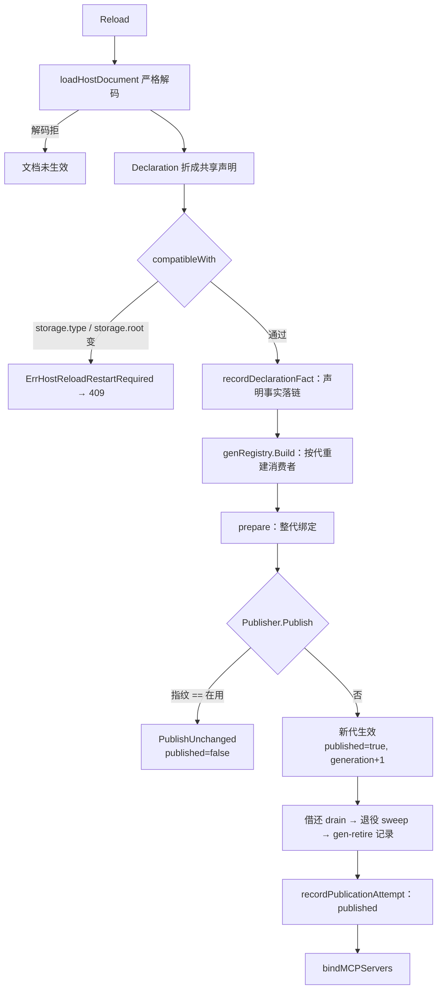

# 组织级热重载（三档判据 · 声明链 · 代际装配 · 代际退役）

一次配置改动在本仓只有三种合法读数：**一档新代发布**、**二档具名拒绝（须重启）**、**三档同指纹不开新代**。第四种读数——回执成功而实际没生效（静默 applied）——只有两类成因：字段不进声明指纹，或字段进了指纹但它的消费者只在 `Boot` 构造一次且没有按代重建通路。判据是**消费点在哪一刻被读**，不是字段的敏感程度。

## 一、机制定位

`assembly.Host.Reload` 是热更的唯一入口：重读配置源 → 用 Boot 同一个严格解码器解同一份方言 → 判档 → 声明事实落链 → 经 `state.Publisher` 这一条发布入口生效 → 给回执。文档解不动就什么都没发生（不换 `h.doc`、不换 `h.models`）。

| 文件 | 本篇用到的职责 |
|---|---|
| `assembly/host_reload.go` | `Reload`、`compatibleWith`、`restartRequiredChanges`、两个哨兵错误、回执结构 |
| `assembly/host_document.go` | 方言解码（`loadHostDocument`）、`mapDocument`、`Declaration()` 派生、启动对账 `reconcileBootConfig`、各宿主方言消费者的 `registration()` |
| `assembly/run.go` | `publishDeclared`：声明 → 构整代消费者 → 候选 → 发布 → 尝试结果；`GenRegistry` 驱动、`gen-retire` 记录 |
| `assembly/commit.go` | 配置链事实的落链与去重（`declaration` / `record` / `result` 三类，`commitFactChecked` 按键幂等） |
| `assembly/host_face.go` | `/reload` 端点与 401 / 503 / 409 / 200 映射 |
| `runtime/state/publish.go` · `genregistry.go` · `retire.go` · `lease.go` · `baseline.go` | 唯一发布入口、代际作用域消费者注册表、退役台账、候选租约、基线复检 |
| `api/config/fingerprint.go` · `clone.go` | 指纹规范化、深拷贝 |

**为什么整代而不是逐个换**：一次改动可能同时动多个字段，逐个替换会让读者在中途看到半新半旧的组织；整代发布保证任何时刻读到的都是一个完整一致的代。

整代里的消费者由代际作用域注册表按代重建（ADR 0007），发布路径只认注册表，不认特性名。

## 二、指纹：只有声明面参与

`config.Fingerprint(d)` 是规范化 JSON 的 SHA-256。canonical 形只含五项：`entry`、`agents`、`refs`、`baseline`、`mcp_servers`。其中每个 agent 收进 `model`、`tools`、`plugins`、`task_policy`、`files`、`params`、回放窗三值（`max_tokens`/`compress_threshold`/`keep_recent_tasks`）、采样三值与 `max_tool_iterations`，外加 `memory`/`meditation`/`file`/`exec` 四个域段；`id`/`parent_id`/`final_round`/`environment_block` 也在 `canonicalAgentCore` 里，改它们同样换代。

规范化三件事：先 `Clone` 再 `applyDefaults`（省略的集合编成空集合、`nil` 指针省略键、负零归零）；字段顺序由 canonical 结构固定；map 按名排序。**活对象与 `Raw` 源文档永不进指纹**，所以同一份声明在任何 YAML 迭代顺序下算出同一串。

三条推论：

- 指纹变 ⇒ 一定换代，绝不会掉进档三。
- 指纹不变 ⇒ 档三，除非有字段在指纹之外还需要判（见第九节）。
- 指纹**不是身份**：身份是 `Generation` 序号，指纹只是内容标签，任何执行路径都不得据它选版。

`mcp_servers` 进指纹的意义：改一台服务器就是一次真实改动，必换代；换代时 `bindMCPServers` 按声明名重绑——停答的服务器立刻停、新增的立刻答、声明没变的保持连接。声明面之外还有一格缺口：`providers.*` 的端点与凭据环境变量名不在 canonical 形里，见末章。

## 三、代际：一个序号、一条上一代、没有环

| 量 | 含义 | 前进时机 |
|---|---|---|
| `Generation`（`uint64`） | 发布身份 | 每次真正发布 +1；回滚同样 +1，不重用旧号 |
| `Publication{Generation, Fingerprint, Baseline}` | 当前生效的一代 | 与其余生效面同一次切换 |
| 上一代（`source` / `sourceGen` / `sourceOK` 单槽） | 回滚重建的数据源 | 每次新代发布轮转 |

没有 ring-2 回滚环，也没有第二个"完整应用计数"轴：任何"改了几次"的读数都必须从应用记录重放得出，不得成为第二个身份，也不得被任何路由读作版本依据。

档三在这里落地：同指纹时 `publishLocked` 释放候选并返回 `PublishUnchanged` 与**当前** `Publication`——不建记录、不换绑定、序号不动。回执因此带 `publication{generation, published}`，"没换代"是可读的事实，不必从空的 `model_changes` 反推。

## 四、应用记录：声明链先行，再切换生效面

一次真正发布按固定次序穿过唯一入口：基线复检 → 治理前置检查 → **提交 `PublicationRecord`** → 持有新 plan → 切换生效面（绑定、序号、上一代）→ 退役台账 `track` + `sweep`。配置链（`tagent/config/v1/fact:`，只追加）上同一次改动依次留下三种事实：`declaration`（声明载荷与指纹）、`record`（`PublicationRecord` 整条）与 `result`（一次尝试的结果）；代的退役另记 `gen-retire:<id>`（见第七节）。其中 `declaration` 按生效次序追加：与最新一条同指纹则不追加，不同则追加一条并记下它从哪条声明移动来（`previous_fingerprint`），所以回退到更早用过的声明同样追加一条——最新一条 `declaration` 永远是本次加载产出的声明，reload 的"链上声明必须回答加载声明"与重启对账读的都是它。

- **记录在切换之前提交**：记录提交失败即拒发布，生效面原地不动，候选资源逆序释放。`PublicationRecord{Generation, Fingerprint, Result, RollbackSource, Checks}` 经 `PublicationRecorder` 单独提交，绝不与任务终态提交或待发通知共用一个事务。
- **一次尝试只有一条结果**：`result` 取 `published` / `unchanged` / `load-failed` / `governance-rejected` / `install-failed` 之一，由发布结果判档（`candidateInService`：`Publication.Generation≠0` 且 `Result∈{Applied,Unchanged}`）。先乐观记 `published`、再补一条 held 的矛盾双事实不再存在。
- **决策窗口随记录落链**：`publicationWindow{previous, previousFingerprint, models, dimensions, at}` 记下这次尝试从哪一代/哪一指纹移动、每个 agent 之后运行的模型版本、每个配置维度的判定与记录时刻。

**逐维度的 applied/held**：`configDimensionOutcomes` 把每个移动的维度记成 `applied` 或 `held`，随尝试结果落链并回执到 `config_changes`，所以"哪一项没生效"与"整次尝试的结果"是两笔可分别核对的账。
- **重启只采纳，不重发布**：`reconcileBootConfig` 读链上最新 `declaration` 与 `record` 判四种情形——无声明则首代发布；文件即最新声明则按记录代**采纳**；文件更新则接在记录代之后发布；链比文件新则采纳链声明并按名记下滞后的文件。采纳走 `adoptBootGeneration`：驱动同一个消费者注册表重建该代的工具面、执行实例、记忆读命名空间、反思循环、治理规则与观测面，独占资源登进该代退役台账。

治理前置检查（`PublishContract`）：契约无必需检查、必需检查缺席、检查判拒、豁免未带理由或作用域，各自具名拒发布——沉默是缺证据，不是通过。

**热参怎么生效**：没有任何"下发"通道。每个消费边界读**当前代声明**（`foldWindowOf(spec)`、`specOfLocked(r.current.Plan.Declaration, agentOf(evt))`），所以"改了没生效"的诊断是"这个消费者读到的声明属于哪一代"，而不是哪里少了一条广播。

## 五、配置快照的私有化

`Declaration.Clone` 是**手写逐字段深拷贝**（`cloneAgents` / `cloneAgentSpec` / `cloneToolRefs` / `cloneServerSpecs` / `cloneRawMap` / `cloneFileRefs` / `cloneStrings` 等），不是序列化往返。读面同样只给拷贝：`AgentSpecs()`、`ToolRefs()`、`RawDocument()`。

为什么换成手写：序列化往返的正确性依赖标签对称——进程级路径字段不参与序列化、`omitempty` 的"空但非 nil"集合回来变 `nil`、`Raw` 这类 `map[string]any` 解码会丢具体类型。这些偏离在往返里是隐式的，在手写拷贝里是可见的。代价是新增字段必须同步改手写拷贝的每一处（`cloneAgents`/`cloneAgentSpec`/`cloneToolRefs`/`cloneServerSpecs`/`cloneRawMap`/`cloneFileRefs`/`cloneStrings`，编译期不报错），收益是拷贝语义与字段一一对应，且指纹、候选构造与回滚重建共用同一份语义。

## 六、被拒候选必须完全退场

候选 = 一份 `StatePlan` + 一份 `Leases` 账目（本候选独占的资源与释放函数）。被拒时每一份副作用都要撤销，生效面与拒绝前完全一致，在途请求照常跑完。

- **基线复检**：候选构造时记下 `baselineOf(generation, fingerprint)`；提交点复检，被更新的发布推进过就是 `ErrBaselineAdvanced`——陈旧候选丢弃，绝不覆盖更新的发布。
- **逆序释放一次**：`Leases` 在获取那一刻登记释放函数；失败按获取逆序释放，每条释放只跑一次；共享面与在用资源不在任何账目里。
- **能力缺席按名拒**：没有绑定持有者、没有记录提交端口、空 plan、契约无必需检查，各自具名拒绝，而不是"发布成功但什么也没换"。

## 七、属主退役：代被取代且无人持有才释放

退役台账按代登记"候选独占资源 + 释放函数"，登记键是 `gen:<id>:<consumer>`（`state.GenLeaseKey`）。一次发布**不提前退役任何东西**：仍被请求持有的代保留资源，最后一个持有释放时排空自行推进，不需要额外业务回合；共享面与在用代的资源不进任何一次释放。

释放之后才写 `gen-retire:<id>`：该键只由代号决定，经 `commitFactChecked` 按键去重，所以退役记录恰好一次；它只是链上的记录与重放锚，绝不反过来触发释放。崩溃落在"换指针"与"退役记录"之间时，重启的 `convergeGenerationRetirements` 对每一代已落链、已被取代且无后续借用的代号补发记录——不重复释放，那些资源是进程私有的，已随进程结束。

三个事实必须分开陈述：**停止接受新路由**（新代的可达集）、**义务收敛**（在途请求与任务）、**资源释放**（独占资源与存储租约）。把三者折成一句"已退役"，会让一次有界返回被读成"资源已交还"。

## 八、关闭必须覆盖排空期间落位的义务

关闭分两段：先 `Host.Quiesce` 关 intake 闸门（外部新输入被具名拒绝，关闭期内由已受理义务派生的回合仍受受理）并**静止到不动点**，再由 `Host.Close` 停消费者与设施。不动点由同源判据 `Unsettled()` 求值——关闭、重启、报告读同一处。出口四值：零值 `CloseUnreached`（判定未到达）＋ `Quiesced`（自然收束）／`Cut`（预算到点，余量在链上由重启续上，**正常返回**）／`Broken`（不可判，告警）；`Cut`/`Broken` 的 `DrainReport.Unsettled` 逐地址报出未消费通知与未终态工作。

宿主关闭次序（次序即契约）：

| 序 | 动作 | 为什么在这个位置 |
|---|---|---|
| 1 | `Quiesce`（关 intake 闸门 + 静止到不动点） | 先拒绝新输入再等已受理的收敛；静止期派生回合仍受受理 |
| 2 | 消费循环 / 结算驱动 / 反思调度 `Stop` | 不动点已判，会自己发起回合的面才依次停 |
| 3 | HTTP face `stop` | 不再接新请求，不再有新 reload |
| 4 | 执行资源 `Close` + 等收尾 | 归还进程内执行槽；未释放的具名告警 |
| 5 | `Run.Close` | 排空之后再关运行；失败也必须继续收尾 |
| 6 | `CloseMCPServers` | **共享资源最后**：仍被借用的服务器不在中途拆除 |
| 7 | `sealCapture` | 排空之后再封轨迹，一次账户覆盖整次运行 |
| 8 | `stopTelemetry` | 观测最后退出，前面的失败仍然可见 |

关闭一旦发起，`Reload` 在读文档之前就返回 `ErrHostClosed`（face 映射 503）：向正在拆除的宿主发布一代，会把一次有界返回的关闭变成无人收敛的状态。

## 九、二档：只剩根状态须重启

| 档 | 判据（消费点在哪一刻被读） | 回执形态 |
|---|---|---|
| 一档 新代发布 | 候选构造期按代重建的消费者，或请求边界现读 | `publication.published=true`，`generation` 前进 |
| 二档 具名拒绝 | 只在 `Boot` 打开一次、无按代重建通路的根状态 | `ErrHostReloadRestartRequired` → HTTP **409**，`publication` 不前进 |
| 三档 不开新代 | 文档内容与在用指纹相同 | `published=false`，`generation` 不变 |

二档只剩根状态两组：`storage.type`、`storage.root`。它们是 Boot 打开一次的事实链与原文仓，每条链都开在它之上，任何一代都不重建它，所以移动即具名拒绝（`restartRequiredChanges` 只比这两项）。其余非根字段——工具声明、`skill_dirs`、`read_root`、`file`、`exec`、`memory`、`meditation`、`request_timeout_seconds`、`governance`、`telemetry`——全是一档，因为各自的消费者已挂上代际作用域注册表，按代重建：

| 消费者（登记名） | 每代重建什么 | 资源归属 |
|---|---|---|
| `exec` | 执行账本与 tracker 实例 | 进程私有，退役 `Detach` 释放一次；tmux 会话跨代重探接管 |
| `host-face` | 工具面、skill 仓、read root、file 面、反思会话面 | 无独占资源，退代只丢安装 |
| `memory` | 记忆声明与召回分区 | 复用 Boot 打开的存储 |
| `meditation` | 反思计划与驱动 | 计划与触发态链派生 |
| `governance` | 风险规则与准入包装 | 待审批态落账本 |
| `telemetry` | 观测面 | 复用进程观察者 |

冥想一侧已按这个范式归位：解析、交付校验与实例构造从装配根移进 `features/evolution/meditation/mount.go`（`Resolve` / `ValidateDelivery` / `Instances`），装配根只经注册表驱动，不再出现特性名。每个消费者经自己的选项挂上注册表（`WithGenerationConsumer`），装配根不认特性名；注册表按挂载顺序构整代，`GenerationConsumers` 是这次装配的只读诊断面。注册集合与登记键由 `TestConsumersSelfRegister` 钉住，重启采纳重建该代的消费者由 `TestBootAdoptNewConsumers` 钉住。

错误形态与可观察性：

- `ErrHostReloadRestartRequired` 的文案含 `requires a restart`，`Unwrap()` 到 `ErrHostReloadStructural`，所以 `/reload` 的 409 与结构拒绝同一个出口，`errors.Is` 两个都能命中。
- 结构拒绝只在一处具名（`ErrHostReloadStructural`）：文档缺失（"the reload carries no document"）。
- 错误点名的是 **YAML 路径**（`storage.type`、`storage.root`），顺序固定，同一次编辑永远给出同一串名字。
- 一次混合修改（可热字段 + 须重启字段）**整批拒绝**，序号不推进：半应用是最难复现的形态。

钉住这三档的是 `tests/integration/host/reload_tiers_test.go`（换代、`storage.*` 两组的哨兵/路径/409/无租约发布、未改不换代），全清单热更的混沌锚是 `tests/integration/hotupdate/full_list_test.go`：在途回合握着旧代时换代照常，排空后旧代资源释放一次、退役记录恰好一条。

## 已知缺口与演进方向

| 缺口 | 现状与防线 | 候选方向 |
|---|---|---|
| `providers.*` 端点热切换 | 只在"版本身份（provider/model）移动触发租约重建"时被重读；只改端点不动模型名时既不换代也不被拒，现值静默失效。它没进拒表，因为"新增 provider 键 + 换模型"是当前可用的热路径，按字段拒会误伤 | 端点并入版本身份，或"端点热切换"独立提案 |
| 回滚无生产入口 | `Publisher.Rollback` / `RollbackConfig` 已实现（上一代单槽、指纹必须与来源一致、回滚同样前进序号、结果记 `PublishRolledBack`），但只有测试调用它，`Host` 没有暴露回滚入口 | 接上宿主入口时必须同时给出"何时可回滚"的可观察判据 |
| 四通道热矩阵（已删除） | `runtime/state/channels.go` 已删除，矩阵不是第二权威、也不再被任何代码读取。每个维度只归一条热通道的唯一判据是 `assembly/host_reload.go` 的三档；每次判档落下的 `config_change` 事实链（`config_change_dimension`）就是通道归属的唯一记录 | 不恢复矩阵；若要只读视图，只从 `config_change` 事实链生成 |
| 重入判定缺位 | 集合热增删已支持（见 `TestReloadAddsAnAgentThatServesItsFirstTurn`），但"同名成员在排空 / 已开始关闭 / 已退出"三态重入仍无判据；退役台账只覆盖"代被取代" | 集合热增删下补回三态门，且须在任何资源建立之前 |
| `app` 段无常驻消费者 | 原样携带、不声称应用、也不拒绝 | 部署方若缓存该段需自行重读源文件 |

延伸：[存储概念图](../../demos/storage-concept-map.html)（事实链、原文仓、交付账本等术语的统一口径）· [存储时光机](../../demos/storage-time-travel.html)
