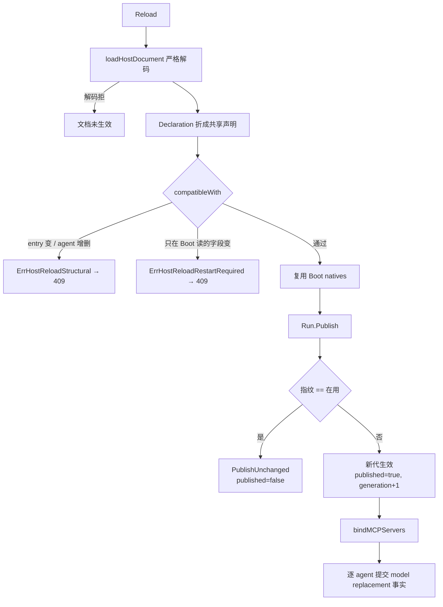

# 组织级热重载（三档判据 · 单一发布入口 · 代际退役）

一次配置改动在本仓只有三种合法读数：**一档新代发布**、**二档具名拒绝（须重启）**、**三档同指纹不开新代**。第四种读数——回执成功而实际没生效（静默 applied）——只有两类成因：字段不进声明指纹，或字段进了指纹但它的消费者只在 `Boot` 构造一次。判据是**消费点在哪一刻被读**，不是字段的敏感程度。

## 一、机制定位

`assembly.Host.Reload` 是热更的唯一入口：重读配置源 → 用 Boot 同一个严格解码器解同一份方言 → 判档 → 经 `state.Publisher` 这一条发布入口生效 → 给回执。文档解不动就什么都没发生（不换 `h.doc`、不换 `h.models`）。

| 文件 | 本篇用到的职责 |
|---|---|
| `assembly/host_reload.go` | `Reload`、`compatibleWith`、`restartRequiredChanges`、两个哨兵错误、回执结构 |
| `assembly/host_document.go` | 方言解码（`loadHostDocument`）、`mapDocument`、`Declaration()` 派生 |
| `assembly/run.go` | `Publish`：指纹 → 声明校验 → 候选 → 发布 → MCP 重绑 → 模型替换事实 |
| `assembly/host_face.go` | `/reload` 端点与 401 / 503 / 409 / 200 映射 |
| `runtime/state/publish.go` | 唯一发布入口、`PublicationRecord`、`Generation`、上一代单槽 |
| `runtime/state/retire.go` · `lease.go` · `baseline.go` | 退役台账、候选租约、基线复检 |
| `api/config/fingerprint.go` · `clone.go` | 指纹规范化、深拷贝 |

**为什么整代而不是逐个换**：一次改动可能同时动多个字段，逐个替换会让读者在中途看到半新半旧的组织；整代发布保证任何时刻读到的都是一个完整一致的代。

## 二、指纹：只有声明面参与

`config.Fingerprint(d)` 是规范化 JSON 的 SHA-256。canonical 形只含五项：`entry`、`agents`、`refs`、`baseline`、`mcp_servers`。其中每个 agent 收进 `model`、`tools`、`plugins`、`task_policy`、`files`、`params`、回放窗三值（`max_tokens`/`compress_threshold`/`keep_recent_tasks`）、采样三值与 `max_tool_iterations`，外加 `memory`/`meditation`/`file`/`exec` 四个域段。

规范化三件事：先 `Clone` 再 `applyDefaults`（省略的集合编成空集合、`nil` 指针省略键、负零归零）；字段顺序由 canonical 结构固定；map 按名排序。**活对象与 `Raw` 源文档永不进指纹**，所以同一份声明在任何 YAML 迭代顺序下算出同一串。

三条推论：

- 指纹变 ⇒ 一定换代，绝不会掉进档三。
- 指纹不变 ⇒ 档三，除非有字段在指纹之外还需要判（见第九节）。
- 指纹**不是身份**：身份是 `Generation` 序号，指纹只是内容标签，任何执行路径都不得据它选版。

`mcp_servers` 进指纹的意义：改一台服务器就是一次真实改动，必换代；换代时 `bindMCPServers` 按声明名重绑——停答的服务器立刻停、新增的立刻答、声明没变的保持连接。声明面之外还有一格缺口：`providers.*` 的端点与凭据环境变量名不在 canonical 形里，见末章。

## 三、代际：一个序号、一条上一代、没有环

| 量 | 含义 | 前进时机 |
|---|---|---|
| `Generation`（`uint64`） | 发布身份 | 每次真正发布 +1；回滚同样 +1，不重用旧号 |
| `Publication{Generation, Fingerprint, Baseline}` | 当前生效的一代 | 与其余生效面同一次切换 |
| 上一代（`source` / `sourceGen` / `sourceOK` 单槽） | 回滚重建的数据源 | 每次新代发布轮转 |

没有 ring-2 回滚环，也没有第二个"完整应用计数"轴：任何"改了几次"的读数都必须从应用记录重放得出，不得成为第二个身份，也不得被任何路由读作版本依据。

档三在这里落地：同指纹时 `publishLocked` 释放候选并返回 `PublishUnchanged` 与**当前** `Publication`——不建记录、不换绑定、序号不动。回执因此带 `publication{generation, published}`，"没换代"是可读的事实，不必从空的 `model_changes` 反推。

## 四、应用记录：先提交记录，再切换生效面

一次真正发布按固定次序穿过唯一入口：基线复检 → 治理前置检查 → **提交 `PublicationRecord`** → 持有新 plan → 切换生效面（绑定、序号、上一代）→ 退役台账 `track` + `sweep`。

两条红线：

- **记录在切换之前提交**：记录提交失败即拒发布，生效面原地不动，候选资源逆序释放。
- **记录自足**：`PublicationRecord{Generation, Fingerprint, Result, RollbackSource, Checks}` 经 `PublicationRecorder` 单独提交，绝不与任务终态提交或待发通知共用一个事务。`Result` 三值 `PublishUnchanged` / `PublishApplied` / `PublishRolledBack`，`RollbackSource` 只有回滚才非零。

治理前置检查（`PublishContract`）：契约无必需检查、必需检查缺席、检查判拒、豁免未带理由或作用域，各自具名拒发布——沉默是缺证据，不是通过。

**热参怎么生效**：没有任何"下发"通道。每个消费边界读**当前代声明**（`foldWindowOf(spec)`、`specOfLocked(r.current.Plan.Declaration, agentOf(evt))`），所以"改了没生效"的诊断是"这个消费者读到的声明属于哪一代"，而不是哪里少了一条广播。

## 五、配置快照的私有化

`Declaration.Clone` 是**手写逐字段深拷贝**（`cloneAgents` / `cloneToolRefs` / `cloneServerSpecs` / `cloneRawMap`），不是序列化往返。读面同样只给拷贝：`AgentSpecs()`、`ToolRefs()`、`RawDocument()`。

为什么换成手写：序列化往返的正确性依赖标签对称——进程级路径字段不参与序列化、`omitempty` 的"空但非 nil"集合回来变 `nil`、`Raw` 这类 `map[string]any` 解码会丢具体类型。这些偏离在往返里是隐式的，在手写拷贝里是可见的。代价是新增字段必须同步改四个 clone 函数（编译期不报错），收益是拷贝语义与字段一一对应，且指纹、候选构造与回滚重建共用同一份语义。

## 六、被拒候选必须完全退场

候选 = 一份 `StatePlan` + 一份 `Leases` 账目（本候选独占的资源与释放函数）。被拒时每一份副作用都要撤销，生效面与拒绝前完全一致，在途请求照常跑完。

- **基线复检**：候选构造时记下 `baselineOf(generation, fingerprint)`；提交点复检，被更新的发布推进过就是 `ErrBaselineAdvanced`——陈旧候选丢弃，绝不覆盖更新的发布。
- **逆序释放一次**：`Leases` 在获取那一刻登记释放函数；失败按获取逆序释放，每条释放只跑一次；共享面与在用资源不在任何账目里。
- **能力缺席按名拒**：没有绑定持有者、没有记录提交端口、空 plan、契约无必需检查，各自具名拒绝，而不是"发布成功但什么也没换"。

## 七、属主退役：代被取代且无人持有才释放

退役台账按代登记"候选独占资源 + 释放函数"。一次发布**不提前退役任何东西**：仍被请求持有的代保留资源，最后一个持有释放时排空自行推进，不需要额外业务回合；共享面与在用代的资源不进任何一次释放。

三个事实必须分开陈述：**停止接受新路由**（新代的可达集）、**义务收敛**（在途请求与任务）、**资源释放**（独占资源与存储租约）。把三者折成一句"已退役"，会让一次有界返回被读成"资源已交还"。

## 八、关闭必须覆盖排空期间落位的义务

`agent.Shutdown.Close`：先立 `refusing`（此后新输入 `ErrShutdownRefused`），再轮询真实结算，最后交 `DrainReport{Drained, Unsettled}` 或 `ErrDrainUnsettled`。登记面（`Track`）覆盖"经 task face 受理的调用"，所以排空期间落位的义务同样被结算——同一任务登记两次仍是同一个任务。

宿主关闭次序（次序即契约）：

| 序 | 动作 | 为什么在这个位置 |
|---|---|---|
| 1 | 结算驱动 `Stop` | 先停会自己发起回合的那一面 |
| 2 | 反思调度 `Stop` | 再停周期性的自省 |
| 3 | HTTP face `stop` | 不再接新请求，不再有新 reload |
| 4 | 执行资源 `Close` | 归还进程内执行槽；未释放的具名告警 |
| 5 | `Run.Close`（排空） | 等真实结算；排空失败也必须继续收尾 |
| 6 | `CloseMCPServers` | **共享资源最后**：仍被借用的服务器不在中途拆除 |
| 7 | `sealCapture` | 排空之后再封轨迹，一次账户覆盖整次运行 |
| 8 | `stopTelemetry` | 观测最后退出，前面的失败仍然可见 |

关闭一旦发起，`Reload` 在读文档之前就返回 `ErrHostClosed`（face 映射 503）：向正在拆除的宿主发布一代，会把一次有界返回的关闭变成无人收敛的状态。

## 九、二档：具名拒绝须重启

| 档 | 判据（消费点在哪一刻被读） | 回执形态 |
|---|---|---|
| 一档 新代发布 | 候选构造期或请求边界现读 | `publication.published=true`，`generation` 前进 |
| 二档 具名拒绝 | 只在 `Boot` 构造一次，运行期没有重绑通路 | `ErrHostReloadRestartRequired` → HTTP **409**，`publication` 不前进 |
| 三档 不开新代 | 文档内容与在用指纹相同 | `published=false`，`generation` 不变 |

二档字段共 12 组，路径就是运维在配置文件里搜的名字：

| 层 | 字段 | 唯一消费点 |
|---|---|---|
| 顶层 | `storage.type`、`storage.root` | Boot 的记忆计划 |
| 顶层 | `request_timeout_seconds` | Boot 构造的 HTTP client |
| 顶层 | `governance` | Boot 的 `WithPolicy`（`call->ruling` 实例） |
| 顶层 | `telemetry` | Boot 的观测观察者 |
| 每 agent | `tools` | Boot 的 native 工具面（send / recall / knowledge / spec / file） |
| 每 agent | `skill_dirs`、`read_root` | Boot 的 knowledge 工具 |
| 每 agent | `file` | Boot 的 file 工具（`base_dir`） |
| 每 agent | `exec` | Boot 的 exec manager |
| 每 agent | `memory` | Boot 的存储计划与召回分区 |
| 每 agent | `meditation` | Boot 的反思计划与 reflection 插件 |

**两类静默 applied**，正是二档存在的理由：

- **甲类：不进指纹。** `storage.*`、`request_timeout_seconds`、`governance`、`telemetry` 不在 canonical 形里——不拒就会得到 `reloaded:true` + `published:false`，新值永不被任何代码再读。
- **乙类：进了指纹，但实例是 Boot 的。** `Reload` 把 `h.natives` 原样交给发布，而工具、知识工具、file 工具、exec manager、记忆计划、反思计划都只在 Boot 跑一次——不拒就会换代重建绑定，面看起来换了、能力还是旧的。插件同理：实例由 `WithPlugins` 在装配期构造一次，每代绑定携带同一批实例，热更没有重建通路。

错误形态与可观察性：

- `ErrHostReloadRestartRequired` 的文案含 `requires a restart`，`Unwrap()` 到 `ErrHostReloadStructural`，所以 `/reload` 的 409 与结构拒绝同一个出口，`errors.Is` 两个都能命中。
- 结构拒绝独立具名（`ErrHostReloadStructural`）：`entry` 改名、agent 增删——Boot 已把模型租约、反思计划与工具面按这个集合钉死。
- 错误点名的是 **YAML 路径**（`storage.type`、`agents.user.file`），顺序固定：先五个顶层，再按 agent id 字典序比七个域段——同一次编辑永远给出同一串名字。
- 一次混合修改（可热字段 + 须重启字段）**整批拒绝**，序号不推进：半应用是最难复现的形态。

钉住这三档的是 `tests/integration/host/reload_tiers_test.go`：`TestReloadPublishesTheHotFieldsAsOneGeneration`（模型与提示词文件一起换代；下一请求由新模型服务、携带新正文、旧正文不再出现）、`TestReloadRefusesTheFieldsOnlyBootReads`（12 个子用例逐条断言哨兵、字段路径、409、无租约发布、下一轮仍是启动模型）、`TestReloadCarriesNoGenerationForAnUnchangedDocument`（两次未改都不换代，改模型后恰好 +1）。逐字段的 28 行分档表在 `openspec/changes/success-semantics/reload-tiers.md`。

## 已知缺口与演进方向

| 缺口 | 现状与防线 | 候选方向 |
|---|---|---|
| `providers.*` 端点热切换 | 只在"版本身份（provider/model）移动触发租约重建"时被重读；只改端点不动模型名时既不换代也不被拒，现值静默失效。它没进拒表，因为"新增 provider 键 + 换模型"是当前可用的热路径，按字段拒会误伤 | 端点并入版本身份，或"端点热切换"独立提案 |
| 回滚无生产入口 | `Publisher.Rollback` / `RollbackConfig` 已实现（上一代单槽、指纹必须与来源一致、回滚同样前进序号、结果记 `PublishRolledBack`），但只有测试调用它，`Host` 没有暴露回滚入口 | 接上宿主入口时必须同时给出"何时可回滚"的可观察判据 |
| 四通道热矩阵无生产消费者 | `runtime/state/channels.go` 的 `Channel` / `Dimension` / `ChannelMatrix` / `Route` / `Router` 承载"每个维度只归一个通道"的判据，目前只有测试引用；宿主真正的三档判据在 `assembly/host_reload.go` | 二者合流成一条判据（把宿主档位读成矩阵的一个视图），或明确矩阵只服务别的接缝 |
| 重入判定缺位 | 宿主当前不允许 agent 集合变化，所以"同名成员在排空 / 已开始关闭 / 已退出"三态重入不存在；退役台账只覆盖"代被取代" | 集合热增删若解禁，必须在任何资源建立之前补回三态门 |
| `app` 段无常驻消费者 | 原样携带、不声称应用、也不拒绝 | 部署方若缓存该段需自行重读源文件 |

延伸：[存储概念图](../../demos/storage-concept-map.html)（事实链、原文仓、交付账本等术语的统一口径）· [存储时光机](../../demos/storage-time-travel.html)
