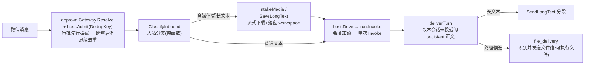

# tagent WeChat Bot — 完整示例

tagent 组合根的**真实宿主示例**：常驻微信机器人，把 `assembly.Boot`（→ `assembly.Assemble`）产出的 `*assembly.Run` 接上消息链路——
入站去重、媒体与长文本落盘、按显式会址投递、审批通道与投递回执全部跑在真消息上。

> 部署（裸机 systemd / 容器）见 [deploy/README.md](deploy/README.md)；历史设计记录见 [../../docs/wiki/](../../docs/wiki/)（该目录 25 篇＝16 篇活契约页 + 9 篇 historical-verbatim；当期契约以 [../../openspec/specs/](../../openspec/specs/) 与 `scripts/gates/gen_godoc.sh` 生成的 `docs/api/` 为准）。

---

## 快速开始

```bash
./wizard.sh    # 六步向导：依赖检查 → 密钥(不回显) → .env → 运行目录 → 连通性验证 → 指引
./run.sh       # 前台启动（./run.sh --help 看全部命令）
```

需要 Go ≥ 1.24、以及一把 `ZAI_API_KEY`（GLM Coding Plan）与一把 `DEEPSEEK_API_KEY`（knowledge 子 agent 的 provider）。密钥写入 `.env`（chmod 600，被本目录白名单式 `.gitignore` 天然忽略）；`run.sh` 启动时自动加载 `.env`，已导出的环境变量优先，并在启动前逐个校验配置里被 agent 引用的密钥（判据是「被引用」而非「会被驱动」：`knowledge` 声明的 deepseek 密钥照样必填，尽管本宿主只驱动 entry）。

`resources/prompts/USER.md`（个人上下文）不随仓库分发：检出库不带它也能启动，部署侧需要时从 `resources/prompts/USER.md.example` 复制填写。

## 装配面（当前实现）

| 环节 | 码面 |
|---|---|
| 读配置 | `loadHostDocument(TAGENT_CONFIG)` → `api/config.DecodeStrict`：schema 之外的键**拒绝启动**，错误点名 `文件:行:字段路径`（`config.ErrUnknownConfigKey`）；schema 即 `assembly/host_document.go` 的 `hostDocument` 结构标签 |
| 装配 | `assembly.Assemble(ctx, decl, natives, opts...)` → `*assembly.Run`（宿主入口 `assembly.Boot`）（恒挂 `WithGovernance`，配了审批网关再加 `WithPolicy`）；`decl` 由 `hostDocument.Declaration` 派生（entry agent、各 agent 的 `system_prompt.files`、声明了的 `send` 工具），模型按 `providers` 的 `api_endpoint` + `api_key_env` 现场构造 |
| 驱动 | `host.Drive` → 按会址加锁 → `run.Invoke(ctx, tagent.InvokeRequest{InvocationID, Address, TriggerSource: "user", Input})`；收尾走 `run.Close(ctx, agent.CloseRequest{...})` |
| HTTP 面 | `assembly` 的 `hostFace` 由 `Boot` 装配、绑 `127.0.0.1:<TAGENT_HTTP_PORT>`，端点为 `GET /healthz`、`GET /metrics`、`GET /debug/pprof/{heap,goroutine,allocs}`、`POST /task`、`POST /reload`；`GET /healthz` 与 `POST /task` 走同一鉴权门（`TAGENT_RL_AUTH_TOKEN` 非空时回环也必须带 Bearer，否则 401+WWW-Authenticate） |

- **已接线的键**：`entry`/`provider`/`model`/`prompt_dir`/`providers`/`mcp_servers{transport,url,api_key_env}`/`agents{provider,model,system_prompt.files,tools,file{base_dir,read_roots},exec{monitor{interval,stable_duration,interactive_stable_duration,fake_dead_duration}},final_round{max_rounds,budget_seconds,timeout_seconds,prompt},memory{...},meditation{...}}`/`request_timeout_seconds`/`governance{enabled,enforcement,dir,approval_ttl_minutes}`/`app.wechat{config_dir,token_file,context_token_dir,workspace_dir,approvers}`；工具面按 `hostToolNames` 固定清单过滤（`send`、四个 `recall_*`、`skill_search`/`skill_load`、`spec`、七件 file 工具、`exec`、`mcp_call`/`mcp_discover`），写清单外的 `id` 不进声明，`agent:` 键在 schema 里但零消费（写了不报错也不生效）；file/exec/mcp 三类 id 由核心按声明装配、file 面同时由宿主按声明贡献（委派 target 的工具面只取 `NativeAgent.Tools`；file 面写根在 `file.base_dir`，声明 `spec` 的 agent 改由计划后端交出工作区根，`exec` 授予 `exec_run`/`exec_release` 并取 `exec.monitor` 节奏，MCP 网关读 `mcp_servers` 绑定的活注册表），宿主只转发声明；看门狗预算按声明接 `SetFinalRound(finalRoundPolicy(decl))` 与 `SetAgentFinalRounds(agentFinalRoundPolicies(decl))`（`assembly/run.go:571-573`）；`tagent.yaml` 的 knowledge/recall 等逐 agent 也各给 `final_round`，不只 entry。
- **环境变量**（码面实际读取）：`TAGENT_CONFIG`、`TAGENT_API_ENDPOINT`（覆盖 entry endpoint）、`TAGENT_SESSION_ID`（会址前缀标签，默认 `wechat-session`）、`TAGENT_WECHAT_WORKSPACE_DIR`、`TAGENT_HTTP_PORT`（HTTP 面端口，默认 8089）、`TAGENT_RL_AUTH_TOKEN`（HTTP 面凭据；空则只信回环对端）、`providers.*.api_key_env` 点名的每个变量（被 agent 引用的必需，未被引用的可选）。
- **HTTP 面**：宿主自己装配的最小面（**不经** `cli.NewCLI`，故无 `/query`、`/diagnostics`、`/feedback`）：`GET /healthz` 无凭据答 `200 ok`；`POST /task` 收 `{"messages":[{"role":"user","content":"..."}],"trigger_source":"user"}`，有 token 则要求 `Authorization: Bearer <token>`，否则仅回环对端；注入没有会话身份，投到**最近一次有投递的会话**上（无会话答 503）。mail-poller 走的就是这条通道。

## 待接线清单（写进 yaml 前须先接 schema）

严格解码的判据是「键只许出现在它被读取的地方」：下列声明先要在 `assembly/host_document.go` 的 `hostDocument` 接线并消费，再写入 yaml；`tagent.yaml` 以行首 `待接线` 注释登记同一清单。

| 键路径 | 宿主现状 |
|---|---|
| `log_level` / `trajectory_*` / `working_dir` | 无读取点；环境变量侧同样没读点，故 `wizard.sh`/`run.sh`/`.env.example` 已不再采集（配置即业务：不读就不采） |
| `evolution` / `reliability` / `governance.budget_*`、`max_*_risk`、`goal_required_for` | 平台面只装配治理闸：预算与 goal 未接，只消费 `enabled`/`enforcement`/`dir`/`approval_ttl_minutes` |
| `agents.*.compress` / `task_*_ttl` | schema 未声明、装配面不读（`memory` 与 `meditation` 已接线，见下节）；`max_tokens`/`compress_threshold`/`temperature`/`thinking_enabled`/`reasoning_effort` 已在 `api/config/decode.go:160-161` 声明并由 `assembly/host_document.go` 解析消费（见 `tagent.yaml:98/132-133`） |
| `agents.*.tools[]` 除 `{kind: tool, id: send}` 与 `recall_*` | 工具面接了 `send`＋`recall_query/get/recent/trace`（tool/recall），读面由宿主装配后注入（Searcher=`Run.Recall`、Table=持久链直读、Originals=scoped 原始层、Embedder=`memory.engine` 的真 embedding、Trace=同一条链按需推导父边），有 `memory` 声明即可用，无声明则调用即具名拒绝；`{kind: agent, ...}` 委派已接、`description_file`/`event_params` 已消费；file 由宿主与核心按声明装配、`exec`/`mcp_*`/`skill_*` 由核心装配，`spec` 已接线（七操作闭集，后端为可替换的计划后端），清单外的 id 仍被固定清单挡下 |

## 记忆与自察冥想（已接线）

```yaml
agents:
  tagent:
    tools:
      - { kind: tool, id: send }         # 反思会话的唯一跨会话写面(教训推送)
    memory:
      type: localfile
      path: .wechat-config/data          # 旧世界 KV/事件目录:接回跨重启历史知识
      read_namespaces: [tagent]          # 跨分区读授权(recall.New);自身命名空间恒在内
      engine:
        backend: memory
        embedding: { provider: zhipu, model: embedding-3, api_key_env: ZAI_API_KEY, dimensions: 512 }
        vector_top_k: 20                 # 混合检索双腿上限;零值=历史行为(不截断)
        keyword_top_k: 20
        rrf_k: 60                        # RRF 秩常数;零值=默认 60
    meditation:                          # 缺省自察:主语=tagent 自身,反思会话=tagent-session:tagent:reflection
      enabled: true
      interval: 30m                      # 两次点火的最小间隔(状态机检查方式,不是 tick 周期;零值=30m)
      min_gap: 2h                        # 两次已消费反思的最小间隔
      prompt_file: meditation.md         # 相对 prompt_dir;每次注入随摘要与真实材料携带
      deliver_to: [tagent]               # send 白名单:同 agent 的活跃业务会话
```

独立策展 agent(跨域观察)降格为可选声明:`tagent.yaml` 里保留整块注释,解开它并把 `tagent` 的 `meditation` 注释掉(一个进程至多一条 enabled 循环);它读 `observed_namespaces` 圈定的他人分区,反思会话仍按 `<prefix>:<agent>:meditation` 命名。

- **归并纪律**：全体 `memory` 声明归一成**一个** `ledger.StorageConfig`（`WithStorage`）＋**一个**引擎（`WithEmbedder`，trpc `knowledge/embedder/openai`；替换旧 `HashEmbedder` 占位），不一致/缺 key/引擎无存储均拒启动（`ErrMemoryDeclaration`/`ErrMemoryEngine`/`ErrEmbeddingKey`）；`read_namespaces` 追加到 `recall.New` 的分区授权。
- **自察纪律**：一个进程至多一个 `enabled` 冥想声明；水位与状态机电荷同锚在 `<storage root>/meditation/<agent>/anchors.json`（`WithReflectionAnchors`）。触发是**自持状态机**：外部事实充电（自管血统不计费）→ 规则激活（novelty / quiet-window / external-request）→ 激活即一条既有 `external_input`（元数据带 `activation.rule/window_start/window_end/source/source_lineage/charges`）→ 注入本 agent 的专属反思会话。没有 ticker，`interval` 只是两次点火之间的下限，`min_gap` 是两次已消费反思的节律地板；只有 **consumed** 的回合推进水位。`enabled: false`/未声明 = 零行为。
- **为什么只有一个引擎**：同一份向量只能属于一个向量空间；两套 embedding 混写会让相似度失去意义，所以第二个不同的引擎声明直接拒启。

## Agent 声明（五个 + 可选策展，`tagent.yaml`）

| Agent | 角色 | 可声明的工具面 |
|---|---|---|
| `tagent` | **entry**：接收消息、编排全局、直接回复；**自察冥想**的声明处 | 四个 `{kind: agent}` 委派（knowledge/recall/plan/action）+ `send`（反思会话推送教训；业务正文仍只经自动投递） |
| `knowledge` | 知识获取与翻译 | `skill_search`/`skill_load`/`read_file`/`mcp_call`/`mcp_discover` |
| `recall` | 记忆召回执行体 | `recall_query` / `recall_get` / `recall_recent` / `recall_trace`（读面由宿主注入；`read_namespaces` 决定跨分区范围） |
| `action` | 命令与文件执行 | 七件 file 工具 + `exec` + `mcp_call`/`mcp_discover` |
| `plan` | 工作计划管理（拆解 / 记账 / 归档审计，**不代工**） | `spec` + 七件 file 工具（写根＝计划后端交出的工作区根） |
| `meditator` | *可选*：跨域策展声明（默认整块注释；启用后读他人分区，与自察同一机制、不同观察面） | `send` + 七件 file + `exec` + 四个 `recall_*` |

## 治理审批（critical 操作人工把关）

治理闸启用且 critical 操作被拦截时，bot 会向对话推送审批请求（含 digest）。

- **消息批准**：回复 `approve <digest>` / `reject <digest>`（或「批准/拒绝 <digest>」）——仅 `app.wechat.approvers` 白名单内的用户生效（安全默认：未配置白名单时消息批准关闭）；
- **CLI 批准**：`./wechat-bot approve <digest>`（`reject <digest>` 拒绝；零服务器，直接写审批文件）；
- **直投通道**：`ApprovalChannel` 不经 agent 转述，直接送达微信（配 `app.wechat.approvers` 后启用；**直投目标=白名单首个 approver**，其余审批人仍可经回复/CLI 批准）；
- **查看待批**：`approval_list` 工具**不在本宿主工具面内**（完整清单见「装配面」的 `hostToolNames`：send、四个 `recall_*`、skill_*、spec、七件 file、exec、mcp_*），待批项经审批文件观察。

## 消息链路



入站与出站两层都依赖**窄接口**（`MediaDownloader` / `FileSender`，`*wechat.Bot` 天然满足），故可脱离真实微信登录、CDN 与 LLM 做单元测试（见 `file_intake_test.go` / `file_delivery_test.go`）。

## 目录导览

**入库的源码与配置**（clone 后即可见）：

| 路径 | 说明 |
|---|---|
| `main.go` | 宿主启动：读配置 → `newWechatApp`/`assembly.Boot` → 绑定微信回调 → `Drive`；发送通路 `hostRuntime` 实现 `assembly.MessageSender` |
| `wechat.go` | 宿主运行时 `hostRuntime`：`Admit`/`Drive`/`Wake`/`intake`/`lockAddress` 与 `assembly.MessageSender` |
| `assembly/host_face.go`（框架侧） | 宿主 HTTP 面：`GET /healthz`/`GET /metrics`/`GET /debug/pprof/*`/`POST /task`/`POST /reload`，统一鉴权 |
| `wechat_files.go` / `wechat_approval.go` / `wechat_notice.go` | 媒体与长文本落盘 / 审批通道 / 重启恢复与通知 |
| `tagent.yaml` | 主配置（六 agent + providers + governance + `app.wechat`；未接线键以注释登记） |
| `tagent.rl.yaml` | RL 参数基线（模型/端点/超时；同严格 schema，可装载） |
| `wizard.sh` / `run.sh` / `.env.example` | 部署向导 / 运行入口 / 环境变量模板 |
| `resources/prompts/` | 系统提示词：entry 的 `AGENTS.md`/`SOUL.md`/`TOOLS.md`，五个子 agent 各一份（`knowledge_agent.md`+`knowledge_backend.md`/`recall_agent.md`/`action_agent.md`/`plan_agent.md`/`meditator_agent.md`）；`USER.md` 是部署侧个人上下文不随仓库分发，仓库只带模板 `USER.md.example` |
| `deploy/`、`Dockerfile` / `docker-compose.yml` / `entrypoint.sh` | systemd 单元模板与指南、容器形态（podman/docker 兼容） |
| `skills/` | 技能体系说明与已入库技能；入库边界以 `git ls-files examples/wechat-bot/skills/` 为准（多个技能入库，非只有 `url-fetcher`） |

**运行时生成、不入库**（白名单式 `.gitignore` 刻意忽略，clone 后看不到属正常）：`.env`（密钥）、`.wechat-config/`（登录态 cursor 与去重 seen.json）、`.wechat-context-tokens/`、`workspace/`、`data/`（治理审批状态）、`logs/`、`incoming/`、`knowledge_base/`、`skills/` 下未入库的技能、`.tagent-workspace/`（附件/长文本落盘）、`wechat-bot`（构建产物）。

## 三种运行形态

| 形态 | 命令 | 适用 |
|---|---|---|
| 前台 / 后台 | `./run.sh` / `./run.sh start`（`status`/`log`/`stop`/`restart`） | 本地开发调试 |
| **裸机 systemd 常驻** | `./run.sh build` → 装 `deploy/tagent-wechat.service` → `systemctl enable --now` | 远端服务器（推荐，见 [deploy/README.md](deploy/README.md)） |
| 容器 | `docker-compose up -d`（或 podman） | 已有容器编排基建 |

> `deploy/` 指南与 compose healthcheck 都探 `:8089/healthz`：该端点由宿主 HTTP 面提供（见「装配面」末条），`main.go` 装配失败时日志报 `HTTP 面未装配`，探针随之不可用。

## RL 参数基线（入口已退役）

`features/rl/` 现有 15 个非测试 Go 文件、无子目录；采集侧是 `features/rl/capture.go` 的 `RequestSnapshot`/`SnapshotPolicy`、`features/rl/produce.go` 的 `Recorder`/`RecorderAdapter`、`features/rl/feedback.go` 的 `FeedbackAttribution`；组合根无 `run.go`/`request.go`/`host_face.go`，`SwappableModel` 全仓 0 命中。`rl/` 顶层目录与 `sft`/`import`/`verifier`/`reward_ledger` 子包均已不存在，故 `./run.sh rl` 已退役（调用即具名拒绝，不静默退回生产配置）。
`tagent.rl.yaml` 保留为**可装载的参数基线**（`TAGENT_CONFIG=tagent.rl.yaml ./run.sh` 可读），重接线时以它为起点。

## 深入阅读

| 主题 | 位置 |
|---|---|
| 部署、数据目录备份、故障排查 | [deploy/README.md](deploy/README.md) |
| 框架机制（记忆 / 事件 / 工具 / 插件 / prompt）当期契约与历史记录 | [../../docs/wiki/](../../docs/wiki/)（16 篇活契约页随代码走，9 篇 historical-verbatim 描述已移除实现） |
| 平台子系统历史记录（子系统当前未接线，行为矩阵是历史口径） | [platform-subsystems.md](../../docs/wiki/platform/platform-subsystems.md) · [agent-behavior-matrix.md](../../docs/wiki/platform/agent-behavior-matrix.md) |
| 行为契约（SHALL 级规格） | [../../openspec/specs/](../../openspec/specs/) |
| 真实 LLM 契约守护矩阵 | [../../tests/integration/](../../tests/integration/)（原 `tests/README.md` 不存在） |
