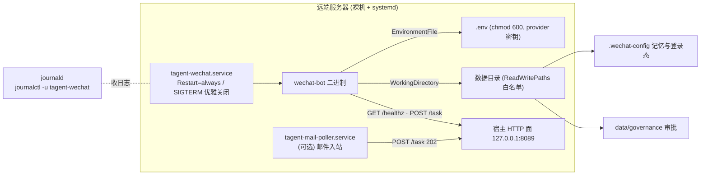

# tagent WeChat Bot · 裸机 systemd 部署指南

面向**个人助手**定位的单台远端服务器常驻部署。相比容器形态(见根目录 `Dockerfile` /
`docker-compose.yml`),裸机 systemd 无 Docker 依赖、资源开销更低、更贴近"个人助手"运维直觉;
安全加固(非 root / 只读根 + 可写白名单 / 资源上限 / 崩溃自愈)与 docker-compose **对齐**。

> 本指南配套 `deploy/tagent-wechat.service`(systemd 单元模板)。快速指引亦可执行 `./run.sh systemd`。
> 这份部署实际接了什么、哪些变量**不被读取**,以根目录 README「装配面」与「待接线清单」为准。

---

## 一、部署拓扑



HTTP 面是宿主自己装配的最小面(不依赖 `cli.NewCLI`):`/healthz` 答存活、`/task` 收一条注入,
只绑回环地址,故外部不可直达。

---

## 二、前置依赖

| 依赖 | 必需性 | 用途 | 安装(Debian/Ubuntu) |
|------|--------|------|---------------------|
| **go ≥ 1.24** | 硬性 | 构建二进制 | 官方 tarball（https://go.dev/dl/，推荐）或发行版 backports；`apt install golang-go` 在多数稳定版源中版本偏低，装后务必 `go version` 核对 ≥1.24 |
| **curl** | 软性 | 健康探针 `/healthz` 与 `restart-*.sh` 的健康门 | `apt install curl` |
| **node 22 + openspec** | 软性 | plan 子 agent 的 spec 工具后端(工具面未接线,保留供重接) | `apt install nodejs` + `npm i -g @fission-ai/openspec` |
| **rustviking** | 可选 | 仅 `memory.type: file` 需要(本配置用 `localfile`,无需) | 见 rustviking 仓库 |

> `./wizard.sh` 会自动检查以上依赖(硬缺失则中止,软缺失则降级告警)。

---

## 三、部署步骤

约定部署路径 `/opt/tagent/wechat-bot`(如不同,步骤 4 用 `sed` 替换 unit 内路径)。

```bash
# 0) 拉取代码(含 tagent 主仓 + example;example go.mod replace 指向本地 tagent)
sudo mkdir -p /opt/tagent && sudo chown "$USER" /opt/tagent
git clone <your-tagent-repo> /opt/tagent/repo
cd /opt/tagent/repo/examples/wechat-bot
# 若部署目录就是此处,可直接用;否则拷贝 examples/wechat-bot 到 /opt/tagent/wechat-bot

# 1) 初始化向导(6 步:依赖→密钥→.env→运行目录→连通→下一步)
#    只采集码面真读的变量:provider 密钥 + 部署路径覆盖。部署侧个人上下文(USER.md)自备。
./wizard.sh                       # 交互式;或 NONINTERACTIVE=1 预置 env 后跑

# 2) 构建二进制(纯静态,无需 gcc)
CGO_ENABLED=0 ./run.sh build      # 产出 ./wechat-bot

# 3) 专用系统用户 + HOME 目录(幂等)
sudo useradd -r -s /usr/sbin/nologin tagent 2>/dev/null || true
mkdir -p .home                    # HOME 收敛到部署目录内(数据集中、便于备份)

# 4) 安装 systemd 单元(路径不同则先 sed 替换)
sudo install -m 644 deploy/tagent-wechat.service /etc/systemd/system/
# sudo sed -i "s#/opt/tagent/wechat-bot#$(pwd)#g" /etc/systemd/system/tagent-wechat.service

# 5) 部署目录属主交给 tagent(数据目录须可写)
sudo chown -R tagent:tagent "$(pwd)"

# 6) 启动 + 开机自启
sudo systemctl daemon-reload
sudo systemctl enable --now tagent-wechat
```

**验证**:

```bash
systemctl status tagent-wechat                 # Active: active (running)
journalctl -u tagent-wechat -f                 # 实时日志
curl -fsS http://127.0.0.1:8089/healthz        # 健康探针(应回 ok)
curl -sS -o /dev/null -w '%{http_code}\n' \
  -X POST http://127.0.0.1:8089/task \
  -H 'Content-Type: application/json' \
  -d '{"messages":[{"role":"user","content":"探活一下"}],"trigger_source":"user"}'   # 应回 202
```

`/task` 注入没有会话身份,宿主把它投到**最近一次有投递的会话**上;还没有任何会话时答 503。

---

## 四、数据目录与持久化

`ProtectSystem=strict` 下仅 `ReadWritePaths` 白名单可写。所有状态集中于部署目录,便于备份/迁移:

| 路径 | 内容 | 备份优先级 |
|------|------|-----------|
| `.wechat-config/` | 登录态 cursor 与消息去重 seen.json(localfile) | ★★★ 核心 |
| `data/governance/` | 待批文件与审批状态(配置项 `governance.dir`) | ★★ |
| `data/trajectories/` | LLM 调用轨迹 JSONL | ★ 可选 |
| `.home/` | HOME(进程内配置文件) | ★ |
| `workspace/` `.tagent-workspace/` | 微信附件/长文本落盘(可清理) | ☆ 临时 |

**备份**:

```bash
sudo -u tagent tar czf tagent-backup-$(date +%F).tgz .wechat-config data/governance
```

### 个人上下文 `USER.md`

entry agent 的系统提示词声明了 `AGENTS.md`/`SOUL.md`/`USER.md`/`TOOLS.md`。其中 `USER.md` 是
**部署侧个人上下文**,不随仓库分发(仓库里只有模板 `resources/prompts/USER.md.example`):
`cp resources/prompts/USER.md.example resources/prompts/USER.md` 后按实际情况填写即可。
检出库不带它也能启动——宿主跳过一个 info 日志继续装配,`journalctl` 里会看到
`declared prompt file absent, skipped`。

---

## 五、运维

| 操作 | 命令 |
|------|------|
| 启 / 停 / 重启 | `sudo systemctl start\|stop\|restart tagent-wechat` |
| 开机自启开关 | `sudo systemctl enable\|disable tagent-wechat` |
| 实时日志 | `journalctl -u tagent-wechat -f` |
| 最近 200 行 | `journalctl -u tagent-wechat -n 200` |
| 健康检查 | `curl -fsS http://127.0.0.1:8089/healthz` |
| 改端口 | `.env` 里 `TAGENT_HTTP_PORT=<端口>` 后 restart(unit 的 `Environment=` 优先) |
| 给 `/task` 加凭据 | `.env` 里 `TAGENT_RL_AUTH_TOKEN=<随机串>`;mail-poller 读同名变量须一致 |

**更新代码**(拉新版 → 重建 → 重启):

```bash
cd /opt/tagent/wechat-bot && git pull
sudo -u tagent CGO_ENABLED=0 ./run.sh build
sudo systemctl restart tagent-wechat
```

**更新配置**:`tagent.yaml` 每个键都在启动时经严格解码读一次,任何改动(含 `agents`/`governance`)
都需 `systemctl restart` 生效——本宿主不做配置热同步。提示词文件(`resources/prompts/*.md`)同理,
随进程重启加载。

---

## 六、安全加固说明

`tagent-wechat.service` 已启用(对标 docker-compose):

- `User=tagent`(非 root) + `NoNewPrivileges`(禁提权) + `ProtectHome`(真实 /home 不可见);
- `ProtectSystem=strict` + `ReadWritePaths` 白名单(只读根,仅数据目录可写);
- `PrivateTmp`(私有 /tmp,服务间隔离) + `ProtectKernel*` / `RestrictSUIDSGID`;
- 资源上限 `TasksMax=256` / `MemoryMax=1G` / `LimitNOFILE=65536`;
- 密钥仅经 `EnvironmentFile=.env`(chmod 600,gitignore),**绝不硬编码或走 ~/.zshrc**;
- HTTP 面只绑 `127.0.0.1:8089`:外部无法直达,同机 mail-poller 才够得着。

文末附**可选进一步加固**(RestrictAddressFamilies / CapabilityBoundingSet / SystemCallFilter),
默认注释,启用前务必验证业务命令。

---

## 七、故障排查

| 现象 | 排查 |
|------|------|
| 启动即退出,status 示权限错 | 数据目录属主非 tagent:`sudo chown -R tagent:tagent <部署目录>`;确认 `ReadWritePaths` 覆盖 |
| `ZAI_API_KEY 未设置` | `.env` 缺失或未被 `EnvironmentFile` 读到;重跑 `./wizard.sh`,确认 `.env` 在部署目录且 chmod 600 |
| `DEEPSEEK_API_KEY 未设置` | knowledge 子 agent 的 provider 密钥同样必需(启动前校验);补进 `.env` 后 restart |
| `/healthz` 连不上 | 端口被占或面未装配:日志里 `HTTP 面未装配` 说明绑定失败(查 `ss -tlnp | grep 8089`);换端口用 `TAGENT_HTTP_PORT` |
| `/healthz` 回 401 | 设了 `TAGENT_RL_AUTH_TOKEN` 而探针没带 Bearer;`restart-*.sh` 会自动带上,手测需自行加 `-H` |
| `/task` 回 503 | 宿主还没有任何会话投递过(注入没有会话身份);先发一条微信消息再注入 |
| `/task` 回 401 | 异机来源且未配 `TAGENT_RL_AUTH_TOKEN`;或 token 与 mail-poller 侧不一致 |
| `declared prompt file absent, skipped` | 缺 `resources/prompts/USER.md`(个人上下文,不随仓库分发);按 §四 从模板复制 |
| OOM 被 kill 后重启 | `MemoryMax=1G` 触发;按机器内存上调 unit 的 `MemoryMax` 后 `daemon-reload && restart` |
| 端口冲突 | `TAGENT_HTTP_PORT` 经 `.env` 或 unit `Environment=` 改 |

---

## 八、与容器形态的关系

两种部署形态**并存**,择一即可:

- **裸机 systemd**(本指南):无 Docker 依赖,贴近个人助手,资源开销低 —— **本次远端部署推荐**;
- **Docker Compose**(根目录 `docker-compose.yml`):镜像隔离,适合已有容器编排基建的场景。

二者共用同一 `tagent.yaml`(能力配置一致)与 `.env`(密钥),安全加固级别对齐。
容器内 HTTP 面同样只绑 `127.0.0.1`,宿主机经 `ports` 映射到 `127.0.0.1:8089`。

---

## 九、systemd unit 撰写通用陷阱（mail-poller 实战复盘）

新增 unit（如 `tagent-mail-poller.service`）时，以下三类坑均已实战踩过，撰写/排障先对照：

1. **行内注释静默吞值**：`ProtectSystem=full  # 注释` 整值解析失败被忽略（`systemd-analyze verify` 仅告警不拦截）。
   纪律：unit 文件注释一律独立成行；verify 有输出即视为失败，逐条清零。
2. **service PATH ≠ 交互 shell PATH**：`/usr/bin/env <interpreter>` shebang 的可执行（node/python venv 等）在 systemd 最小 PATH 下 exit 127。
   纪律：unit 显式 `Environment=PATH=<解释器所在目录>:/usr/bin:/bin`；交互 shell 手测通过 ≠ service 环境通过，**验收必须以 `systemctl status` + 服务日志为证**。
3. **崩溃自愈须实测**：`Restart=always` 写了不算数，`sudo systemctl kill -s SIGKILL` 后确认 MainPID 更换、子进程重拉、持久化状态完好（参照 mail-poller notes 5.1 场景 5）。
