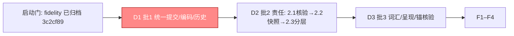

# 编排账目（只编排）

> **只编排**：验收条款在 design D6 与 ORCHESTRATION.md；**启动门已满足**（fidelity-and-recovery 归档 `3c2cf89`）。
> **派发单元=批**（D0/D4：根包闭包相交，批内串行、批间串行；并发轴=实施×验证×后台门禁三角色）。
> **每批三问**：删了什么（diff）· 责任归谁（报告）· 验收仍成立（锚复跑+定点破坏）。
> **负锚=勾选硬门**（R29）：测试不存在或未被证据点名=不得勾选；验收面只对账不缩水。

## 跟踪图

## 批 1（统一正确性分支）——派发单 D1（根包簇：facts.go/tools.go/age_fold.go/memory/event_body.go/run.go/request.go）

- [x] 1.1 (a) 提交单入口：删 facts.go:57 `commitFact`，tools.go:111、age_fold.go:219 改走 `commitFactChecked`，age_fold 提交失败补观测（返回/记录，不静默）；单入口语义入 Godoc —— 验证：`go test ./tests/integration/host -run 'TestFactFidelity' -count=1`（正锚）+ `go test ./tests/integration/host -run 'TestFoldCommitFailureSurfaces' -count=1`（负锚·新建：注入拒写 tier→fold 提交失败可观测）+ `go build ./...` 与 `go test ./tests/integration/host -run 'RequestFidelity' -count=1`（消费者锚）—— 补勾（波1-A1+集成-1，2026-10-27）：正锚/负锚 2 子测/消费者锚/build 全 RC=0；**裁定①（负锚构造等价）**：tier 注入对无 Owner.AgentID 的 fold 事实在 persistFact 早退、不可构造（反事实实证）→ 改「公共入口两类真实拒写」（无事件时间/同键异内容→具名拒绝+活账本零写入），具名测试与 `-run` 正则逐字符不变
- [x] 1.2 (c) EventBody 索引派生+legacy 删除：删 Summary/Content 存储字段（Record/Event 改派生自 Meta[summary]/Message.Content），删 DecodeEventBody legacy 分支与 legacyBodyKey，旧数据不迁移冷启动重建（D3.2 用户裁定）—— 验证：`go test ./memory/... -short -count=1` + `go test ./tests/integration/host -run 'TestFactFidelity' -count=1`（正锚）+ `go test ./memory -run 'TestDecodeEventBodyLegacyRefused' -count=1`（负锚·新建：legacy event_key 字节→ErrEventBody）+ `TAGENT_FIDELITY_COLD_BOOT=1 go test ./tests/integration/host -run 'RequestFidelity' -count=1`（消费者锚·冷启动正式读回）—— 补勾（波1-B+集成-1，2026-10-27）：memory 5 包 37 PASS、正锚/负锚/冷启动消费者锚全 RC=0；负锚红绿双证=变异-复原（临时恢复 legacy 接受分支→RED exit 1，复原 sha 逐字符一致→GREEN）；**裁定②（跨轨消费者）**：根包 5 处直接字段引用（facts.go×3/read.go×2）由编排者集成适配为 `Message.Content`/`Meta[MetaKeyEventSummary]` 派生（read.go 原无白名单归属=计划缺口，R8 编排者修复）；**行为变化登记**：混有旧代 event_key body 的 state 冷启动具名硬失败（ErrEventBody 上抛）需删状态重建——D3.2 no-legacy 裁定的必然推论
- [x] 1.3 (b) 历史路径统一：删 facts.go `r.history` map 与 CommitHistory 映射门（654–681）、HistoryFace 语义迁移（SessionHistory 读投影/单路径恢复）、删 AttachReplay 注册门（无窗口也注册，fold 用缺省窗口，预算只影响呈现）—— 验证：`go test ./tests/integration/host -run 'TestHistoryRestoresWithoutBudget' -count=1`（正锚·G7 锚不动）+ `go test ./runtime/agent -short -count=1`（HistoryFace 契约）+ `go test ./tests/integration/host -run 'TestSingleHistoryPath' -count=1`（负锚·新建：同会话有/无预算恢复历史逐消息相等）+ 结构断言 `grep -c 'history\[' facts.go`=0 + 冷启动复跑（消费者锚）—— 补勾（波1-A1+集成-1，2026-10-27）：结构断言 2→0；G7/负锚/契约/冷启动/全 host（29.8s）/全仓 short 38 包全 RC=0；**裁定③（重定基线如实记录）**：双路径第二面在 8919acf 已不可达（映射门先于本变更存在、注册门已不存在）——本叶实为删死代码，负锚行为锚基线即绿（两臂同源恢复），红转绿由结构断言承载；SessionHistory 单面=空、CommitHistory=文档化 no-op，host 既有锚（delivery_projection/mapped_sequence 断言 SessionHistory==0）一字未动；tools.go ageFold 挂载门 `MaxTokens>0` 保留（呈现/fold 门非注册门，G7 子测 presentation_is_unlimited_at_zero 钉住）；HistoryFace 契约文档补 mapped-sequence 例外（编排者，loop.go）

## 批 2（统一责任）——派发单 D2（2.1 核验先行 → 2.2 → 2.3）

- [x] 2.1 (d) 核验+关闭（重定基线：旧状态已由 3.2+F3b 删）：TestSettleWakeSingleDrive 三子测复跑 3 遍 + 结构证据 + findings 登记「跨会话串行 pump=已知边界，并行化另行立案」—— 验证：`go test ./tests/integration/host -run 'TestSettleWakeSingleDrive' -count=3`（正锚+消费者锚·真子进程 SIGKILL+重启）+ `grep -cE 'retained|firing|rearm' settle_turn.go`=0（负锚·结构）—— 补勾（集成-1，2026-10-27）：`-count=3` 10.1s RC=0；结构 grep=0（C1 增量注释措辞由编排者 retained→owed 保持断言零匹配）；边界已登记 findings（跨会话串行 pump=已知边界，并行化出案另行）
- [ ] 2.2 (e) 快照单源：删 run.go:200 `snapshots` 与 request.go snapshotRequest 双保存，快照只采集一次入 Capture（rl.CaptureAdapter.Snapshot），RequestSnapshots/callArgumentsOf 改读 Capture（SnapshotRefs/SnapshotOf），Seal 不动（D3.1），decision-capture 主规格条款核对（D3.7，失真走 MODIFIED 登记）—— 验证：`go test ./rl -short -count=1` + `go test ./tests/integration/host -run 'RequestFidelity' -count=1`（正锚·Seal 二封契约+协议）+ `go test ./rl -run 'TestRequestSnapshotsSingleSource' -count=1`（负锚·新建：读出面与 Capture 同源）+ `grep -c 'snapshots' run.go`=0 + `go test ./runtime/agent -short -count=1`（消费者锚·loop sealCapture 生产消费）
- [x] 2.3 ① Observer 责任分层：注册分类 Observer-only/Driver（marker 或注册面声明），Observer-only 失败=记缺口不阻断、Driver 失败=义务保留可重试（mailbox 账既有），分层语义入 Godoc 红线 —— 验证：`go test ./api/plugin -run 'TestObserverLayering' -count=1`（负锚·新建：Observer-only 失败→流程继续+缺口可查；Driver 失败→义务保留，只记日志=红）+ `go test ./tests/integration/host -run 'TestSettleWakeSingleDrive' -count=1` + `go test ./telemetry ./rl -short -count=1`（正锚+消费者锚·真实 Driver=SettleDriver、真实 Observer=telemetry/rl）—— 补勾（波1-C1+集成-1，2026-10-27）：TestObserverLayering 4 子测 PASS+双变异红绿（分类失效/只记日志两变异各红→复原绿）；settle×3、telemetry/rl、api/evolution/runtime_agent 消费者面全 RC=0；**裁定④（driver 失败落点）**：`After` 无 error 返回（skeleton_assert+根包两调用点钉住）→ driver 失败以 gap+导出 sentinel `ErrObservationObligationRetained`（errors.Is 可判）落 presentation 读面，义务重试路径（mailbox）未动；机制=未导出 `driverObservation` 接口+`DrivesObligation()` 标记（S4 概念预算无新债实测 ok）；settle_turn.go 增量 10 行零逻辑改；**归属待裁**：rl LeaseObserver 分类（Driver 需账户 vs Observer-only+边界登记）随波2-A2

## 批 3（降抽象成本）——派发单 D3（api/plugin → memory/replay/request.go；3.2 前置=2.2）

- [ ] 3.1 (f) 删 Phase 保 Port：删 Phase 类型与 RouteOf（api/plugin），observePhase 门控/日志键改 Port（present.go/phases.go），examples/contract api_plugin 面同步 —— 验证：`go test ./api/plugin -short -count=1` + `go build ./...`（正锚）+ 结构断言：`grep -rn 'plugin.Phase\|RouteOf' --include='*.go'` 非测试引用=0（负锚）+ `go test ./evolution/... -short -count=1`（消费者锚·meditation 经 Port）
- [ ] 3.2 (g) 删呈现决策+Content 双角色拆解：删 decisions 持久复用与 recordLocked 原地改写，呈现 viewOf 现算（事实+配置+预算），"过去看到什么"由请求快照（2.2 读回）承担，noticeCard 预算下限修复（room<0）—— 验证：`go test ./memory/replay -run 'TestRequestBudgetEnforced' -count=1`（正锚·G9 锚不动）+ `go test ./memory/replay -run 'TestPresentationRecomputedOnBudgetShrink|TestNoRecordedPresentationReuse' -count=1`（负锚·新建：预算缩→重裁；两次装配预算不同→呈现不同）+ `go test ./tests/integration/host -run 'RequestFidelity' -count=1`（消费者锚·三场景协议合法）
- [ ] 3.3 四不变量锚全量核验：D5 四锚全量复跑 + 本批定点破坏红证（四不变量各取一修复点：还原→红→还原三重→绿）—— 验证：D5 命令四条全绿 + 破坏红证入 evidence/

## F（一级直管）

- [ ] F1 契约面断言：`git diff 3c2cf89..HEAD -- openspec/specs/` 仅含本变更声明的增量（orchestration 收尾增量+可能登记的 MODIFIED）；`git diff 3c2cf89..HEAD -- golden/runtime/event_integrity_scenarios.json` 为空或逐行登记等价迁移；decision-capture 条款复核
- [ ] F2 全量门禁（逐批已跑，收尾总复跑）：lint（`bash scripts/lint.sh`）/ selftests（`python3 -m unittest discover -s scripts/gates -p 'test_check_runtime_*.py'`）/ check-openspec（`bash scripts/gates/check-openspec.sh`）/ 三模块 `go test ./... -short -count=1` / short 十轮（`python3 scripts/scenarios/run_runtime_scenarios.py --contract golden/runtime/event_integrity_scenarios.json --scope event-short --repeat 10 --out <dir>`）/ long 六片（`--scope event-long --seed .. --window .. --repeat 1 --timeout 1200` 六组合）/ mutations（`python3 scripts/gates/check_event_integrity_mutations.py --all --json --out <dir>`）/ 症状 job（`go -C examples/wechat-bot test -tags smoke . -run '^TestLocalSmokeSymptom' -count=1 -timeout 600s`）——逐条原始退出码入 evidence/F2-gates.txt
- [ ] F3 DoD + 回滚即红：四不变量定点破坏双证（3.3 已备）+ 每批三问记录归档核对 —— 证据 evidence/F3-redgreen.txt
- [ ] F4 归档 + 导览（域→证据链接，提交号逐字符核对）

## 粒度统计

3 批 9 叶 + F4；批=派发单元（D0 闭包实测：根包簇合单，批内串行）；负锚新建 7 个具名测试（1.1/1.2/1.3/2.2/2.3/3.2×2）+ 2.1/3.1/2.2 结构断言 3 处。
