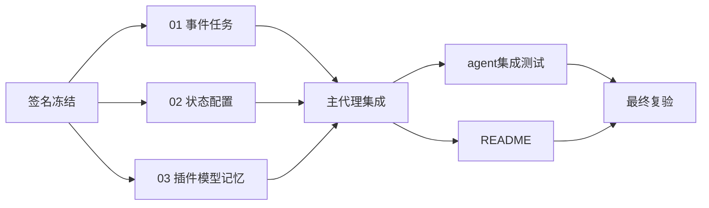

## 1. 编排

本文件只编排；领域孙任务在 changes/*/tasks.md。
启动门：一级design签名冻结，过程件写树隔离。
波次仅为汇报分组，解锁以依赖已集成到本工作区为准，不执行git提交。

- [x] 1.1 核验 changes/01-pipeline/ 的事件与任务 staging 产物，集成后验证任务管线。
- [x] 1.2 核验 changes/02-state/ 的状态与配置 staging 产物，集成后验证恢复与孤儿回收。
- [x] 1.3 核验 changes/03-adapters/ 的选择性插件、记忆与模型代理产物，集成后验证请求与票据。

## 2. 集成验收

- [x] 2.1 删除四个旧 *_test.go，新增 agent 集成测试覆盖一级 design 的八个场景，含真实子进程恢复。
- [x] 2.2 更新 README 架构图/模块职责/JSON配置/执行命令/能力边界，核对每文件职责、未实现、接线说明。
- [x] 2.3 运行 `GOPROXY=off go test ./prototype -count=10` 与 `GOPROXY=off go test -race ./prototype -count=10`；`go vet ./prototype`；核验旧机制不再出现。
- [x] 2.4 校验 `openspec validate simplify-prototype-event-pipeline --strict`，清理staging，报告实际结果；不提交、不归档。

## 验证记录

- 三域隔离并发实现；集成时修复两份staging中的重复package子句，编译后才确认产物有效。staging现已清理，子域验证命令指向集成文件。
- 删除prototype_test.go/state_test.go/child_test.go/example_test.go，保留两份agent集成测试文件。六个进程内场景与一个跨进程场景通过；子进程辅助入口在父测试中Skip，writer/reader各在独立进程真实执行并校验完成标记。
- 跨进程补充验证：writer经agent执行archive保存Memory原文，reader从恢复上下文票据经agent调用recall取回；unknown任务经Complete回报模拟重挂结果，没有自动重跑slow；无owner按配置回收。
- 主代理复跑 `GOPROXY=off go test ./prototype -count=10 -timeout=90s`、`GOPROXY=off go test -race ./prototype -count=10 -timeout=180s`、`go vet ./prototype` 均退出0；gofmt/diff检查无输出；本change严格校验通过。
- 同时到达的一批驱动事件合并一次模型调用；这不构成等待尚未完成任务的栅栏。输入保留增长及真实资源恢复边界已在README注明。

