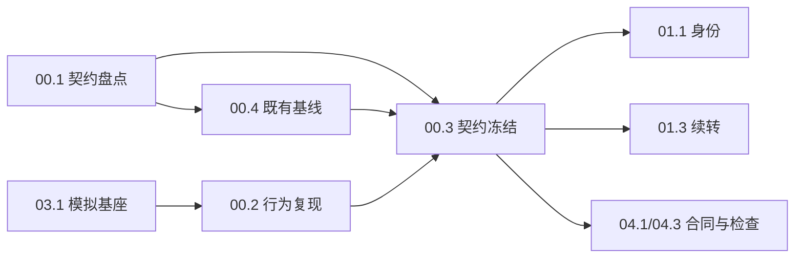

# 00-contract-evidence 设计

本设计只回答“如何取证、如何冻结、何时阻塞”。它不授权修复，也不把任何静态分支预先定性为缺陷。所有文件路径均为未来实施候选，本轮不落盘。

## D1 五轴契约与证据决策

### D1.1 五轴对账

| 轴 | 记录内容 | 不用于 |
|---|---|---|
| 责任身份 | `InstanceID`、`InvocationID`、`DecisionID`、`CallID`；任务通知的责任归属到发起调用的 invocation | 不能因版本更新而改写 |
| 事实引用 | `EventID` 与通知四元 `TaskID/Round/Kind/Seq` 的引用关系 | 不得用事实键替换通知身份 |
| 运输重试 | 同一通知身份的重复运输、同正文不同身份、同身份不同正文 | 不得把运输次数当业务执行次数 |
| 逻辑消费 | 消费方身份 + 事实键 + 消费位置 + 确认时点 | 不得把领取（`Claim`）、发送成功或任务终态当消费完成 |
| 外部发送 | 显式 `send`、最终答复、文件、分片各自的动作身份与确认/未知状态 | 不得把“已送出请求”当“已确认送达” |

### D1.2 身份分层

- 通知身份固定为 `(TaskID, Round, Kind, Seq)`（`Round`/`Kind` 对应既有 `ExecutionRound`/`Category`）；`Seq` 在同一 `(TaskID, Round, Kind)` 内稳定。
- `EventID` 是事实引用，不是通知身份。重试复用通知身份，事实键保持稳定。
- 同一身份携带不同正文/任务/类别时是**冲突**，不是幂等重试。实现必须具名拒绝或隔离后到者，不能静默保留首份。
- 多个合法消费者（遥测投影、任务续转、恢复扫描）读取同一已提交事实，各自形成逻辑消费归属，不构成第二份事实，也不构成业务重复执行。
- `hostSendTool`、`deliverFresh`、文件投递与渠道分片各有动作身份；不得用一个“发送成功”覆盖另一个动作的未确认状态。

### D1.3 静态事实与待验证断言分栏

| 类别 | 内容 | 处置 |
|---|---|---|
| 已确认静态路径 | `host.go:fireNoticeTurn` 新 invocation + Feedback 正文 + `InvokeRequest.Input` 同正文；`invoke.go` 输入事实提交 | 作为 `00.2` 的候选复现对象，不直接定性 |
| 已确认静态分支 | `settle_turn.go` 的 `firing` 属整个驱动器，忙时 `ObserveCommit` 直接返回 | 作为 `00.2` 的候选复现对象，不直接定性 |
| 未复现根因 | 原微信多余确认的精确根因；模型“说重复”、历史重现、单次写链计数均不足 | 记入 `unresolved[]`，不据此分配修复 |
| 不得定性 | 无调用声明、`Seq=0`、局部内存字段、零引用结构 | 只入 findings，不写成缺陷 |

## D2 子域边界

- 本域拥有：E1—E8 八类机制盘点、行为复现、五轴冻结、既有基线。
- 本域不拥有：产品修复（`01`/`02`）、模拟矩阵（`03`）、机器门（`04`）、CI（`05`）。
- 本域不新建第二套消费状态仓、不默认新增 public API 或持久化格式、不改主规格、不改根账目；确需新增公开面或持久格式时，必须由 `00.3` 列明消费者、失败窗口、恢复路径与回退并标 `public_api_or_format_change=blocked` 上报裁定。
- 本域 change 内只落 `changes/00-contract-evidence/evidence/*.json|md` 摘要（含 `log_ref`）；原始运行日志落临时目录/CI `runner.temp`，不写入规划目录；根 `findings.md`/`coverage.md` 由编排者单写，本域只提交摘要。

## D3 依赖与就绪

- `00.1`：实施授权后即可开始，只读源码与主规格。
- `00.4`：`00.1` 完成后开始；在基线提交的独立工作树/副本执行，干净基线先测，不以跳过过滤排除新测试；与 `00.2` 无先后依赖。
- `00.2`：依赖 `03.1` 的同包基座；`03.1` 未就绪时 blocked，不自建第二套 provider/sender/barrier。子测试初始固定为 `control_normal_path`、`duplicate_notice_material`、`busy_notice_loss`、`request_and_send_identity_correlation` 四项，不以 `static_risk_*` 动态通配新增/替代凑数；原微信根因未复现时，只在固定子测试内以 `basis=static_risk`、`original_root_cause=false` 记录独立静态风险红证，不得声称复现原案例根因；新增子场景必须先同步 `00.2-reproduction.json` 的 `subtests` manifest 与任务行。连独立红证都无法形成时，只把对应修复项写入 `blocked_leaves`，不扩大到全机制停工。诊断红证/未复现记录产物 ready 即可供 `00.3`；本叶 checkbox 等 `01.5` 后同一测试十轮独立绿证再完整验收，不永久排除。
- `00.3`：依赖 `00.1`、`00.2` 诊断证据产物 ready（复现或未复现记录，不等其最终 checkbox）、`00.4`；`00.2` 未复现时只把对应 `repair_leaf` 写入 `blocked_leaves`，不整体阻塞冻结，不以静态推断代替行为证据。
- 波次只是汇报分组；解锁以“前置产物进入受控集成树并核验”为准，不以日历波次为准。

## D4 写入归属与逐叶文件候选白名单

| 叶 | 产出 | 写候选白名单（精确到文件） | 正式消费者/读取闭包 | 取舍 | 风险 |
|---|---|---|---|---|---|
| `00.1` | E1—E8 机制盘点 | `changes/00-contract-evidence/evidence/00.1-contract-inventory.json`、`.md` | `00.3` 读取；`01`/`02`/`04` 经 `00.3` 间接读取 | 只盘点，不修；用 JSON 保证机器可核 | 盘点漏机制会把后续修复引向局部；必须以 `00.3` 的 E1—E8 覆盖检查兜底 |
| `00.2` | 行为复现（固定四子测试；诊断红证） | `tests/integration/host/event_integrity_test.go`（拟新增）、`evidence/00.2-reproduction.json`、`.md`（摘要+`log_ref`）；原始 jsonl 写 `${TMPDIR:-/tmp}/event-consumption-integrity/00.2/`（CI `${{ runner.temp }}/...`） | `00.3` 读取诊断证据产物，不等最终 checkbox；测试经 `Boot` 正式入口与 `03.1` 同包基座 | 只复现，不修；正常对照与失败证据同测；初始固定四项，原症状未复现时只在固定子测试内标 `basis=static_risk`、`original_root_cause=false`，不得以 `static_risk_*` 通配新增/替代凑名；新增场景先同步 manifest 与任务行 | 未复现且无独立红证时只阻塞对应修复项；编译失败/超时不充红；`03.1` helper 漂移会使复现失真；checkbox 等 `01.5` 后十轮绿证 |
| `00.3` | 契约冻结与裁定 | `evidence/00.3-frozen-contract.json`、`.md` | `01.1`/`01.3`/`01.4`/`02.x`/`04.1`/`04.3` 读取 | 冻结五轴与缺陷—叶—负锚映射；不预选补丁类型；不默认授权新 public API/持久化格式 | 原 invocation/版本冲突未裁决时阻塞 `01.1`/`01.3`；新增公开面或持久格式须标 `public_api_or_format_change=blocked` 上报；不得新建 invocation 绕过 |
| `00.4` | 既有基线 | `evidence/00.4-baseline.json`、`.md`（摘要+`log_ref`）；原始日志写 `${TMPDIR:-/tmp}/event-consumption-integrity/00.4/`（CI `${{ runner.temp }}/...`） | `05.1`/`05.4`/F2 读取 | 只记录既有行为；不把既有红算成本次引入 | 三模块与 Golden 的命令/环境漂移；红项须隔离复验 |

### D4.1 读取闭包（不写入）

- 根：`host.go`、`invoke.go`、`run.go`、`prepare.go`、`tools.go`、`facts.go`、`request.go`、`settle_turn.go`、`host_capture.go`、`host_reload.go`、`host_model.go`、`age_fold.go`。
- 任务与状态：`runtime/task/registry.go`、`wrapper.go`、`manager.go`、`lifecycle.go`、`handoff.go`、`cancel.go`、`fact.go`、`restore.go`、`commit.go`；`runtime/state/mailbox.go`、`durable.go`、`session.go`、`memory.go`。
- 代理循环：`runtime/agent/loop.go`、`delegate.go`、`request_assembly.go`。
- 业务消费者：`evolution/meditation/driver.go`、`reflection.go`、`watermark.go`、`deliver.go`；`memory/replay/age_segments.go`、`projection.go`、`fold.go`、`replay_settle.go`、`replay_budget.go`；`rl/replacement.go`、`lease_model.go`、`lease_observer.go`；`evolution/governance/policy.go`、`runtime/task/approval/approval.go`、`approval_store.go`；`rl/capture_wiring.go`、`sink.go`、`produce.go`、`export_chain.go`、`tool/subagent/capture.go`、`builder.go`。
- 宿主：`examples/wechat-bot/main.go`、`wechat.go`、`wechat_approval.go`；`examples/cli-host/main.go`。
- 测试基座：`tests/integration/host/scripted_provider_test.go`、`meditation_boot_test.go`、`public_runtime_entry_test.go`、`settle_turn_test.go`、`soak_continuity_test.go`；微信 `smoke_harness_test.go`、`smoke_test.go`、`smoke_errors_test.go`、`smoke_data_test.go`、`wechat_test.go`；CLI `examples/cli-host/main_test.go`。

## D5 验收锚与 spec 场景映射

| 叶 | 正锚 | 负锚 | 正式消费者锚 | spec 场景 |
|---|---|---|---|---|
| `00.1` | E1—E8 机制 JSON 均含生产入口/事实身份/消费者/确认保留点 | `inventory_missing_mechanism`：删一项后检查命令必须非零 | `00.3` 冻结件逐项引用 | 不新增 scenario；为全量契约盘点 |
| `00.2` | `TestEventIntegrityReproduction/control_normal_path` 绿；`request_and_send_identity_correlation` 提供 Boot 请求/发送逐身份关联证据；四项固定子测试齐全；最终十轮绿证 | `duplicate_notice_material` / `busy_notice_loss` 以业务断言红；原症状未复现时在固定子测试内标 `basis=static_risk`、`original_root_cause=false`，只阻塞对应修复项；不得以 `static_risk_*` 通配新增/替代凑名 | `Boot` 实际 provider 请求与 sender 记录按通知身份关联 | 复现目标：`persistent-event-loop` 新增“同一通知不重复生成输入”“忙时通知保留待办”；`async-task-execution` 新增“运输接收不等于消费” |
| `00.3` | 五轴、E1—E8、`defects[].confirmed` 与 `unresolved[]` 齐全 | `unresolved_without_blocked_leaf`：未裁决项缺 `blocked_leaves` 必须非零；`top_level_confirmed_array_rejected`：出现顶层 `confirmed[]` 双结构必须非零 | `01.1`/`01.3`/`04.1` 读取冻结件 | 冻结件引用全部新增/修改 requirement；不单独产生 scenario |
| `00.4` | 既有根/微信/CLI 测试与 deterministic Golden 有原始退出码 | 任一非零未隔离复验不得勾选 | `05.1`/`05.4` 复用基线 | 既有 S01—S15 deterministic 场景，不改写历史归属 |

`派生视图有来源且不改写源事实` 的 3 个场景由 `02` 域投影/遥测消费者接线测试承接；`00` 只冻结契约，不新增产品测试，`01` 不重复定义同义要求。

## D6 发送边界

- 本域只冻结“发送确认”与“消费确认”分离，不决定发送实现；发送动作身份与未确认结果由 `01.4` 落地。
- 已确认成功的动作不因恢复重发；结果未知保留未确认，不自动重发、不伪报成功；显式重试经既有正式入口或人工处置，保留原动作关联。
- 未取得渠道幂等证据，不承诺端到端恰好一次。

## D7 证据协议

### D7.1 红证规则

- 红证必须是**业务断言失败**，测试名与 `-run` selector 逐字符一致；`00.2` 初始固定四项子测试，不得以 `static_risk_*` 动态通配新增/替代；编译失败、包失败、超时、零匹配、skip 均不充红证。
- 正常对照必须先绿；只有对照绿、缺陷子测试以业务断言红，才可写 `reproduced=true`。
- 原微信根因未复现时，只在固定四项子测试内以 `basis=static_risk`、`original_root_cause=false` 记录独立、可重复红证；MUST NOT 声称复现原案例根因，MUST NOT 用 `static_risk_*` 动态通配新增/替代子测试来凑四名。新增场景必须先同步 `00.2-reproduction.json` 的 `subtests` manifest 与任务行。
- 若缺陷子测试绿或无法稳定触发且连独立静态风险红证也无法形成，写 `reproduced=false`；只把对应 `repair_leaf` 写入 `blocked_leaves`，不阻塞 `00.3` 冻结其他机制，也不扩大到全机制停工；不得修改测试把绿伪装成红。诊断证据产物 ready 只供 `00.3`，不代替 `00.2` 的最终 checkbox。
- 红证原始 `-json` 输出、run-id、命令与退出码写 `${TMPDIR:-/tmp}/event-consumption-integrity/00.2/`（CI 为 `${{ runner.temp }}/event-consumption-integrity/00.2/`）；change 内 `evidence/00.2-reproduction.json`/`.md` 只留摘要与 `log_ref`，不写入大 jsonl。

### D7.2 基线规则

- 每条命令单独执行、单独记录原始退出码，不与 `&&` 或 commit 串联；原始日志写 `${TMPDIR:-/tmp}/event-consumption-integrity/00.4/`（CI 为 `${{ runner.temp }}/...`），change 内只留 `00.4-baseline.json`/`.md` 摘要与 `log_ref`。
- 基线在基线提交的独立工作树/副本执行，干净基线先测；不以跳过过滤排除新测试，与 `00.2` 无先后依赖。
- 红项在干净隔离基线复验；记录是既有红、环境噪声还是新引入，不能以“已知红”直接勾选。
- deterministic Golden 只证明既有合同场景；不把规划工具绿灯算成产品回归。

### D7.3 复跑与十轮

- `00.2` 有诊断基线与最终回归两种模式：诊断红证（预期非零）供 `00.3`，不纳入十轮绿证；`01.5` 修复后同一 `TestEventIntegrityReproduction` 必须按 `event-short` 十轮独立绿证（每轮 `-count=1`、单独日志/run-id/退出码）作为 `verify_after_01.5`，不得因早期诊断角色永久排除。`00.2` checkbox 需诊断证据产物 ready + 最终十轮绿证完整验收；证据产物 ready 即可供 `00.3`，无循环等待。
- `00.4` 是基线任务，按原命令复跑即可；不新增产品测试。
- 后续 `01` 域的新产品测试按各自任务行的十轮模板执行：同一父 selector 独立执行 10 次，每次 `-count=1`、单独日志、单独 run-id/退出码，日志写 `${TMPDIR:-/tmp}/event-consumption-integrity/<leaf>/`；不得用 `-count=10` 把十轮塞进单轮证据。每轮全部具名 `run`/`pass` 终局由 `04.2` 正式证据检查器逐轮核对，agent 不得以 `grep`、文件数量或合并日志自报通过。

## 取舍

- 选择“先冻结、后修复”，而不是先改 `fireNoticeTurn` 或 `settle_turn.go`：静态路径不足以证明最终漏处理，先修会把合法多消费者或运输重试误伤。
- 选择 JSON 证据件而不是只写散文：E1—E8 覆盖、缺陷—叶—负锚映射、未裁决阻塞需要机器可核。
- 选择默认不新增 public API 或持久化格式：新增公开面会扩大恢复与兼容责任；确需新增由 `00.3` 列明并裁定，未裁定不实施。
- 选择复用 `03.1` 的基座而不是在 `00.2` 自建：避免两套 provider/sender/barrier 对同一事实给出不同观测。
- 不把 `state.SendFace`、`rl.Recorder`、旧投影恢复路径接回：`SendFace` 当前仅测试构造，零生产引用；接回会制造第二套发送/记录语义。

## 风险与回退

| 风险 | 触发条件 | 回退/处置 |
|---|---|---|
| 复现失败 | `00.2` 全绿或无法稳定触发 | 先在固定子测试内形成 `basis=static_risk`、`original_root_cause=false` 独立红证；不得以 `static_risk_*` 通配新增/替代凑名；仍无法形成时记录 `reproduced=false` 并只阻塞对应修复项，不阻塞 `00.3` 其他机制；不改测试造红 |
| 静态红证被误报为原案例根因 | 在固定子测试内用静态风险红证替代原症状 | 证据固定 `basis=static_risk`、`original_root_cause=false`；只阻塞对应修复项 |
| 公开面扩张 | 冻结时顺手新增 public API 或持久化格式 | `00.3` 默认不授权；确需新增列明消费者、失败窗口、恢复路径与回退并标 `public_api_or_format_change=blocked` 上报，另需单独实施授权；未授权保持未勾选 |
| 冻结冲突 | 原 invocation 与当前代无法一致解释 | `00.3` 标记 `invocation_version_conflict=blocked`，阻塞 `01.1`/`01.3`，请求裁定 |
| 基线污染 | 新测试与基线同树 | `00.4` 与 `00.2` 无先后依赖；基线在基线提交的独立工作树/副本执行，不以跳过过滤排除新测试；红项隔离复验 |
| 基座漂移 | `03.1` helper 改名或语义变化 | `00.2` blocked，按 `03.1` 冻结接口重接；不自建第二套 |
| 证据漂移 | 证据文件与日志/命令不一致 | `00.3` 检查每项 `log_ref` 可解析、命令与退出码逐字对账；不一致即不勾选 |
| 范围蔓延 | 盘点时顺手修产品 | 本域写集只含 `evidence/` 与 `00.2` 测试文件；产品改动一律拒收 |
