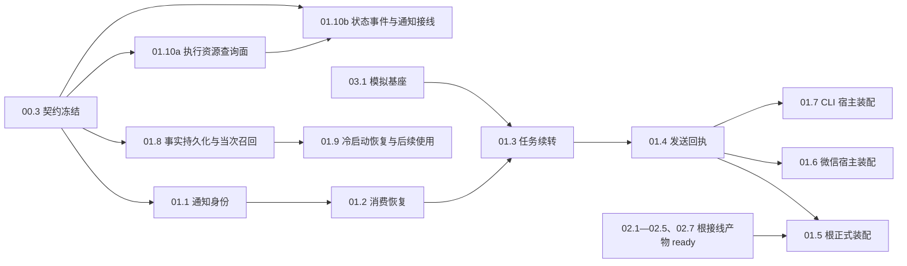

# 01-runtime-consumption 设计

本设计把 `00.3` 冻结的五轴落到输入、任务、消费、恢复与发送。所有文件路径均为未来实施候选；本轮不修改产品树。

## D1 契约继承与不可重释

- 继承 `00.3` 的五轴：责任身份、事实引用、运输重试、逻辑消费、外部发送分别对账。
- 通知身份固定 `(TaskID, Round, Kind, Seq)`；`EventID` 只是事实引用。同一身份不同正文是冲突，不是幂等。
- 多个合法消费者读取同一已提交事实，各自记逻辑消费，不构成第二份事实或第二次业务动作。
- 一次终态通知的下一步 decision SHALL 归属原 invocation；MUST NOT 新建 invocation。版本绑定按 decision 开始执行时取当前有效代；该交叉语义由 `00.3` 裁定，本域不预先改写。
- 回收 turn 的输入材料只取该通知已提交事实或有来源的有界视图；同一通知身份 MUST NOT 为同一 decision 重复生成用户输入事实，MUST NOT 触发第二次逻辑消费。正文可在会话历史中合法再次出现，重复判定按事实/通知/动作身份与因果归属，MUST NOT 以正文出现次数或文本相似度判重。
- 驱动器忙时保留待办，不丢弃；不同 TaskID/invocation/session 不合并、不互相覆盖。
- 不建立第二套消费状态仓；复用现有 mailbox、任务 envelope、restore 与事实链；不默认新增 public API 或持久化格式，确需新增须经 `00.3` 裁定并另获单独实施授权，未授权保持未勾选。`01.10b` 的接线需要新增最小 public API 时，按 `00.3` 流程先在该叶实施单列明 API 面（签名、消费者、失败窗口、回退）再动，超最小面停报；授权范围登记在 `00.3` 冻结件。

## D2 子域边界

- 本域拥有：通知身份与幂等（`01.1`）、消费恢复（`01.2`）、任务续转（`01.3`）、发送动作与未确认（`01.4`）、根正式装配（`01.5`）、微信宿主装配（`01.6`）、CLI 宿主装配（`01.7`）、会话事实持久化与当次召回（`01.8`）、冷启动恢复与后续使用（`01.9`）、执行资源查询面生命周期（`01.10a`）、执行状态事件生产与通知接线（`01.10b`）。
- 本域不拥有：冥想/反射、投影/压缩、热更/替换、审批、采集/导出（`02`）；模拟矩阵（`03`）；机器门与变异（`04`）；CI 与远端（`05`）。
- 本域不改 `event-metadata-contract`/`committed-event-attribution` 的冻结语义；如需变更，回 `00.3` 重裁，不在 `01` 另建同义条款。

## D3 依赖与就绪



- `01.1`：只在 `00.3` 冻结后开始；未冻结时 blocked。
- `01.2`：复用 `01.1` 的身份与幂等；按 `00.3` 核准的当前路径恢复，使用既有 task 提交/恢复与 mailbox `Claim`/`Consume`，不得自造通知键，不复活旧 inbox。
- `01.3`：依赖 `01.2` 与 `03.1`；`03.1` 未就绪时 blocked，不自建 provider/sender/barrier。
- `01.4`：依赖 `01.3` 的责任范围与未确认状态。
- `01.5`：依赖 `01.4` 与 `02.1`—`02.5`、`02.7` 的可集成根接线产物 ready，不等待 `02` 最终 checkbox；按根 ORCHESTRATION 的 ready/verified 两阶段语义，`01.5` 先完成根正式装配与已就绪端口验收，`02` 最终验收在 `01.5` 之后。未 ready 端口具名 blocked，不冒充完整接线。`02.6` 微信审批只经 `01.6` 回验，不并入本叶前置。
- `01.6`/`01.7`：只依赖 `01.4`，分别完成微信/CLI 宿主正式装配；缺必要身份/凭据时具名拒绝。`02.6` 的最终回验前置是 `01.6`，方向单向、不构成环。
- `01.8`：只依赖 `00.3`；先归因持久化真实载体（durable chain / 框架存储插件 / ledger），再把正式回合新事实接上持久化与实时召回；不得以测试内手工提交冒充。
- `01.9`：依赖 `01.8`；重启后除恢复账本外，必须证明下一实际请求使用恢复材料。
- `01.10a`：只依赖 `00.3`；在 `tool/exec` 包内验证五态查询面（调用已返回/仍在运行/退出码/释放确认或具名未知），用包内测试，不改根装配；负锚证明稳定与部分输出不构成成功或完成。
- `01.10b`：依赖 `01.10a` 与 `00.3`；归因 `renewForCall`/`defer stopRenewing` 与 `MonitorWatch` 的现有形态后接持续驱动或等价，把状态变化接入既有通知消费链，并让生产 Sweep 与 `Host.Close` 触达 exec 资源；需要新 public API 时先列最小面再动，超面停报；不新建平行资源仓。
- 根热点锁由 P1 持有；`01` 同一所有者串行执行热点链，`01.5` 汇入其他域的根接线需求（微信装配归 `01.6`、CLI 装配归 `01.7`）。P2 不同时编辑根热点。
- 同树并发按触碰集判定：测试文件与产品文件均按“同文件单写”处理；`00.2`/`01.3`/`01.4`/`01.5` 共用 `tests/integration/host/event_integrity_test.go`，必须串行；`01.2`/`01.8`/`01.9` 与 `02.3`/`03.9` 共用 `tests/integration/history/event_integrity_test.go`，按 `01.2 → 01.8 → 01.9 → 02.3 → 03.9` 串行；`01.1`/`01.10b` 共用 `tests/integration/execution/event_integrity_test.go`，按 `01.1 → 01.10b` 串行；`01.10a` 单写 `tool/exec/event_integrity_test.go`（与上述文件不同）；`01.6` 单写 `examples/wechat-bot/smoke_harness_test.go`（与 `02.6` 的 `wechat_test.go` 不同文件），`01.7` 单写 `examples/cli-host/main_test.go`（无同文件冲突）。

## D4 写入归属与逐叶精确文件候选白名单

| 叶 | 产出/测试 | 写候选白名单（精确到文件） | 正式消费者/读取闭包 | 取舍 | 风险 |
|---|---|---|---|---|---|
| `01.1` | `tests/integration/execution/event_integrity_test.go`（**拟新增**）中的 `TestEventIntegrityNoticeIdentity` | `runtime/task/wrapper.go`、`runtime/task/manager.go`、`runtime/agent/delegate.go`、`runtime/agent/loop.go`、`tools.go`、`facts.go`、`run.go`、`invoke.go`、`host.go`；`runtime/task/registry.go`/`fact.go`/`commit.go`/`handoff.go` 仅在 Read/Grep 证明生产调用且经 `00.3` 裁定时才改 | `Boot`/`Host.Invoke` → 声明工具/子代理 → `runtime/task` 正式通知生产 → `Run.deliver`（子代理）或 `WithMailbox(r.sink)`（工具）→ `facts.go` 的 `sink`/`bookNotice`/`noticeProjection`；测试经正式入口，不手工 commit 通知事实 | 复用 `task.Notice` 四元与 `Notice.FactKey()`，不新增通知字段；`MemoryRegistry.IssueNotice` 无生产调用、`NoticeSequencer` 仅恢复路径 `Observe` 使用，不接回为通知生产；冲突用既有事实键 + 内容比对具名拒绝 | 与 `00.3` 身份定义漂移；`Text` 不入身份导致同键异文；Handoff 只改未来通知的边界；误把零生产引用结构接回 |
| `01.2` | `tests/integration/history/event_integrity_test.go`（**拟新增**，与 `02.3`/`03.9` **同文件单写**）中的 `TestEventIntegrityConsumptionRecovery` | `runtime/state/mailbox.go`、`runtime/state/durable.go`、`runtime/state/session.go`、`runtime/state/memory.go`、`runtime/task/restore.go`、`runtime/task/commit.go`、`runtime/task/lifecycle.go`、`runtime/agent/loop.go`、`host.go`、`prepare.go`、`run.go` | 任务事实提交 → mailbox `AcceptNotice`/`Claim`/`Consume`（`Consume` 记录完成并推进连续位置）→ `Boot` 恢复；独立子进程重启 | 复用现有 `Claim`/`Consume` 与 outstanding 核对；不新增第二套消费状态仓；不复活旧 inbox 或完成回执机制；损坏 slot 沿用整封隔离；补差先证交接结果可恢复再确认消费，不得仅挪动确认调用 | 子进程握手/临时根/信号边界；跨平台文件屏障；`claimed` 滞留；测试内存 store 冒充 durable |
| `01.3` | 扩展 `tests/integration/host/event_integrity_test.go` 的 `TestEventIntegrityTaskContinuation`（文件由 `00.2` 创建，**同文件单写**） | `host.go`、`invoke.go`、`settle_turn.go`、`facts.go`、`runtime/agent/loop.go`、`runtime/task/registry.go`、`runtime/task/handoff.go`、`runtime/state/mailbox.go` | `Boot` → `Host.Invoke`/`fireNoticeTurn` → `SettleDriver.ObserveCommit` → `Loop.Backflow` → 原 invocation 下一步 decision；正式 sender | 去掉同一通知的第二次用户输入/第二次逻辑消费，而不是在模型视图层做文本去重；正文可在历史中合法重现；忙时把待办留在既有 intake/mailbox，不新建第二缓冲；补差覆盖未配置投影/零窗口/有窗口三态，无投影合法路径不得断通知输入 | 根热点串行；`firing` 修复可能改变时序；多 session/多 task 交错；`00.3` 版本裁定未决；误把合法历史重呈现判为重复 |
| `01.4` | 扩展同一 host 文件的 `TestEventIntegrityDelivery`（**同文件单写**） | `host.go`（`MessageSender`、`deliverFresh`、`hostDeliveryMeter`、`hostSendTool`）；仅证实路径需要时加 `host_face.go` 的读面，不加发送实现 | `Boot` 的 `send` 工具 → `MessageSender`；用户 turn 的 `deliverFresh`；记录型 sender 观察实际动作 | 不接回零生产引用的 `state.SendFace`；动作身份落在正式 sender 路径；未知结果用受控 sender 返回歧义错误验证“不自动重发” | 无法在本地真实渠道制造“确认丢失”；用受控 sender 只能证明调用侧不重发，不能证明渠道幂等；文件/分片动作易被最终答复身份覆盖 |
| `01.5` | `TestEventIntegrityFormalAssembly`（扩展 host `event_integrity_test.go`） | 产品候选：`host.go`、`run.go`、`prepare.go`、`tools.go`、`facts.go`、`request.go`、`invoke.go`；测试：`tests/integration/host/event_integrity_test.go` | 根 `Boot` 正式装配 + `Host.Invoke`；汇入 `02.1`—`02.5`、`02.7` 根接线产物 | 只用正式入口，缺端口具名失败；不因导出符号、`Seq=0` 或零用例默认接回；不为测试放宽 `test-mirror` 门 | `02` 域产物未 ready 导致部分端口无法接线（只验已就绪端口并列 blocked）；测试补线诱惑；导出/零用例接回诱惑 |
| `01.6` | `TestEventIntegrityHostAdapters`（扩展微信 `smoke_harness_test.go`，`//go:build smoke`） | 产品候选：`examples/wechat-bot/main.go`、`examples/wechat-bot/wechat.go`、`examples/wechat-bot/wechat_approval.go`；测试：`examples/wechat-bot/smoke_harness_test.go` | 微信 `main → newWechatApp → Boot → bindWechat → bindChannel → registerHandlers` | 复用 `bootSmokeRig` 正式装配；缺声明身份具名失败；不为新文件放宽 `test-mirror` 门 | 微信 smoke 构建标签；三模块命令与根 `./...` 不同；测试补线诱惑 |
| `01.7` | `TestEventIntegrityCLIAdapter`（扩展 `examples/cli-host/main_test.go`） | 产品候选：`examples/cli-host/main.go`；测试：`examples/cli-host/main_test.go` | CLI `run` 正式入口 | 不用 `cli.NewCLI` 或接口声明冒充 CLI 生产入口；缺模型凭据时退出非零且 stderr 具名 | 三模块命令与根 `./...` 不同；误把 `cli.NewCLI` 当生产入口 |
| `01.8` | `tests/integration/history/event_integrity_test.go`（与 `01.2`/`02.3`/`03.9` **同文件单写**）中的 `TestEventIntegrityPersistence` | `facts.go`、`run.go`、`prepare.go`、`request.go`、`memory/recall.go`、`memory/store_query.go`、`memory/ledger/tier_facts.go`、`memory/ledger/localfile.go`、`memory/search/store_searcher.go` | `Boot`/`Host.Invoke` 正式回合 → `commitFact`/durable 载体 → 检索索引/`StoreQuerySource` → `host.go` 的 `recall.New` → `tool/subagent` 声明式 recall → `Run.RecallReads()` | 先归因持久化真实载体（durable chain / 框架存储插件 / ledger）再最小改动；存储失败可见、索引失败留可恢复欠账；不新增第二状态仓；排序语义归另立变更 | 基线 `commitFact` 仅内存、`StoreEvent` 零生产调用、`ObserveStore` 仅启动快照；新增 public API/持久格式需另授权 |
| `01.9` | 同一 history 文件中的 `TestEventIntegrityRestoreUse` | 同一测试文件；产品候选 `run.go`、`prepare.go`、`request.go`、`memory/recall.go`、`memory/store_query.go`、`memory/ledger/tier_facts.go`、`memory/ledger/localfile.go` | `Boot` 重开同一 durable 根 → 恢复原文/归属/工具配对 → `Host.Invoke` 下一实际请求 | 正常关闭与进程中断分开取证；除恢复账本外必须证明下一请求使用恢复材料 | 子进程握手/临时根/跨平台文件屏障；测试内存 store 冒充 durable |
| `01.10a` | `tool/exec/event_integrity_test.go`（**拟新增**，包内测试 `package exec`）中的 `TestEventIntegrityExecLifecycle` | `tool/exec/tool.go`、`tool/exec/exec.go`、`tool/exec/monitor.go`、`tool/exec/tmux_executor.go`、`tool/exec/stop.go`；测试文件 | `RunTool.Call`（`tool/exec` 正式执行入口）→ `Manager`（Acquire/Renew/Observe/Capture/Release/Explain）→ `Capture`/`Held` 与 `Release(exit=N)`/`retained`/`ErrResourceUnknown` 查询面 | 只验查询面可达性与五态区分；同键复用 `Capture` 可见后续输出；`Capture` 答案不证明进程结束；不改根装配、不新建平行资源仓 | `Stable` 只是静默；释放到状态未知须具名呈现；包内测试须被源码发现清单识别 |
| `01.10b` | `tests/integration/execution/event_integrity_test.go`（与 `01.1` **同文件单写**）中的 `TestEventIntegrityExecStateEvents` | `tool/exec/tool.go`、`tool/exec/exec.go`、`tool/exec/monitor.go`、`tool/exec/tmux_executor.go`、`tool/exec/stop.go`、`host.go`、`run.go`、`prepare.go`、`tools.go`、`facts.go`、`request.go`、`invoke.go`、`settle_turn.go`；测试文件 | `Boot` 声明工具 → `RunTool.Call` → `Manager`/`MonitorWatch` → 既有通知消费链（sink/Backflow）→ 下一轮 decision；生产 Sweep 与 `Host.Close` 经同一 exec Manager 触达资源 | 返回后继续跟踪；续租不随返回终止；状态变化生成后续通知；修复 close 后泄漏；重启接管或具名未确认；新增 public API 先列最小面再动 | `renewForCall` + `defer stopRenewing` 已知形态；根热点串行；最小 API 面超界即停报 |

### D4.1 读取闭包（不写入）

- 根：`host.go`、`invoke.go`、`run.go`、`prepare.go`、`tools.go`、`facts.go`、`request.go`、`settle_turn.go`。
- 任务/状态：`runtime/task/registry.go`、`wrapper.go`、`manager.go`、`lifecycle.go`、`handoff.go`、`cancel.go`、`fact.go`、`restore.go`、`commit.go`；`runtime/state/mailbox.go`、`durable.go`、`session.go`、`memory.go`。
- 代理循环：`runtime/agent/loop.go`、`delegate.go`、`request_assembly.go`。
- 记忆/召回：`memory/recall.go`、`memory/store_query.go`、`memory/event_body.go`、`memory/partition.go`、`memory/query_events.go`、`memory/ledger/tier_facts.go`、`memory/ledger/localfile.go`、`memory/ledger/segment_store.go`、`memory/ledger/original_store.go`、`memory/search/store_searcher.go`、`memory/search/fusion.go`。
- 外部执行：`tool/exec/tool.go`、`exec.go`、`monitor.go`、`tmux.go`、`tmux_executor.go`、`stop.go`、`decl.go`。
- 宿主：`examples/wechat-bot/main.go`、`wechat.go`、`wechat_approval.go`；`examples/cli-host/main.go`。
- 测试基座：`tests/integration/host/scripted_provider_test.go`、`settle_turn_test.go`、`soak_continuity_test.go`、`public_runtime_entry_test.go`；微信 `smoke_harness_test.go`、`smoke_test.go`、`smoke_errors_test.go`、`smoke_data_test.go`、`wechat_test.go`；CLI `examples/cli-host/main_test.go`。

## D5 验收锚与 spec 场景映射

| 叶 | 正锚（全部父 selector 内子测试） | 负锚（勾选硬门） | 正式消费者锚 | spec 场景 |
|---|---|---|---|---|
| `01.1` | `tool_and_subagent_notice_reaches_original_invocation`、`multiple_progress_ordered_by_seq`、`handoff_preserves_issued_target` | `duplicate_delivery`（同身份同正文不产生第二事实）、`conflicting_body_same_identity`（异正文具名冲突）、`cross_invocation_not_merged` | `Boot`/`Host.Invoke` → 声明工具/子代理 → `runtime/task` 正式通知生产 → `Run.deliver`/`facts.go` 现有消费者；不把 `IssueNotice` 当生产入口 | `event-metadata-contract`：同身份异正文被判冲突、不同责任身份的通知不合并、事实引用不代替通知身份；`committed-event-attribution`：两个消费者各自归属；`persistent-event-loop` 既有「多 progress 稳定 seq 有序」的重复运输幂等、未来通知转新目标与实例、已开始通知保留旧目标 |
| `01.2` | `claim_then_commit_retry_recovers`、`consume_only_after_durable_commit`、`independent_process_restart` | `claim_does_not_confirm_early`、`no_skip_over_gap`、`consumed_entry_not_reprocessed`、`handover_before_confirmation`（补差：`Consume` 成功与 `Backflow` 交接之间退出，交接结果必须可恢复；交接前确认导致未交接结果丢失即失败） | 既有 task 提交/恢复 + mailbox `Claim`/`Consume` + `Boot` 恢复 + 父子进程真实重启 | `persistent-event-loop` 新增：空洞阻断后续确认、领取不提前确认、恢复从最后确认位置继续；`telemetry-channel`：运输接收不触发降级、未消费通知不可丢；既有「输入处理确认与幂等」：`Claim` 不提前确认、`Consume` 后推进、已消费项不重复处理；既有「启动直接核对未确认完成证据」「不可解码 slot 触发整封隔离」 |
| `01.3` | `idle_notice_drives_next_decision`、`busy_notice_retained_and_consumed`、`two_tasks_same_host_each_continuation`、`multi_session_same_host_isolated`、`late_notice_not_dropped`、`notice_input_without_projection`（补差：未配置投影/零窗口/有窗口三态下通知材料均可达） | `no_duplicate_input_for_same_notice`（同一通知身份不重复生成用户输入/不重复逻辑消费；正文可合法重现）、`busy_notice_not_dropped`、`no_new_invocation_for_notice` | `Boot` 正式入口 + `Host.Invoke` + 真实 `SettleDriver` | `persistent-event-loop`：同一通知不重复生成输入、忙时通知保留待办、多任务多会话各自续转、空闲时任务完成唤醒循环、decision 进行中任务完成则排队、后台结果不新建 invocation、既有 Handoff 已开始通知保留旧目标；`async-task-execution`：运输接收不等于消费、发送成功不等于消费、重启恢复未消费义务；`telemetry-channel`：已外显通知即时退出、内部性通知的 N 轮提醒 |
| `01.4` | `all_legal_actions_delivered`、`confirmed_action_reentry_no_resend`、`unknown_result_retained`、`explicit_retry_keeps_link` | `confirmed_action_not_resent`、`unknown_result_not_auto_resent`、`distinct_actions_not_merged` | `Boot` 的 `send` 工具 + `deliverFresh` 正式 `MessageSender` | `delivery-dispatch-receipts`：已确认动作重入不重发、结果未知不自动重发、不同动作身份不合并、显式重试保留关联；`event-metadata-contract`：外部发送动作身份独立；既有「已送达不回执」「回执不递归」 |
| `01.5` | `TestEventIntegrityFormalAssembly/formal_boot_delivers_turn`，从根正式入口完成一次带通知/发送的回合 | `TestEventIntegrityFormalAssembly/missing_sender_fails_closed`（根宿主无 sender 且文档不声明 `send` 工具时 `Host.Invoke` 返回 `ErrHostSenderMissing` 且无 provider 请求） | 根 `Boot` 正式装配 + `Host.Invoke` | `persistent-event-loop`：根宿主缺 sender 以具名错误拒绝；既有「可靠模式的恢复能力与格式准入」「循环停止为终结态」 |
| `01.6` | `TestEventIntegrityHostAdapters/formal_channel_turn`，从微信正式应用链完成一次带通知/发送的回合 | `TestEventIntegrityHostAdapters/missing_entry_fails_closed`（声明身份为空时 `newWechatApp` 返回 `ErrNoChatAddress` 而非默认地址） | 微信 `main → newWechatApp → Boot → bindWechat → bindChannel → registerHandlers` | `persistent-event-loop`：微信宿主缺声明身份以具名错误拒绝；`delivery-dispatch-receipts`：正式 sender 路径动作身份 |
| `01.7` | `TestEventIntegrityCLIAdapter/formal_cli_turn`，从 CLI 正式入口完成一次带通知/发送的回合 | `TestEventIntegrityCLIAdapter/missing_model_key_fails_closed`（真实模型缺 key，`run` 退出 1 且 stderr 具名，不回退 mock） | CLI `run` | `persistent-event-loop`：CLI 宿主缺模型凭据以具名错误拒绝；`delivery-dispatch-receipts`：正式 sender 路径动作身份 |
| `01.8` | `new_fact_recalled_same_turn`、`original_text_matches_committed_bytes`、`formal_recall_tool_returns_new_fact` | `storage_failure_not_reported_as_success`、`index_failure_leaves_recoverable_debt`、`new_fact_keeps_old_reachable` | `Boot`/`Host.Invoke` 正式回合 → durable 载体 → 检索索引/`StoreQuerySource` → `host.go` 的 `recall.New` → 声明式 recall 工具 → `Run.RecallReads()` | `session-fact-lifecycle`：提交即持久化且当次可召回、原文一致、存储失败不伪成功、索引失败留可恢复欠账、新事实不使既有可达记录不可达 |
| `01.9` | `restart_restores_original_text`、`restart_restores_invocation_attribution`、`restart_restores_tool_call_result_pairing`、`next_request_uses_restored_material` | `restore_only_ledger_is_not_completion` | `Boot` 重开同一 durable 根 → `Host.Invoke` 下一实际请求 | `session-fact-lifecycle`：正常关闭与进程中断后恢复原文/归属/工具配对；下一请求必须使用恢复材料 |
| `01.10a` | `returned_call_does_not_prove_exit`、`same_key_capture_sees_more_output`、`release_reports_exit_code`、`released_or_named_unknown` | `stable_is_not_success`、`partial_output_is_not_completion` | `RunTool.Call` → `Manager` 查询面（`Capture`/`Held`/`Release(exit=N)`/`retained`/`ErrResourceUnknown`） | `execution-resource-lifecycle`：查询面五态（调用已返回不证明进程结束、同键复用可见后续输出、退出码、释放确认或具名未知）、稳定/部分输出不等于成功或完成 |
| `01.10b` | `lease_keeps_renewing_after_return`、`state_change_emits_followup_notice`、`next_turn_consumes_exec_state`、`host_close_releases_exec_resources`、`restart_takes_over_or_names_unconfirmed` | `unconfirmed_restart_not_reported_stopped` | `Boot` 声明工具 → `RunTool.Call` → `Manager`/`MonitorWatch` → 既有通知消费链（sink/Backflow）→ 下一轮 decision；生产 Sweep 与 `Host.Close` | `execution-resource-lifecycle`：返回后持续跟踪、状态变化进入既有消费链、生产 Sweep 与 `Host.Close` 触达资源、重启接管或具名未确认 |

## D6 发送边界

- 已确认成功的动作不因恢复、重放或重入再次执行。
- 结果未知（确认丢失、超时、错误不可辨）保留动作身份、目标、错误与未确认状态；不自动重发、不伪报成功。
- 显式重试经既有正式入口或人工处置，保留与原动作的关联。
- 显式 `send`、最终答复、文件、渠道分片各有动作身份；不得以一个成功覆盖另一个未确认。
- 未取得渠道幂等证据，不承诺端到端恰好一次；只承诺本地“不重发、不伪报、可关联”。

## D7 证据协议与十轮模板

### D7.1 父 selector 与子场景

- 每条产品验证命令必须使用完整父 selector（如 `^TestEventIntegrityNoticeIdentity$`），一次跑全部子场景；不得只列子测试名，也不得以父测试绿推断子场景已跑。
- `-run` 正则与测试名逐字符一致；改名必须同步任务行、design 映射与合同，否则零匹配空转。
- 每叶至少一个具名有意义负向子测试；负向子测试是勾选硬门，不得只做正向路径。

### D7.2 十轮独立执行模板

新增/扩展产品测试在交付前按下列模板执行十轮。每轮是独立进程、独立日志、独立 run-id/退出码；**不得**用 `-count=10` 或把十轮日志合并进单轮证据：

```sh
go test <pkg> -run '^<TestName>$' -count=1 -race -json -timeout <n> > "${TMPDIR:-/tmp}/event-consumption-integrity/<leaf>/run-<i>.jsonl" 2>&1
```

- 第 i 轮独立执行一次上述命令，写入临时目录的 `run-<i>.jsonl` 并原样记录该进程退出码；不得用 `|| exit 1`、`&&`、`echo` 或合并日志改写退出码。CI 将同一路径映射到 `${{ runner.temp }}/event-consumption-integrity/<leaf>/`；change 内 `evidence/<leaf>-summary.json` 只留摘要、逐轮退出码与 `log_ref`。

- `01.1`：`<pkg>=./tests/integration/execution`，`<TestName>=TestEventIntegrityNoticeIdentity`，`<n>=5m`。
- `01.2`：`<pkg>=./tests/integration/history`，`<TestName>=TestEventIntegrityConsumptionRecovery`，`<n>=10m`。
- `01.3`/`01.4`：`<pkg>=./tests/integration/host`，`<TestName>=TestEventIntegrityTaskContinuation`/`TestEventIntegrityDelivery`，`<n>=5m`。
- `01.5`：`<pkg>=./tests/integration/host`，`<TestName>=TestEventIntegrityFormalAssembly`，`<n>=5m`。
- `01.6`：`<pkg>=./examples/wechat-bot`（`go -C examples/wechat-bot test -tags smoke ...`），`<TestName>=TestEventIntegrityHostAdapters`，`<n>=10m`。
- `01.7`：`<pkg>=./examples/cli-host`（`go -C examples/cli-host test ...`），`<TestName>=TestEventIntegrityCLIAdapter`，`<n>=5m`。
- `01.8`/`01.9`：`<pkg>=./tests/integration/history`，`<TestName>=TestEventIntegrityPersistence`/`TestEventIntegrityRestoreUse`，`<n>=10m`；两叶同文件，按 `01.2 → 01.8 → 01.9` 串行。
- `01.10a`：`<pkg>=./tool/exec`，`<TestName>=TestEventIntegrityExecLifecycle`，`<n>=5m`；包内测试，单写 `tool/exec/event_integrity_test.go`。
- `01.10b`：`<pkg>=./tests/integration/execution`，`<TestName>=TestEventIntegrityExecStateEvents`，`<n>=5m`；与 `01.1` 同文件，按 `01.1 → 01.10b` 串行。
- 三叶各自独立十轮、各自目录（`${TMPDIR:-/tmp}/event-consumption-integrity/01.{5,6,7}/run-$i.jsonl`，CI 为 `${{ runner.temp }}/...`）；不得把多模块日志合并成单轮证据。

### D7.3 证据判定

- 每轮要求：父 selector 真实执行、全部子测试有终局、无 fail/skip/零匹配/截断、包级唯一 start/pass；单轮内重复 run 仍是错误。上述判定由 `04.2` 正式证据检查器逐轮读取 JSON 核对，agent 不得以 `grep`、文件数量或合并日志自报通过。
- 十轮全部成功才可称“稳定”；任一轮失败保留原始日志与退出码，不以其余九轮覆盖。
- 正式消费者证据必须来自产品入口调用链；测试手工补接线不算生产消费者。
- `00.2` 的诊断红证与 `01.x` 绿证分开记账；`00.4` 的既有绿不证明新行为，`00.2` 的诊断红不冒充产品回归。`01.5` 修复后同一 `TestEventIntegrityReproduction` 的十轮独立绿证作为 `event-short`/`verify_after_01.5` 最终回归，不得永久排除。
- 原始日志只落临时目录/CI `runner.temp`；change 内证据件只保留摘要与 `log_ref`，不把大 jsonl 写入规划目录。
- 验收面在任务行冻结；实施中发现需要缩水，先停并上报，不追认缩水后勾选。

## 取舍

- 选择按通知/事实/动作身份约束同一通知的输入生成与逻辑消费，而不是在模型请求或投影层做文本去重：文本去重会误伤同正文不同身份，也会把合法历史重呈现误判为重复；`fireNoticeTurn` 的双路径风险只在 `00.2` 证实后按因果归属修复。
- 选择复用 `task.Notice` 四元与 `Notice.FactKey()`，不新增通知字段：四元已能表达稳定身份；新增字段会制造第二套身份真源。`NoticeSequencer` 只保留恢复路径的 `Observe`，不接回 `IssueNotice` 作为通知生产。
- 选择在既有 intake/mailbox 保留忙时待办，不新建第二缓冲：第二缓冲会与恢复材料、TTL、Handoff 产生三套状态。
- 选择正式 `MessageSender` + `hostSendTool` 路径，不接回 `state.SendFace`：后者当前仅测试构造，零生产引用；接回等于恢复历史实现。
- 选择独立子进程恢复，不用测试内存 store：只有真实进程边界能证明 `Claim` 不提前确认、`Consume` 后推进、重启重放。
- 不默认恢复 `rl.Recorder` 或旧投影恢复路径：它们不是本次通知消费的正式消费者，恢复会扩大范围并制造假绿。
- 不默认新增 public API 或持久化格式：新增公开面会扩大兼容与恢复责任；确需新增须由 `00.3` 列明消费者、失败窗口、恢复路径与回退并裁定。`01.10b` 的最小 API 面按此流程先列明再动，超面停报。

## 风险与回退

| 风险 | 触发条件 | 回退/处置 |
|---|---|---|
| 根热点互踩 | `01.3`/`01.4`/`01.5` 同时编辑 `host.go` | P1 同一所有者串行；按叶合单；集成后全量复验 |
| 同文件测试互踩 | `00.2`/`01.3`/`01.4`/`01.5` 共用 host `event_integrity_test.go` | 同文件单写；按 `00.2 → 01.3 → 01.4 → 01.5` 串行；后写者先读回 |
| 宿主模块互踩 | `01.6` 与 `02.6` 都触达 `examples/wechat-bot/wechat_approval.go` | 锁簇串行；`01.6` 只改 `smoke_harness_test.go`/`main.go`/`wechat.go`，`02.6` 只改 `wechat_test.go`/`wechat_approval.go`；同文件单写 |
| 子进程不稳定 | 信号/临时根/文件屏障跨平台差异 | 父子握手确认故障边界；父只中断自建子进程；记录停止/Wait/重启证据；不宣称掉电恢复 |
| 微信构建标签 | smoke 测试需 `-tags smoke` | 命令显式带标签；不为新文件放宽 `test-mirror` 门；扩展现有 smoke 文件 |
| `02` 域产物未 ready | `01.5` 前置 `02.1`—`02.5`、`02.7` 可集成根接线产物 | 只验已就绪端口；未 ready 项列 blocked，不用测试补线；不等待 `02` 最终 checkbox，`02` 最终验收在 `01.5` 后；`02.6` 微信审批只经 `01.6` 回验 |
| 未知发送不可制造 | 本地无真实渠道确认丢失 | 用受控 sender 返回歧义错误，断言无第二次调用、无成功声明；不宣称渠道幂等 |
| 版本裁定未决 | `00.3` 标记 `invocation_version_conflict=blocked` | `01.1`/`01.3` 保持 blocked；不用新建 invocation 绕过 |
| 旧 inbox 复活 | 直接复用历史 inbox/完成回执命名 | `01.2` 以既有 task 提交/恢复 + mailbox `Claim`/`Consume` 取证；不新增持久格式，不复活旧 inbox |
| 补差只挪确认调用 | 为过 `handover_before_confirmation` 把确认调用后移但无恢复证明 | 先证明交接结果可恢复（先交接后确认或等价不变量）再确认；不得恢复正文双路输入；无恢复证明不勾选 |
| 事实提交伪成功 | 存储/索引失败仍返回成功或静默丢弃 | `01.8` 负锚强制失败可见：提交路径失败可判、索引失败留可恢复欠账；不以内存写入冒充持久化 |
| 恢复账本即完成 | `01.9` 只证明账本可读，下一请求未携带恢复材料 | 负锚 `restore_only_ledger_is_not_completion`；必须证明下一实际请求使用恢复材料 |
| 续租随调用终止 | `renewForCall` 的 `defer stopRenewing()` 使租约在调用返回时停止 | `01.10b` 先归因再接持续驱动或等价；返回后仍跟踪活进程，取消/释放显式化；`01.10a` 先冻结查询面判据 |
| 稳定/部分输出被当成功 | 把 `MonitorWatch` 的 `Stable` 或已读输出当作任务完成 | `01.10a` 负锚 `stable_is_not_success`、`partial_output_is_not_completion` 只验查询面不报成功；`01.10b` 证明通知与完成判定同源；完成以真实退出码与资源释放为准 |
| 召回排序越界 | 把“旧记忆被新无关记录挤掉”的排序语义塞进 `01.8` | 本变更只验可达性底线（`new_fact_keeps_old_reachable`）；完整排序语义登记为另立变更 |
| 正文重现被误判重复 | 以正文出现次数或文本相似度判重 | `01.3` 按通知/事实/动作身份与因果归属判定；正文可在历史中合法重现 |
| 公开面扩张 | 为接线顺手新增 public API 或持久化格式 | `00.3` 默认不授权；确需新增列明消费者、失败窗口、恢复路径与回退并标 `public_api_or_format_change=blocked` 上报，另需单独实施授权；未授权保持未勾选；`01.10b` 的最小 API 面先在该叶实施单列明，超面停报 |
| 验收缩水 | 实施中发现某子场景无法稳定构造 | 停并上报；保留原验收面；不以“已覆盖”勾选 |
| `01.5` 等 `02` 最终 checkbox | 把域产物 ready 误读为最终验收 | `01.5` 只等可集成产物 ready；`02` 最终验收在 `01.5` 后，不构成反向门 |
| 原始日志写入规划目录 | 把运行 jsonl 落到 change 内 | 原始日志只写 `${TMPDIR:-/tmp}/event-consumption-integrity/<leaf>/` 或 CI `${{ runner.temp }}/...`；change 内仅摘要+`log_ref` |
