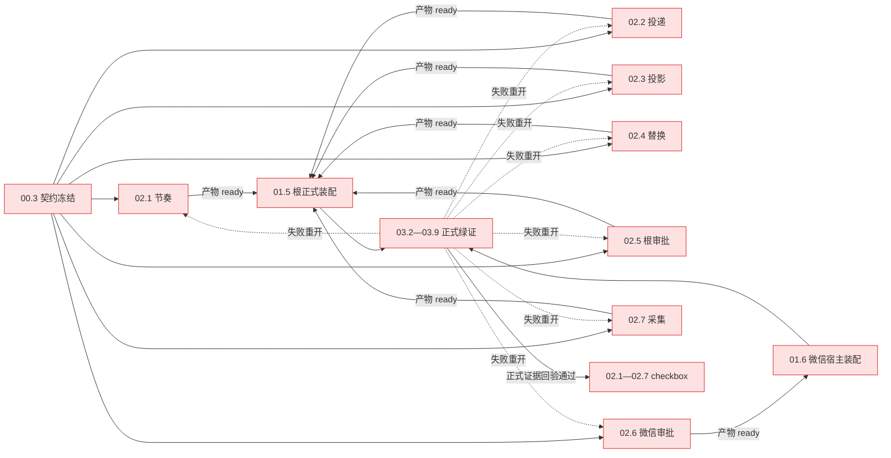

# Design — 02-event-consumers（业务消费者）

## D0 结论

本域的完成标准不是"给八个消费者各加一条规格"，而是：**每个消费者都能在 00.3 冻结的契约下，用一条完整父 selector 复跑出"正式请求里确实消费了、且只消费一次"的正负证据**。七叶均不拥有根接线；每叶先用本域已有正式入口做先验，需要根接线的域产物以 `ready` 交 01.5 集成，微信审批交 01.6 回验。02 的 checkbox **在集成后正式证据回验通过后才勾选**（根接线类经 01.5，微信审批经 01.6）；01.5/01.6 不以 02 全部勾选为输入，因此不成环。任何"组件绿了但正式入口没接上"的结论一律不算完成。

## D1 契约冻结与不可协商条款

1. **五层对账分离**：责任身份、事实引用、运输重试、逻辑消费、外部发送分别对账；多个合法消费者读同一事实不等于业务重复执行（承接 00.3）。
2. **失败不是消费**：反思回合未达 `completed` 终态、审批未批/被拒/过期、模型替换重建或发布失败、采集准入被拒——都 MUST NOT 被记成"已消费/已批准/已生效/已完整"。
3. **身份先于幂等**：没有动作身份就不承诺"重放不多写"。本域不新造身份字段；需要身份而现行接口没有的，登记为 00.3 裁定门（D8-G2/G6），不以内容相似度或时间窗代替。
4. **原文保真**：源消息、角色、`ToolCallID`、`ContentParts` 与身份原样保存；摘要/卡片是有来源的投影视图，不能反推原文，也不以文本相似度去重。
5. **不建第二消费状态仓**：复用现有 mailbox、任务提交与恢复材料；需要新增持久事实时，先由失败窗口和正式恢复消费者证明。
6. **不预选补丁**：不预先指定 `InjectEvent` 或某个事件类型为实现手段；02.x 只冻结"可观测义务"，实现路径由 00.3 分派。
7. **静态线索不是缺陷结论**：本域所有"已有/未见/仅测试调用"均为待证线索，不声称全仓绝对结论；旧符号/旧类型仍在不是恢复指令，发现缺陷须有复现与具名负锚。
8. **勾选不缩水**：不得以 `design-blocked`、部分正负通过、组件测试或测试手工补接线勾整叶；G2/G4/G6 未验时对应叶保持未勾选。

## D2 子域与能力边界

| 叶 | 能力 | 负责的消费完整性 | 不负责 |
|---|---|---|---|
| 02.1 | `meditation-idle-gating` | 反思节奏/水位：新材料按节奏执行、冷启动直通、失败不冒充消化、自身产物不循环、忙时观察不推进水位 | 反思投递（02.2）、任务续转（01.3） |
| 02.2 | `meditation-delivery-tool`（引用 `cross-session-delivery`） | 模型显式调用才回流；目标覆盖与结果对账；错目标/越权不多写；既有四道门逐条保留 | 根/微信/CLI 宿主装配（01.5/01.6/01.7）、跨会话投递条款改写 |
| 02.3 | `event-sourced-projection` | 小窗口折叠与恢复：未消费不丢、原文可达、恢复不重折、折叠产物不自激、实际请求可见 | 压缩预算数值（既有能力）、召回策略 |
| 02.4 | `config-hot-reload` | 模型替换：新请求新版本、在途流稳定、失败/重复替换不重复发布或安装且结果可判定 | 结构热更全量矩阵（既有能力）、org 发布 |
| 02.5 | `approval-channels`（根） | 根审批：批准后执行；未批/拒绝/过期/重复/改参不越权；通道投递失败不阻塞门；正式治理+任务包装（根 `tagent approve` 为既有独立待验项） | 微信审批（02.6）、治理规则内容（既有能力）、审批落盘格式、根审批 CLI 新增 |
| 02.6 | `approval-channels`（微信） | 微信审批：`runApprovalCLI` 解析批准/拒绝、`approvalGateway.Resolve` 落到 `ApprovalManager`；歧义前缀/未知摘要/非审批人被具名拒绝 | 根审批（02.5）、治理规则内容、审批落盘格式 |
| 02.7 | `decision-capture`（引用 `offline-training-export`） | 真实请求/尝试/版本与记录逐项对应；错误可见、不伪造尝试；显式离线导出消费来源关联且关联不自动生成 reward | 真实 tokenizer/训练资格、Boot 自动导出、新增 CLI |

**纯引用登记**：`cross-session-delivery` 与 `offline-training-export` 不写 delta。前者本域只验证既有义务（禁止以改写条款追认现行入口命名），并把该能力的白名单/空表/未知目标/未运行/拒绝账本/不喂肥新鲜度/同批让位逐条映射到 02.2 子测试；后者只验来源关联，真实 tokenizer/训练资格保留为既有独立待验项，MUST NOT 由本域缩水替代。

## D3 依赖与绿证复验（无环）



- 实线 `C → P` 是**任务前置**：七叶只依赖 00.3。
- 实线 `P → W`（02.1—02.5、02.7）与 `P6 → W6`（02.6）是**产物 ready**：实现、端口与域内证据可被 01.5/01.6 消费；**不是 checkbox 完成**。01.5/01.6 不等待 02 全部勾选。
- 实线 `W/W6 → G` 是集成后的正式绿证；`G → K` 是**正式证据回验**，通过后才勾 02 叶。
- 虚线是**复验重开边**：正式证据失败则重开对应叶；它是验证边，不是 `K → W` 的派发前置，因此不构成环。
- 七叶之间无相互前置；02.6 → 01.6 只是 verify_after（01.6 不依赖 02.6），方向单向、不构成环；两处同文件/同编译单元由 D4 的锁与串行约束处理，不写成依赖边。

## D4 写入归属与精确白名单

以下均为**实施期候选白名单**；00.3 按证实路径裁剪到"每单只含本叶所需"。本轮不产生任何产品改动。越出本表的产品 API、持久格式、依赖或文件先报告，不得顺手改。

| 叶 | 生产写集（候选） | 测试文件 | 只读引用（禁改） | 锁 / 等待者 |
|---|---|---|---|---|
| 02.1 | `evolution/meditation/reflection.go`、`evolution/meditation/driver.go`、`evolution/meditation/watermark.go` | `tests/integration/evolution/event_integrity_test.go`（拟新增） | `tagent.Boot` 装配、`meditation.NewDriver`/`NewReflection`、`Driver.ObserveCommit`、`Run.ReflectionInput` | `meditation-core`；等待者 02.2 |
| 02.2 | `evolution/meditation/deliver.go` | `tests/integration/host/event_integrity_test.go`（与 00.2/01.3/01.4/01.5/02.4 **同文件单写**） | `hostDocument.toolsFor`、`meditation.NewDeliverSummaryTool`、`hostMeditationPort.CommitToSession`、`Run.CommitToSession` | `meditation-core`（与 02.1 串行）；`host-event-integrity-test`（同文件单写）；等待者 01.5 |
| 02.3 | `age_fold.go`、`memory/replay/age_segments.go`、`memory/replay/replay_budget.go`、`memory/replay/fold.go`、`memory/replay/projection.go`、`memory/replay/replay_settle.go` | `tests/integration/history/event_integrity_test.go`（拟新增，与 01.2、03.9 **同文件单写**） | `Run.AttachReplay`、`AgeFoldPlugin.ObserveCommit`、`ReplayProjection.FoldByAge`、`RebuildProjectionFromWAL`、`request.projectedSegment` | `history-event-integrity-test`（同文件单写）；等待者 01.2、03.9 |
| 02.4 | `host_reload.go`、`host_model.go`、`rl/replacement.go`、`rl/lease_model.go`、`rl/lease_observer.go` | `tests/integration/host/event_integrity_test.go`（与 00.2/01.3/01.4/01.5/02.2 **同文件单写**） | `Host.Reload`、`POST /reload`、`Run.NoteModelChange`、`rl.NewLeaseModel`、`ModelLease.Replace`、`Run.LeasePublications` | `root-package-tagent`（与 01 根热点同编译单元，串行或隔离工作树）；`host-event-integrity-test`；等待者 01.5 |
| 02.5 | `evolution/governance/policy.go`、`runtime/task/approval/approval.go`、`runtime/task/approval/approval_store.go` | `tests/integration/capabilities/event_integrity_test.go`（拟新增） | `runtime/task/wrapper.go`（P1，禁改）、`ApprovalManager` | `approval-surface`；等待者 03.4/01.5 |
| 02.6 | `examples/wechat-bot/wechat_approval.go` | `examples/wechat-bot/wechat_test.go`（扩展既有，**不新增 `wechat_approval_test.go`**） | `runApprovalCLI`、`approvalGateway.Resolve`、`ApprovalManager` | `approval-surface`；`wechat-smoke`（与 01.6 串行）；等待者 01.6 |
| 02.7 | `host_capture.go`、`rl/capture_wiring.go`、`rl/sink.go`、`rl/produce.go`、`rl/export_chain.go`、`tool/subagent/capture.go`、`tool/subagent/builder.go` | `tests/integration/learning/event_integrity_test.go`（拟新增） | `openHostCapture`/`hostRunCapture.Record`、`Run.SessionFacts`、`rl.NewChainExporter`/`ChainExporter.Export`、`rl.ReadCaptureSeal`、`Builder.Capture` | `root-package-tagent`（与 02.4 串行）；等待者 01.5 |

**落位约束**：

- `tests/integration/` 是 `scripts/codetools/package_layout.go` 声明的 test-mirror 豁免树，新测试文件名可自由。
- `examples/wechat-bot/` **不在**豁免树；微信审批测试**扩展现有 `wechat_test.go`**，不新增 `wechat_approval_test.go`，不得为放新测试扩大 `mirrorExemptFiles`。微信宿主装配测试（01.6）只写 `smoke_harness_test.go`，与 02.6 不同文件。
- `host_reload.go`、`host_capture.go` 属 `package tagent`，与 01 的根热点共享编译单元；并发编辑会以构建闭包互相污染，必须串行或使用独立受控工作树（R21）。
- `tests/integration/host/event_integrity_test.go` 由 00.2 创建、01.3/01.4/01.5/02.2/02.4 扩展，属**同文件单写**：同刻仅一个写者，后写者先读回；不得为 02.2/02.4 另建 `event_integrity_meditation_delivery_test.go` 或 `event_integrity_model_replacement_test.go`。

## D5 三级验收与三锚

每叶勾选以三级证据齐全为准（缺一不得勾选）：

| 级别 | 判据 |
|---|---|
| 孙任务 | 完整父 selector 下全部具名子场景通过，原始退出码 0；`-count=1 -race`；每轮父测试与全部子测试由既有 checker 扩展核验 `run`/`pass` |
| 子域 | 该叶对应的 delta 场景逐条被至少一个具名子测试覆盖（正锚/负锚分列）；纯引用能力按其既有场景逐条映射，不丢验收面 |
| 变更级 | 01.5 集成后由 03.x 复跑正式入口绿证；**正式证据回验通过后才勾 02 叶**；04.5 的叶—scenario—selector—消费者映射门通过 |

**三锚定义**：

- **正锚**：点名测试 + 可复跑命令，测试名与 `-run` 正则逐字符一致；完整名为 `TestParent/subtest`。
- **负锚**：具名负向子测试，证明"错误路径走不通"；完整名为 `TestParent/subtest`，每叶至少一条，且不得与正锚共用同一断言分支。
- **消费者锚**：正式入口/真实路径的调用证据。组件测试绿、测试里手工补接线、`tagent.Assemble` 旁的手工工具注入均不算生产消费者；必须以 `tagent.Boot`、`POST /reload`、`runApprovalCLI` 或公开离线 `Export` 等正式入口为准。

**勾选纪律**：

- 不得"正负部分通过就勾整叶"；任一条具名负锚缺失、被 `skip`、零匹配或非业务断言失败，整叶不勾。
- 不得以 `design-blocked` 作为勾选路径；G2 replay 身份、G4 生产恢复、G6 导出关联未验时，对应叶保持未勾选并上报。
- 允许合并：一个实际场景可以同时证明正常行为与正式消费者（例如 02.2 的"显式调用→目标请求可见"），无需为凑三锚复制同构子测试；但负锚必须独立具名。

## D6 发送与导出边界

- **发送未知不自动重发**：发送结果不确定时保留动作身份、未确认状态与错误，不自动重发、不伪报成功；显式重试经既有正式入口或人工处置，并保留与原动作的关联。未取得渠道幂等证据前，不承诺渠道端"恰好一次"。
- **成功已确认不重放**：成功确认的动作不因恢复再次执行；合法显式 send、最终答复、文件与分片各有自己的动作身份（00.3 冻结）。
- **导出是显式离线消费**：`rl.NewChainExporter` 是公开的显式离线 API；调用它读取授权的 `ExportOptions.SessionIDs` 就是真实消费者，**不要求 CLI，也不要求 Boot 自动导出**。02.7 的消费者锚为：`tagent.Boot` 产生实际 capture（`trajectories/attempts.jsonl` + `rl.ReadCaptureSeal` manifest）→ 公开 `ChainExporter.Export` 读取有权限的会话 → manifest/attempt 记录与导出样本按 session/episode/turn 逐项关联。当前静态检索未见生产调用点只是**待证线索**，不是新增 CLI 的理由；关联未验则 02.7 不勾选。
- **不冒充资格**：不宣称真实 tokenizer/chat template/collator、不宣称训练收益；`offline-training-export` 的"真实本地消费验收"保持独立待验。

## D7 证据协议

1. **十轮独立执行**：每叶跑 10 次独立进程，每次 `-count=1 -race -json` 单独落盘；**不是**单轮 `-count=10`，也不把同一份日志重复计入。
2. **原始退出码**：每轮直接 `go test ... > run-i.json 2>&1`，随后 `rc=$?`，把 `rc` 写入 `exits.txt`；**禁止**用 `echo`/`tee` 包裹 `go test` 后取管道退出码，禁止 `&&` 串联吞掉中间失败。任一轮非 0 立即保留原始日志并以该退出码失败。
3. **日志位置**：仓库外 `/tmp/event-consumption-integrity/<叶>/run-<i>.json`，避免 R26 的 index 污染与仓库卫生门。
4. **逐份校验**：扩展既有 `scripts/check_runtime_evidence.py` 的 test-log 状态机，逐轮核验父测试与其全部具名子测试各恰有一次 `run` 与终局 `pass`；拒绝 `skip`、`fail`、零匹配、截断、错误模块、重复 run-id 与包级失败；`exits.txt` 10 行逐行与 `run-i.json` 对应。**不使用 `grep -c` 统计通过数**。
5. **数字可溯源**：报告中的通过数/场景数必须给出对应命令与日志目录；不引用"上次跑过"。

十轮命令模板（以 02.1 为例，其余叶替换包路径与父 selector；不得加 `tee`/`echo` 包裹）：

```sh
EVID=/tmp/event-consumption-integrity/02.1
mkdir -p "$EVID"
for i in $(seq 1 10); do
  go test ./tests/integration/evolution \
    -run '^TestEventIntegrityMeditationSchedule$' \
    -count=1 -race -json > "$EVID/run-$i.json" 2>&1
  rc=$?
  printf 'run-%d exit=%d\n' "$i" "$rc" >> "$EVID/exits.txt"
  if [ "$rc" -ne 0 ]; then exit "$rc"; fi
done
```

**检查器扩展契约**：输入证据目录、父测试名与该叶全部具名子测试名；逐轮检查生命周期嵌套（子测试在父测试窗口内、父测试终局无未终结子测试）、每子测试唯一 `run` 与唯一终局 `pass`、原始退出码逐行对应；输出缺失/非 pass 子测试与首个失败原文。具体 CLI 形式在实施期落地，但不得退化为 `grep -c`。

## D8 静态线索与未决门

以下均为**只读取证/待证线索**，不构成缺陷结论，也不声称"全仓无生产路径"的绝对结论；每条都给出消费方与待验证断言。未裁决项阻塞对应叶。

| 编号 | 静态线索（待证；符号级） | 消费方 | 待验证断言 | 处置 |
|---|---|---|---|---|
| G1 | `Driver.ObserveCommit` 在 `firing` 时提前返回（待证：是否丢弃观察） | 冥想驱动 | 该观察的材料是否仍在下一次可执行 tick 的扫描窗口内；水位是否被越过 | 02.1 负锚取证；不据此断言"漏处理" |
| G2 | 主规格声明参数 `{target, content}`；`DeliverSummaryTool.Declaration`/`Call` 当前只接受 `content`，目标由 `deliver_to` 装配期固定（待证） | 反思投递工具 | 规格滞后还是实现漂移；"重放不多写"的动作身份从何而来 | **00.3 裁定**；未裁定前 02.2 的 `replay_identity` 不得以内容摘要/时间窗代替身份；未验则叶不勾选 |
| G3 | 主规格以 `InjectMessageWithSource("meditation", …)` 命名入口；现行实现经 `Run.CommitToSession` 落目标链后 `pipeline.After`（待证） | 跨会话投递 | 既有白名单/空表/未知目标/未运行/拒绝账本/不喂肥新鲜度/同批让位在现行入口是否仍成立 | **00.3 裁定**；02.2 按既有场景逐条取证，不改写条款；G3 不阻塞其余子场景 |
| G4 | `memory/replay/fold.go` 在内存构造 `CompactionFact`；当前静态检索未见 `context_compress_summary` 写入点（待证，不排除动态装配/测试外路径） | 投影重建 | 主规格"折叠向事实链追加 compaction 事件"是否真有生产写路径；冷启动是否只能走 fallback | 02.3 以"重建后逐字节/尾部"取证；缺失则交 00.3 分派（可能需 01.5 接线）；未验则叶不勾选 |
| G5 | `rl.ErrLeaseVersionHeld` 已存在；`Host.Reload` 失败逐条汇总（待证：重复替换是否零重建/零安装） | 模型替换 | 重复替换是否真的不重复发布/安装、结果可判定；在途流是否真持旧版本 | 02.4 正负锚取证；delta 固化"不重复发布/安装、结果可判定"，**不从 `ErrLeaseVersionHeld` 反推公共 `Reload` 必须报错** |
| G6 | 当前静态检索未见 `rl.NewChainExporter` 的生产调用点（待证）；显式离线 API 本身是合法消费者 | 离线导出 | Boot 实际 capture 与公开 export API 的样本能否按 manifest/attempt/session/episode/turn 逐项关联 | **不新增 CLI、不自动接 Boot 导出**；02.7 以显式 API 为消费者锚；未验则叶不勾选，不以 `design-blocked` 代替 |
| G7 | `runtime/task/approval/approval_store.go` 含过期拒绝与清理（待证）；主规格 `approval-channels` 未提过期 | 审批 | 过期请求是否可能被恢复为待执行义务；改参执行是否可能沿用旧批准 | 02.5 正负锚取证；delta 固化 |
| G8 | `facts.go` 有 `RecordingLosses` 显式损失账目（待证）；主规格 `decision-capture` 未要求"尝试与记录逐项对应" | 决策采集 | 失败尝试是否可能被记为成功；被拒记录是否可能无账目缺失 | 02.7 正负锚取证；delta 固化 |
| G9 | 主规格用 `[delivery_denied]`；`deliver.go` 用 `[deliver_summary_denied]`（待证） | 反思投递工具 | 拒绝前缀以哪个为准 | **00.3 裁定**；delta 只写"既有具名拒绝文本"，不写死前缀 |

**门与叶的绑定**：G2 未验 → 02.2 整叶不勾选；G4 未验 → 02.3 整叶不勾选；G6 未验 → 02.7 整叶不勾选。G3 只影响 02.2 的四道门结论口径，不阻塞其余子场景；G7 只影响 02.5/02.6 的取证结论，G8 只影响 02.7，均不构成跳过负锚的理由。所有门均不以 `design-blocked` 作为勾选替代。

## D9 风险与回退

| 风险 | 影响 | 缓解 / 回退 |
|---|---|---|
| 把静态线索当缺陷，改了正确机制 | 引入真实重复/漏处理 | 先取证后修复；无复现则只补回归；修复必须带具名负锚；静态线索一律标待证 |
| 02.2/02.7 的身份与消费者未验 | 叶被错误勾选 | G2/G6 未验即保持未勾选并上报；不以内容去重、测试接缝、Boot 自动导出或新增 CLI 绕过 |
| 用 `design-blocked` 或部分通过勾整叶 | 谎报完成 | D1 第 8 条硬门；G2/G4/G6 未验不勾；任一负锚缺失不勾 |
| 从 `ErrLeaseVersionHeld` 反推公共 `Reload` 必报错 | 测试绑定实现细节、误判 | 02.4 只验"不重复发布/安装、结果可判定"；no-op 与具名拒绝均可 |
| 为 G6 凑消费者新增 CLI/自动导出 | 越权扩面、假消费者 | 显式离线 API 即真实消费者；Boot capture → 公开 Export → manifest 关联即可 |
| 根包两叶（02.4/02.7）与 01 并发 | 编译闭包互踩、红绿不可归因 | D4 锁串行或独立工作树；每单完成即 `go build ./...` 自检 |
| `history/event_integrity_test.go` 三域共写、host 文件六域共写 | 文件冲突、证据串味 | 单点归属 + 等待者登记；同刻只允许一个写者，后写者先读回 |
| 十轮证据被压成一轮或被 `tee`/`grep -c` 假绿 | 稳定性不可判 | D7 强制十份独立日志、原始退出码单列；既有 checker 扩展逐子测试核验 |
| 正式消费者绿证被组件测试冒充 | 谎报完成 | 三锚硬门；01.5/01.6 后正式证据回验；失败重开原叶 |
| 行号漂移导致引用失真 | 文档与代码错位 | 一律引用符号入口，不写行号；实施时以符号定位 |
| 导出被误当训练资格 | 对外承诺越界 | D6 边界；`offline-training-export` 真实消费验收保持独立待验 |
