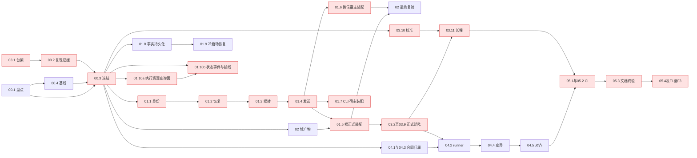

# 全事件消费完整性：一级编排账目

本级只编排六域和收尾，不展开产品实现。
启动门：计划回写已获授权并完成；业务实施按叶授权，真实服务、提交/推送与归档分别待授权。
波次仅作汇报分组，解锁依据为前置产物进入受控集成树并通过核验，不等待整域。

派发以 [ORCHESTRATION.md](ORCHESTRATION.md) 为准；42 叶的依赖、精确写集和验收锚在 [task-graph.json](task-graph.json) 及二级 tasks 中逐项登记。`depends_on` 表示域产物就绪，`verify_after` 表示最终正式验收前置；两阶段展平后检验无环，不把“交产物”写成“已完成”。

## 1. 六域编排

- [x] 1.1 核验 [00-contract-evidence](changes/00-contract-evidence/tasks.md) 的 00.1—00.4；00.2 依赖 03.1，00.4 依赖 00.1，00.3 消费两类证据。未复现原案例与独立静态风险红证分栏，不伪造根因。
- [x] 1.2 核验 [01-runtime-consumption](changes/01-runtime-consumption/tasks.md) 的 01.1—01.10b；00.3 后热点链串行，01.5 汇入 02 域根接线（微信装配归 01.6、CLI 装配归 01.7），三者各单写各自测试文件，不等待 02 的最终 checkbox。01.2/01.3 为补差重开（勾选已回退），01.8/01.9 与 01.10（后拆为 01.10a/01.10b）为计划回写③新增（会话事实持久化/冷启动恢复/外部执行生命周期）；01.10 于计划回写④拆为 01.10a（执行资源查询面）/01.10b（状态事件与通知接线）。
- [x] 1.3 核验 [02-event-consumers](changes/02-event-consumers/tasks.md) 的 02.1—02.7；前置 00.3，根接线交 01.5、微信审批交 01.6；正式消费者复验前保持未完成。
- [x] 1.4 核验 [03-formal-simulation](changes/03-formal-simulation/tasks.md) 的 03.1—03.11；台架先行（03.1 已勾选），03.2—03.8 等 00.3、03.9 等 01.2，正式绿证等 01.5/01.6 宿主装配；03.10 只读校准后跑 03.11 长程，05.1 核账。
- [x] 1.5 核验 [04-regression-gates](changes/04-regression-gates/tasks.md) 的 04.1—04.5；契约先冻结，runner 在 01.5/01.6/01.7 与 03 正式测试就绪后真实运行，变异与映射均不可由合成 fixture 冒充。
- [x] 1.6 核验 [05-mr-integration](changes/05-mr-integration/tasks.md) 的 05.1—05.4；03.11 与 04.5 后接 CI（预算用 03.10 校准值），05.3 最终验收等 05.2；本地与远端结果分层。

## 2. 一级收尾

- [x] F1 核对完整差异与授权：基线 `6cc441436c2aab15edcee34cf2561086232c8311`；原批准计划、用户配置/数据、子模块及未授权依赖零改动，全部允许差异能关联叶和证据。验证：`git diff 6cc441436c2aab15edcee34cf2561086232c8311 --stat`、`git status --short` 并逐文件核对，未跟踪必要文件另列，不以 diff 空冒充无改动。
- [x] F2 在最终集成树运行旧 lint/Golden、根与微信/CLI 三模块测试及新增 short/long/mutations/race；逐命令原始退出码与必跑子场景完整。验证：05.4 命令清单及 bundle 对账；任一非零、skip 或缺件均不通过。
- [x] F3 独立验收产物、正式消费者、负锚、勾选真实性及目标覆盖；旧红证、新绿证、变异拒绝证据和源树摘要齐全。验证：独立偏差报告与原任务行逐项一致；未授权真实服务/长期发布证据保持待验，不宣称全发布门完成。
- [x] F4 另获授权后才执行提交/推送、远端 MR 与合并保护核验；取得归档授权后合并二级 delta、标准 archive 并复验主规格。验证：远端实际 job/required 结果、归档前后 OpenSpec strict 输出及主规格差异。未授权保持未勾选。

## 3. 当前状态

本轮完成计划回写（03 域细化为 11 叶）、计划回写②（01.5 拆 01.5/01.6/01.7、02.5 拆 02.5/02.6、采集顺移 02.7，共 38 叶）、计划回写③（01 域 7→10 叶：新增 01.8 会话事实持久化、01.9 冷启动恢复、01.10 外部执行生命周期；01.2/01.3 补差重开，勾选回退）与计划回写④（用户裁定 C：01.10 拆为 01.10a 执行资源查询面 / 01.10b 状态事件与通知接线，共 42 叶）；既有实施勾选 32 叶保留、其余 10 叶未勾选（01.9、01.10a、01.10b、02.3、03.11、04.2、05.1—05.4）。回写未改产品/测试代码（04.1 合同、checker/自测计数与 04.4 变异锚点同步除外）。规划自审、合同检查与 CLI 结构验证记录在 ORCHESTRATION 台账，不占用实施 checkbox。

终收口（单 AK，2026-10-25）：42/42 叶与 1.1—1.6、F1—F3 全部勾选；唯一未勾为 F4（提交/推送、远端 MR、required 与归档均待授权）。05.4 按任务行字面全量重跑（24 条命令全 exit 0、bundle 17 份证据 ok=true、三负锚演练全红）；race 门按编排者裁定选项 A 登记上游双签名豁免（`scripts/race_check.sh` + `LEDGER.md` U5，移除条件=升级到含上游修复版本），分类器自测 15 例全 PASS。preflight 唯一红片（seed=42/window=32768 输入身份对账）定性为重启代对账 flake：非重复投递、无重复答复，红证保留、受控重跑 match。证据见 [05.4-summary.json](evidence/05.4-summary.json) 与 [F3-acceptance.json](evidence/F3-acceptance.json)。
