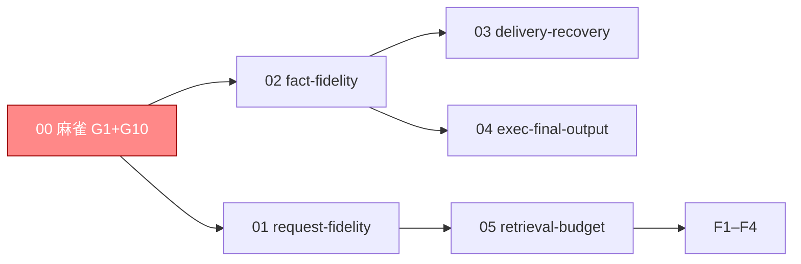

# 编排账目（只编排）

> **只编排**：验收条款在域 specs。**启动门**：麻雀（G1 协议保真）先红转绿。
> **波次语义**：分组汇报；解锁=依赖入 main。

## 跟踪图

## W0（麻雀）

- [x] 1.0 G1 协议保真红转绿：投影恢复完整调用-结果配对（tool_call_id/ToolCalls/工具名），工具调用后下一轮/压缩后/冷启动后三场景过协议校验 —— 验证：`go test ./tests/integration/host -run 'RequestFidelity' -count=1`（红证先行）；正锚三场景配对校验；负锚（拆掉 ToolCallID→400）；消费者锚=Boot→Invoke 真实请求 —— 补勾（2026-10-27 收尾）：①② W0 红转绿、③ 由 1.2 兑现（request_after_cold_boot PASS、Skip 解除）；三场景+ProtocolGate 负锚复跑 3×绿
- [x] 1.1 G10 测试去假设：NoSendTool 按模型身份+标记定位请求，单跑 10 次全绿 —— 验证：`go -C examples/wechat-bot test . -run '^TestLocalSmokeSymptomNoSendTool$' -count=10 -tags smoke`；负锚（注入乱序请求→仍定位正确）
- [x] 1.2 调用事实入链（Q5 裁定：1.0 ③ 冷启动协议合法的前置）：assistant 工具调用消息（ToolCalls/ToolCallID/逐字参数）由 commitCalls 提交为调用事实、先于 result 入链；seedReplay 将存储事实回填活账本（seedFact），恢复即重配对 —— 验证：`TAGENT_FIDELITY_COLD_BOOT=1 go test ./tests/integration/host -run 'RequestFidelity' -count=1`（红证先行→修后解除 Skip 转绿）；正锚 request_after_cold_boot 冷启动后完整配对（含逐字参数）；负锚拆 ToolCallID→400（既有协议门）；消费者锚=Boot→Invoke 真实请求

## W1

- [x] 2.1 G4 作用域：replays 索引改 AgentID+SessionID 完整地址 + 跨 Agent 同名会话隔离测试 —— 前置：无（与 1.0 同文件 request.go→串行）；正锚隔离测试；负锚（还原 SessionID 单键→串历史）
- [x] 2.2 G2+G3 事实保真合单：EventBody 全字段；同键幂等/冲突；commit 失败→Invoke error —— 前置：无；正锚重装配全字段；负锚（同键异内容→冲突不双成功；断屏障→error 非 completed）；消费者锚=Host.Invoke 返回值
- [x] 2.3 戳记边界（Q17 裁定：戳记 vs 事实机制化）：提交协议零值回填（InjectEvent/CommitToSession 非零不覆写 Source/Target/Owner/InvocationID，InstanceID 保持协议盖戳）；SameFact 排除面改为协议生成戳记（Timestamp/InvocationID/InstanceID/Format/Retention 出比较面），Source/Target/TaskID 调用方提供即入（absent-wildcard）—— 验证：`go test ./tests/integration/host -run 'TestFactFidelity' -count=1`；正锚（同事实一次带 Source 一次不带=幂等、声明戳记存活入事实）；负锚（覆写非零戳记→ErrFactKeyConflict 具名冲突、存储不动）

## W2

- [x] 3.1 G5 交付恢复：pendingDeliveries 持久化（跨重启可批准/拒绝）+ 发送失败持久重试义务 —— 前置：2.2（同 host.go 簇）
- [x] 3.2 G6b 唤醒统一（Q6/Q8 裁定改写）：SettleDriver retained 降解为 mailbox 未消费通知（Claim→drive→Consume 同账；通知本体持久化+durable 消费回执+回调重试；未消费通知跨 Stop 保留）—— 前置：2.2；验收：重复 fire 不双回合、跨重启可恢复、Stop 保留
- [x] 3.3 G6 执行最终输出：退出释放前保存最终输出（可读）+ 接管测试升级（unknown→查询→接管或具名报告） —— 前置：无

## W3

- [x] 4.1 G7 历史恢复与预算解耦（max_tokens=0 仍恢复旧历史）—— 裁定 (a) 落地（R23 骨架断言错位）：`TestReceiptAndBackgroundStaySeparate` requests[2] 断言随 RoleOf 契约迁移（settled body 以 tool 角色呈现；receipt 是 in-flight 面产物、投影面不恢复=合法），receipt/背景分离意图保留于 requests[1]；`go test ./tests/integration/execution -run 'ReceiptAndBackground' -count=3` 3×绿
- [x] 4.2 G8 向量候选完整检索（不按 recent 预截断）
- [x] 4.3 G9 完整请求预算（呈现决定条件重用+硬约束）

## F

- [x] F1 契约面断言（口径按清障裁定①：golden 修订仅限本变更声明的语义变更，逐行登记）—— golden/runtime/event_integrity_scenarios.json 零改动（场景清单不删不改）；三合同锚断言随 G6b/G7 语义演进等价迁移、逐行登记 evidence/golden-migration.txt（R1 NoticeIdentity / R2 CLIAdapter / R3 Restart，旧行为→新行为→裁定依据=architectural-subtraction D3/Q16 批准，0 行无法等价迁移）；主规格 delta 核对 + `openspec validate fidelity-and-recovery --strict` 全过；凭据 evidence/F1-contract.txt + evidence/golden-migration.txt
- [x] F2 全量门禁（lint/三模块/short 十轮/long 六片/mutations/症状 job）—— 清障单重跑口径（逐条原始退出码 evidence/F2-gates.txt 清障段）：short 十轮 10/10 全 verdict=match（裁定①后，F2 期 0/10→全绿）、mutations --all 11/11 killed（裁定③ M1-M4 迁移/补全后）、三模块 build/vet/test -short 全绿、lint/selftests/check-openspec/症状 job 全绿；唯二红门：long 六片 6/6 verdict=fail（裁定②干净树重采仍红：settle notifications 49-51/47 want 47，受控重跑仍红 7/7 非 flake）+ bundle 总门透传红（红源=long 03.11）——「全绿口径」未能如实达成，long/bundle 红待编排者裁
- [x] F3 DoD + G1–G10 回滚即红双证据（定点破坏各修复点）—— G1–G10 全 PASS（红→还原三重→绿闭环；G7/G10 第一版破坏未咬合、改点后咬合，如实留痕）；凭据 evidence/F3-redgreen.txt
- [x] F3b 双驱动真缺陷修复（c2→c1+e，按 evidence/dual-drive-attribution.txt 4.6 推荐与 S1–S3 裁定）—— c2 回执与交付同屏障（host.driveLocked 在 run.Invoke 返回后即 settleTerminal，先于 deliverFresh；settle_turn.go driveSeat 把 settleBarrier 盖到 fire 的 ctx）；c1 fire 前落 durable attempt（RecordAttempt 先于驱动；门 `held && Terminal==completed` → 只 Consume 不重驱）；e 通知身份去 invocation 分域（noticeInvocation = "notice:"+FactKey，键形状不变）；验收三锚：新增 TestSettleWakeSingleDrive 三子测（真子进程 SIGKILL+重启恰一驱动 / landed attempt 只补回执 / 同进程重放 entryCalls≥3 单指令）7 子测 PASS、回滚即红三点逐点实测（①②③ 各自原文）、03.11 长程六片 6/6 verdict=match（逐片 notif=47、dup=0、action 1728/1728；1 片受控重跑并归因既有委派 admission 冲突）——F2 遗留的 long 03.11 超发（settle notifications 49–51/47）与归因 E1–E3 的重复驱动同源，本单六片回到 47/47；门禁 build/vet/short 38 包/四包 race/三模块/lint/症状全家全 RC=0；凭据 evidence/F3b-dual-drive-fix.txt
- [x] F4 归档 + 导览（域→证据，提交号逐字符可验：W0 麻雀 G1=38cd808·G10=ac0b80b·红绿双证 evidence/F3-redgreen.txt；01 调用事实入链 1.2+2.3=6e0500b；02 事实保真 G2+G3=817ab97·G4=e46708d·正锚 tests/integration/host/fact_fidelity_test.go TestFactFidelity；03 交付与唤醒 G5=adf4611·G6=28ebac2·G6b=a3e7441·双驱动修复=0365931·归因 evidence/dual-drive-attribution.txt+F3b-dual-drive-fix.txt·红证 3-1/3-2/3-3-*.txt；05 检索预算 G7=0f96892·G8+G9=a68bef6；F1 契约面 evidence/F1-contract.txt+golden-migration.txt；F2 门禁 evidence/F2-gates.txt——唯二红门（long 03.11 超发）已由 F3b 同源闭环至 6/6 verdict=match；归档时 orchestration delta 三处 Requirement 因主规格同名改名：麻雀先行→协议保真麻雀先行、症状回滚即红→十锚回滚即红、热点串行→协议保真热点串行，正文零改动）

## 粒度统计

5 域 11 叶（00:2 / 01:1 / 02:1 / 03:3 / 05:3 + F4）；麻雀单 2；W1 合单 1（G2+G3）+ 串行叶 1；W2 三单；W3 三单。
