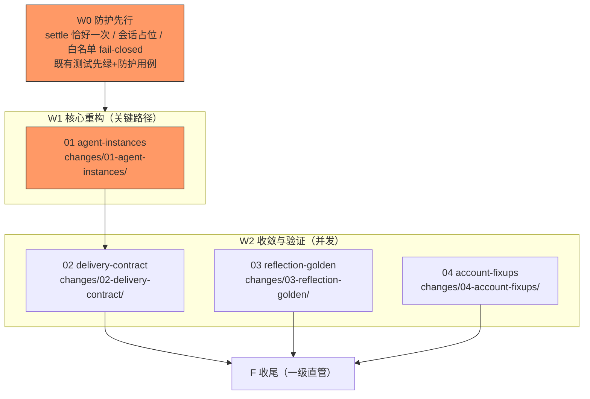

# 任务：agent 常驻实例与投递契约收敛（编排账目）

**只编排**：实现任务在 `changes/<NN-domain>/tasks.md`；每子变更项附路径。
**启动门**：W0 防护面（三条红线测试先绿）未立，01 域实现单不得派发（Q9=a 用例防护先行）。
**波次语义**：波次仅为汇报分组，解锁以依赖入 main 为准；连续推进至法定停点（R31）。

关键路径（红标）：W0 → 01（驱动层重构=最大风险）→ 02 → F。

## 子变更清单（一级 checkbox 跟踪，勾选附凭据摘要）

- [x] W0 防护先行：三条红线（settle 恰好一次/会话占位/白名单 fail-closed）既有测试复跑绿 + 防护用例立起 —— changes/01-agent-instances/tasks.md 0.x
- [x] 01 agent-instances（G1：每 agent 常驻实例、直驱退役、委派管线化） —— changes/01-agent-instances/
- [x] 02 delivery-contract（G2+G3：元数据同构、插件路径范围门、删 NewSendFace、投递账目） —— changes/02-delivery-contract/
- [x] 03 reflection-golden（G4：长时反思 golden 入 CI 常规门） —— changes/03-reflection-golden/
- [x] 04 account-fixups（G5 账目瑕疵 + route 端口注记预留） —— changes/04-account-fixups/

## 收尾 F 任务（一级直管）

- [x] F1 契约零改动断言：`git diff <基线>..HEAD -- openspec/specs api` 除 design D2 表声明的 MODIFIED/ADDED delta 外为空
- [x] F2 全量门禁：`go build ./...`；`go test ./...`；smoke 症状组；golden 门（03 域产物）exit 0
- [x] F3 DoD 逐项核验入 run notes，含**症状锚 I1–I4 红转绿双证据**（完整回滚必红、修复后必绿）与三条红线测试零回退证明
- [ ] F4 `openspec validate agent-instances-and-delivery --strict` → `openspec archive` + 导览文档
