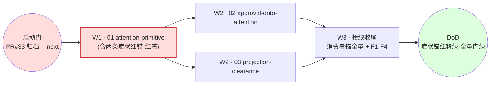

# Tasks: attention-lifecycle（一级只编排）

> 本文件只编排：进度账目 + 波次 + 收尾 F 任务。孙任务与验收命令在二级域的
> tasks.md；派发唯一依据是 ORCHESTRATION.md。

> 启动门（2026-11-01 用户改判）：并行推进、完成后一并合并——attention 的实施基线 = 含 PR #33 内容的合并线（oom-storm-fuse-and-consumer-loops + 本计划），两条线在同一分支汇合后一次推送、一次 CI；不再等待 PR #33 的 CI 先行变绿。

> 波次语义：波次仅是汇报分组，不是栅栏；解锁 = 前置域入 next。

红线节点 = 关键路径（01 未入 next 则 W2 双域全阻塞）。

## W1

- [x] 01 域四件套评审通过（编排者，阶段 5 自审即评审）—— 验证：本 tasks.md 勾选 + 01/specs strict 校验通过
- [x] 01 域实施完成并入合并线（门改判后 next=本分支）—— 验证：`go test ./api/event/... ./runtime/task -count=1` exit 0（ok ×2）
- [x] 两条症状锚已落仓库且红着（立案当日凭据入台账） —— 验证：`go test ./tests/integration/host -run '^TestAttentionClears' -count=1` 失败（红锚凭据已入 ORCHESTRATION 台账）

## W2（并发，触碰集见 design D6）

- [x] 02 域四件套评审通过（编排者）—— 验证：勾选 + 02/specs strict 校验通过
- [x] 02 域实施完成并入合并线 —— 验证：02 tasks.md T1–T6 全勾；四路锚命令复验 exit 0（台账 W2-22 行）
- [x] 03 域四件套评审通过（编排者）—— 验证：勾选 + 03/specs strict 校验通过
- [x] 03 域实施完成并入合并线 —— 验证：03 tasks.md T1–T6 全勾；六锚命令复验 exit 0 + 干净 worktree 自洽（台账 W2-03' 行）
- [x] W2 波后偏差评估 —— 验证：编排者逐单五查+对照原任务行（三处偏差均为编排者裁定后落：Lookup 裁决读面/文件通道记录/读时推导在场，spec 同步修准，台账逐条在案；缩水=0：全部验收命令原样复跑 exit 0）

## W4（静止收束·04 域，与 F3.5 修复批并行）

- [x] 04 域四件套评审通过（proposal/design/tasks/specs ×2）—— 验证：勾选 + `openspec validate attention-lifecycle --strict` 过（2026-11-02 复跑：`Change 'attention-lifecycle' is valid`）
- [x] 04.1 同源函数 `Unsettled()`（工作∪未消费通知，关闭/重启/报告同源）—— changes/04-quiescent-close/tasks.md 4.1
- [x] 04.2 关闸分档+静止相位（intake 关/derived 开；编排顺序修正）—— changes/04-quiescent-close/tasks.md 4.2
- [x] 04.3 三态出口与报告（Quiesced/Cut/Broken，禁零 deadline）—— changes/04-quiescent-close/tasks.md 4.3
- [x] 04.4 拒收落 feedback 事实族（跨重启可见）—— changes/04-quiescent-close/tasks.md 4.4
- [x] 04.5 概念拆除（D8 清单零残留）—— changes/04-quiescent-close/tasks.md 4.5
- [x] 04.6 契约与文档同步（spec/wiki/state-inventory/polls 断言）—— changes/04-quiescent-close/tasks.md 4.6
- [x] 04.7 症状锚 Q-A–Q-D 红转绿双证据 —— changes/04-quiescent-close/tasks.md 4.7

## W3（编排者单做）

- [x] 消费者锚全量核验：governance 门、fuse seam、wechat 人侧、notice 清除、summary 投影各有一名实消费者 —— 验证：逐消费者命令凭据入台账
- [x] F1 契约登记与冻结面零改动断言：新增事件类型与 meta 键全部进
      `api/event/skeleton_assert.go` 与 `docs/FACT-VOCABULARY.md`，且
      `git diff <01入next点>..HEAD -- api/event` 为空（冻结面零改动）
      —— 验证：`bash scripts/lint.sh` exit 0；diff 为空凭据入台账
- [ ] F2 全量门禁·本地四门（分项勾选；CI 面单列为 F2.e）
      —— 验证：四项逐条复跑，**2 绿 2 红**；两条红因均落在 04 域落料
      （`ErrCloseTimeoutMissing` 契约 + 拒收即消费 + `assembly/host.go` 重排），
      详见台账 F3.5 清偿·T7 行
  - [x] F2.a `bash scripts/lint.sh` exit 0（须在真 .git 目录内跑）
        —— 证据：`lint: ok` / `EXIT=0`；`gen_godoc: docs/api matches the source (68 packages)`；
        `comment_policy: 0 finding(s)`
  - [x] F2.b `go test ./... -short -count=1` —— 证据：39 包 `ok`；04 域四条落料红已清偿——
        capabilities `TestRecallEvaluation` PASS 0.24s、config `TestPresetToolsAssemble` PASS 0.11s
        （`CloseRequest` 补显式 200ms 超时）、history `TestEventIntegrityRestart` PASS 8.41s
        （断言改读 D8 退役义务词汇后的状态词，强度只增不减）、inspection `TestRuntimeInventory`
        S1–S7 全 PASS（适配「拒收即消费」：拒收通知不占 pending 槽，改以 owner 派生交叉核验 +
        拒收原因读数）。四目标包 `-count=1` EXIT=0；全量仅余 1 条锚②共因
        `tests/integration/host TestAttentionClearsNoticeOnWorkEnd`（已裁，见 T6/⑤-⑥；host 包
        不在本单白名单，未动）
  - [x] F2.c `python3 scripts/gates/check_event_integrity_mutations.py --all` —— 证据：`gate: ok` /
        `EXIT=0`；8 条 control 全 green（`TestEventIntegrityNoticeIdentity` 记 `green_race_waived`）；
        11 条变异全 `killed (named_assertion)`（含 `MUT-EVID-02-dual-material-input`：按 04.2 重排后
        1 tab 锚点重登记，见证改为同 subtest 内稳定命中的 `user copies of`，三次单变异探针均 killed）
  - [x] F2.d `bash scripts/gates/check-openspec.sh` exit 0（脚本空转缺口见 ⑤-④，实质在仓库根跑）
        —— 证据：`TRUE_EXIT=0`；实质检查 `openspec validate --all --strict` = 142 passed / 1 failed，
        唯一红为他域 `change/post-training-data-loop`，本变更已 `Change 'attention-lifecycle' is valid`
- [ ] F2.e CI 全 job 绿 —— 验证：`gh pr checks` 全绿；本计划禁 push，PR 后补凭据（见 ⑤-⑤）
- [x] F3 DoD 逐项核验 + 症状锚红转绿两证 —— 验证：回滚态必红/落地态必绿两份 run 凭据入最终 run notes
- [ ] F3.5 独立只读审者拷问放行 —— 末轮 frontier 空 + 扫描范围 + 逐项证据；
      拷问者不得为任何实施 agent
      —— 验证：拷问记录（轮次/frontier 清单/证据）入 run notes
- [x] F4 openspec archive + 导览文档（域→证据链接，run-id 逐字符核对）—— 验证：`openspec list` 不再含 attention-lifecycle
  —— 执行凭据（2026-11-02）：①delta 六份并入主 specs（新建 attention-primitive/approval-attention/attention-clearance
  三 capability，orchestration +4 requirement，04 两份 MODIFIED 已在 4.6 落）；`openspec validate --specs --strict`
  = 141 passed / 0 failed；②`mv` 至 `openspec/changes/archive/2026-11-01-attention-lifecycle`，`openspec list` 已不含本变更；
  ③导览 `GUIDE.md` 随归档；④doc_budget 具名落锁（口径边界迁移 +3 篇/+272 行）
