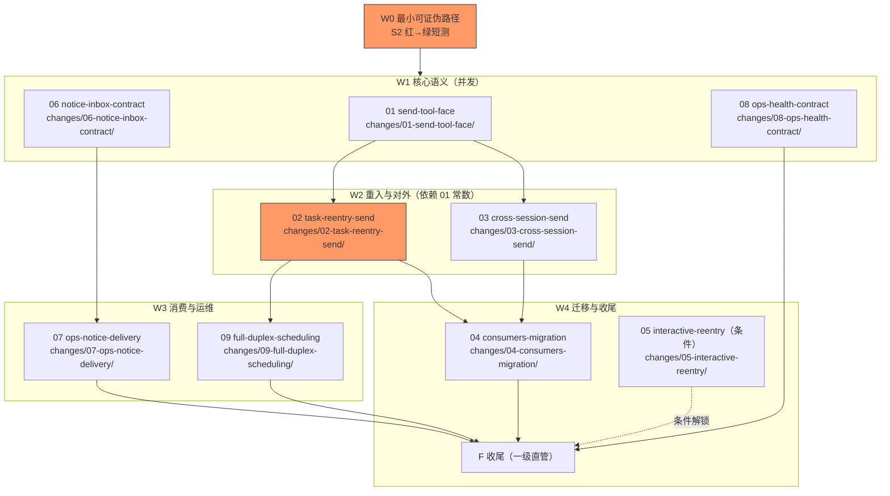

# 任务：send 跨 task、会话通信收敛（编排账目）

**只编排**：本文件不含实现级 `- [ ]`，实现任务在 `changes/<NN-domain>/tasks.md`；每子变更项附路径。
**启动门**：无前置变更并存；W0（最小可证伪路径）先行，S2 红→绿后 W1 才全量展开。
**波次语义**：波次仅为汇报分组，解锁以依赖入 main 为准；连续推进至法定停点（R31）。

关键路径（红标）：W0 → 02（重激活状态机为最大技术未知数）→ 04 → F。

## 子变更清单（一级 checkbox 跟踪，勾选附凭据摘要）

- [x] W0 最小可证伪路径：S2 红→绿短测贯通（症状直通缺陷机制） —— changes/01-send-tool-face/tasks.md 0.x
- [x] 01 send-tool-face（send 声明/参数面/回执/装配唯一化，R2 统一） —— changes/01-send-tool-face/
- [x] 02 task-reentry-send（task ID 重入、settled 重激活、占坑单胜） —— changes/02-task-reentry-send/
- [x] 03 cross-session-send（agent+session 寻址、四道门、入链+驱动一轮、deliver_summary 归并） —— changes/03-cross-session-send/
- [x] 04 consumers-migration（prompt/wiki/smoke/CHANGELOG 迁移） —— changes/04-consumers-migration/
- [x] 05 interactive-reentry（条件波次：tmux 重入归并；不做即记录裁剪） —— changes/05-interactive-reentry/
- [x] 06 notice-inbox-contract（R1 持久接纳/消费确认/稳定身份；R4 来源分账） —— changes/06-notice-inbox-contract/
- [x] 07 ops-notice-delivery（R3 固定目标+立即唤醒；R5 现场查询接线） —— changes/07-ops-notice-delivery/
- [x] 08 ops-health-contract（R6 healthz 对齐+五态探测） —— changes/08-ops-health-contract/
- [x] 09 full-duplex-scheduling（R7 首叶实证→收敛实现） —— changes/09-full-duplex-scheduling/

## 收尾 F 任务（一级直管）

- [x] F1 契约零改动断言：`git diff <基线>..HEAD -- openspec/specs api` 除 design D2 表声明的 MODIFIED/ADDED delta 外为空
- [x] F1.5 清除残留门（D15）：`grep -rn "deliver_summary\|DeliverSummaryTool\|resume_task\|hostSendLineage\|declaresSendOutside" --include=*.go --include=*.md` 在 `*.go`/prompt 面零残留（`openspec/specs` 与 CHANGELOG 历史段列排除表）；每项 DEL 的伴生引用降级检查记录入台账
- [x] F2 全量门禁：`go build ./...`；`go test ./...`；`.github/scripts/run-go-tests.sh`（若在 CI 面）exit 0；wecht-bot smoke 症状组绿
- [x] F3 DoD 逐项核验入 run notes，含**症状锚 S1–S3+N1–N6 红转绿双证据**（完整回滚本变更必红、修复后必绿）
- [ ] F4 `openspec validate send-cross-task-session --strict` → `openspec archive send-cross-task-session --yes` + 导览文档（域→证据链接）
