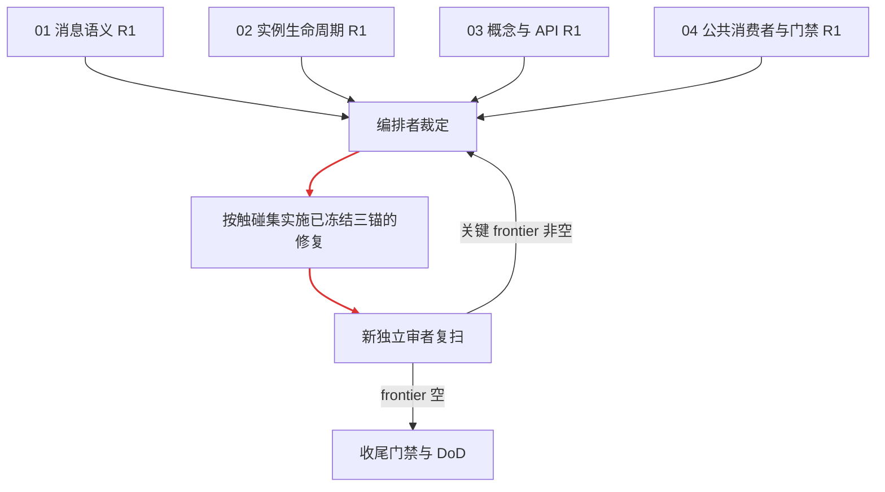

# PR36 核心概念与行为收敛编排

本文件只编排，不承载实现级叶任务。启动门已满足：基线、范围、破坏性收敛授权与双门均由用户冻结。波次仅作汇报分组，解锁以同树前置集成与复验为准，不表示已入 main。

## 原话验收矩阵

| 用户原话 | 直译场景 | 第一天证据 | 完成判据 |
|---|---|---|---|
| “系统设计不断膨胀，偏离核心框架设计，问题越改越多” | 同一 send/close 经公共入口只沿一个状态机推进；独立复审不再发现关键语义分裂；修复后公共概念面净减 | R1 公共入口复现 + `dfdfa72e` 概念账；已绿项须基线红或变异证明 | 不假收束、不丢通知、不双驱动；frontier 空；概念/API 净减；门禁全绿 |

## 跟踪图

## 子变更

- [ ] 01 消息语义：[changes/01-message-semantics/](changes/01-message-semantics/) —— 当前派发 R1.1/R1.2；修复叶待裁定后补入，不预设方案。
- [ ] 02 实例生命周期：[changes/02-instance-lifecycle/](changes/02-instance-lifecycle/) —— 当前派发 R2.1/R2.2；与 01 共享的结清定义由编排者统一裁定。
- [ ] 03 概念与 API：[changes/03-concept-surface/](changes/03-concept-surface/) —— 当前派发 R3.1/R3.2；只依据当前树记账，不照搬历史审查。
- [ ] 04 公共消费者与门禁：[changes/04-consumer-gates/](changes/04-consumer-gates/) —— 当前派发 R4.1/R4.2；CI 与产品修复分线。

## 一级直管收尾

- [ ] F1 冻结契约核对：R1 裁定后形成的验收面与后续 diff 对照，无追认缩水；被删结构及伴生引用零残留 —— 验证：`openspec validate pr36-concept-convergence --strict --no-interactive`，加逐域残留 grep 清单。
- [ ] F2 全量门禁：逐条直接运行并记录原始退出码，不与提交串联 —— 验证：`go build ./...`；`go vet ./...`；`go test ./... -short -count=1`；`bash scripts/gates/race_check.sh .`；`bash scripts/lint.sh`；`bash scripts/gates/check-openspec.sh`。
- [ ] F3 DoD 与症状证据：公共入口三症状、负锚、生产消费者、概念/API 差异逐项入台账；已绿旧症状补基线红或变异杀死证据 —— 验证：末轮独立审者明确“frontier 空”，编排者复核所有命令、用例数与退出码。
- [ ] F4 归档（需用户另行明示）：DoD 全过后才允许 `openspec archive pr36-concept-convergence --yes`；本轮不执行。
