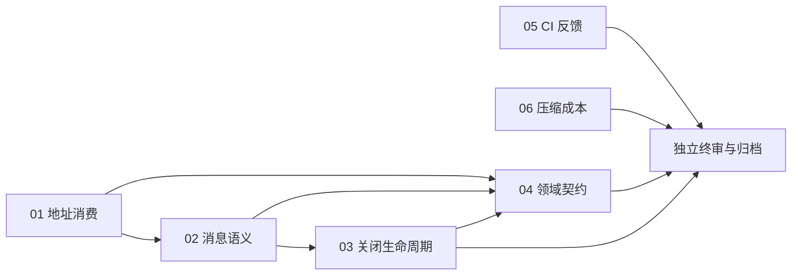

# 一级编排账

本文件只编排二级子变更与收尾，不承载实现级孙任务。启动门：W0 六域报告全部由编排者裁定后，才可冻结实施子任务。波次仅是汇报分组，解锁以依赖完成和触碰集不相交为准。

## W0 独立拷问

- [x] 0.1 完成 `changes/01-address-consumption/` 的独立拷问、裁定与三锚规划。凭据：W0-A01 Critical 1、Major 3；F1–F7 均采纳，四件套已落地。
- [x] 0.2 完成 `changes/02-message-semantics/` 的独立拷问、裁定与三锚规划。凭据：W0-A02 C1–C3 核码成立；Q1–Q5 采纳，四件套与三组 spec delta 已落地。
- [x] 0.3 完成 `changes/03-close-lifecycle/` 的独立拷问、裁定与三锚规划。凭据：W0-A03 Q1–Q4 采纳；Cut 可重试且不释放活 writer 是补充裁定。
- [x] 0.4 完成 `changes/04-domain-contracts/` 的独立拷问、裁定与三锚规划。凭据：W0-A04 Q1–Q5 采纳；形状/领域分门，无符号总数 KPI；GLOSSARY 已按裁定去重。
- [x] 0.5 完成 `changes/05-ci-feedback/` 的独立拷问、裁定与三锚规划。凭据：W0-A05 实测 CI 中位 90m49s；Q1–Q7 采纳，merge queue 外部启用为 5.6 硬门。
- [x] 0.6 完成 `changes/06-compression-cost/` 的独立拷问、裁定与三锚规划。凭据：W0-A06 C1 经编排者核码成立；Q1–Q6 采纳，恢复 Volume 门并删除 Material 公共面。

## 后续域（仅编排占位，非实施授权）

- [x] 1. 地址消费域：1.1 send/Run 唯一 Consumer、单 current/tombstone/锁外 join 均 fresh 审 frontier 空；1.2 Run 入口经 waitResident，输出因果 input_events 落地，handoff 恢复。凭据见台账 r5–r16、r19–r20。
- [x] 2. 消息语义域（本轮范围内）：send ok=事实提交、全双工迟到结果闭合前 harvest、段结算先 seal 后唤醒、Capture 封档恢复；capabilities/execution/learning 整包 exit 0。剩余 2.2–2.6 未派发。
- [ ] 3. 关闭域在状态权威明确后收敛为单一关闭状态机。【Wave 3 当前派发面】两公共红锚：TestCloseRefusesWhileModelInFlight（StopResidents→Consumers.Stop 无界 join 死锁）与 TestSendCrossSessionGates/denies_not_running（在飞调用被误报 Quiesced）。
- [ ] 4. 领域契约域删除重复公共面和失效规范，概念账本净减。
- [ ] 5. CI 域独立缩短反馈，同时保持 merge 前完整证明。
- [ ] 6. 压缩域凭独立规格和基准决定保留、修改或撤回候选改动。

## F 收尾

- [ ] F1 核对契约差异只含已批准 delta，公共概念账本净减。
- [ ] F2 复跑全部项目门禁与 merge 前完整长程证明，记录原始退出码。
- [ ] F3 逐条核验 DoD 与用户症状锚的回滚红/修复绿证据。
- [ ] F4 在独立审者显式 frontier 空后执行 OpenSpec archive 并复验主 specs。

## 补记：证据链复核（2026-11-04，post-hoc）

本节不改写上面的勾选状态——上面的 3–6 与 F1–F4 是归档时的过程快照，保持未勾。本节点仅登记每个收尾项的实际证据状态，供新克隆审计：

| 项 | 原勾选 | 实际证据 | 状态 |
|---|---|---|---|
| F1 核对契约差异、概念账本净减 | [ ] | evidence/04-concept-net-ledger.md；golden/runtime/architecture.json::concept_ratchet；check_concept_budget.py --json → errors: []、removed=10/renames=0 | 本地可核，仍标注为过程快照 |
| F2 复跑全部项目门禁与 merge 前完整长程证明 | [ ] | evidence/07-local-gate-sweep.md：openspec/concept/doc/doc-refs/build 均绿；short 全量 37 包 ok、3 包因沙箱禁 tmux fork 失败；long 六片与 smoke 未跑 | **未闭合**：缺长程证明与远端 run 工件 |
| F3 DoD 与症状锚红转绿双证 | [ ] | 归档 ORCHESTRATION r90/F3 表 + r138/r137；MUT-EVID-04 判据在 e94344a5 后放宽（见冲突分类报告 B6） | 部分可核，锚强度待补 |
| F4 独立审者 frontier 空后 archive | [ ] | 四簇独立评审合计带出约 40 个开放问题；归档目录由 170ef267 建立，早于被引 CI run；evidence/09 登记远端 run 不可核 | **未闭合**：frontier 非空、归档顺序与主规格冲突 |

依据与 hash 映射见 evidence/08-ledger-reconciliation.md；本地门禁原始退出码见 evidence/07-local-gate-sweep.md；远端 run 状态见 evidence/09-ci-run-attestation.md。
