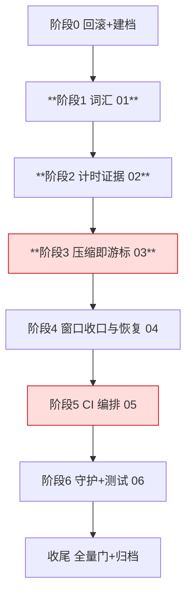

# 一级 tasks（只编排）

> 头部三行：① 本文件只编排，不写实现细节；② 启动门 = 阶段 0 回滚与建档完成 + 基线门全绿；③ 波次仅汇报分组，解锁 = 依赖入 main 且独立拷问 frontier 空。

## 跟踪图（关键路径红标）

## 子变更清单（一级 checkbox 跟踪）

- [x] 01-vocabulary — 转世→重启恢复、代码名词规范化、撤销伪词条；验证：与子域 `changes/01-vocabulary/tasks.md` 1.1–1.4 完全一致（叙述层含 `*.sh`/`*.yaml` 的豁免后计数 0、根模块 + `examples/wechat-bot` 独立模块 go test、伪词条不作为术语行/标题、`verify_contracts.py` PASS），MUST NOT 用无豁免的裸 `grep | wc -l`（该命令实测 151，见 r6）
- [x] 02-timing-evidence — Scan/fold 分段计数（**部分**：进程内计数已达产物；带数据重启计数与全零判红移交 5.1a，该任务现随 05 域转移至 hot-update-and-purity-closure/changes/07-ci-orchestration，非缩水）；验证：具名单测 + 冻结命令 10 行计数
- [x] 03-compression-cursor — 链上票据 + 外部只读 blob + 失败退回全量；验证：正锚（全量≡dump+增量）/负锚（5 类失败含 blob 缺失）/消费者锚（真实 Boot）；放行=第 7 轮闭合清单 P1–P5 全 PASS（ORCHESTRATION r25）
- [ ] 04-window-recovery — **转移至 hot-update-and-purity-closure**（`changes/06-window-recovery/`，含已完成的 4.c0/4.c3/4.c4/E2/E3/E4 勾选记录）；原冻结路径：最终路径以 r82 重写的任务表为准，A 折叠锚与 B 派生态审计已封存；C 4.c0 原文去重退役、4.c3 最小懒校验与 4.c4 零消费者面删除；E 逐项关闭恢复缺口，E2–E5/E9 是默认锚启动硬前置；4.a5 完成前必须默认开启且与全量重放逐条一致；D 时间纯度、游标测量与真实 120 重启消费者证据。通用状态注入、在线 relations、观察表、VectorSeam 与跨消息正文共享全部禁止恢复
- [ ] 05-ci-orchestration — **转移至 hot-update-and-purity-closure**（`changes/07-ci-orchestration/`，含 5.1a 重启计数进 CI 产物）
- [ ] 06-guards-and-tests — **转移至 hot-update-and-purity-closure**（`changes/08-guards-and-tests/`）

## 收尾 F 任务

- [ ] F1 契约零改动断言：`verify_contracts.py` PASS（六个冻结字符串、10 文件 56 行、MISMATCH 0）——**转移至 hot-update-and-purity-closure**（合并后收尾由其 F1–F4 承接；归档时点复跑 PASS 见归档注记）
- [ ] F2 全量门禁 exit 0；`go test ./tool/exec -count=2` 复跑确认既存 flake 不构成回归——**转移至 hot-update-and-purity-closure**
- [ ] F3 DoD 逐项 + 症状锚红转绿两次证据入 run notes——**转移至 hot-update-and-purity-closure**（boot 曲线锚随 04→06、CI 六分片锚随 05→07；新变更锚 B（重启漏投）已由本变更 E3 兑现基线绿，锚 A（热更 409）归新变更）
- [ ] F4 `openspec archive` + 导览文档——**转移至 hot-update-and-purity-closure**（本变更仅归档已完成的 01/02/03，见归档注记；原归档链接债务已按 r9 迁表解除）

## 归档注记（2026-11-08）

- 本变更只归档已完成部分：嵌套 01/02/03 的 delta 提升至一级 `specs/` 标准 capability 路径后由 `openspec archive` 合并入主规格；未完成子域 04/05/06 已整体转移至 hot-update-and-purity-closure（06/07/08），其已完成孙任务的勾选记录随迁保留。
- 02 delta 撤回「SHALL 写入 CI 可上传产物」与「缺段或全零即红」：该验收面由 hot-update-and-purity-closure/07 的 5.1a 承接（未实现）；本变更已兑现面=进程内五段 Scan 计数 + fold 计数（boot INFO，随 go test stdout 进 runner test-log）。
- 一级 orchestration delta 撤回「症状直译锚红转绿」条款：锚①（120 重启 boot 曲线）与锚②（CI 六分片）的实现面均已转移（06/07），留在主规格即成未实现要求；撤回后主规格只收已实现条款（阶段门禁/三挂点守护/词汇一致）。
- 归档时点复跑凭据：`python3 openspec/changes/restart-recovery-optimization/changes/01-vocabulary/verify_contracts.py` → `VERDICT: PASS (line sets identical)`、`MISMATCH_FILES= 0`；`python3 scripts/gates/check_durable_truth_registry.py` → ok（errors=0）；`python3 scripts/gates/test_check_durable_truth_registry.py` → 11 case(s) PASS。
