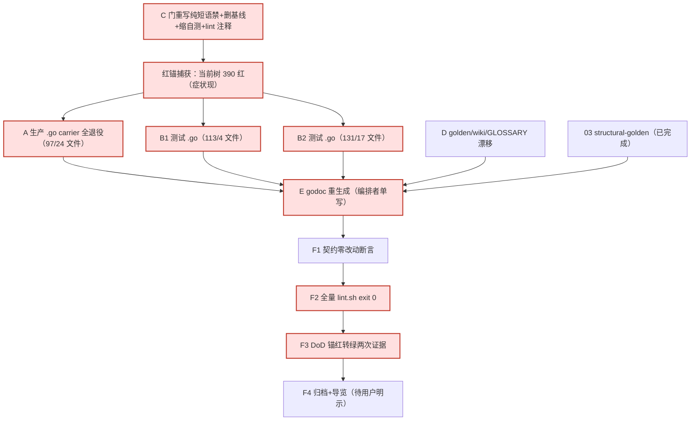

# Tasks: code-vocabulary-alignment

> 本文件只编排：跟踪图＋子变更清单＋收尾 F 任务。孙任务明细与 verify 锚见各二级 `changes/<NN>/tasks.md`；决策见 `design.md`；派发唯一依据见 `ORCHESTRATION.md`。
> **甲 修订（取代旧「指纹棘轮＋泛义保留」方案）。** 勘误：旧 tasks 的 02.1/02.3（指纹棘轮门＋建 2377 行分类基线）、01.1（仅检查点义退役、泛义不动、task_checkpoint_test.go:174 回退）系据伪前提「user_ruling 泛义保留」而立；用户明确「我没有裁定过泛义保留」。甲＝carrier 全退役＋纯短语禁门＋删基线，净负代码。旧已落地的检查点义改名（01.2-01.6）、03 结构/golden 经复核正确，**保留 [x]**；门重写（C 轨）已验完成，carrier 全退役（A/B1/B2 轨）执行中，godoc/全量门/红转绿（E/F）待重跑。执行轨见 ORCHESTRATION D3。
> 启动门：C（门重写）立案即跑；A/B1/B2 待 C 红锚捕获（当前树 390 红）后并发；D（golden/wiki/GLOSSARY 漂移）触碰集不相交可并发；E（godoc）待 A+B 全部 .go 注释定稿；F 待 E。
> 波次语义：波次仅汇报分组，解锁＝依赖就绪，非栅栏（R3）。

## 跟踪图（关键路径红标）

关键路径：C 门重写（红锚 390）→ A/B1/B2 carrier 全退役（门转绿）→ E godoc → F2 全量门 → F3 红转绿证据 → F4 归档。D 与 A/B 并发（触碰集不相交）；03 已完成。

## 二级子变更清单

### 02 vocabulary-gate（C 轨，唯一 spec delta：architecture-guardrails MODIFIED）

- [x] 02.1 重写 `scripts/gates/check_vocabulary_alignment.py` 为**纯短语禁**（4 规则见 design D6：carrier 大小写不敏感子串／generational|fold generation|folding generation 短语／api/plugin 内 Product／退役词；**注释散文先归并续行再匹配短语**，单行只计一次；guard_checklib；`--root`/`--json`；**删 load_registry/baseline_entry/write_baseline/verdict/EXEMPT_CLASSES/CLASSIFICATIONS/fingerprint/--registry/--write-baseline/镜像逻辑**）—— 验证：正锚 `python3 scripts/gates/check_vocabulary_alignment.py` 对当前树 exit 1 且 **390 命中**（341 .go＋49 docs/api，症状锚红，已存证 red-anchor-390.log）；消费者锚见 02.4
- [x] 02.2 重写 `scripts/gates/test_check_vocabulary_alignment.py` 负例自测（tempfile+subprocess 真退出码；植入 carrier 标识符 commitCarrier／carrier 散文／跨行 folding generation／单行 folding generation／foldGeneration 驼峰／generationalBand／字符串字面量／api/plugin Product＋MaterialProduct／pluginProduct／退役词，门必拒 exit 1；合法形 gen:／instance_id／recorder generation／compress.product／小写 product／动词 carries/carried/carrying **不误拒**；单行只计一次；缺 docs/api 红）—— 验证：`python3 scripts/gates/test_check_vocabulary_alignment.py` exit 0（**17 例 52 断言**，非空转）
- [x] 02.3 **删除** `golden/runtime/vocabulary_alignment.json`（旧 2377 行分类基线随伪前提「泛义保留」一并退役；纯短语禁无基线/分类/豁免/棘轮）—— 验证：`ls golden/runtime/vocabulary_alignment.json` 不存在；门无 --write-baseline/--registry；净负代码（基线 2377→0）
- [x] 02.4 接线 `scripts/gates/lint.sh`（policy 块 test+check 对，注释改纯短语禁；wiring 行字节不变）＋确认 `.github/workflows/ci.yml:109` Lint step 实跑 `bash scripts/lint.sh`→gates/lint.sh —— 验证：消费者锚 grep 实证 ci.yml→lint.sh→词汇门接线；门红则 CI 红
- [x] 02.5 `changes/02-vocabulary-gate/specs/architecture-guardrails/spec.md` delta（`## ADDED Requirements`「代码词汇对齐 GLOSSARY 规范词（机械门）」requirement＋scenarios：carrier 全义退役被拒／压缩 fold generation 被拒合法世代不触禁式／负例自测真拒／正式消费者接 lint 与 CI／**纯短语禁无基线**／冻结拼写与归档不改写；requirement 散文只述不变量，门名/命令置 Scenario）—— 验证：`bash scripts/gates/check-openspec.sh` exit 0；`python3 scripts/gates/check_spec_hygiene.py` exit 0

### 03 structural-golden（已完成，实现子域，无 spec delta；甲不改）

- [x] 03.1 评估 `runtime/task/checkpoint.go` SnapshotCheckpoint/RestoreCheckpoint vs 接缝 SnapshotState/RestoreState：裁定 **KEEP**（distinct role 实证：runtime/state→runtime/task 单向依赖，MemoryRegistry 实现接缝即成导入环；契约不对等 RestoreCheckpoint 另登记去重键/观测序号）—— 验证：读码裁定产出＋级联调用方全清单（grep）
- [x] 03.2 删除 `assembly/checkpoint.go:71` checkpointSliceMailbox 重复常量（唯一消费者 `assembly/checkpoint_test.go:1151` 改用 StateSliceMailbox）—— 验证：负锚＝删除前 grep 实证唯一消费者；正锚 `go build ./... && go vet ./... && go test ./assembly/ ./runtime/state/` exit 0。**提交归属注**：两文件同载 Phase2 CheckpointKey 签名修复，文件粒度下随 Phase2 提交（克隆 F2 排除之）；词汇 commit 交付 03.2 须 hunk 拆分（03.2 hunk 与 Phase2 hunk 不相交）——A3 裁定，见 run-notes「03.2 纠缠」
- [x] 03.3 `golden/runtime/window_bounds.json` 检查点义「载体」→checkpoint —— 验证：`python3 scripts/gates/check_window_bounds.py` exit 0

### 01 residual-cleanup（A/B1/B2/D 轨，实现子域，无 spec delta）

- [x] 01.1 **生产 .go carrier 全退役**（A 轨，97 命中/24 文件）：检查点义 carrier→checkpoint 旧改名保留；泛义→既有精确实名（commit／DurableCommit／credential／URL／projection／envelope／fact／record，design D6 映射）；包内私有标识符改名（lifecycle.go carrier 字段→commit、durable.go newCarrier→newDurableCommit、commit.go commitCarrier→commitLedger、tool.go 局部 carrier→result）；**导出 API 零改动、逻辑零改** —— 验证：A 簇 `grep -rni carrier` 全 0；`go build ./...` exit 0；git diff 仅注释/私有标识符行（编排者于 A+B 全落后跑权威 go test）
- [x] 01.2 **测试 .go carrier 全退役**（B1 轨 113/4 文件＋B2 轨 131/17 文件）：seedCarrier→seedCommit、logicalRig.carrier 字段→commit、reactivationFact/reactivationRollbackFact 参 carrier→commit、carrier 局部→commit、散文→精确实名；task_checkpoint_test.go:174「durable carrier」→「durable commit」（**旧 Issue3 回退被甲取代**）；handoff_test.go carrier→envelope —— 验证：B1/B2 簇 `grep -rni carrier` 全 0；`go build ./...` exit 0；`go test -list '.*'` 计数不变、断言数不降（编排者于 A+B 全落后跑权威 go test）
- [x] 01.3 **golden/wiki/GLOSSARY 漂移对齐**（D 轨）：architecture.json:1206/1211「carrier rebuild」→「commit rebuild」、durable_truth.json:204「carrier tables」→「commit tables」、wiki task-lifecycle.md:9「commit carrier」→「commit」、GLOSSARY 行 3 增 carrier 全退役注（既有退役词子句内，不增行、不造新概念）—— 验证：D 簇 `grep -ni carrier` 全 0（GLOSSARY 退役注为合法提及，在门扫描面 docs/api 之外）；golden 门不逐字比对散文故无耦合（编排者复核 check_runtime_architecture/check_durable_truth_registry exit 0）
- [x] 01.4 `memory/replay/age_segments.go`「folding generation」→band promotion（旧已改，甲保留）—— 验证：词汇门 generation 短语规则绿；`go test ./memory/replay/` exit 0
- [x] 01.5 `memory/ledger/journal_test.go:522` 错误测试名引用更正（TestTheCheckpointCarrierStaysBoundedByItsEntries→**TestTheCheckpointStaysBoundedByItsEntries**，旧已改，甲保留）—— 验证：引用名 grep 实证存在于 assembly/checkpoint_test.go
- [x] 01.6 检查点义测试 helper/夹具/局部变量/测试名改名（journal_test.go carrierFrameValueBytes→checkpointFrameValueBytes、TestJournalCarriesTheFrameworkCarrierFrame→…CheckpointFrame；segment_store_test.go carrier-old/new→checkpoint-*；旧已改，甲保留）—— 验证：`go test ./memory/ledger/ -list '.*'` 计数不变；旧名残留 grep 全仓 0（冻结归档勘误除外）
- [x] 01.7 两处冻结归档附勘误（`13-bounded-compression/tasks.md` 引用 TestJournalCarriesTheFrameworkCarrierFrame；`session-checkpoint-material-unification/tasks.md` 引用 TestTheCheckpointCarrierStaysBoundedByItsEntries；旧已附，甲保留）—— 验证：归档原文逐字不变（git diff 仅**新增**勘误行）
- [x] 01.8 （Issue7，用户授权）永久 spec `openspec/specs/session-checkpoint-material/spec.md` 检查点义中文「载体」→checkpoint（5 处 :10/:47×2/:49/:52；旧已改，甲保留）；:38「端口名 SHALL NOT 是语义的唯一载体」**保留**——语义判断（非用户裁定）：此处「载体」系泛义『承载者』（bearer-of-meaning，Material 契约语义），非检查点义容器、非英文 carrier，且在门扫描面（.go＋docs/api 英文）之外，改 checkpoint 反致语义错误；用户「我没有裁定过泛义保留」针对英文 carrier 全退役，不涉此处中文泛义 —— 验证：`grep 载体` 仅余 :38；spec_hygiene／doc-budget／check-openspec 均 exit 0

## 收尾 F 任务（一级直管，编排者执行）

- [x] F0/E godoc 重生成：A+B 全部 `.go` 注释/标识符改定后，编排者统一跑 `bash scripts/gates/gen_godoc.sh`（避免并发互踩；docs/api 49 镜像命中随重生成消解）—— 验证：`bash scripts/gates/gen_godoc.sh --check` exit 0；词汇门 docs/api carrier 归 0；`git diff -- docs/api` 仅词汇改名（无逻辑/结构漂移）
- [x] F1 契约零改动断言：冻结契约**拼写/签名**（GLOSSARY §五 reincarnation 族 10 文件、导出 API 标识符）对基线零更名；`api/config` 零改动；`api/event` 内仅两类授权改动——`types.go` **注释散文**词汇对齐（`fact carrier`→`fact contract`，1 行，非签名/标识符）＋`checkpoint.go`/`checkpoint_test.go` 的 **Phase2** `CheckpointKey(seq)`→`CheckpointKey(partition,seq)` 分区键签名修复（独立已完成工作，与词汇面分离）—— 验证：10 冻结文件＋`api/config` 对基线 `git diff --stat a0ff631b` **为空**（exit 0，实测）；`api/event` diff 仅 `types.go` 1 注释行＋Phase2 `checkpoint.go`/`test`（verify_contracts.py 系归档一次性脚本，等价断言以直接基线 diff 替代）
- [x] F2 全量门禁：**词汇提交树**（干净克隆 `/tmp/jia_f2_clean`＝`git clone` a0ff631b＋仅词汇面＋克隆内 godoc 重生成，排除 Phase2/外来；.git 为目录故 dotted-refs 门可跑）`bash scripts/gates/lint.sh` **exit 0**（`lint: ok`，原始码非管道吞码）＝该 commit 的 CI 等价证明。**当前混合工作树**另带两类非词汇红，归属已核（100% 词汇零触碰）：①Phase2 comment_policy 棘轮 9 findings（free-standing 0→5、test-doc-not-one-sentence 0→4，全在 Phase2 测试文件 api/event/checkpoint_test.go、assembly/checkpoint_test.go、memory/ledger/migrate_test.go，4 个被flag Test 函数 ABSENT_IN_HEAD＝Phase2 引入）；②外来未跟踪 test_check_runtime_symptoms.py 1 fail（CI 克隆不存在）。二者属独立 finding，Phase2 零触碰约束下词汇面无法代为复绿 → A3 停点上报用户裁 —— 验证：克隆 lint 原始退出码 0；真树红逐项归因（4 Test 函数基线缺失实证）
- [x] F3 DoD 逐项核验入 run notes：①词汇门**红转绿证据**（当前树 390 红＝症状现，已存证；A/B/D/E 清理后 0 绿；**仅回退清理**门复红＝因果；负例自测植入违规必红＝真拒）；②负例自测 17 例 52 断言拒植入违规；③全量 lint exit 0；④docs/api diff 仅 godoc；⑤冻结归档仅附勘误；⑥外来未跟踪文件零触碰；⑦**净负代码**（门 550→266、自测 480→215、基线 2377→0）—— 验证：七项逐条带命令＋原始退出码＋产物引用
- [x] F4 `openspec archive code-vocabulary-alignment -y`（无 --skip-specs/--no-validate）＋导览文档；architecture-guardrails delta 转正合并；doc-budget 具名上调（M4 先例）—— 用户明示已收（「归档并commit and push，然后PR squash merge main」，A3 发布授权停点解除）。**编排 delta 处置**：top-level `specs/orchestration/spec.md` 四条要求（启动门与波次解锁/共享面单写守护/spec 最小化/症状锚优先与独立放行）系主 orchestration spec 既有通用原则（:700/:714/:728）的本变更实例化（点名 C/A/B/D/E/F 轨、390 锚），按本 delta 自身「spec 最小化不新建重复能力」MUST NOT 重复转正 → `git mv` 至变更根 `orchestration-spec.md` 随档冻结留存，不入主 spec；唯一真新增能力 architecture-guardrails 词汇对齐门由 02 嵌套 delta 提升至 top-level `specs/architecture-guardrails/spec.md`（标题归一 `# architecture-guardrails Specification`）经 CLI 转正合并。**doc-budget**：转正使 `openspec/specs/architecture-guardrails/spec.md` 330→365 行（+37 新增需求 −2 归档器归一化空行＝净 +35），属权威 spec delta 转正（M4 类「不得靠删散文对冲」），按 M4 先例具名上调基线 21957→21992（逐项列清见 doc_budget.json note），此后仍只降不升 —— 验证：`openspec validate code-vocabulary-alignment --strict` exit 0；check-openspec.sh 归档前 exit 0、归档后 exit 0；`python3 scripts/gates/check_doc_budget.py` 棘轮绿（231 篇/21992 行＝基线）；导览见 `archive/README.md` code-vocabulary-alignment 节