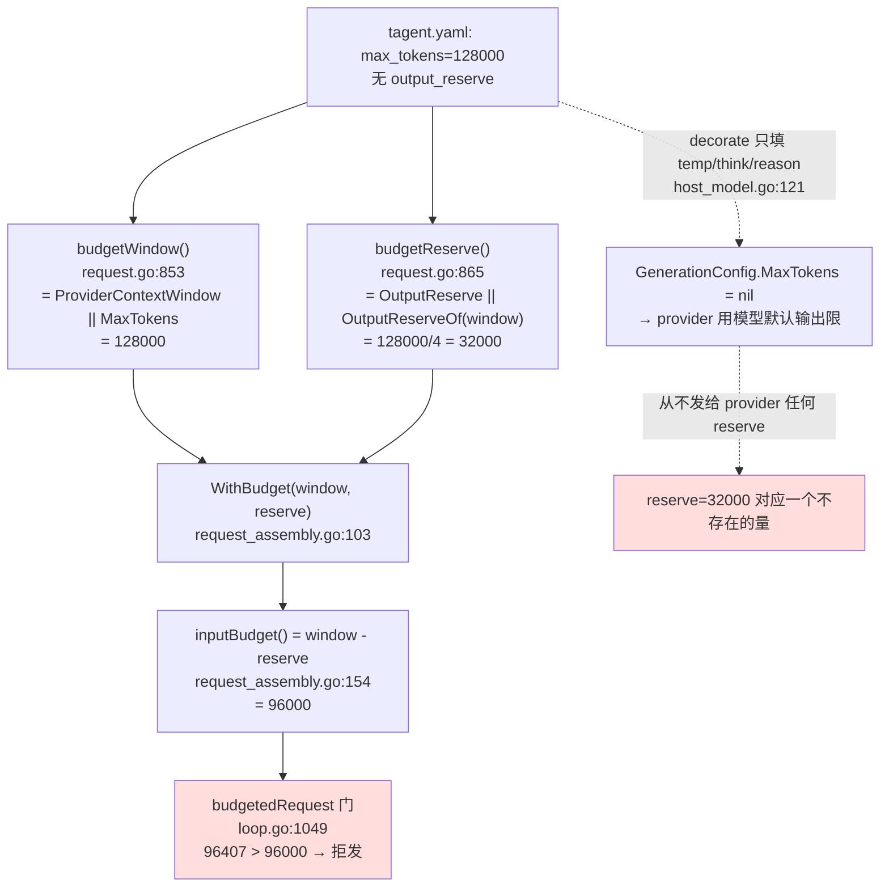
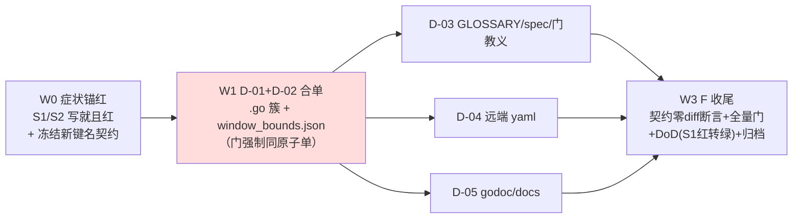

# 配置面归位设计

> 本文档供审。承用户裁定：**破坏性归位 + 远端同步**、**整个 agent 配置面**、**先出规划文档供审**。
> 证据分级：✅ 实测（读码/grep 确认）· ⚠️ 提及未确认 · ❓ 推断。

## 〇、结论先行

**抵达 DoD 的唯一路径**：把「输出余量」从凭空 `window/4` 改为派生自真实输出限，把 `max_tokens` 的名实归位（回放窗→`replay_window`，输出限收回 `max_tokens` 名并发给 provider），预算门唯一来源=`context_window`（裁定乙，删 derived-window 耦合），删死字段 `params`，门/注册表/GLOSSARY/spec/远端 yaml 同步改写一致；以 c75 症状直译锚红转绿为验收第一行。

**当前最大风险**：预算字段 rename 的消费者面极宽（双层 schema + golden 注册表 + 门 + 大量测试），且 `check_window_bounds.py` 强制「恰一个 window 类」——归位若漏改注册表或门类，门立即红。故 rename 与注册表必须**同一原子单**落地，不可分波。乙下远端 yaml **必须**显式声明 `context_window`，否则微信助手长会话失去预算保护（D-04 必做）。

## 一、自然性判据（承 e-7，五条）

| # | 判据 | 含义 |
|---|---|---|
| C1 | 输入预算是派生量 | `input_budget = window − output_limit`，无第三个独立旋钮 |
| C2 | 每个输入量有独立来源 | window ← 模型物理容量/声明；output_limit ← 声明的输出限或模型默认；两者都不是「窗口比例」 |
| C3 | 无声明 = 无假设 | 未声明输出限 → 用模型默认或 reserve=0，绝不凭空发明 window/4 |
| C4 | 名字承载真实语义 | `max_tokens` = 输出上限（API 通用义）；回放窗叫 `replay_window` |
| C5 | 加自定义模型 = 声明物理属性 | 声明容量/输出限，harness 派生预算；而非借回放窗兼任 |

## 二、全字段审计（整个 agent 配置面）

核心字段（`api/config/config.go` AgentSpec）＋四域段。逐字段过 C1–C5：

| 字段 | 现语义 | 判定 | 处置 |
|---|---|---|---|
| `id`/`parent_id`/`model`/`tools`/`plugins`/`task_policy`/`files` | 身份/结构 | ✅ 自然 | 不动 |
| `params` (map[string]float64) | 「声明期模型参数」 | ❌ **死字段**：无行为消费者（§三缺陷B） | **删** |
| `max_tokens` | 回放窗（折叠节奏） | ❌ C4 名实不符 | → `replay_window` |
| `provider_context_window` | 预算门窗口 | ⚠️ C2/C5：缺省借回放窗，物理容量无独立来源 | → `context_window`，缺省来源裁定见 D4 |
| `output_reserve` | 输出余量 | ❌ C1/C2/C3：独立旋钮 + window/4 凭空 + 不读真实输出限 | **删字段**，余量改派生（D2/D3） |
| （缺）输出上限 | 无 | ❌ C3/C5：生产 `GenerationConfig.MaxTokens`=nil | **新增** `max_tokens`（输出限），经 decorate 发 provider |
| `compress_threshold` (0.8) | 折叠触发占比 | ✅ 策略缺省有领域义（溢出前折） | 不动 |
| `keep_recent_tasks` (2) | 保留近段数 | ✅ 策略缺省 | 不动 |
| `long_context_tokens` | 长上下文审批档 | ✅ 模型退化位置，非窗口派生 | 不动 |
| `temperature`/`thinking_enabled`/`reasoning_effort` | 采样 | ✅ nil/空=模型默认，经 decorate 真发 | 不动（输出限加入同一 decorate） |
| `environment_block` | 环境块开关 | ✅ | 不动 |
| `max_tool_iterations`/`max_calls_per_response` | 轮/调用界 | ✅ zero=无界 | 不动 |
| `final_round`{max_rounds,budget_seconds,timeout_seconds,prompt} | 看门狗 | ✅ zero=无界 | 不动 |
| `memory`{type,path,read_namespaces,engine{backend,embedding{...}}} | 记忆面 | ✅ | 不动 |
| `meditation`{enabled,interval,min_gap,prompt_file,observed_namespaces,deliver_to} | 反思面 | ✅（min_gap 已在前序解决） | 不动 |
| `file`{base_dir,read_roots} | 文件面 | ✅ | 不动 |
| `exec`{monitor{interval,stable_duration,interactive_stable_duration,fake_dead_duration}} | 执行面 | ✅ | 不动 |

**结论**：缺陷集中在**预算三量 + 缺失输出限 + params 死字段**；其余字段自然，不动。审计面收敛，不发散。

## 三、缺陷定性（证据分级）

### 缺陷A：预算三量名实不符（核心）

**数据流（现状，✅ 实测）**：

- ✅ `budgetReserve = OutputReserve || OutputReserveOf(window)`，`OutputReserveOf = (window+3)/4`，`DefaultOutputReserveDivisor=4`（request_assembly.go:380,409）。
- ✅ `decorate`（host_model.go:121）只填 Temperature/ThinkingEnabled/ReasoningEffort，**不填 MaxTokens**；`budgetedRequest` 构造 Request 不含输出限 → 生产 `GenerationConfig.MaxTokens`=nil。
- ✅ **实现背离自身 spec**：`request-budget-accounting/spec.md:16` 已写「输出余量＝请求层 `GenerationConfig.MaxTokens` 或声明值」，但 `budgetReserve` 从不读 `GenerationConfig.MaxTokens`。spec 的「未声明取有界缺省余量，具体常量在 design」被 design 落成 window/4——这正是 e-7 批判的凭空常量。
- ✅ 远端 `tagent.yaml:106` `max_tokens: 128000`、无 `output_reserve` → window=128000、reserve=32000、budget=96000，**与 c75 报错数字逐字吻合**。
- ⚠️ c75 各输入面占比（哪类材料撑到 96407）需 c75 轨迹；宿主日志只到 #c51，未确认。
- ❓ 折叠目标数学：`target = history − over − 4`，只重折回放投影、不折当前 transcript；transcript_Content>4 时折叠徒劳，6 次空转拒发（读码推导，未对 c75 运行时确认）。

**真实设计意图须尊重（✅ 实测）**：`window_bounds.json` provider-window 条目 reason 明载「与回放窗**刻意解耦**（smoke 入口 = 2×回放窗；合并会先撞预算，见 r32 的 1519/1500）」。回放窗（折叠节奏）与预算窗（物理容量）是**两个真实不同的量**，归位**保留分立**，只改名与派生关系，不合并。缺陷不在「分立」，在「命名 + 凭空缺省 + 缺真实输出限」。

### 缺陷B：`params` 死字段（✅ grep 全 .go消费者）

`AgentSpec.Params`（map[string]float64）的全部引用：
- `decode.go:199`（解码）、`fingerprint.go:210`（规范编码）、`clone.go:58`（深拷贝）——皆是**声明面自身 machinery**。
- `host_reload.go:719` `note("params", !DeepEqual(before.Params, after.Params))`——只产「params 变了」的**reload 日志标签**，不驱动任何模型行为。
- `fingerprint_test.go:142,300` 用 `Params["temperature"]` 作负零归一**测试 fixture**（测试不纳入衡量）。
- **无任何生产代码读 `AgentSpec.Params` 设置模型参数**；采样实由 Temperature/ThinkingEnabled/ReasoningEffort 显式字段经 decorate 注入。
- **双重确认**：远端宿主 `hostAgent`（host_document.go:91-113）**根本不暴露 params 键**——生产部署从未接线它。

→ 违元规则二（结构不得自证）：其「消费者」全是服务于声明面自身的 machinery + 一个日志标签，无独立行为需求。**删**。

### 缺陷C：模型物理属性无声明面（C5 缺口，✅ 实测）

`hostProvider`（host_document.go:84-88）只声明 `provider`/`api_endpoint`/`api_key_env`（连接属性），**无 context_window / max_output**。物理容量只能借 agent 级回放窗兼任预算窗缺省。本期在 agent 级 `context_window` 声明物理容量（D4）；model 级容量注册表是 C5 完整形态，**留待未来，不在本期**（避免过度设计）。

## 四、设计分支与裁定

> 命名分支（D1）已由用户裁定，直接采纳；其余按判据独立裁，列被否方案。

### D1 命名归位（用户已裁定）
- `max_tokens`（回放窗）→ **`replay_window`**。
- `provider_context_window` → **`context_window`**。
- 收回 **`max_tokens`** 名给真实输出上限（API 通用义）。
- 旁证：`host_reload.go:721` 的 reload 标签**已经**叫 `replay_window`——内部词汇早已视 MaxTokens 为回放窗，归位是名实对齐。
- 被否：`max_output_tokens` 另立新名。否因：用户裁定收回 `max_tokens` 本义；且 `max_tokens` 是 provider API 通用键，收回它最自然，不另造词。

### D2 输出余量派生（C1/C2/C3）
- `reserve = 有效输出限`（即 decorate 发给 provider 的 `GenerationConfig.MaxTokens`）`?? 0`。
- **单一来源**：有效输出限算一次，同时供 decorate（发 provider）与 budgetReserve（扣预算），杜绝两处各算。
- 未声明输出限 → reserve=0（无声明=无预留，对齐 dsh `reservedCompletionTokens = maxTokens ?? default ?? 0`，「No declared cap means no reservation」）。
- **删** `DefaultOutputReserveDivisor`、`OutputReserveOf`。
- 被否：保留 window/4 作「有界缺省」。否因：C3——无领域来源的凭空比例；spec 虽允许「有界缺省」，但自然缺省是 0（不预留）或模型默认，不是窗口比例。

### D3 `output_reserve` 字段去留（C1）
- **删独立字段**。余量既派生自输出限，就不该是第三旋钮（C1）。
- 被否：保留 `output_reserve` 作显式 override。否因：C1 禁第三独立旋钮；若未来需安全 headroom，应另立明确策略量（如 dsh headroomTokens），不与输出限混淆。本期无此需求。

### D4 `context_window` 缺省来源（C2/C5）——用户裁定：乙
- **乙（已裁定）**：`context_window` 未声明 → 预算门**不开**。预算门开 ⟺ `context_window>0`（唯一来源）。`replay_window` 只驱动折叠/投影，**不再兼任预算窗缺省**。
  - `budgetWindow()`（request.go:853）去 `|| MaxTokens` 缺省链，直接返回 `ContextWindow`；「derived window」概念删除。
  - 彻底满足 C2/C5：预算窗有独立来源（显式物理容量声明），回放窗专司折叠，两量各独立、无耦合。
  - **接受后果**：只声明 `replay_window` 的 agent 预算门关闭、整包发送（无预算拒发）。这是裁定的纯语义——「要折叠但不设预算门」与「在此物理容量设预算门」是两种明确声明。
  - **硬要求**：远端 `tagent.yaml` 必须显式声明 `context_window: 128000`，否则微信助手长会话失去预算保护（D-04 升级为必做，非可选）。
  - **级联（✅ 实码）**：`TestProviderWindowGateSemantics` 的 `derived` 例（`MaxTokens:64` 断言门开拒发，request_test.go:780）翻为门闭整包发；`TestBudgetDefaultOutputReserve`（钉 `DefaultOutputReserveDivisor=4`，request_test.go:801）整测删改——正是被移除的机制。`projectionBudget`（request.go:1198）仍读 `replay_window`，折叠职责不变。
- **甲（已被乙取代，勘误）**：原「缺省=replay_window、门开⟺context_window>0∨replay_window>0、倾向甲」作废。否因：用户选纯——保留缺省耦合不满足 C5；乙删除耦合更干净。以乙为准。

### D5 门类重分类（✅ 门机制实测）
- `check_window_bounds.py:40` KNOB 正则匹配 `window|tokens|reserve|...` → `replay_window`/`context_window`/`max_tokens` 均须注册。
- `:169` 强制**恰一个 window 类**，`:163` 其 source 须 = `"external: the model window"`。
- 归位后注册表：
  - `window` 类 = **`replay_window`**（保留唯一 window，source 不变）→ 门不变式满足。
  - `budget` 类 = **`context_window`** + **`max_tokens`**（输出限）。
  - **删** `output-reserve` 条目、**删** `output-reserve-divisor` 常量条目。
- 被否：把 `context_window` 升为 window 类、replay_window 降 policy。否因：门「恰一个 window=external model window」教义须连带重写，且回放窗本就是「外部模型窗口用于回放」，保留它为 window 类最小改动、语义可通。

### D6 `params` 删除
- 删 AgentSpec.Params + decode/clone/fingerprint 伴生（floatMapField/cloneFloatMap/canonicalFloatMap）+ host_reload note("params")。
- **勘误（实施期独立纯度裁定，非用户裁定）**：原 D6/2.1 冻结「fingerprint_test fixture 改用 Temperature 测负零归一仍绿」为**伪前提**——Temperature 在 canonicalAgentCore 是裸 `*float64`（json omitempty），从不经 canonicalFloat 归一，改用它测负零必红。
  - **探针实证**（`/tmp/negzero_probe.go`，PROBE_EXIT=0）：Go json `omitempty` 对 `-0.0` 与 `+0.0` **一并丢弃**（因 `-0.0==0`）；非 omitempty 的 float 字段与 map 值才把 `-0` 编码成 `"-0"`（异于 `"0"`）。
  - Params（`json:"params"`，**无 omitempty**）是唯一恒编码的 float 容器。删 Params 后，canonicalFloat 的全部剩余消费者（CompressThreshold/BudgetSeconds/TimeoutSeconds）皆 omitempty → canonicalFloat **可证冗余**。
  - **裁定**：按 §〇二（结构不得自证）+ §四.1（级联回卷）删 canonicalFloat 及其 3 处 omitempty 包装 + 负零归一测试 + math import。此为**行为保持**：canonicalFloat 删除本身不改指纹；sectionsFingerprint 迁移（f834ae0b→3a1232e6）纯由 Params 的 `"params":null` 恒编码项消失所致。负零不变量此后由 Go json omitempty 语义对全部剩余 float 字段保证（探针已验），无残留路径可令 `-0.0` 漏入指纹——**非追认缩水**。

### D7 模型物理声明裁剪
- 本期 agent 级 `context_window`（D4 乙：唯一预算门来源）。model 级容量注册表**不在本期**。

## 五、症状直译锚（R33/R34，验收第一行）

**用户原话**：「这里没有配置为什么有这样的控制」（没声明 output_reserve 却被扣 32000）＋ c75 拒发。

**直译测试**（第一天就存在且红着）：

| 锚 | 场景 | 修复前（红） | 修复后（绿） |
|---|---|---|---|
| **S1 主锚** | agent 声明 `replay_window=128000, context_window=128000`，**无输出限**；输入 96407 | reserve=32000（凭空）→ budget=96000 → 96407>96000 **拒发** | reserve=0（无声明=无预留）→ budget=128000 → 96407<128000 **放行** |
| **S2 输出限真发** | agent 声明 `max_tokens=8000`（输出限） | `GenerationConfig.MaxTokens`=nil（从不发） | `GenerationConfig.MaxTokens`=8000（decorate 真发）且 reserve=8000 |
| **S3 名实归位** | 声明 `replay_window` 驱动折叠 | `max_tokens` 键（名实不符） | `replay_window` 键驱动折叠，行为与旧 max_tokens 一致（回归锚） |
| **S4 门唯一来源（乙）** | agent **只**声明 `replay_window=64`、无 `context_window`；输入超 64 | `MaxTokens>0` 派生门开 → **拒发** | 乙：门开⟺context_window>0 → **门闭、整包发送**（derived-window 耦合删除） |

- S1 是 c75 的隔离复现：把「凭空扣 32000」单独钉成红→绿，不依赖 c75 完整轨迹（⚠️ 部分）。S1 在乙下要求显式 `context_window=128000`（门才开）。
- 完整回滚本变更 → S1 必红；修复后 → S1 必绿。两次证据入最终 run notes（F3）。
- 负锚：`context_window` 小于输入且不可降级 → 仍显式拒发落 failed（保留既有拒发语义，不因归位而静默全量进请求）。
- S4 钉乙的门语义翻转：`TestProviderWindowGateSemantics` 的 `derived` 例由「拒发」改断言「门闭环整包」；`TestBudgetDefaultOutputReserve`（钉 divisor=4）整测删改。

## 六、多级任务拆分（域 + 孙任务 + verify 三要素）

> 一级 = 本变更（编排）。二级域如下。孙任务 verify 三要素（正锚/负锚/消费者锚）随任务行冻结（R29）。精确派发矩阵待审过后落 ORCHESTRATION.md。

### D-01 预算三量归位（核心原子域，.go 簇）
触碰：`api/config/{config,decode,fingerprint,clone,defaults}.go`、`assembly/{host_document,request,age_fold,facts,run,tools,checkpoint,host_model,host_reload}.go`、`runtime/agent/{request_assembly,loop}.go` + 其测试 + `golden/runtime/window_bounds.json`（门强制同单）。
- [ ] 1.1 改名 `MaxTokens→ReplayWindow`、`ProviderContextWindow→ContextWindow`（双层 schema：agentKeys + hostAgent yaml + canonical + clone + 全 .go 消费者）—— 验证：正锚 `go test ./api/config/... ./assembly/...`（S3 回归锚绿）；负锚 `check_window_bounds.py` 对漏注册键红；消费者锚 `grep -rn "MaxTokens\|ProviderContextWindow" --include=*.go` 零残留（除 FoldWindow 内部字段裁定）。
- [ ] 1.2 新增输出限 `max_tokens`（AgentSpec.MaxOutputTokens 或收回名）经 `hostParameterizedModel.params` → `decorate` 填 `GenerationConfig.MaxTokens` —— 验证：正锚 S2（`effective_config_test.go` 断言 served.MaxTokens=声明值）；负锚 未声明→served.MaxTokens=nil；消费者锚 `loop.go:929 withEffectiveConfig` 真把输出限带上 provider 请求。
- [ ] 1.3 `budgetReserve` 改派生自有效输出限 `?? 0`；`budgetWindow` 去 `|| MaxTokens` 缺省链、门开⟺`ContextWindow>0`（乙）；删 `output_reserve` 字段 + `DefaultOutputReserveDivisor` + `OutputReserveOf` —— 验证：正锚 S1（96407 输入无输出限→放行）；负锚 声明输出限 8000→budget=window−8000；消费者锚 `request.go:820 assemble` 与 decorate 读**同一**有效输出限（单一来源）。
- [ ] 1.4 `window_bounds.json` 重分类（D5）：replay_window=window、context_window+max_tokens=budget、删 output-reserve/divisor 条目 —— 验证：正锚 `python scripts/gates/check_window_bounds.py` exit 0；负锚 故意漏注册 max_tokens→门红；消费者锚 门 scan_config_keys 真扫到新 agentKeys。
- [ ] 1.5 测试归位：`TestProviderWindowGateSemantics` 的 `derived` 例改断言门闭环整包（S4）；删改 `TestBudgetDefaultOutputReserve`（divisor 机制已除）；全 `AgentSpec{MaxTokens/ProviderContextWindow/OutputReserve}` 构造改名 + reserve 期望调整 —— 验证：正锚 S1/S2/S3/S4 具名测试绿；负锚 只声明 replay_window→门闭（S4）；消费者锚 `go test ./assembly/... ./runtime/agent/...` 全绿。

### D-02 死字段清除（与 D-01 同簇，串行/合单）
- [ ] 2.1 删 `AgentSpec.Params` + decode/clone/fingerprint 伴生（floatMapField/cloneFloatMap/canonicalFloatMap）+ canonicalFloat 及 3 处 omitempty 包装 + 负零归一测试（D6 勘误：探针证冗余，行为保持）+ host_reload note("params") —— 验证：正锚 `go test ./api/config/...` exit 0（sectionsFingerprint 迁移 f834ae0b→3a1232e6，纯由 params 恒编码项消失）；负锚 声明 agent `params` 键→decode 拒 unknown field（具名例 `retired_agent_model_params`）；消费者锚 `grep "\.Params" *.go` 仅余 ToolRef.Params（string map）+ 无关 MCP/go-types。

### D-03 门教义/GLOSSARY/spec 归位（.go 簇外，可并行）
- [ ] 3.1 `docs/GLOSSARY.md` §一「请求预算」行改写（回放窗 replay_window／预算面 context_window+max_tokens／余量派生）—— 验证：正锚 `verify_contracts.py`/doc 门绿；消费者锚 GLOSSARY 行与 window_bounds.json 类一致。
- [ ] 3.2 `request-budget-accounting/spec.md` MODIFIED：输出余量派生自真实输出限、删凭空缺省、replay_window 命名（显式取代「MaxTokens 语义 MUST NOT 改变」冻结）—— 验证：正锚 `openspec validate --strict`；负锚 旧「window/4 缺省」断言不再出现；消费者锚 spec 与实现 budgetReserve 一致。
- [ ] 3.3 `check_window_bounds.py` docstring/KNOB 教义随归位核对（若 D5 保留 replay_window=window 则教义不变，仅核）—— 验证：正锚 门自测 `test_check_window_bounds.py` 绿。

### D-04 远端同步（yaml，可并行）
- [ ] 4.1 `tagent.yaml`/`tagent.rl.yaml`：`max_tokens:128000`→`replay_window:128000` + **必显式** `context_window:128000`（乙下门唯一来源，漏写则微信助手失预算保护）；按需声明输出限 `max_tokens`；注释如实改写 —— 验证：正锚 `go test ./assembly -run 'TestProviderWindowGateSemantics|TestSymptomAnchorUnifiedRequestBudget' -count=1`（门开 context_window>0）；负锚 漏写 context_window→门闭整包（S4 `TestSymptomAnchorReplayWindowAloneOpensNoGate`）、max_tokens 写大值→输出限挤占预算拒发（`TestBudgetReservesOutputAllowance`）；消费者锚 smoke boot 真 yaml 装配（`TestLocalSmokeSymptomBootDeployed`）。锚精化勘误见 [04 tasks](changes/04-remote-sync/tasks.md)（原 `TestHostDocument` 空转、原「max_tokens→unknown field」伪负锚已改真）。

### D-05 消费者收尾（godoc/docs，D-01 后）
- [ ] 5.1 重生成 `docs/api/*.md` godoc；改 `CHANGELOG.md`/`examples/wechat-bot/README.md`/`docs/wiki/platform/org-hot-reload.md` 涉预算键处 —— 验证：正锚 doc 门绿；消费者锚 `git grep -nI "output_reserve\|provider_context_window" -- docs/ examples/` 零残留（exit 1，归档除外；原 `grep -rn` 命中 gitignore 二进制＋docs/.dev 超时，锚精化见 [05 tasks](changes/05-consumer-docs/tasks.md)）。

## 七、消费者全清单（R11，rename 影响面）

**双层 schema**：`api/config/decode.go` agentKeys（核心声明）＋ `assembly/host_document.go` hostAgent yaml 标签（远端实际解析层）。
**代码**：config.go/decode.go/fingerprint.go/clone.go/defaults.go；host_document.go/request.go/age_fold.go/facts.go/run.go/tools.go/checkpoint.go/host_model.go/host_reload.go；runtime/agent/request_assembly.go/loop.go。
**门+注册表**：golden/runtime/window_bounds.json、scripts/gates/check_window_bounds.py（+ test_check_window_bounds.py）；**golden/runtime/schema_allowlist.json**（R1 generic_keys 白名单——宿主文档 agent 键注册表。实施期补全的 R11 缺口：原清单漏列，W2 远端 yaml 新键 replay_window/context_window 触发门红；已归位 generic_keys：删 provider_context_window/output_reserve、增 replay_window/context_window，max_tokens 保留为输出限。编排者共享面单写 R17）。
**文档**：docs/GLOSSARY.md §一、openspec/specs/request-budget-accounting/spec.md、config-hot-reload/spec.md、**openspec/specs/orchestration/spec.md**（契约守护需求追加乙裁定勘误。实施期补全的 R11 缺口：原清单漏列，boundary-closure 旧预算门触发语义「MaxTokens 为正」被乙取代；历史 body 原文保留、附勘误指向 request-budget-accounting 权威。编排者共享面单写 R17）、docs/api/*.md（生成）、CHANGELOG.md、examples/wechat-bot/README.md、docs/wiki/platform/org-hot-reload.md。
**远端**：examples/wechat-bot/tagent.yaml、tagent.rl.yaml。
**测试**：所有构造 `AgentSpec{MaxTokens/ProviderContextWindow/OutputReserve}` 的 *_test.go（assembly/runtime/agent/tests/integration/examples，grep 命中 ~40 文件）。
**冻结不动**：openspec/changes/archive/**（只附勘误）；§五冻结拼写（reincarnation 族，不含预算字段，已核）；外来未跟踪文件。

## 八、波次与耦合约束（R21/R28）

- **W1 必须合单**：rename 的 .go 簇与 window_bounds.json 被门强耦合（漏改即红），且 D-02 params 删除触碰同簇 config.go/decode.go/fingerprint.go——按 R21 触碰集相交，合单串行，不可并行派发。
- **W2 三域可并行**：D-03（文档/spec）、D-04（yaml）、D-05（godoc/docs）触碰集互不相交，且都在 W1 键名落地后（R22 共享面已冻结）。
- **波次收尾是记账不是停点**（R31）：连续推进至法定停点（资源门缺凭据/提交归档需明示/重大取向裁定/blocked/DoD）。

## 九、规划自审（review-checklist 六项 + 现实对齐）

| 项 | 自审 |
|---|---|
| 目标-任务矩阵 | 三缺陷 A/B/C → D-01(1.1-1.4)/D-02(2.1)/D4裁剪；每目标有孙任务承载 ✅ |
| 消费者枚举 | §七双层 schema+门+注册表+文档+远端+测试全列；grep 实证 ✅ |
| 档位覆盖 | 远端 wechat-bot 是唯一部署档；smoke 2×回放窗解耦意图保留（D5/D4）✅ |
| 性能主张 | 无性能主张；reserve 派生是 O(1) 计算，不增计量面 ✅ |
| 真实路径 | 消费者锚点名生产入口（assemble/withEffectiveConfig/loadHostDocument），非组件测试绿 ✅ |
| verify 可判定性 | 每孙任务正锚=具名测试+可复跑命令、负锚=具名错误路径、消费者锚=生产入口；S1 红→绿可判定 ✅ |
| 5.11 症状直译锚 | S1 把用户原话「没配置被扣 32000」直译成红→绿，第一天存在 ✅ |
| 5.12 方案降格/规模警戒 | c75 报错是症状非方案；归位范围收敛到预算三量+params，其余字段不动，不发散 ✅ |

**必答一问**：「本变更全部完成、全绿归档后，用户原话场景（没配置却被扣 32000 致拒发）还会发生吗？」
**答**：不会——证据＝S1 症状直译锚已存在且红着（无输出限→reserve=0→budget=128000→96407 放行），修复后必绿，完整回滚必红，两次证据入 F3 run notes。

**裁定状态**：D4 用户已裁**乙**（context_window 唯一门来源，删 derived-window 耦合，远端必显式声明容量）。其余分支按判据独立裁已定。design 全文已据乙改写一致（D4/§〇/§五 S4/§六 1.3-1.5/D-04）。下一步落 tasks.md + ORCHESTRATION.md + 二级子变更，再行实施。