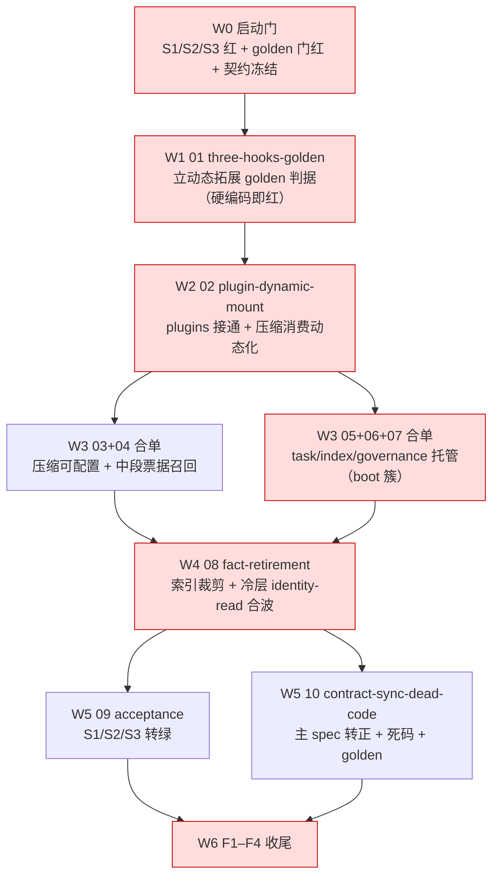

# 运行时恢复理想态 · 编排账（tasks.md，重制）

> **只编排**：本文件只编排波次与子变更；孙任务明细 + verify 三要素见 [design.md](design.md) 与各二级子变更。
> **启动门**：W0 症状锚 S1/S2/S3 写就且**红** + P0 golden 守护门红（硬编码）+ 共享面契约冻结，方可进 W1。
> **波次语义**：波次仅汇报分组；解锁 = 前置孙任务**复跑凭据绿**。核心＝三挂点动态拓展作 golden；工作次序＝甲（先立守护判据再修特性）。

## 跟踪图（关键路径红）

## 子变更清单（二级，含孙任务级前置）

| 子变更 | 域 | 孙任务 | 前置 | 波次 |
|---|---|---|---|---|
| [01-three-hooks-golden](changes/01-three-hooks-golden/tasks.md) | 三挂点动态拓展 golden 守护 | 1.1 守护不变量登记 · 1.2 门禁（硬编码即红）· 1.3 正反自测 | W0 | W1 |
| [02-plugin-dynamic-mount](changes/02-plugin-dynamic-mount/tasks.md) | 插件动态挂载 | 2.1 plugins 声明接通 · 2.2 代际注册表 · 2.3 压缩消费动态化 | 01 判据立 | W2 |
| [03-compression-configurable](changes/03-compression-configurable/tasks.md) | 压缩可配置 | 3.1 摘要预算配置字段 · 3.2 去 2048 硬界 · 3.3 摘要经租约 | 02 | W3（与 04 合单）|
| [04-midband-ticket-recall](changes/04-midband-ticket-recall/tasks.md) | 中段票据自主召回 | 4.1 中段→event_key 票据 · 4.2 ticketText 格式兼容 · 4.3 InjectEventKeys · 4.4 S3 锚 | 02；与 03 共触 age_segments 合单 | W3 |
| [05-task-custody](changes/05-task-custody/tasks.md) | task 托管 | 5.1 切片扩携 · 5.2 load 读切片 · 5.3 时序后移 | 02 | W3（boot 簇合单）|
| [06-bounded-open-index](changes/06-bounded-open-index/tasks.md) | 有界开档/索引 | 6.1 引擎自持索引切片 · 6.2 尾增量 · 6.3 静默跳页改响亮 | 02；boot 簇合单 | W3 |
| [07-governance-custody](changes/07-governance-custody/tasks.md) | governance 托管 | 7.1 切片携尾 seq · 7.2 读切片消全扫 · 7.3 生产接线 | 02；boot 簇合单 | W3 |
| [08-fact-retirement](changes/08-fact-retirement/tasks.md) | 退位有界 | 8.1 全局提交序 · 8.2 冷层 identity-read · 8.3 排他安静点 · 8.4 脚手架接线 · 8.5 S1 锚 | 05/06/07 存活权威 | W4 |
| [09-acceptance-real-measure](changes/09-acceptance-real-measure/tasks.md) | 验收真量 | 9.1 四量探针 · 9.2 多代多任务夹具 · 9.3 S1/S2/S3 转绿 | 05-08 绿 | W5 |
| [10-contract-sync-dead-code](changes/10-contract-sync-dead-code/tasks.md) | 契约同步+死码 | 10.1 主 spec 转正/退役 · 10.2 golden 同步 · 10.3 死码删 | 代码稳定 | W5 |

**合单判据（R21/R28）**：03+04 共触 memory/replay/age_segments.go→合单串行；05+06+07 同触 boot 路径簇→合单串行；03+04 与 05+06+07 不相交→W3 并行。08 索引裁剪＋冷层 identity-read 固有耦合→合波原子（D6.12）。

## 收尾 F 任务（一级直管）

- [x] F1 **契约变更面一致断言**：契约改动恰为 design 所列（6 主 spec 同步＋golden architecture/plugin_mounts/window_bounds/fold_plan＋doc_budget 具名上调），无计划外漂移；冻结归档（archive/**）零 diff。
- [x] F2 **全量门禁**：build＋结构门（concept_budget/spec_hygiene/doc_links/doc_budget/plugin_mounting/window_bounds/schema_allowlist）＋openspec validate 全 exit 0；全量 assembly(295s)/host(213s)/memory/runtime 绿。**远端模块 examples/wechat-bot 长跑未跑（禁区，待部署核验）**。
- [x] F3 **DoD 逐项核验 + 症状锚红转绿**：S1/S2/S3 完整回滚必红、修复必绿，两次证据入 run-notes.md（隔离副本 md5 核验主树零写入）；P0–P8 逐项核验。
- [ ] F4 **归档 + 导览**：openspec archive runtime-recovery-ideal（不 --skip-specs）；归档后 check-openspec.sh 全绿；导览链接域→证据。**待用户明示授权（R31 法定停点）**。

## 进度账（一级 checkbox，复跑凭据为准）

- W0 启动门：☑（S1/S2/S3 红 + golden 门红 + 契约冻结）
- W1 01：☑（golden 守护门立，硬编码即红）
- W2 02：☑（7 特性全插件化＋builtin 默认注册＋plugins 定制，P0 门绿）
- W3 03+04：☑（压缩可配置＋中段票据，S3 绿）/ 05+06+07：☑（task/index/governance 托管，S2 绿）
- W4 08：☑（退位有界，S1 绿；6.4 脚手架 oracle 接线余项见域账）
- W5 09：☑（验收真量）/ 10：☑（6 主 spec 同步；RebuildProjectionFromWAL 删除待 config-surface 后、compression-recovery-ticket 解绑余项见域账）
- W6 F1：☑ / F2：☑（远端待部署核验）/ F3：☑ / F4：☐（归档＋commit/push 待用户明示，R31 法定停点）

## 重制说明（取代旧 01-06 编号）

旧域重编号：旧 01-task-custody→05、02-bounded-open-index→06、03-governance-custody→07、04-acceptance-real-measure→09、05-contract-sync-dead-code→10、06-fact-retirement→08。新增 01-three-hooks-golden、02-plugin-dynamic-mount、03-compression-configurable、04-midband-ticket-recall（核心重框定 D6.15-D6.18）。旧域内容沿用，编号与依赖按本表对齐。
