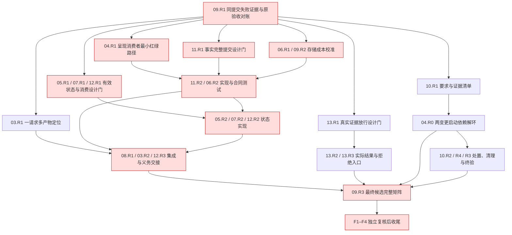

# 运行时恢复理想态 · 编排账（tasks.md，重制）

> **只编排**：当前处于实施与独立复验，尚未完成；旧实现保留，旧全量完成结论撤销。当前叶以各域 `.R` 编号为准，旧孙任务与历史凭据须经对应重整叶逐项对账，不能丢弃。
> **启动门**：保留原 S1/S2/S3 定义；先固定已知 CI 红记录与最小可证伪路径，再通过 G1–G4 对应设计门和各叶正/负/消费者验证准备。规划文件 4/4 不是实现可派发证明。
> **波次语义**：波次仅汇报分组；就绪由具体叶的前置证据决定，并发须写入集及验证读取闭包不相交。未完成闭包计算的候选并发不标已允许。

## 跟踪图（关键路径红）

图表示依赖，不表示同层节点可直接并发；运行型叶与写代码叶的读取闭包相交时也需隔离。关键路径是假设，实际耗时以首轮测量校准，不用历史异机时长承诺完成时间。

## 原 01–10 子变更对照（保留旧叶定位，不表示当前就绪）

| 子变更 | 域 | 孙任务 | 前置 | 波次 |
|---|---|---|---|---|
| [01-three-hooks-golden](changes/01-three-hooks-golden/tasks.md) | 三挂点动态拓展 golden 守护 | 1.1 守护不变量登记 · 1.2 门禁（硬编码即红）· 1.3 正反自测 | W0 | W1 |
| [02-plugin-dynamic-mount](changes/02-plugin-dynamic-mount/tasks.md) | 插件动态挂载 | 2.1 plugins 声明接通 · 2.2 代际注册表 · 2.3 压缩消费动态化 | 01 判据立 | W2 |
| [03-compression-configurable](changes/03-compression-configurable/tasks.md) | 压缩可配置 | 3.1 摘要预算配置字段 · 3.2 去 2048 硬界 · 3.3 摘要经租约 | 02 | W3（与 04 合单）|
| [04-midband-ticket-recall](changes/04-midband-ticket-recall/tasks.md) | 中段票据自主召回 | 4.1 中段→event_key 票据 · 4.2 ticketText 格式兼容 · 4.3 InjectEventKeys · 4.4 S3 锚 | 02；与 03 共触 age_segments 合单 | W3 |
| [05-task-custody](changes/05-task-custody/tasks.md) | task 托管 | 5.1 切片扩携 · 5.2 load 读切片 · 5.3 时序后移 | 02 | W3（boot 簇合单）|
| [06-bounded-open-index](changes/06-bounded-open-index/tasks.md) | 有界开档/索引 | 6.1 引擎自持索引切片 · 6.2 尾增量 · 6.3 静默跳页改响亮 | 02；boot 簇合单 | W3 |
| [07-governance-custody](changes/07-governance-custody/tasks.md) | governance 托管 | 7.1 切片携尾 seq · 7.2 读切片消全扫 · 7.3 生产接线 | 02；boot 簇合单 | W3 |
| [08-fact-retirement](changes/08-fact-retirement/tasks.md) | 删退位机制＋外部折回脚本 | 8.3 删退位机制及其测试（S3）· 8.4 删切面族＋外部折回脚本（S4）| 05/06/07 存活权威；08.R3 须待 06 索引读侧接线 | W4 |
| [09-acceptance-real-measure](changes/09-acceptance-real-measure/tasks.md) | 验收真量 | 9.1 四量探针 · 9.2 多代多任务夹具 · 9.3 S1/S2/S3 转绿 | 05-08 绿 | W5 |
| [10-contract-sync-dead-code](changes/10-contract-sync-dead-code/tasks.md) | 契约同步+死码 | 10.1 主 spec 转正/退役 · 10.2 golden 同步 · 10.3 死码删 | 代码稳定 | W5 |

原表的波次与触碰范围只用于查旧任务；当前调度以 design D9、各 `.R` 叶前置和 ORCHESTRATION 等待表为准。共享 facts/run/durable/checkpoint/ledger 的实际读写闭包未复核前不得并发；同规格场景的叶合单验收，不按域名推断不相交。

## 收尾 F 任务（一级直管，完成状态重开）

- [ ] F1 **契约与归属复核**：原 P0–P8、旧子要求、新增设计门及明确转移项逐项对应；区分批准裁决与工程建议；检查本轮改动清单，不重写原始历史凭据、不夹带其他变更。
- [ ] F2 **同候选全量门禁**：主模块及独立模块的正式检查、十短/六长/变异/普通测试/竞态测试/格式与规格门全部有实际执行结果；原用户真实数据禁区不豁免临时合成数据的模块验收。跳过、零测试、超时、缺日志、错提交均不是完成。
- [ ] F3 **目标逐项与反例核销**：S1/S2/S3 原口径保持；长期阶段成本另验；G1–G4 的负面反例经真实入口触发对应失败，原版通过；实际结果由13收证，同提交独立审查范围与逐项证据完备。不声称有限自测证明无限完备。
- [ ] F4 **归档与合并拒绝有效后再发布**：先验证缺证据/失败/过期/错版本确实被拒；F1–F3通过、发布授权有效后方可归档与提交/合并；归档后的文件变化仍须与验收源码对应。此轮只规划，不执行发布。

## 当前待完成面（2026-11-18，R262）

| 承载叶 | 当前事实 | 下一步凭据 |
|---|---|---|
| 12.R1 | S4/S5 与消费失败锚已在主树，原镜像门阻碍已由合并解决；设计门不是“完全未启动” | 按设计门标准核销，不用实现红否定已有设计产物 |
| 12.R2 | 两处失败报告已补，信箱拒收及义务保留锚通过十次竞态检测；切面覆盖失败事实仍为真实红 | 全局/会话切面拒绝、同身份恢复及重投路径逐项实测 |
| 12.R3 | 卸载后义务消失仍为真实红 | 12.R2 完成后实施安全移除与生命周期验证 |
| 06.R1 / 09.R2 | 原无重叠成本锚恒真，已删除；独立核验不承认完整归因已承接 | 重建可失败的阶段测量，不把现有计数锚当完整归因 |
| 12.R2 / 09.R3 | 重复生成并投递的失败日志存在，G78 配额中断；未得根因与安全修复 | 用已留探针补真实切点与耐久收据证据，不能以重跑绿销案 |
| F1–F4 | R35 不放行；已授权操作不等于完成；旧矩阵证据脱离现树 | 实施收口、逐叶对账、同候选复验及独立审查后再提交/归档 |

下方 R141–R210 的勾选与数字只保留历史沿革，不代表当前队列、当前绿态或全部范围已完成。

## 历史重整域账（旧证据保留，当前完成不能由旧勾选推导）

> **勘误（R141，2026-11-17）**：本节原引叶号已过期——`06.R1–R2`／`08.R1–R2` 已随退位反转**作废**，`10.R1–R4` 已被 `10.R5–R8` 取代。现按实际叶集与**编排者亲验凭据**重写；**未跑不勾**，勾选只给有直接证据者，其余留空并注明待何凭据。逐项证据见 ORCHESTRATION 台账 R87–R140。

- [x] 06 / 08 **反转与三层去物化＋派生态真水位化**：`06-bounded-open-index/` 的 06.R3–R13（索引读侧接线、读写面拆分、窗口日志字节界、store 常驻索引去物化、checkpoint 只载开放项）；`08-fact-retirement/` 的 **08.R3/R3b（退位整体删除）／08.R4a（切面族删除）／08.R4b（外部折回脚本）**。**凭据**：退位 27 符号与切面族八符号生产/测试**零命中**；boot 症状锚三锚 PASS 且三界 `[0 0 0 0 0]`；长跑锚 PASS（23.0s）〔**勘误 R210：该「长跑锚 PASS」是单次 `-count=1` 读数，已废。G36 配对实验（21 对×3 run）确证 depth252 boot 1.64–1.74×、p10 全高于 1.3 界，增长为真；主因＝本候选把 HEAD 的内存 map 遍历改成 `eachRecordOnce` 磁盘全表扫（38.7×）。勾选保留（三层去物化与退位删除本身凭据仍成立），但「长跑达标」这一项不成立，中心论点未达成，G44 在修**〕；结构锚证 8/32/128/512 已结深度 checkpoint body **逐字节相等**；折回脚本 12/12 测＋49/49 逐键 sha256 相等。**08.R1/R2 及原 6.x 作废不得派发**（见 08 域头部 banner）。
- [x] 05 **尾谓词接缝**：`05-task-custody/` 的 05.R3-甲——导出既有 `commitOrder` 为 `ledger.CommitOrder`（一份契约两个消费者），三态语义落地，三枚冻结锚 ×10 PASS。**05.R1–R2 旧叶见域内记录**。
- [x] 10 **契约/文档/门/端口收口**：`10-contract-sync-dead-code/` 的 **10.R5（主 spec 退位条款删除）／10.R6+R6b+R6c+R6d（文档与升级说明、行号锚改条款名锚、陈旧标识符）／10.R7（golden 腐化绑定）／10.R8a+R8b（三接口收口为 `api/durable.FactLog` 3 方法）**。**凭据**：旧三接口名全仓零命中、`api/durable` 已登记 packages＋edges、三道架构门 0；三处 spec 冷档前置齐套；doc_budget **22149＝baseline 绿且锁步**；vocabulary 0；**死代码门建成并 exit 0（24 条真死生产者已删）**。
- [ ] 09 **校准与全矩阵**：`09-acceptance-real-measure/` 的 09.R4 已落（症状锚重定），**09.R2 校准（噪声判据、真实 checkpoint 切片采样复核下界 49,608）／09.R3 全 CI 矩阵待跑**。
- [ ] 13 **实际证据与归档拒绝**：`13-verified-completion/` 的 13.R2（N6 attestation）／13.R3（外部授权）待。**DoD 门自身三缺陷已由 G8 收口**（字面量为权威、形状锚、门锚 schema、P4 自证判决退役），**站点行号漂移已由 G11 收口**（20 站点改 `<file>#<func>`，D5 自测 48/48）。**现余真跑侧 10 gap**：P5/P6 变异已由 G20 注册并**真跑 killed**（runner 增门判决模式，G27 补齐夹具门分支使自测 54/54）、P5 已绑 `check_spec_hygiene.py` 门锚；**P4 原变异已退役须重指存活反例**（两候选锚文本落在存储面改动区，待其落地）＋八条「已注册无真跑记录」。**九变异实跑硬依赖控制树全绿**，排在存储面修复之后。另 DoD 判据三处字段腐化（P1 文本含已删机制、P4/P5 `ci_gate` 指错 job）已由编排者修正，见台账 R172。
- [ ] 01 / 02 / 03 / 04 / 07 / 11 / 12：**旧叶账见各域 tasks.md**；本轮未重开其实施，**其勾选状态须由 F1 逐项对账确认**，不得由本重整推导为已完成。07.R2 的治理切面锚重述已由 A1 落地（三处变异证明齐全）。

**当前状态（R151 重写，取代 R141 段；编排者亲测凭据）**：

> **勘误**：R141 段原写「两条症状直译锚全绿（boot 三界全 0、长跑各阶段达标）」——**该声称已撤销**。它出自单次 `-count=1` 绿，而 06.R14v 复跑显示长跑 boot 阶段 run2 报 1.511 破界；且 `tests/integration/history/symptom_anchor_midband_test.go:195` 症状锚现红。**单次绿不得声称达成，症状锚未全绿。** 原段并列的「concept 剩 1 条」「DoD 15 gap」「在跑四单 06.R14v/G8/S4b」均已过期，以下列实测为准。

- **已闭合（编排者逐项亲测，凭据见台账 R145–R172）**：**五条阻断全闭**——ABBA 死锁／A 簇新根只读开档 ENOENT 3 条／C 簇 memory 档兜底错序 3 条／重入落座（`send_reentry_restart_test.go:97`）／midband 症状锚（根因＝memory 档两引擎，G23 删特异分支使与 durable 同构）。**两条症状直译锚均绿**；`TestStorageCapabilities` 损坏检测安全回归已修（G25，亲测 0）。门禁绿：build／vet／concept（stale 0）／dead_producers（3447）／vocabulary／doc_budget（slack 0）／doc_links／**comment_policy 棘轮三模块 0 findings**／**openspec strict 0**（CLI 已装真跑）／event-ownership／durable_truth（R167 收）／**mutations 自测 54/54**（G27 收）／dod 自测 39/39／runtime discover 296 中**仅 1 红且属外来禁改面**。另收：ci.yml race 集补 `./api/durable/...`、合成树夹具补四门 stub、DoD 判据三处字段腐化（P1 文本含已删机制／P4·P5 ci_gate 指错 job）、夹带 `url-fetcher/UPGRADE.md` 一行已剔、**裁决面扩大两处已勘误**（落点/3 方法/净减 2 是编排者推导非用户原话）。
- **🔴 中心论点未达成（R210 严格实验否证，取代本段先前一切乐观表述）**：**只兑现「boot 索引走查有界」**（visits/valueReads 恒 4），**未兑现「恢复成本随历史有界」**。G36 配对法（21 对×3 run、奇偶换序、比值中位）确证 depth252 boot **1.643/1.735/1.724×**、p10 全高于 1.3 界、随深度单调 ⇒ **增长是真的不是噪声**。**~78% 增量来自两条四量量不到的 O(历史) 读**：主因＝`journal.go:1490 eachRecordOnce` **磁盘全表扫**（61.5µs→2383.8µs＝**38.7×**，零匹配反证随表容量增长；**HEAD 是内存 map 遍历，本候选改成全表扫＝自己引入的回归**），次因＝`:615` 开档全 log CRC（**副本实验确证非主因**）。**先前「亚线性＋机器离散」归因已勘误**：`judgeFixtureDispersion` 量 total 而界逐 stage 判，**轴不对齐**，run1 真增长根本没被判。**G44 在修**（消全表扫＋补两观测量入计数面＋判据四点校准，禁调大界禁删守卫禁引第二真相）。
- **未闭合（亲测红，R208/R210 时点）**：`check_dod_coverage` **9 gap**（G35 已真跑 killed 闭 P4 两条；余 8 为 P0-P3/P5-P8 无 run 记录，G41 在全量真跑）；`gen_godoc --check` 红两文件；`check_product_surface` 1（`NewMemoryOriginalStore` test-only 导出，**R193 裁「接线非删」**，G43 在做）；`proc-refs` 1（**属另一活动变更 `no-prefix-criterion` 未跟踪工作，非本候选**）；`tracked-hygiene` 13（**暂存态⇒全量 lint 须排在暂存之后、提交之前**）；`package-layout` 17（HEAD 既有＋2 新增）；**G34 安全修复暴露 8 包约 20 条夹具须补 `WriteRights: true`**（G42 在做）；**G8 重铸号覆盖仍违 P1 红线**（R201 洞语义已冻结，G40 在做）。**assembly 功能性红已全闭**（原 10→0，G26 修夹具＋G33 重表达陈旧锚），**仅余长跑中心论点锚**。
- **⚠️ F2 硬依赖与顺序**：`check_dod_coverage`／`gen_godoc`／`check_product_surface`／`proc-refs`／`tracked-hygiene`／`package-layout` **都在 `scripts/gates/lint.sh` 内**，故全量 lint 不可能提前绿。**`tracked-hygiene` 须把删除入索引才转绿 ⇒ 全量 lint 必须排在暂存之后、提交之前。** 完整门禁面已逐门实测（约 30 绿），清单与退出码见台账 **R149／R169**。
- **在跑两单**：G25（`memory/ledger/journal.go`＋`journal_kv.go`：损坏检测已修，提交 EINVAL 6 条同根红在收）、G26（装配层三红）。**其余待派项全部与其写面或构建闭包相交，故两单即当前最大不相交并发。**
- **待派/待做（依赖序，详见台账 R164／R172）**：①八面懒水合（`Obligations` 现时可达，靠 `read.go:473→477` 隐式顺序兜住）②`NewMemoryOriginalStore` 零残留删除（须同批迁 5 测试＋3 处断言）③**11.R2 消费者锚 `TestRecoverKVReadsARelocatedRoot` 被 08.R3b 整文件删除且无后继**，须补或裁定承接 ④11.R3 `landedSeq` 负锚、07.R1 两 tier 锚（均无承接叶）⑤feedback 孤儿转移项**须立承接实体否则 F4 归档丢失** ⑥兜底路径生产侧观测缺口 ⑦水合成本界声明 ⑧长跑 profiling／09.R2 ⑨P4 退役重绑 ⑩九变异实跑（须控制树全绿）⑪godoc 统一重生成 ⑫两条稳定红归因（`TestDurableCommitBarrier`／`TestConsumptionFailureIsReportedByName`）→ 全量 lint＋CI 矩阵 → **F1 完整反夹带（196 文件核心 diff 未逐行审）** → **R35 第二轮独立放行审** → F2/F3/F4。**归档与 commit/push 须用户明示授权，本轮不执行。**
- **范围裁定（不夹带）**：G12 报的跨包 feedback 孤儿（`assembly/host_diagnostics.go:171`、`features/rl/feedback.go:8`、`openspec/specs/feedback-binding/spec.md:26`）经核**在 HEAD 就已死**，非本变更残留 ⇒ 立案为既有缺口归独立变更（when：本变更归档后；why：删它须同时退役一条已接受主 spec 条款，属另一契约面裁定）。见台账 R148。**⚠️ G28 指出该转移项无承接实体（无变更目录、无 LEDGER 条目），F4 归档须携带。**

## 重制说明（取代旧 01-06 编号）

旧域重编号：旧 01-task-custody→05、02-bounded-open-index→06、03-governance-custody→07、04-acceptance-real-measure→09、05-contract-sync-dead-code→10、06-fact-retirement→08。新增 01-three-hooks-golden、02-plugin-dynamic-mount、03-compression-configurable、04-midband-ticket-recall（核心重框定 D6.15-D6.18）。旧域内容沿用，编号与依赖按本表对齐。
