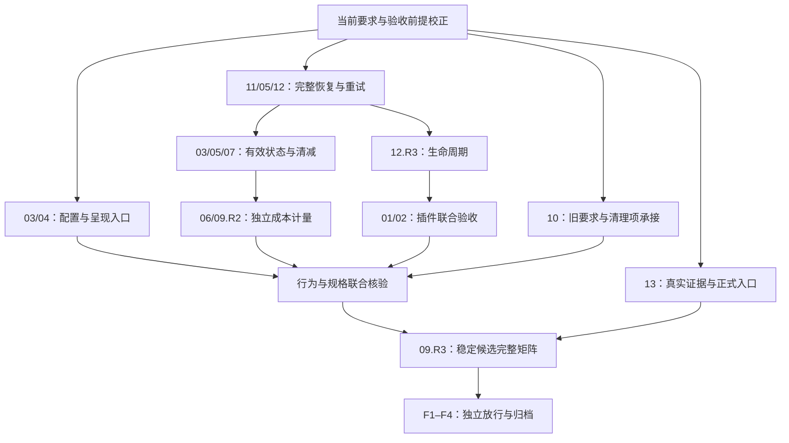

# 运行时恢复理想态 · 当前任务索引

> **只编排**：本文件索引十三个领域的执行叶及F1–F4；具体产出、写面和正/负/正式入口验证在各域tasks。旧勾选不代表当前候选完成，未勾也不代表没有实现。
> **启动门**：本轮先校正计划，不自动启动生产修改。后续实现先满足对应叶的身份、状态、计量及证据前置，不借“产物4/4”宣告就绪。
> **波次语义**：依赖满足的叶才就绪；同一图层不保证可并行。当前派发、授权及资源状态只读 [ORCHESTRATION.md](ORCHESTRATION.md)。

## 目标与原症状承接

| 验收面 | 当前要求 | 所属领域 |
|---|---|---|
| 原日志增长问题 | 历史原文及顺序保持可读；明确记录磁盘增长。删除退位后不再要求物理文件封顶，不以更名后的其他指标冒充原S1达成 | 06、08、09、11 |
| 启动与长期运行 | 分别量恢复解码、索引读取/常驻、任务加载及墙钟；安全完整性扫描按已声明的线性成本单独核算。保留完整测量，不把所有boot时间声称为常数 | 03、05、06、07、09 |
| 原S3模型自主召回 | 中段保留可用原事件票据，正式召回入口取回原文；最终呈现不越预算，不掩盖重复通知 | 03、04 |
| 一次完整行为 | 输入保存、状态应用、检查点、重启和同身份重到达保持正确顺序，不丢义务、不重复驱动 | 05、11、12 |
| 插件扩展与生命周期 | 统一注册入口；有未完工作时禁用/卸载/替换具名交接或拒绝且保原对象 | 01、02、12 |
| 可信完成 | 旧要求与清理项逐一承接；正式检查入口消费绑定最终代码及依赖的真实证据 | 09、10、13、F1–F4 |

原验收及旧顶层勾选原文保存在 [TASKS-HISTORY.md](TASKS-HISTORY.md)，原轮次依据在 [ORCHESTRATION-HISTORY.md](ORCHESTRATION-HISTORY.md)。这是历史保全，不是完成归档。目标适用条件见 [design.md](design.md) D1/D5/§六。

## 当前领域状态与承接

全部领域保持待最终核销；本表说明现有成果与尚欠，不设虚构完成百分比。

| 域与执行入口 | 已有成果 | 当前未完成承接 |
|---|---|---|
| [01 三挂点守护](changes/01-three-hooks-golden/tasks.md) | 检查器及正式入口已接，原功能存在 | R1：守护边界、跨函数绕路与运行行为覆盖；旧免检描述校正 |
| [02 插件挂载](changes/02-plugin-dynamic-mount/tasks.md) | 内置目录、配置读取、扩展和禁用存在 | R1及原2.4：生命周期集成；验收依12.R3，但12.R3可使用已有装配能力，不反向等待本域验收 |
| [03 压缩](changes/03-compression-configurable/tasks.md) | 核心预算、模型租约、未完请求存档存在 | 宿主文件预算入口；R2历史遍历/内存清减；R1重复产物原因核销；R3最终成本与契约 |
| [04 呈现与召回](changes/04-midband-ticket-recall/tasks.md) | 票据及正式召回原文路径存在 | R0跨变更依赖解环；R1既有识别修复由R3补带票据重复通知计数；R2最终预算、双票据及正式入口验收 |
| [05 任务托管](changes/05-task-custody/tasks.md) | 当前/欠交付任务存档、旧任务按需读取存在 | R1/R2/R3：旧键与收据未加载不可当未结；与12.R2联合诊断重复生成；原1.4与缺失验收归本域 |
| [06 开档与索引](changes/06-bounded-open-index/tasks.md) | 索引读侧、去全量物化、增量路径存在 | R3旧键查询起点成本；R5屏障原验证承接；其余未核旧叶与09.R2的真实成本归因，不以已废R1/R2重开退位 |
| [07 治理托管](changes/07-governance-custody/tasks.md) | 原审批身份/拒绝决定、历史读取、流水安全修复存在 | R2：已决审批与目标存档清减、绑定扫描；保持决定按身份可读，补真实存储及重启验收 |
| [08 删除退位](changes/08-fact-retirement/tasks.md) | 退位删除与外部折回工具存在 | R3/R4：保全历史及外部转换异常前置；旧原型/符号删除验收逐项核销，不恢复框架冷热分支 |
| [09 真实测量](changes/09-acceptance-real-measure/tasks.md) | 多代探针、实际读数及部分反例存在 | R2独立阶段计量与原指标承接；R3最终候选矩阵；R4历史红锚建立不等于性能通过 |
| [10 契约与清理](changes/10-contract-sync-dead-code/tasks.md) | 持久接口收口、部分文档及死码清理存在 | 当前叶逐项承接旧R1–R4及旧清理名单；Fold/旧WAL恢复家族、六读端口、旧主规格与golden不靠绿门销案 |
| [11 整事实提交](changes/11-atomic-fact-commit/tasks.md) | 批提交、判重与写者互斥存在 | R2/R3：拒绝/结果未知分类、稳定身份重交不占新号、旧转换消费者锚承接与真实入口验证 |
| [12 消费与生命周期](changes/12-consumer-state-lifecycle/tasks.md) | 具名失败、拒绝错误进度和定向重试保护存在 | R2及补差：总序恢复、折叠后重试、跨进程收据；R3拒绝卸载保原对象，S5前提校正；未放行 |
| [13 可信放行](changes/13-verified-completion/tasks.md) | 实际证据运行器及部分拒假反例存在 | 现树和依赖指纹、正式lint传证、有效comment scope、归档/合并实际拒绝入口与权限事实核实 |

## 依赖图

图表示逻辑前置。计量定义、已有缺陷诊断、文档清理可在不相交写面先行；需要被测实现的最终计量留到实现稳定后。12.R3不阻止12.R2的重复生成调查；02.R1的验收等待12.R3，不形成实现互等。

## F1–F4（仍未完成）

- [ ] **F1 要求与归属复核**：P0–P8、原症状及批准的目标调整、全部旧叶和转移项逐项有实现/验证/承接；旧检查位置迁移不等于删除；核对整个拟提交候选与未提交内容的归属。批准的规格变化按含义核验，不要求这些变化伪装为零diff。
- [ ] **F2 同候选完整验证**：正式lint、主模块和独立模块、十短/六长、普通/竞态测试、变异及文档门有实际终局；绑定编译所用本地依赖。程序失败、跳过、零命中、超时、缺日志和错版本都不算通过。
- [ ] **F3 目标与反例核销**：保持原文可读、真实启动及长期成本、模型自主召回、完整行为和G1–G4各自的可失败反例；历史CRC反例仅证明完整性校验，不代替性能反例。独立评审重新扫描最新修复，范围内无阻断。
- [ ] **F4 完成归档与发布**：无证据、失败、过期、错源码/依赖时正式入口拒绝；F1–F3通过、授权有效后才运行OpenSpec归档并校验主规格。分批提交按ORCHESTRATION的独立候选条件执行，不以搬出历史台账代替完成。

## 本轮调整范围

仅更新计划和历史索引；不改变生产代码、测试、主规格、权限或index。历史成功记录保留，但R264的整体完成与无效门禁声称不再有效。当前没有确认可直接归档的完整子域；独立候选评估见ORCHESTRATION的分批条件，未通过不执行提交。
