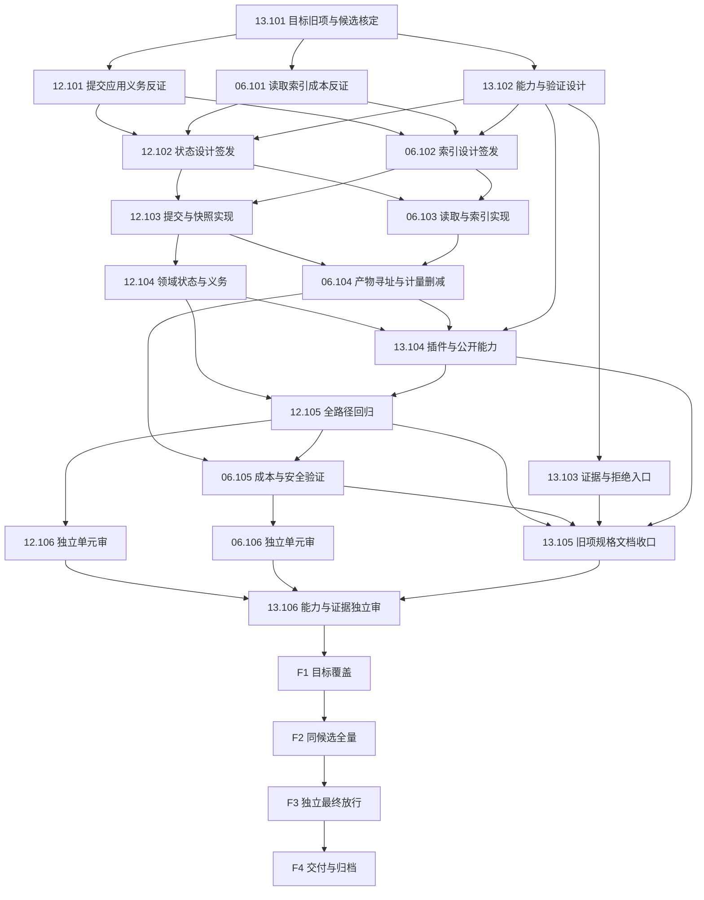

# runtime-recovery-ideal · 语义重整总账

> 本文件只编排；执行细节仅在三个活动单元tasks.md。
> 启动门与派发依据为 [ORCHESTRATION.md](ORCHESTRATION.md)；旧域/R编号不能直接派发。
> 波次是汇报分组；解锁按同一候选上前置叶的证据和签发，不等待本变更先合入main或先归档。

## 当前状态

2026-11-21：计划重整及独立复审完成，产品未完成。`7b0cde16`为复核起点，不继承旧“各域闭合/R35空”的结论。所有新叶与F均未完成；历史勾选及原文见 [CARRYOVER.md](CARRYOVER.md) 与历史快照。

## 三单元与依赖图

图只表达依赖；写面或验证读取相交时另按ORCHESTRATION串行/隔离。图中的实现叶必须先有D4签发记录，不能因前置checkbox被误勾而自动执行。

- [x] **A 提交—应用—义务**：[12单元](changes/12-consumer-state-lifecycle/tasks.md) 的12.101–12.106完成；真实故障/并发/重启反例与独立审齐，不以局部grep证明未丢义务。（12.106 两轮审关；六缺陷修复全绿＋变异咬合；死写三处删除。）
- [x] **B 历史读取—派生索引**：[06单元](changes/06-bounded-open-index/tasks.md) 的06.101–06.106完成；历史读取与完整成本都被承接，未知增长不能只列日志后关闭。（06.106 两轮审关：boot O(历史)→O(log C) 实证、rustviking 80/80 零 skip、35 行终判、R4 补锚清偿；CRC 线性项单列维持。）
- [x] **C 能力契约—验证体系**：[13单元](changes/13-verified-completion/tasks.md) 的13.101–13.106完成；需求、旧项和执行证据只有一个当前解释，未接线入口不算已拦截。（13.106 终审关；R6→F1、R7→补签窗、R13 已归位。）

## F1–F4：全部目标的最终收工

- [x] **F1 要求与归属核销**（依13.106）：design D1每行、CARRYOVER每项、模式/档位/跨变更交接核到期实现及单元证据，已到期未完成非零即不勾；后置F2矩阵、F3最终审、F4实际CI/保护/交付逐项有验收但仍记待核销，不提前计兑现。合法规格改变按语义审，不强求spec零diff。核原文、发现、隔离、无tier、真实存储CLI及soak边界；不存在的类不等于取消需求。（2026-11-22 勾：独立核销审四判成立——D1 13 行兑现 10/待阶段 3、H01–H14 终态闭合、151 项兑现 135、模式档位全绿（rustviking 80/80）；五到期项全清＝R2/R3/H13 编排者裁定、R13 补记、R1 勘误关闭（C11.12，派发前提错误由实施单拒施纠出，真树即 03.R5 成果＋S1 门绿）；待 F2/F4 清单显式列名交 C11.3。）
- [x] **F2 同一候选完整验证**（依F1）：冻结源码、全部编译依赖、主规格/合同、工具、CI本地文件及环境身份；执行正式lint/preflight、主模块与独立模块必需回归、race、十短、六长、全量变异和CI对应的可本地运行命令。先用`go list`与构建标签核命中；同候选bundle经真实checker接受，DoD原始结果不缺项。冷/热、失败/重试都留存，未知成本、缺资源、skip、零匹配或无终局不计绿；产物持久保存。实际服务端CI/保护仍待F4，本地等价执行不冒称远端已运行。（2026-11-22 勾：最终冻结树——六长 6/6、十短重取 10/10（首个 10 轮中 repeat-7 tmux 空捕获负载间歇已按协议 superseded 留样于 superseded-flake-20261122/、串行×10 全绿；**F3 审 B1 纠出首轮 bundle/lint 回显空转**，重以原始 exit 落 final/exits.txt：SHORT=0、BUNDLE=0、LINT=1 唯一红＝外来 symptoms 自测 C7.3 集成差异）、变异 23/23 控制绿、bundle 17 份 exit 0、lint 全链 exit 0（comment_policy 0、DoD 9/9）、golden 重录 drift=0；smoke＝隔离副本全量绿＋主树 Symptom×2 环境阻断（CI 权威、F4 复验）；根模块全绿除两枚负载 flake（串行绿×3）；F2 中发现并修复 seed-1×256 真回归（无屏障标记）；证据 ~/Documents/codes/tagent-f2-evidence/2026-11-22-f2/final/；残留：三观测轴未验、total 1.18× 未终裁、file 档发现端到端归 F4/CI。）
- [x] **F3 独立最终候选审**（依F2）：非实施者复审完整候选的前提、全部新增结构、原症状、接口/配置/模式、规格删减、验证敏感性与全PR夹带。报告分母、未查面、成立/驳回项；到期候选缺陷frontier为空且目标证据齐才勾。F4实际CI/保护/交付仍待核，不算产品交付完成；新增修复回所属单元，受影响F1/F2重开。（2026-11-22 两轮勾：初轮三阻断——源码/规格/golden 面 frontier 干净确认（diff 授权链逐文件、八机制反事实、原症状四条对证、151 项抽 5）；B1 证据-台账不同步＋首轮 bundle/lint 回显空转已纠（真验 exits.txt：SHORT=0 十短 10/10、BUNDLE=0 复验 ok=True、LINT=1 唯外来红 C7.3 在案）、B3 R9 已改 F4/CI、B2 git 索引污染记 F4 前置第一步。二轮因上游 API 中断由编排者亲验四项全过（覆盖边界如实：终轮为编排者直验非独立审者，初轮已覆盖分母主体）。）
- [ ] **F4 实际CI、交付与完成归档**（依F3及具体授权）：逐文件审暂存归属，仅纳入本变更；build/test与commit独立，提交后确认commit、内容及证据绑定。按授权push候选并核实际CI、分支保护/绕过权限；未通过前不归档/合并。再按13.105已验证的唯一合并输入同步主规格并archive（不跳spec/校验），复验受影响正式门、归档制品及新提交/远端结果；归档改变绑定内容时重取相应证据，不改旧摘要。全部旧项含后置要求核销后才交付；缺授权、CI失败或必需保护未生效均保留F4及整体未完成。

## 验收命令归属

具体正/负/消费者命令由各叶冻结；F2完整选择清单由13.105输出并由13.106审过，不把示例命令当完整矩阵。旧`run-notes.md`只能追历史，不能给本轮F打勾。

规划结构验证可执行 `openspec validate runtime-recovery-ideal --strict`；它不执行三域的产品反例，不证明F1–F4。现有`check_runtime_plan.py`有旧域/ID集合约束，13.103应验证是否可复用并接入本计划，不为得到绿报告创建一个假图或跳过未知叶。
