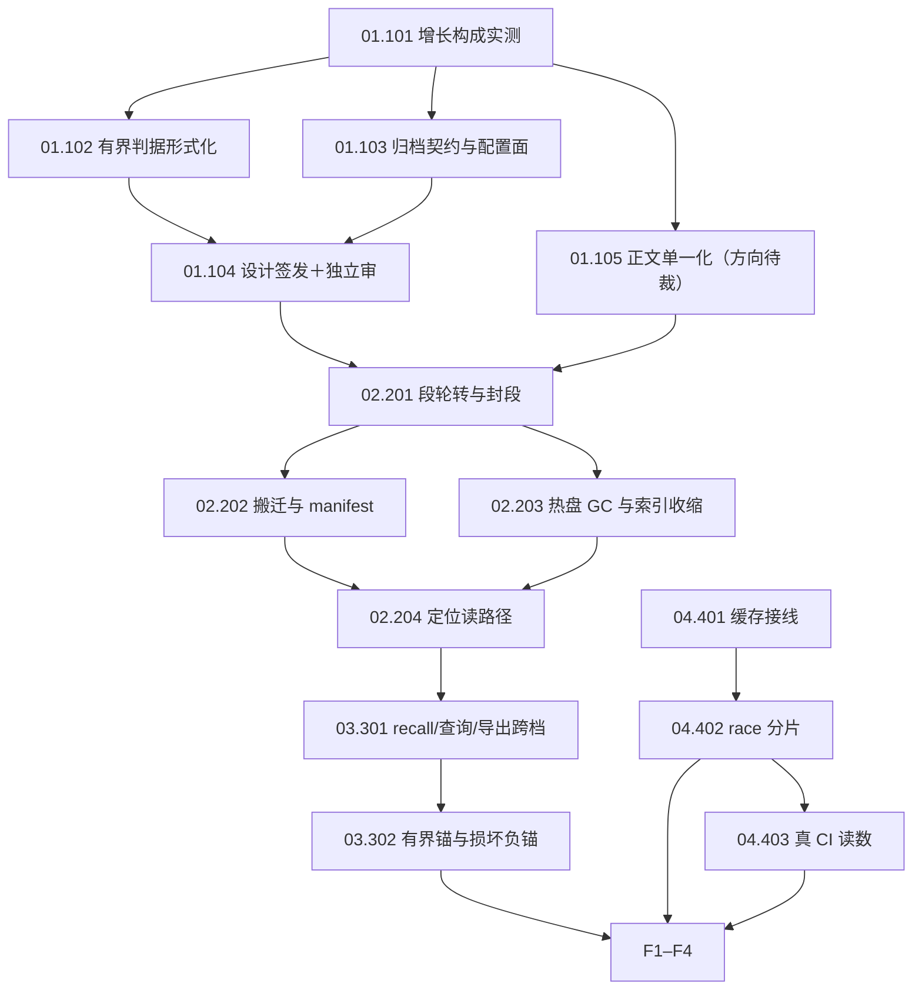

# Tasks：bounded-hot-log（一级只编排）

> 本文件只编排。派发唯一依据是 [ORCHESTRATION.md](ORCHESTRATION.md) 与各子变更 `tasks.md`。
> 启动门：runtime-coherence 的 CI 修复收口（PR 可合并）后，01.101 方可派发。
> 波次只是汇报分组；解锁以依赖叶有同候选证据为准。

## 子变更

- [x] [changes/01-bounds-contract/](changes/01-bounds-contract/)：增长实测、判据、归档契约、签发（01.101–01.104）
- [x] [changes/02-rotation-archive/](changes/02-rotation-archive/)：轮转/封段/搬迁/GC/定位读（02.201–02.204）
- [x] [changes/03-read-paths-release/](changes/03-read-paths-release/)：消费一致性与验收（03.301–03.302）
- [x] [changes/04-ci-throughput/](changes/04-ci-throughput/)：CI 缓存与 race 分片、真 CI 读数（04.401–04.403）

## 收尾（一级直管）

- [x] F0.1 C1 预算口径：有效字节预算取 `hot_log_max_bytes + 2*当前热段最大日志区间` 与恒热结构下限 `H` 的较大值；补结构下限观测、S1 条件断言与 quiet/early-cut 反例 —— 验证：`TestHotLogPlateausAcrossGenerationsAndOldFactsStayReadable`、`TestQuietPointUnreachableToleratesOverBudget`、`TestHotLogBudgetRequestsEarlierCut` 与 mutation 锚同批重跑
- [x] F0.2 manifest 去歧义：临时段与索引先屏障，manifest 先陈述目标名，再 rename 落归档、最后删热；无 manifest 仅有已命名归档制品归 `ErrArchiveCorrupt`，未提交临时件可由恢复清理 —— 验证：四切点、manifest 全丢、索引缺失/损坏负锚
- [x] F0.3 F1 规格与文档：一级 spec 只留编排契约；补四个新 capability、`session-checkpoint-material`/`bounded-recovery`/`storage-lifecycle-completion`/`compaction-scheduler` delta 与 02.205–02.209、FactReader 变化；GLOSSARY/wiki/CHANGELOG/OPERATION 同批对齐
- [x] F0.4 04 证据重绑：把 consumer/restart/mailbox 稳定性修复纳入 04 边界；同工作流冷热两轮与最终完整 CI 原文入档，基线/候选等价性如实标注
- [x] F0.5 跨档枚举：`Keys`/`Namespaces`/`EachCommittedNewestFirst`/`EachCommittedNewestFirstFrom` 合并热段与归档段，按最新提交序去重、跳过墓碑并保留 early-stop —— 验证：真实 cut/archive 后全键、namespace、提交序、删除与分段起点锚 ×10
- [x] F0.6 归档最后副本安全：有效 manifest 未陈述的最终名制品具名拒且不删；崩溃残留删热副本/缩 journal 前对对应本代段／索引验摘要，稳态不预扫 —— 验证：`TestArchiveManifestRefusesUnstatedNamedArtifact`、`TestBootArchiveConvergenceRefusesToDeleteHotCopyBehindCorruptArchive`、`TestBootArchiveConvergenceRefusesToShrinkLogBehindCorruptArchive` ×10
- [x] F1 承接与契约修订零遗漏：`session-checkpoint-material`/`bounded-recovery` 措辞、GLOSSARY 术语、升级说明
- [x] F2 全量门禁：冻结树完整矩阵＋三 module＋race＋lint＋openspec
- [x] F3 DoD：S1 稳态平台锚红转绿（回滚即红）、S2 损坏具名拒、P1–P8 逐条证据（含承诺面审计：强度主张≡条件句＋成对见证锚；强度词扫描 warn-only 报告入档，词表可绕过不作门）
- [x] F4 独立审 frontier 空后归档；真实 CI 绿才判放行
