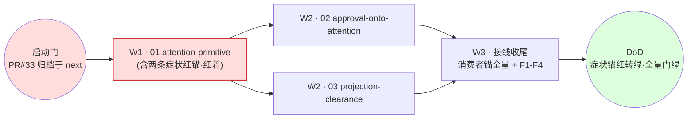

# Tasks: attention-lifecycle（一级只编排）

> 本文件只编排：进度账目 + 波次 + 收尾 F 任务。孙任务与验收命令在二级域的
> tasks.md；派发唯一依据是 ORCHESTRATION.md。

> 启动门：`event-driven-consumption`（PR #33 线）已落地 next 并归档——attention
> 动 notice/settle 面，代码基线必须含消费循环语义，否则本计划文件清单即漂移。

> 波次语义：波次仅是汇报分组，不是栅栏；解锁 = 前置域入 next。

红线节点 = 关键路径（01 未入 next 则 W2 双域全阻塞）。

## W1

- [ ] 01 域四件套评审通过（编排者）—— 验证：本 tasks.md 勾选 + 01/specs strict 校验通过
- [ ] 01 域实施完成并入 next —— 验证：`go test ./runtime/task/... ./api/event/... -count=1` exit 0
- [x] 两条症状锚已落仓库且红着（立案当日凭据入台账） —— 验证：`go test ./tests/integration/host -run '^TestAttentionClears' -count=1` 失败（红锚凭据已入 ORCHESTRATION 台账）

## W2（并发，触碰集见 design D6）

- [ ] 02 域四件套评审通过（编排者）—— 验证：勾选 + 02/specs strict 校验通过
- [ ] 02 域实施完成并入 next —— 验证：02 tasks.md 全勾 + 正/负/消费者锚命令 exit 0
- [ ] 03 域四件套评审通过（编排者）—— 验证：勾选 + 03/specs strict 校验通过
- [ ] 03 域实施完成并入 next —— 验证：03 tasks.md 全勾 + 正/负/消费者锚命令 exit 0
- [ ] W2 波后独立偏差评估（对照原任务行验收面，非追认缩水后）—— 验证：评估记录入 ORCHESTRATION 台账

## W3（编排者单做）

- [ ] 消费者锚全量核验：governance 门、fuse seam、wechat 人侧、notice 清除、summary 投影各有一名实消费者 —— 验证：逐消费者命令凭据入台账
- [ ] F1 契约登记与冻结面零改动断言：新增事件类型与 meta 键全部进
      `api/event/skeleton_assert.go` 与 `docs/FACT-VOCABULARY.md`，且
      `git diff <01入next点>..HEAD -- api/event` 为空（冻结面零改动）
      —— 验证：`bash scripts/lint.sh` exit 0；diff 为空凭据入台账
- [ ] F2 全量门禁 —— 验证：`bash scripts/lint.sh`；`go test ./... -short -count=1`；`python3 scripts/gates/check_event_integrity_mutations.py --all`；`bash scripts/gates/check-openspec.sh`；CI 全 job 绿
- [ ] F3 DoD 逐项核验 + 症状锚红转绿两证 —— 验证：回滚态必红/落地态必绿两份 run 凭据入最终 run notes
- [ ] F3.5 独立只读审者拷问放行 —— 末轮 frontier 空 + 扫描范围 + 逐项证据；
      拷问者不得为任何实施 agent
      —— 验证：拷问记录（轮次/frontier 清单/证据）入 run notes
- [ ] F4 openspec archive + 导览文档（域→证据链接，run-id 逐字符核对）—— 验证：`openspec list` 不再含 attention-lifecycle
