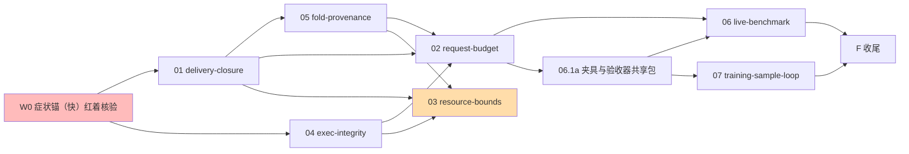

# 边界闭合与收益验证：一级编排账目（只编排）

本级只编排波次与收尾 F 任务，不展开产品实现；实施在二级子变更的孙任务。派发以 [ORCHESTRATION.md](ORCHESTRATION.md) 为准。
启动门：六条症状锚（快）红着 + 症状锚⑤（慢）自有红凭据在 W2 首日补齐（见 0.1；grill r1 F1 裁定：锚数=症状锚（快）六条+症状锚（慢）一条，口号与命令必须一致）。
波次仅作汇报分组；解锁依据为前置域入 main 并通过全量门核验，不等待整波。

关键路径（红系）：W0 → 01 → 03 → 07 → F（03 的 300 轮长跑与 07 的样本证据是工期最长链）。W1 内 05 串行在 01 后（loop.go 提交面稳定，grill r1 F26）；06.1a（任务夹具与验收器共享包）先行入 main，06 其余与 07 并行消费它（grill r1 F27）。

## 0. 启动门

- [x] 0.1 W0 锚定（grill r1 F1 修正口径）：**六条症状锚（快）**——①`TestSymptomAnchorDeliveryRegistrationStopsSend`②`TestSymptomAnchorDeliveryWindowSurvivesRestart`③`TestSymptomAnchorRetryAutoRedrive`④`TestSymptomAnchorUnifiedRequestBudget`（assembly）⑥`TestSymptomAnchorExecDeadPaneIntegrity`（tool/exec，真实 tmux）⑦`TestSymptomAnchorFoldSummaryProvenance`（memory/replay）——验证（全带 `-v`，断言 FAIL 行数）：`go test ./assembly -run 'TestSymptomAnchor' -count=1 -v`（FAIL 行数=4）+ `go test ./tool/exec -run 'TestSymptomAnchor' -count=1 -v`（FAIL 行数=1）+ `go test ./memory/replay -run 'TestSymptomAnchor' -count=1 -v`（FAIL 行数=1），三包 FAIL 行数均 >0 且无 PASS/SKIP 行冒充红证；lead 已亲验三包输出；**症状锚⑤（慢）**=`cd examples/wechat-bot && go test -tags smoke -run '^TestLocalSmoke$' -count=1 -timeout 2h -v ./...`，红凭据两段：评审两次实测（175/159 KiB/轮）为计划期凭据 + **W2 首日、W1 合并增量（01+04+05）已入 main、02/03 未入树时重跑一次取得自有红证**（该树含 W1 合并增量增重——斜率同时给出与 48d8eb93 评审数的差值，即 W1 合并增量估计；R32 后台长跑单；非空转证明=日志 rounds=300 与斜率数字）。锚③错误形状已修为"确定性失败、非超时"（F9）。

- 注：主 spec `symptom-anchors` 的九则既有锚不在本变更范围（其存在性与红绿由既有 CI 保证）；本变更七条症状锚为其家族新增。

## 0.2 W0 提交基线（原始形态）

- [ ] 0.2 **W0 提交**：锚测试＋计划工件＋文档作为独立提交入库（锚与计划=验收资产，不是回滚对象）；**锚的"注入点/断言迁移"提交分类为实现提交（回滚对象）**——回滚树（`git revert` 实现提交序列后）天然回到 W0 原始锚（在旧码上红=症状在位）；修复树用迁移后锚（绿）；验收资产=W0 锚的初始提交。**本任务是 F3 回滚树的前置（回滚树=`git revert` 实现提交序列后回到本提交），必须在 F3 前完成。** —— 验证：`git status --porcelain` 无本变更未跟踪文件；`git log -1` 含 W0 提交。

## 0.3 九域提升与全量 strict 校验（r3 F13）

- [ ] 0.3 W1 派发前把九个二级域**提升为顶层 change**（**提升提交属后续，不并入 W0**）（`git mv changes/NN-domain` 至 openspec/changes/ 顶层，修 boundary-closure 内相对链接），逐域 `openspec validate <name> --strict` 输出含 "is valid"（**嵌套域 CLI 不可见、strict 是空转——提升后每波门才真实**）；**提升后同步更新锚测试契约注释中的路径**（锚测试注释引用的二级域路径随提升迁移，断言面不变）—— 验证：九次 validate 输出入台账；F4 ① 相应简化为核验路径与内部链接（无 git mv），归档在 F4 ③。

## 0.4 实验开关退役（P6 作废，r22 纯化）

- [x] 0.4 纯化（r22）：01/02/04 的实验开关全部删除，本任务作废（三域均以唯一路径实施；02 按无开关形态实施）；唯一路径负锚替代关闭态测试（01 1.6c、04 1.6a）—— 验证：`go test ./assembly ./tool/exec -run 'TestDeliveryEventificationIsUnconditional|TestGenerationCheckIsUnconditional' -count=1` PASS。

## 1. W1

- [ ] 1.1 [changes/01-delivery-closure/](changes/01-delivery-closure/) —— 交付闭合（事件化：义务嵌入 agent_output 同笔、结算族、消费驱动、KV 迁移、三层告知）—— 验证：见该域 tasks（锚①②③转绿 + 域门禁）。
- [ ] 1.2 [changes/04-exec-integrity/](changes/04-exec-integrity/) —— exec 回执完整性：held/复用路径死 pane 检测、世代令牌、CI 非空转集成锚 —— 验证：见该域 tasks（锚⑥转绿）。
- [ ] 1.3 [changes/05-fold-provenance/](changes/05-fold-provenance/) —— 折叠可追溯：mappedEntryOf 透传世代、摘要行带时刻+世代 —— 验证：见该域 tasks（锚⑦转绿）；**串行在 1.1 后**（loop.go 提交面稳定，F26）。

## 2. W2（九域口径；2026-11-05 扩容：＋08＋09）

- [ ] 2.1 [changes/02-request-budget/](changes/02-request-budget/) —— 最终请求统一预算（能力恢复；三窗口拆分；拒发归 failed→failure-notice；交换机纳入统一集）—— 验证：见该域 tasks（锚④转绿）。
- [ ] 2.2 [changes/03-resource-bounds/](changes/03-resource-bounds/) —— KV 条目级驻留、kvPort 前缀枚举（prefix-pair scan；localFileKV=内存 shard+冷读合并，memKV/rustvikingKV 同步实现）+事件缓存惰性 Load（**两次前缀枚举只物化 idx/meta 小键值、不物化 evt body**）＋内存轻量映射（`{pid}:idx:{event_key}`→`{window}:{seq}`；不另立第二份读路）、**assembly 侧 Observed/Replay/事实表的事实窗口化（1.2a；未清交付事实不落事实窗口外）**、空闲回收与虚胖告警可观测（F13）、真占用门（改判据+采样器）、preflight smoke 段超时 **30m→75m**、联合归因 —— 验证：见该域 tasks（症状锚⑤（慢）转绿 + 长跑 run-id）。
- [ ] 2.3 [changes/08-config-liveness/](changes/08-config-liveness/) —— **配置活线：链驱动**（声明事实+唯一发布入口+发布记录上链+失败回执如实；watcher/重启对账同一入口）—— **前置=W1 入 main** —— 验证：见该域 tasks（声明/发布/失败回执三链 + watcher 三例 + 重启对账/跨维窗口）。
- [ ] 2.4 [changes/09-meditation-autonomy/](changes/09-meditation-autonomy/) —— 冥想自主面：自持状态机＋工具面 file/exec/recall＋自察主体/专属反思会话＋四 delta（含 idle-gating REMOVED）；refine=已登记债（**前置=01 入 main**）—— 验证：见该域 tasks（整理端到端+自察四测试+激活因果+越权负锚）。

## 3. W3

- [ ] 3.0 [changes/06-live-benchmark/](changes/06-live-benchmark/) 任务 1.1（夹具与验收器共享包；**前置=02 入 main 即可，不依赖 03**——r3 F25）先行入 main —— 验证：该域 1.1 验证命令（含 -v）exit 0。
- [ ] 3.1 [changes/06-live-benchmark/](changes/06-live-benchmark/) 其余（三方 runner、DSH 不分期、真实 run）—— 验证：见该域 tasks（run-id+五指标）。
- [ ] 3.2 [changes/07-training-sample-loop/](changes/07-training-sample-loop/) —— 完整训练样本闭环（请求回读+独立验收+验收结论入 rl annex；reward 向量派生延后为显式欠账）—— 验证：见该域 tasks（样本三要素齐备率）；**前置=06.1a 入 main（唯一硬前置；01/03 为真实模式增强，scripted 不依赖）**。

## 4. F 收尾（一级直管）

- [ ] F0 三挂点守护套件（用户裁决 r19，ADR 0006）：四条机械规则各带正反样例自测并接入 preflight/CI——R1 schema 节白名单（agent 声明白名单外特性名节即红）；R2 装配符号扫描（resolve<Feature>/validate<Feature>/<feature>Port 三形态专属路径即红）；R3 持久真相登记（未登记的旁路持久面即红，grandfather 面一次性登记）；R4 规格卫生（主 spec requirement 含 .go 文件名/函数形态/数值常量即红）；突破协议=ADR＋用户裁定＋注册表例外三缺一即红 —— 验证：`python3 scripts/gates/check_schema_allowlist.py`、`python3 scripts/gates/check_assembly_symbols.py`、`python3 scripts/gates/check_durable_truth_registry.py`、`python3 scripts/gates/check_spec_hygiene.py` 各 exit 0＋各门反例（白名单外节/专属符号/未登记持久面/spec 含 .go 文件名）各判红，正反证据入台账。（一级直管；grill r1 F30/F31/F34 重写）

- [ ] F1 契约双断言：`git diff 48d8eb93..HEAD -- api/` 为空**且** `git status --porcelain -- api/` 为空**且** `git diff --cached 48d8eb93 -- api/` 为空；唯一允许例外=`api/config` 新增两个可选字段（provider 窗口、输出余量，见 design D6 修正；**`api/config/decode.go` 与 `api/config/fingerprint.go` 的配套行同属该例外清单**），断言命令相应排除该文件的新增行并逐行列出例外（含 decode/fingerprint）供复核；**08/09 对 `api/**` 零改动（08 常量驻 assembly；09 保留既有 `meditation` 节）** —— 验证：命令组 exit 0 且例外清单为空或逐行经复核。
- [ ] F2 全量门禁：`bash scripts/preflight.sh` + `bash scripts/gates/race_check.sh` exit 0；**doc-budget 纳入 F2 前自检**：`python3 scripts/gates/check_doc_budget.py` exit 0（压回基线后；见 01 任务 1.7）—— 验证：三命令 exit 0。
- [ ] F3 DoD 双向证据（rollback 树定义，F34）：实现提交序列为回滚对象，锚测试与计划文档为验收资产保留——rollback 树=`git revert` 实现提交序列后的树（回到 W0 原始锚）；修复树=主线 HEAD（迁移后锚）。**rollback 树**六条症状锚（快）命令（全带 `-v`）：`go test ./assembly -run 'TestSymptomAnchor' -count=1 -v`（FAIL 行数=4）、`go test ./tool/exec -run 'TestSymptomAnchor' -count=1 -v`（FAIL 行数=1）、`go test ./memory/replay -run 'TestSymptomAnchor' -count=1 -v`（FAIL 行数=1），各包 FAIL 行数均 >0；症状锚⑤（慢）命令同 0.1（必红，R32 后台）。**修复树**同命令：六条症状锚（快）PASS 行数=4/1/1 且均 >0；症状锚⑤（慢）必绿。两树输出均存 run notes。**DoD 另补 08/09 证据位**：08=声明事实/发布记录/失败回执三链测试＋watcher 三例＋重启对账/跨维窗口；09=自主整理、自察四测试、激活因果、自管产出不计入状态积累 —— 验证：rollback 树 6+1 全红（FAIL 行数 4/1/1 且 >0）、修复树 6+1 全绿（PASS 行数 4/1/1 且 >0），08/09 证据位各有 PASS 行，共**三次** 300 轮长跑后台化（① W2 首日自有红证＝1.5b；② rollback 树红跑；③ 修复树绿跑），三次各自 run notes 独立留档。
- [ ] F4 九域归档与收口（F30/F31；r2 F19 判据可执行；r9 F2/F5 收口）：①**九域已由 0.3 提升为顶层 change，本步仅核验路径与内部链接（无 git mv）**；②逐域 `openspec validate <name> --strict` **输出含 "is valid"**；③逐域 `openspec archive <name> --yes`，**判据=输出不含 "Aborted" 且含 "Totals:" 计数行，且对应主 spec 出现预期 Requirement 行（grep 命中）**——MODIFIED 域 grep 更新后的 Requirement 文本、ADDED 域 grep 新增行；**09 的 idle-gating 旧四条款 0 命中、退役记录恰 1 条（空 spec 不允许，归档实证）**；**01 域归档时含四个 delta（`delivery-closure`、`delivery-dispatch-receipts`、`fact-vocabulary`、`failure-notice`）；08 域含两个 delta（`config-liveness` ADDED、`config-hot-reload` MODIFIED）；09 域含四个 delta（`meditation-autonomy` ADDED、`meditation-idle-gating` REMOVED、`meditation-agent-partition` MODIFIED、`self-improvement-meditation` MODIFIED）——逐一 validate/archive 同步**；**同主题（DoD/启动门/契约守护/波次）归档后唯一性检查（r9 F5 升级）**：旧 `变更级 DoD 以两证与全量门为准`、旧 `启动门`、旧 `契约守护三层闭环` 由父 delta 的 REMOVED 显式退役（语义并入新 `变更级 DoD`/`启动门——症状锚先红`/`契约守护`）；归档后 `grep -c '^### Requirement: 变更级 DoD$'`=1、`grep -c '^### Requirement: 启动门$'`=0、`grep -c '^### Requirement: 契约守护$'`=1、`grep -c '^### Requirement: 契约守护三层闭环$'`=0；两条波次条款（`波次解锁以入 main 为准`（RENAMED）与 `波次解锁以依赖入 main 为准`）**各一条，不得出现第三条**；`grep -c '入 next' openspec/specs/orchestration/spec.md`=0（`共享面由冻结方单写` 与波次条款的残留一并 MODIFIED 为 main）；无重复块；④`bash scripts/gates/check-openspec.sh` exit 0 **且其 change 级失败清单不含本变更任何域**（既有 post-training-data-loop WIP 失败不属本变更，如实注明）；⑤最后 `openspec archive boundary-closure --yes` 同判据；⑥导览与归档收口：**归档后在各主 spec 上直接补写 Purpose（非 TBD，≥50 字符）——新增能力的骨架 Purpose 与既有 TBD Purpose 一并补写；退役能力（meditation-idle-gating）Purpose 改为退役说明（指向 meditation-autonomy），不得保留旧双闸门叙事；delta 的 `## Purpose` 不写（归档实证被忽略）**；导览文档（域→证据/踩坑链接，run-id 逐字符核对）+**规格债单列**（单列不实现不改条款）：主 spec `event-segment-store` 的 DeleteEvent/墓碑 eventCount 条款与"从事实链重建/count_known=false"条款在 HEAD 均无实现（全仓无 DeleteEvent、count_known 0 命中）—— 验证：十次 archive 输出（九域+父）+各主 spec Purpose 逐字核对（非 TBD）+同主题（DoD/启动门/契约守护/波次）唯一性 grep+`入 next` 残留 grep+主 spec grep 证据入台账。
