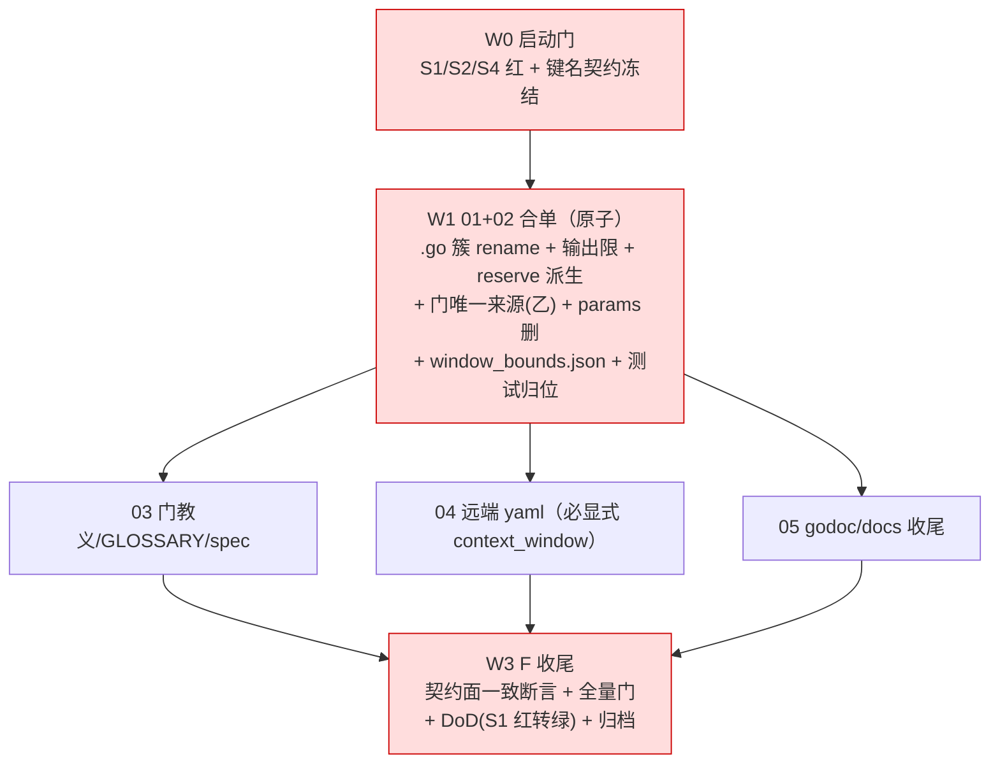

# 配置面归位 · 编排账（tasks.md）

> 当前完成状态勘误：与 runtime-recovery-ideal 合提的最终候选未通过完整验收，归档已回退，F1–F4重新核销。下文W0–W2及旧run-notes为历史时点证据，保留已实现配置改动，不据此宣称当前整体完成；当前放行依恢复变更的同候选终验，此轮不归档或发布。

> **只编排**：本文件只编排波次与子变更；孙任务明细 + verify 三要素见 [design.md](design.md) §六与各二级子变更。
> **启动门**：W0 症状锚 S1/S2/S4 写就且**红** + 新键名契约冻结（replay_window/context_window/max_tokens、reserve 派生、output_reserve+divisor+params 删除），方可进 W1。
> **波次语义**：波次仅汇报分组；解锁 = 前置孙任务**复跑凭据绿**（非汇报绿）。乙已裁定：预算门开 ⟺ context_window>0。

## 跟踪图（关键路径红）

## 子变更清单（二级，含孙任务级前置）

| 子变更 | 域 | 孙任务 | 前置 | 波次 |
|---|---|---|---|---|
| [01-budget-normalization](changes/01-budget-normalization/tasks.md) | 预算三量归位（核心原子） | 1.1 rename · 1.2 输出限真发 · 1.3 reserve 派生+门唯一来源 · 1.4 注册表重分类 · 1.5 测试归位 | W0 红+契约冻结 | W1 |
| [02-dead-field](changes/02-dead-field/tasks.md) | params 死字段清除 | 2.1 删 Params+伴生+fixture 改 | 与 01 同簇，合单串行 | W1 |
| [03-gate-docs-spec](changes/03-gate-docs-spec/tasks.md) | 门教义/GLOSSARY/spec | 3.1 GLOSSARY · 3.2 spec MODIFIED · 3.3 门教义核 | 01 键名落地 | W2 |
| [04-remote-sync](changes/04-remote-sync/tasks.md) | 远端 yaml 同步 | 4.1 tagent.yaml/rl.yaml 新键+必显式 context_window | 01 键名落地 | W2 |
| [05-consumer-docs](changes/05-consumer-docs/tasks.md) | godoc/docs 收尾 | 5.1 godoc 重生成+CHANGELOG/README/wiki | 01 落地 | W2 |

**合单判据（R21/R28）**：01+02 触碰集相交（config.go/decode.go/fingerprint.go/clone.go），且 01 的 rename 与 window_bounds.json 被门强耦合（漏改即红）→ **W1 必须合单原子落地，不可并行派发**。03/04/05 触碰集互不相交且都在 01 键名落地后 → W2 三域可并行。

## 收尾 F 任务（一级直管）

- [ ] F1 **契约变更面一致断言**：本变更**有意**改契约（spec/golden/GLOSSARY），故 F1 非「零 diff」，而是断言契约改动**恰为 design 所列**——`git diff <基线>..HEAD -- openspec/specs golden docs/GLOSSARY.md` 逐处对照 design §四/§六，无计划外契约漂移；冻结归档（archive/**）与 §五冻结拼写零 diff。
- [ ] F2 **全量门禁**：`go build ./...`；`go test ./api/config/... ./assembly/... ./runtime/agent/... ./memory/replay/...`；`python scripts/gates/check_window_bounds.py`；`scripts/gates/check-openspec.sh`；doc 门——各 exit 0（build/test 与 commit 永不串联）。
- [ ] F3 **DoD 逐项核验 + 症状锚红转绿**：S1（c75 隔离复现）完整回滚必红、修复必绿，两次证据入 run notes；S2/S3/S4 绿；远端 yaml strict 解码 + 预算门开（context_window>0）实测。
- [ ] F4 **归档 + 导览**：`openspec archive config-surface-normalization`（不 --skip-specs）；归档后 check-openspec.sh 全绿；导览链接域→证据。

## 进度账（一级 checkbox，复跑凭据为准）

- W0 启动门：☑（S1/S4 行为红锚立起、键名契约冻结，台账 R0）
- W1 01+02 合单：☑（门绿=W1 完成判据达成，台账 R1 1.1–1.5/2.1）
- W2 03：☑ / 04：☑ / 05：☑（三域 doc+结构门全绿＋编排者共享面归位 schema_allowlist/doc_budget/orchestration 勘误，台账 R2）
- W3 F1：☐ / F2：☐ / F3：☐ / F4：☐（合提候选最终验收重开；旧run-notes只说明原时点，当前需与恢复变更同候选验证，未通过不归档）