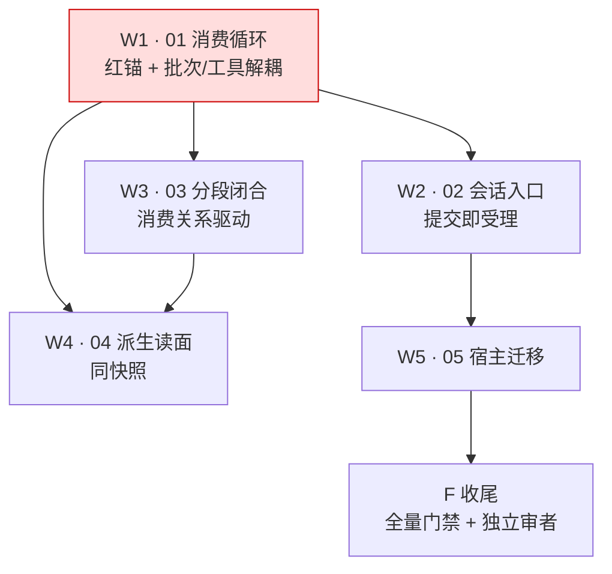

# 任务（只编排；明细在二级子变更）

**只编排**：本文件不承载实现步骤，孙任务在 `changes/<NN-domain>/tasks.md`。
**启动门**：W1 放行前必须已完成——症状直译红锚存在且红、`ORCHESTRATION.md` 四问齐备、跨域签名冻结（`design.md#D6`）。
**波次语义**：波次只是汇报分组，解锁以「依赖已入 main」为准（R3）。

## 子变更清单

- [ ] **01-consumer-loop**（`event-consumer-loop`）：批次取用与工具解耦；跨来源合批；不整轮等待。前置：D6 签名冻结。
- [ ] **02-intake-drive**（`session-intake`）：提交即受理；同会话单消费者推进；门闩语义移除；不移写来源身份。前置：01 入 main。
- [ ] **03-turn-segment**（`turn-segmentation`）：消费关系落链与段判据；回滚可重建。前置：01 入 main（可并行 02）。
- [ ] **04-derived-faces**（`derived-face-consistency`）：rl 导出按消费关系；工具/环境/capture 同一次快照。前置：01、03。
- [ ] **05-hosts**（`host-migration`）：wechat-bot 与 cli-host 适配；端到端症状锚。前置：02。

## 收尾 F（一级直管，顺序固定）

- [ ] **F1 契约零改动断言**：`git diff <基线>..HEAD -- api/event` 逐条核对——只允许新增 `MetaKeyConsumedInputs`/`MetaKeyIsolation` 等键与相应测试，事实族结构不得改动。
- [ ] **F2 全量门禁**：根 `go test ./...`、`scripts/lint.sh`、`event-short` 十轮、`event-long` 六分片全绿。
- [ ] **F3 DoD 与症状锚双证据**：症状直译锚（慢工具期间第二条消息得到回答；第一条回答闭合后第二条不在已完成历史）修复后绿 + 回滚必红，两次证据入 `run-notes.md`；域 delta 落地；`Turn`/`Invocation` 语义文档同步；各域 checkbox 与代码一致。
- [ ] **F4 独立审者放行**：独立只读审者对照任务行验收面分轮拷问，末轮显式 frontier 空 + 扫描范围 + 逐项证据。
- [ ] **F5 归档**：`openspec archive event-driven-consumption`，域→证据链接入 run-notes。

## 账目纪律

- 每单完成即回填：域 checkbox + 本文件子变更 checkbox。
- `compression-and-budget-as-events` 为并行变更，不在本图内；其 L1 与「判定/执行拆分」已完成，需在下次提交时同步勾选。
