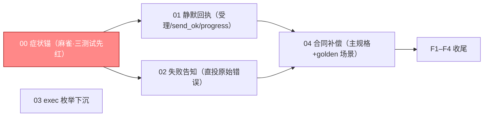

# 编排账目（只编排；spec 已下沉二级域）

> **只编排**：本文件不下沉任何验收条款；每域条款在 `changes/<NN>/specs/`。
> **启动门**：00 域（症状锚）三条测试先红是其余一切的前置；01.1（受理→ok）是 00.2 转绿的最短闭环，W0 内完成。
> **波次语义**：波次仅为汇报分组；解锁=依赖入 main，不是整波栅栏。

## 跟踪图

## 域清单

- [x] 00-symptom-anchors —— 三条症状直译测试先红（受理后无 outbound / 完成恰一条 / 失败→原始信息告知），smoke 台架、独立注入会话、500 注入；补差 00.4 exec 中间态静默回归锚
- [x] 01-silent-receipts —— 受理回执→`ok`、send_ok→`ok`、progress 只落 fact 不进 intake；denied 保留；补差 1.4 exec 中间态静默（审计事实仍落，不驱动回合）
- [x] 02-failure-delivery —— 真失败且无正文→sender 直投原始错误 + fact 留痕 + 日志带原因
- [x] 03-tool-schema —— exec_run/exec_release kind/resource 枚举与格式进 schema
- [x] 04-contract-gates —— persistent-event-loop 四新场景（原三 + 补差 exec 中间态）+ event_integrity/v1 受影响场景核对修订 + 症状测试独立 CI job

## W0（麻雀，必须先完成）

- [x] 1.1 完成 00 域（三测试全红证据 + 跑法）—— 前置：无；红证 evidence/red.txt（G1 请求含 accepted task-；G2 结算前请求含受理材料+outbound=2；G3 罐头话术非原始错误）；G2 判别锚实测重定位已登记
- [x] 1.2 完成 01.1（受理回执→`ok` 的最小闭环）—— 提交 1332064；00.1/G1 转绿（`TestLocalSmokeSymptomAcceptedSilent` exit=0）；00.2/G2 的用户世界断言仍红（outbound=2），留给 01.2/01.3，本项不按“00.2 转绿”宣称；前置：1.1 红证

## W1

- [x] 2.1 完成 01 域余量（send_ok→ok、progress 落 fact 不进 intake）—— 前置：1.2 —— 提交 `49fd79f`（01.2：成功回执→`ok`，点名 `TestQuietSendReceipt` exit=0，判别力=回滚即红）与 `84d6625`（01.3：progress 只落 fact，点名 `TestQuietProgressNotice|TestBackflowNotificationLanes|TestQuietReceipts` exit=0，判别力=关闭跳过即红）；**一级无 G2 条目**：G2 `TestLocalSmokeSymptomSettledOnce` 随 01.3 转绿（exit=0）并同批提交 `84d6625`；01 域原三叶无余量，补差 1.4 单列（exec 中间态静默）。克隆验证（`git clone --local` 到 `/tmp/tagent-clone-84d6625`，checkout `84d6625`）：`bash scripts/lint.sh` exit=0（`lint: ok`）、`go test ./... -short -count=1` exit=0（38 个 `ok` 包、无 FAIL）。
- [x] 2.2 完成 02 域（失败告知直投 + fact + 日志原因）—— 前置：1.1；触碰集与 01 相交（host.go）→ 与 2.1 串行 —— 提交 `179803d`（02.1/02.2：`Outcome.Cause()` + `Turn.Failure` + `deliverFresh` 直投 + 无载荷 `failure-notice` fact + 观测行 `error=%q`，点名 `TestFailureNotice|TestOutcomeCause` exit=0、`TestModelCallObservation` exit=0）与 `9cc4b20`（02.3：示例层去罐头 + G3 转绿，点名 `TestLocalSmokeSymptomFailureNotice|TestLocalSmokeWave2Errors` exit=0）；判别力=HEAD `84d6625` 代码 + 本单 G3 测试即红（`/tmp/event-semantics-boundary/02.3/run-before.json` exit=1，失败断言落在语义而非编译）；`TestLocalSmokeWave2Recall` 在 HEAD `84d6625` 即红（既有红、非本单引入，`recall-head.log`），全量 smoke 扣除它后 exit=0；克隆验证（`git clone --local` 到 `/tmp/tagent-clone-9cc4b20`，checkout `9cc4b20`）：`bash scripts/lint.sh` exit=0（`lint: ok`）、`go test ./... -short -count=1` exit=0（38 个 `ok` 包、无 FAIL）。
- [x] 2.3 完成 03 域（exec 枚举下沉）—— 提交 8d34616；正锚两 Declaration 测试+负锚旧短语消失+消费者锚 NewPreset；证据 evidence/03.{1,2}-summary.json

## W2

- [x] 3.1 完成 04 域（主规格三场景 + golden 核对修订 + CI 登记）—— 前置：2.1、2.2 全部行为落地 —— 04 域 4.1/4.2/4.3 三叶已勾（4.4 由 P-05 裁删）；正锚：主规格新增「循环面的模型感知边界」1 处 + 三场景 3 处（scenario 69→72，`openspec validate persistent-event-loop --strict --json` exit=0 / passed=1；补差加第四场景后 73，见下）、v1 S15 三行改写（`progress_reaches_decision:false`，`TestScenario15TaskLogicalStatus` exit=0、`carried=false`、fact 按 `NoticeFactKey` 恰 1 条）、`event-semantics-symptoms` job 在 `ci.yml` 无条件存在（`python3 -m unittest scripts.test_check_runtime_workflow` exit=0，44 tests OK）；负锚：v2 合同 `git diff --stat golden/runtime/event_integrity_scenarios.json` 为空（F1）、删 job/加 `if`/窄化 selector 均使 workflow 自测红、回滚到 `49fd79f` 时 A5/A7 测试 exit=1；消费者锚：`bash scripts/check-openspec.sh` exit=0、`check_runtime_evidence.py --check-contract`（v1 归档 graph / v2 合同）均 exit=0；**残余（需上级裁定）**：P-08 主规格 +28 行使 `bash scripts/lint.sh` 在 markdown doc budget 门红（22220 vs 22192，基线不在 D6 白名单）；P-09 v1 S03/S11 在 HEAD `9cc4b20` 即漂移（既有，非本单引入）。详见 `changes/04-contract-gates/tasks.md` 的「实施回写」§5；**补差（2026-10-26）**：同一 requirement 加第四场景「exec 中间态不构成模型材料、不驱动回合」，主规格 scenario 72→73；同块合并等量列表项、去掉新场景标题后的空行，净 -1 行，baseline 22220→22219（`--tighten` 锁定），未上调基线

## F（一级直管）

- [x] F1 契约零改动断言（v2 `golden/runtime/event_integrity_scenarios.json` diff 为空；v1 `golden/runtime/scenarios.json` 的 S15 改写在本变更声明的合法变更集内，逐行核对只动 S15 文案；主规格变更仅限本变更声明的 delta）—— `8d34616^..HEAD`：v2 diff 0 字节；v1 numstat `3/3` 且三处改动全在 S15 块（title / anchor_tests 改名 / `progress_reaches_decision:false`）；主规格 numstat `28/0` 仅 `openspec/specs/persistent-event-loop/spec.md`（Requirement+3 Scenario）。证据 `evidence/F1-contract-zero-diff.txt`
- [x] F2 全量门禁（scripts/lint.sh + 三模块 build/vet/test + short 十轮 + long 六片 + mutations，逐条原始退出码）—— 11 项全绿：lint 0；根/微信/cli-host 三连 0-0-0；short 十轮全 exit 0 + 10 个互异 run_id + 每轮 28 test_id（28m43s）；long 六片（1/7/42 × 256/32768）全 exit 0 verdict=match（inputs 7200、restarts 720、无 flaky）；mutations gate.ok 11/11 killed；bundle 17 份 evidence ok=true；症状 job 9 pass/0 skip；unittest OK；check-openspec 0 + strict 0。证据 `evidence/F2-gates.txt`
- [x] F3 DoD 核验 + **症状直译锚红转绿双证据**（完整回滚本变更→三症状测试必红；修复后必绿；两次证据入 run notes）—— G1：admissionText 还原旧文案→exit1（smoke_test.go:3254/3257）→还原（blob==HEAD、sha256 `3bd186f4…`、diff 0）→exit0；G2：send 回执还原与去 progress 过滤均 exit0（无判别力，如实记录），红锚改用非受理面「结算正文投递两次」→exit1（3337/3357）→还原（blob==HEAD、sha256 `81149e70…`）→exit0，另以「受理回执还原→G2 exit1（3327/3337）」作耦合旁证；G3：失败告知分支短路→exit1（3394，告知 0 条）→还原→exit0；还原树整份症状 job 9 pass/0 skip。DoD：三症状绿 / 主规格 strict exit0（72 Scenario）/ CI job `event-semantics-symptoms` + workflow 自测 44 tests OK / lint 绿——逐项勾。证据 `evidence/F3-symptom-redgreen.txt`
- [ ] F4 归档 + 导览（域 → 证据链接；run-id 逐字符核对）

## 粒度统计

5 域、16 叶（00:4 / 01:4 / 02:3 / 03:2 / 04:3；P-07 原实测 14 叶，2026-10-26 exec 中间态补差新增 00.4/1.4 两叶；原 04.4 叶裁删——本变更不建 task-graph，无图时 plan 门不跑，适配叶为空转）、W0 麻雀单 2 笔（00 域合单、01.1 单）、W1 三单（01 余量/02/03，01 与 02 串行）、W2 单笔（04）、F 四笔。

## 待裁项裁定（编排者，2026-10-25）

- P-01 批准：01.3 写集含 progress 读路径（Drive 的 progressNotes/NoticeFeed）——仅去 park 不能让 progress 离开模型。
- P-02 批准：02 域含示例层 `examples/wechat-bot/wechat.go` 罐头失败文案去除（否则框架直投变两条）。
- P-03 批准：模型失败以 `Turn.Terminal=KindFailed` + `Outcome.Cause()`/`Turn.Failure` 贯通（实测 Invoke error 为 nil；error 保留宿主/协议语义，负锚 `host_error_not_a_model_failure` 防混用）。
- P-04 批准：04.2 修订 A2–A7 冲突锚；v1 `golden/runtime/scenarios.json` S15 过期文案同批改写；v2 合同零改（A1 保留）。
- P-05 裁定：不建 task-graph.json，删 04.4 叶（无图时 check_runtime_plan 不跑的适配为空转）。
- P-06 记录：v2 合同实测 29 父/143 子（非 141），findings 登记，不改合同。
- P-07 以实测为准：原叶数 14；2026-10-26 exec 中间态补差新增 00.4/1.4 后为 16（见粒度统计）。
- 4.3 批准独立 CI job 形态；父测试改名 `TestProgressNotificationStaysOutOfTheDecision`（旧名是谎）。
