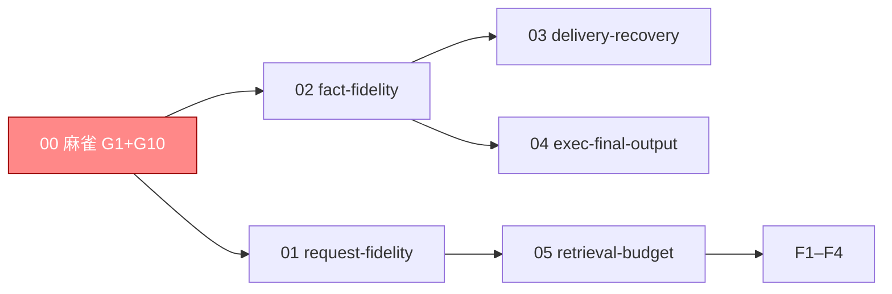

# 编排账目（只编排）

> **只编排**：验收条款在域 specs。**启动门**：麻雀（G1 协议保真）先红转绿。
> **波次语义**：分组汇报；解锁=依赖入 main。

## 跟踪图

## W0（麻雀）

- [ ] 1.0 G1 协议保真红转绿：投影恢复完整调用-结果配对（tool_call_id/ToolCalls/工具名），工具调用后下一轮/压缩后/冷启动后三场景过协议校验 —— 验证：`go test ./tests/integration/host -run 'RequestFidelity' -count=1`（红证先行）；正锚三场景配对校验；负锚（拆掉 ToolCallID→400）；消费者锚=Boot→Invoke 真实请求
- [x] 1.1 G10 测试去假设：NoSendTool 按模型身份+标记定位请求，单跑 10 次全绿 —— 验证：`go -C examples/wechat-bot test . -run '^TestLocalSmokeSymptomNoSendTool$' -count=10 -tags smoke`；负锚（注入乱序请求→仍定位正确）
- [x] 1.2 调用事实入链（Q5 裁定：1.0 ③ 冷启动协议合法的前置）：assistant 工具调用消息（ToolCalls/ToolCallID/逐字参数）由 commitCalls 提交为调用事实、先于 result 入链；seedReplay 将存储事实回填活账本（seedFact），恢复即重配对 —— 验证：`TAGENT_FIDELITY_COLD_BOOT=1 go test ./tests/integration/host -run 'RequestFidelity' -count=1`（红证先行→修后解除 Skip 转绿）；正锚 request_after_cold_boot 冷启动后完整配对（含逐字参数）；负锚拆 ToolCallID→400（既有协议门）；消费者锚=Boot→Invoke 真实请求

## W1

- [x] 2.1 G4 作用域：replays 索引改 AgentID+SessionID 完整地址 + 跨 Agent 同名会话隔离测试 —— 前置：无（与 1.0 同文件 request.go→串行）；正锚隔离测试；负锚（还原 SessionID 单键→串历史）
- [x] 2.2 G2+G3 事实保真合单：EventBody 全字段；同键幂等/冲突；commit 失败→Invoke error —— 前置：无；正锚重装配全字段；负锚（同键异内容→冲突不双成功；断屏障→error 非 completed）；消费者锚=Host.Invoke 返回值
- [x] 2.3 戳记边界（Q17 裁定：戳记 vs 事实机制化）：提交协议零值回填（InjectEvent/CommitToSession 非零不覆写 Source/Target/Owner/InvocationID，InstanceID 保持协议盖戳）；SameFact 排除面改为协议生成戳记（Timestamp/InvocationID/InstanceID/Format/Retention 出比较面），Source/Target/TaskID 调用方提供即入（absent-wildcard）—— 验证：`go test ./tests/integration/host -run 'TestFactFidelity' -count=1`；正锚（同事实一次带 Source 一次不带=幂等、声明戳记存活入事实）；负锚（覆写非零戳记→ErrFactKeyConflict 具名冲突、存储不动）

## W2

- [x] 3.1 G5 交付恢复：pendingDeliveries 持久化（跨重启可批准/拒绝）+ 发送失败持久重试义务 —— 前置：2.2（同 host.go 簇）
- [x] 3.2 G6b 唤醒统一（Q6/Q8 裁定改写）：SettleDriver retained 降解为 mailbox 未消费通知（Claim→drive→Consume 同账；通知本体持久化+durable 消费回执+回调重试；未消费通知跨 Stop 保留）—— 前置：2.2；验收：重复 fire 不双回合、跨重启可恢复、Stop 保留
- [x] 3.3 G6 执行最终输出：退出释放前保存最终输出（可读）+ 接管测试升级（unknown→查询→接管或具名报告） —— 前置：无

## W3

- [ ] 4.1 G7 历史恢复与预算解耦（max_tokens=0 仍恢复旧历史）
- [x] 4.2 G8 向量候选完整检索（不按 recent 预截断）
- [x] 4.3 G9 完整请求预算（呈现决定条件重用+硬约束）

## F

- [ ] F1 契约零改动断言（主规格修订仅本变更声明）
- [ ] F2 全量门禁（lint/三模块/short 十轮/long 六片/mutations/症状 job）
- [ ] F3 DoD + G1–G10 回滚即红双证据（定点破坏各修复点）
- [ ] F4 归档 + 导览

## 粒度统计

5 域 11 叶（00:2 / 01:1 / 02:1 / 03:3 / 05:3 + F4）；麻雀单 2；W1 合单 1（G2+G3）+ 串行叶 1；W2 三单；W3 三单。
