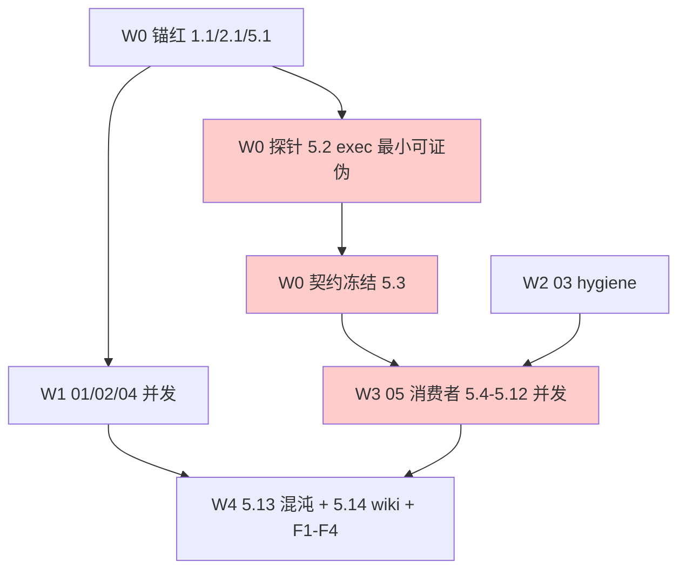

# Tasks: hot-update-and-purity-closure（一级只编排）

> 只编排：本文件不含实现级 `- [ ]`；实现孙任务在各 `changes/<NN-domain>/tasks.md`。
> 启动门：03/05 触碰 recovery.go/run.go/host_reload.go 簇，须在途 `restart-recovery-optimization` 归档后启动；01/02/04 可先行。
> 波次语义：波次仅为汇报分组，解锁以依赖入 main 为准（非波次栅栏）。

## 编排跟踪图（关键路径红标）

## 子变更清单（含孙任务级前置）

- [ ] 01 delivery-correctness —— `changes/01-delivery-correctness/`（前置：锚 B 1.1 红；无跨域依赖）
- [ ] 02 read-failure-honesty —— `changes/02-read-failure-honesty/`（前置：锚 2.1 红；无跨域依赖）
- [ ] 03 retired-state-hygiene —— `changes/03-retired-state-hygiene/`（前置：restart-recovery 归档；run.go 簇先于 05）
- [ ] 04 single-source-gates-docs —— `changes/04-single-source-gates-docs/`（前置：无；gate 正反样例自测）
- [ ] 05 event-guided-hot-update —— `changes/05-event-guided-hot-update/`（前置：锚 A 5.1 红 + 探针 5.2 + 契约 5.3 + 03 入 main）

- [ ] 06 window-recovery —— `changes/06-window-recovery/`（转移自 restart-recovery 04；剩余 E4-E12/4.a5/4.d*）
- [ ] 07 ci-orchestration —— `changes/07-ci-orchestration/`（转移自 restart-recovery 05；重启计数进 CI/分片/ liveness）
- [ ] 08 guards-and-tests —— `changes/08-guards-and-tests/`（转移自 restart-recovery 06；F0/R3/测试重写/R35）
- [ ] 09 runtime-simplicity —— `changes/09-runtime-simplicity/`（转移自 runtime-simplicity-upgrade 全量；journal 帧/kvPort/单屏障/证据/流式/观测/导出）—— **本轮只含纯核心**：已勾的 1.1–1.6（含 1.5b/1.5c/1.5d）与 4.1，另有已勾的 2.1/2.3/5.1/5.2/5.3/6.1；特性叶已拆出（见下"本轮范围裁定"），09 本轮开放叶剩余 = 0
- [ ] 10 turn-segment —— `changes/10-turn-segment/`（转移自 event-driven-consumption 03；消费关系闭段取代 agent_output）
- [ ] 11 derived-faces —— `changes/11-derived-faces/`（转移自 event-driven-consumption 04）
- [ ] 12 checkpoint-state —— `changes/12-checkpoint-state/`（合并阻断项：CI 长分片 LongRun 挂死；框架统一 checkpoint 事实族 + 状态接缝 + 恢复重写 + 退役 RecoveryTicket；前置：无，核心耦合簇单派发）

## 本轮范围裁定（2026-11-08 用户裁定）

09 的"特性 program"已拆分，本一级变更本轮只收口 09 的纯核心；下列两个顶层变更为独立跟踪对象，**deferred、不在本轮实施、不占任何派发单写面、不计入本变更完成度**：

- `openspec/changes/runtime-streaming-increments/` —— 承载 09 流式四叶 3.1/3.2/3.3/3.4（四件套已完成，`openspec validate runtime-streaming-increments --strict --no-interactive` EXIT=0）。
- `openspec/changes/runtime-simplicity-features/` —— 承载 09 其余特性叶 0.1/0.2/2.2/2.4/2.5/4.2/4.3/5.4/6.2/6.3 与 09 收尾 F1–F4（四件套已完成，`openspec validate runtime-simplicity-features --strict --no-interactive` EXIT=0）。

转移明细与计数见 `changes/09-runtime-simplicity/tasks.md` §11；本轮不再新增 09 的开放叶勾选。

## 收尾 F（一级直管）

- [ ] F1 契约零改动断言：`git diff 036c3500..HEAD -- api/event api/config` 除 D6 冻结新增外为空（新增须与 design D6 逐字一致）
- [ ] F2 全量门禁：`scripts/gates/lint.sh` + `openspec validate --all --strict` + `go test ./... -count=1` exit 0
- [ ] F3 DoD 逐项核验入 run notes：锚 A/B 红转绿 + 完整回滚必红双证据；混沌≥10 重复+race；409 清单 grep 空
- [ ] F4 `openspec archive hot-update-and-purity-closure` + 导览文档（域→证据链接，run-id 逐字符核对）