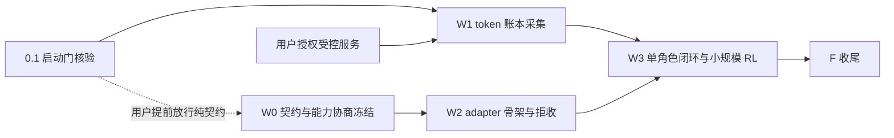

# 在线 RL 训练接入：一级编排账目（骨架级）

本级只编排 W0-W3 与收尾，不展开产品实现；实施拆分（二级域与孙任务）待 `post-training-data-loop` M2 完成后进行。本文件的叶级条目是**工作包**，不是可派发单；细化轮须切到"单文件单机制单测试 + 一条验证命令"。
启动门：M0-M2 完成 + SFT 输入/掩码/held out 实证 + DPO 管线启用 + 受控推理服务授权，四者未同时成立时 W1 起不派发（0.1 为门本身）。
波次仅作汇报分组；解锁依据为前置产物进入受控集成树并通过核验，不等待整波。派发以 [ORCHESTRATION.md](ORCHESTRATION.md) 为准；落位与命名以 design D6 为基线，M2 对账后允许改名并回写。

默认不派发任何叶子；W0 为纯契约工作，可由用户提前放行，但仍不得接触真实采样证据。

## 0. 启动门

- [ ] 0.1 核验启动门四条件并留凭据：M0-M2 完成状态、SFT 输入/掩码/held out 成功率实测、DPO 管线启用、受控服务与预算授权 —— 验证：`openspec show post-training-data-loop --json` 的 artifact/任务状态 + SFT/DPO 验收 run-id 记录；四条件全满足方可进入 W1，G1-G3 任一未满足则 W1 起全部阻塞（W0 纯契约是否提前放行由用户裁定，仍不得接触真实采样证据）。细化拆分待 post-training-data-loop M2 完成后进行。

## 1. W0 契约与能力协商冻结

- [ ] 1.1 冻结 `Capability` 字段集与 `Rejection` 稳定码表：D2 表逐字段各一条缺失码，另含未知 schema 码；`max_policy_staleness=0` 与"未声明"必须可区分 —— 验证：`go test ./rl/trainer -run '^TestCapabilitySchemaFrozen$' -count=1` 通过，且码表条数与 D2 表逐字段核对一致（`grep -c` 计数入凭据）。细化拆分待 post-training-data-loop M2 完成后进行。
- [ ] 1.2 写 named rejection 负向测试集：逐字段缺失、未知 schema 版本、摘要漂移各一例；断言按稳定码与字段定位，不按自由文本 —— 验证：`go test ./rl/trainer -run '^TestCapabilityRejects' -count=1` 全 PASS 且子测试数 ≥ 表字段数。细化拆分待 post-training-data-loop M2 完成后进行。
- [ ] 1.3 冻结在线 RL 记录的版本化 annex（token 账本、`policy_version`、采样参数、tokenizer/chat template 摘要），不改 `tagent.training.v1` 既有字段语义 —— 验证：annex schema 文件落盘 + `go test ./rl -run '^TestOnlineRLLedgerSchema$' -count=1` 通过；对既有记录字段的 diff 为空。细化拆分待 post-training-data-loop M2 完成后进行。

## 2. W1 token 账本采集（需用户授权受控推理服务）

- [ ] 2.1 受控服务能力探针：在本机/内网对已授权服务证明可回传 prompt 与 response 的实际 token IDs、逐 token logprob、tokenizer/chat template 摘要与策略版本 —— 验证：探针 run-id + 产物 JSON（四项逐项有值或明确 `unsupported` 声明来源）；缺任一项即停并按 design D5 升级选型。细化拆分待 post-training-data-loop M2 完成后进行。
- [ ] 2.2 逐 attempt 账本落盘：账本与响应一一对应，token 数与实际 `usage` 核对，logprobs 三态沿用且 `unsupported` 带声明来源 —— 验证：`go test ./rl -run '^TestOnlineRLLedgerRecordsServerTokens$' -count=1` + 受控服务联调 run-id（真实路径，非本地替身）。细化拆分待 post-training-data-loop M2 完成后进行。
- [ ] 2.3 补造拒绝负锚：文本反推 token ID、缺 logprob 填 0、跨 tokenizer/模板对齐三种路径全部具名拒收 —— 验证：`go test ./rl -run '^TestTokenLedgerRejects' -count=1` 全 PASS，且每条负例断言拒收码。细化拆分待 post-training-data-loop M2 完成后进行。

## 3. W2 trainer adapter 骨架与拒收

- [ ] 3.1 adapter 核对层骨架：消费 W0 冻结的 `Capability`/`Rejection` 类型，出核对与导出最低字段校验入口骨架；零业务逻辑、不依赖训练框架 SDK，含编译断言 —— 验证：`go build ./rl/trainer` 与 `go test ./rl/trainer -run '^TestAdapterSkeletonCompiles$' -count=1` 通过。细化拆分待 post-training-data-loop M2 完成后进行。
- [ ] 3.2 逐 attempt 核对与拒收：版本、摘要、token 数、logprob 状态逐项核对；单条不一致只拒该 Attempt 并保留字段级差异 —— 验证：`go test ./rl/trainer -run '^TestAdapterRejectsPerAttempt$' -count=1`。细化拆分待 post-training-data-loop M2 完成后进行。
- [ ] 3.3 `token_exact` ≠ 算法满足 的独立判定 + 在线 RL 导出最低字段拒收（缺 token / 缺必需 logprob / 奖励未知 / 超窗）—— 验证：`go test ./rl/trainer -run '^(TestTokenExactNotAlgorithmSatisfied|TestExportMinimumFields)$' -count=1`；消费者锚：正式导出入口调用账本与核对逻辑的 grep/调用链证据（测试内手工补线不算）。细化拆分待 post-training-data-loop M2 完成后进行。

## 4. W3 单角色闭环与小规模 RL

- [ ] 4.1 固定其他角色的单角色闭环：工具/子代理/裁判不训练，`joint_credit` 不进训练目标；权重按 root episode × 角色归一 —— 验证：`go test ./rl/trainer -run '^TestSingleRoleAttribution$' -count=1` + 导出样本角色字段核对清单。细化拆分待 post-training-data-loop M2 完成后进行。
- [ ] 4.2 小规模多 seed RL 实验（≥3 seeds，极小任务集，单角色）：每 seed 报告功能成功、硬约束、成本 —— 验证：训练 run-id + 指标文件（三列逐 seed 有值；缺失不算完成）。细化拆分待 post-training-data-loop M2 完成后进行。
- [ ] 4.3 隐藏评测与切分隔离：隐藏集不出现在训练/试采分区，报告多 seed 成功分布与成本 —— 验证：评测 run-id + 切分清单摘要（隐藏集 ID 与训练集交集为空）。细化拆分待 post-training-data-loop M2 完成后进行。

## 5. F 收尾

- [ ] F1 契约零改动断言：`git diff <W0 启动 commit>..HEAD -- openspec/specs/decision-capture/spec.md openspec/specs/offline-training-export/spec.md` 为空；若 reader 面对账后确需扩离线导出，则以本变更登记的 `MODIFIED` delta 为准，不得就地改主 spec —— 验证：diff 为空或 delta 与 proposal 的 Capabilities 一致。细化拆分待 post-training-data-loop M2 完成后进行。
- [ ] F2 全量门禁：`go build ./...` 与 `go test ./rl/... -count=1` exit 0 —— 验证：命令输出入凭据。细化拆分待 post-training-data-loop M2 完成后进行。
- [ ] F3 DoD 逐项核验记入收尾 run notes：每条完成项附正锚/负锚/消费者锚三类凭据，缺一不计完成 —— 验证：run notes 中三锚逐条可复跑。细化拆分待 post-training-data-loop M2 完成后进行。
- [ ] F4 `openspec archive online-rl-training` + 导览（域 → 证据/踩坑链接，run-id 逐字符核对）—— 验证：archive 命令 exit 0 且 `scripts/gates/check-openspec.sh` 全绿。细化拆分待 post-training-data-loop M2 完成后进行。
