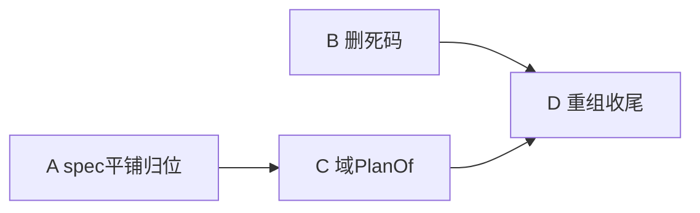

# Tasks：plain-structure（朴素结构重构——file 级孙任务）

> 启动门：设计不妥协（朴素版：config=数据平铺／域=PlanOf+执行／根=纯装配／应用=自定义+挂点注册）。波次语义：解锁=依赖入 main。

## W1：删机制债＋spec 归位平铺

- [x] A1 删 `api/config/section.go`＋`section_test.go`（泛型注册机制撤销）——AgentSpec 回**显式平铺字段**（`Memory MemorySpec`/`Meditation MeditationSpec`/`File FileSpec`/`Exec ExecSpec` 直接字段）；`RegisterSection/Section[T]/SectionSpec` 零残留 —— 验证：`go test ./api/config/... -count=1`＋负锚（未知键严格拒绝保留）＋`grep -rn "RegisterSection" --include="*.go" .` 零
- [x] A2 `MemorySpec/EngineSpec/EmbeddingSpec` 类型回 `api/config/config.go`（从 `memory/decl/spec.go` 迁）；`partitions.go`→`memory/partition.go` 旁（域内聚）；`decl/canonical.go` 并 `api/config/fingerprint.go`；**删 `memory/decl/` 目录** —— 验证：`go test ./api/config/... ./memory/... -count=1`＋`ls memory/decl` 零＋指纹 golden（四段全声明指纹值不变——字节对照）
- [x] A3 `MeditationSpec` 回 `api/config`（从 `evolution/meditation/spec.go`）；**删** `spec_canonical.go`/`spec_test.go`（并 config 的 decode/fingerprint 测试） —— 验证：`go test ./api/config/... ./evolution/meditation/... -count=1`
- [x] A4 `ExecSpec` 回 `api/config`（从 `tool/exec/spec.go`）；同删 canonical/test —— 验证：`go test ./api/config/... ./tool/exec/... -count=1`
- [x] A5 `FileSpec` 回 `api/config`（从 `tool/file/spec.go`）；同删 —— 验证：`go test ./api/config/... ./tool/file/... -count=1`
- [x] A6 四域消费点改直读字段（`prepare.go`/`run.go`/`run_tool.go`/`meditation_plan.go` 的 `Section.Of`→`spec.Memory` 直读；宿主 `Declare`→直赋值） —— 验证：`go test ./... -count=1`＋`cd examples/wechat-bot && go test ./... -count=1`＋golden deterministic match
- [x] B1 删 `telemetry/recorder.go`（零消费者死接口——含 skeleton 断言与 `examples/contract/telemetry/Recorder_example.go`） —— 验证：`go test ./telemetry/... -count=1`＋`grep -rn "telemetry.Recorder\|SealResult" --include="*.go" .` 零

## W2：域 PlanOf＋根包/应用层重组（微单级，8 单并发）

- [x] C1a `meditation_plan.go`（根包）→ `evolution/meditation/plan.go`（`PlanOf`＋类型随迁） —— 验证：`go test ./evolution/meditation/... -count=1`＋`ls meditation_plan.go` 零
- [x] C1b 根包调用点＋测试随迁（run.go 一行调 `meditation.PlanOf`；meditation_plan 测试归域） —— 验证：`go test ./... -count=1`＋根包 import 零 meditation_plan 符号
- [x] D1a `run_commit.go`＋`run_fact.go`→职责命名（`commit.go`/`facts.go` 或并一文件——内容零变化） —— 验证：`go build ./...`＋`go vet ./...` 绿＋两新文件 grep 原符号齐
- [x] D1b `run_invoke.go`＋`run_request.go`→职责命名（`invoke.go`/`request.go`） —— 验证：同上
- [x] D1c `run_tool.go`→职责命名（`tools.go`）＋`read.go`/`host_face.go` 核对名 —— 验证：同上＋golden deterministic match（全根包重组后）
- [x] D2 `memory/embedder_hash.go` 并 `memory/embedder/hash.go` —— 验证：`go test ./memory/... -count=1`＋`ls memory/embedder_hash.go` 零
- [x] D3 `api/document` 定案留（doc 注释写明语义单元：宿主文档方言适配） —— 验证：`go test ./api/document/... && cd examples/wechat-bot && go test ./... -count=1`
- [x] D4a 删 `host_memory.go`（MemoryPlanOf 一行并入 host_runtime 装配；relations 归属核；错误别名删——直用域错误）＋`host_memory_test.go` 装配断言并入 `host_runtime_test.go` —— 验证：`cd examples/wechat-bot && go test ./... -count=1`＋`ls host_memory*.go` 零
- [x] D4b `host_meditation.go`→`meditation_delivery.go`（留 deliverReflection＋address；plan 解析已归域）＋测试改名随迁 —— 验证：`cd examples/wechat-bot && go test ./... -count=1`＋`ls host_meditation.go` 零

## F 收尾

- [x] F1 契约零改动（指纹/golden 字节不变）＋F2 全量门禁＋F3 DoD
- [ ] F4 archive（需明示）
