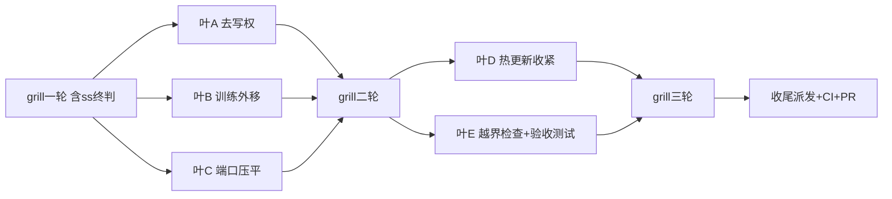

# 任务（待 grill 增补）

- [ ] A. 去写权：StatusProgress 反事实检验（不改允许操作→事实化删写权）；Count/Blocked/Open 报告改现算 —— 验证：反事实判据测试（删状态后无歧义算回）+ `go test ./runtime/task ./memory/... -count=1`
- [ ] B. 训练外移：Recorder 收窄为执行证据（Snapshot 调用时固定保留）；Episode/Decision/Attempt 组织移训练模块 —— 验证：核心包 grep 零训练形态 + 训练模块测试绿 + `go test ./runtime/agent ./features/... -count=1`
- [ ] C. 端口压平：Material×Product 组合推导实证（有则保留写明，无则删词汇保具名端口）—— 验证：plugin 包 grep 零 Material/Product + EXTENSIONS.md 同步 + 六端口派发测试绿
- [ ] D. 热更新三档：/reload 按三档收口（越档具名拒绝）—— 验证：reload 三档测试（新代可变/越档拒绝/固定一次）
- [ ] E. 越界检查+验收：runtime/task 执行细节引用清点；新工具接入验收测试（适配器只给执行/取消/恢复证据跑通全链）—— 验证：验收测试绿+清点表零越界
- [ ] F. grill 循环至无新有效问题 —— 验证：终轮 grill 报告无新有效问题
- [ ] G. 收尾：全套门禁+push+远端 CI 绿+PR+merge（CI 不过不 merge）+ success-semantics 一并收口（design/proposal 入库）
