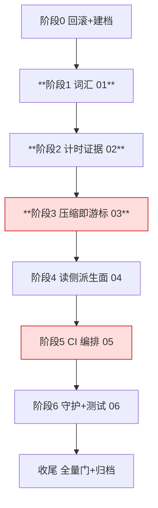

# 一级 tasks（只编排）

> 头部三行：① 本文件只编排，不写实现细节；② 启动门 = 阶段 0 回滚与建档完成 + 基线门全绿；③ 波次仅汇报分组，解锁 = 依赖入 main 且独立拷问 frontier 空。

## 跟踪图（关键路径红标）

## 子变更清单（一级 checkbox 跟踪）

- [x] 01-vocabulary — 转世→重启恢复、代码名词规范化、撤销伪词条；验证：与子域 `changes/01-vocabulary/tasks.md` 1.1–1.4 完全一致（叙述层含 `*.sh`/`*.yaml` 的豁免后计数 0、根模块 + `examples/wechat-bot` 独立模块 go test、伪词条不作为术语行/标题、`verify_contracts.py` PASS），MUST NOT 用无豁免的裸 `grep | wc -l`（该命令实测 151，见 r6）
- [x] 02-timing-evidence — Scan/fold 分段计数写入 CI 可上传产物（**部分**：进程内计数已达产物；带数据重启计数与全零判红移交 5.1a，同变更内承接非缩水）；验证：具名单测 + 冻结命令 10 行计数
- [x] 03-compression-cursor — 链上票据 + 外部只读 blob + 失败退回全量；验证：正锚（全量≡dump+增量）/负锚（5 类失败含 blob 缺失）/消费者锚（真实 Boot）；放行=第 7 轮闭合清单 P1–P5 全 PASS（ORCHESTRATION r25）
- [ ] 04-read-side-recovery — 读侧派生面（观测表/回放投影）状态与水位持久化、完成点扩面、增量装载、失败退全量；验证：成本锚（boot 的 visit 条数 = 增量）+ 等价锚（增量 ≡ 全量逐面 DeepEqual）+ 负锚（状态缺失/坏水位退全量）+ 消费者锚（120 重启 boot_ms 与代数无关）
- [ ] 05-ci-orchestration — 分片/超时重冻/具名 liveness；验证：CI 全 6 分片绿 + 证据完整
- [ ] 06-guards-and-tests — F0 边界规则 + R3 登记 + 测试重写；验证：F0 selftests + 全量门

## 收尾 F 任务

- [ ] F1 契约零改动断言：`verify_contracts.py` PASS（六个冻结字符串、10 文件 56 行、MISMATCH 0）
- [ ] F2 全量门禁 exit 0；`go test ./tool/exec -count=2` 复跑确认既存 flake 不构成回归
- [ ] F3 DoD 逐项 + 症状锚红转绿两次证据入 run notes
- [ ] F4 `openspec archive` + 导览文档；**归档链接债务**：GLOSSARY 第 3 行与 CHANGELOG [Unreleased] 当前指向 active change dir 的契约表，归档后路径失效，须把契约表移入受测文档（如 GLOSSARY 独立节）并同步两处链接、按棘轮规则处理行数（tighten 只降不升，需在同批压掉等量文档），或把表随变更一并归档并把链接改指归档路径。MUST NOT 让归档后留下断链
