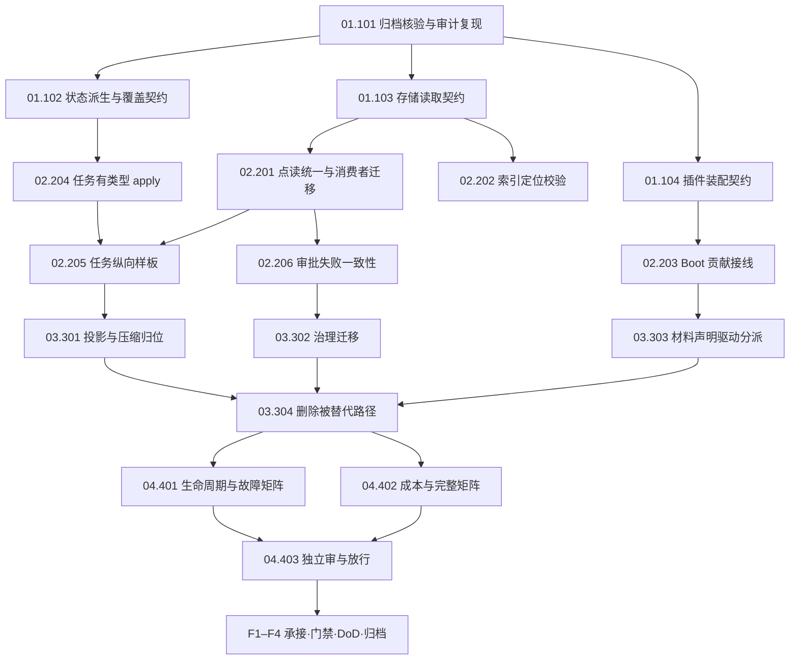

# Tasks：runtime-coherence（一级只编排）

> 本文件只编排，不承载实现任务。派发唯一依据是 [ORCHESTRATION.md](ORCHESTRATION.md) 与各子变更 `tasks.md`。
> 启动门：`01.101` 完成（归档核验与审计复现台账落盘）后，其余叶方可派发。
> 波次只是汇报分组；解锁以依赖叶有同候选通过证据为准，不等待整波完成。

## 子变更

- [ ] [changes/01-contract-evidence/](changes/01-contract-evidence/)：复现与四契约冻结（叶 01.101–01.104）
- [ ] [changes/02-task-vertical/](changes/02-task-vertical/)：存储前置接线、任务纵向样板、审批一致性（叶 02.201–02.206）
- [ ] [changes/03-consumer-convergence/](changes/03-consumer-convergence/)：投影/压缩、治理、材料声明、删除（叶 03.301–03.304）
- [ ] [changes/04-release/](changes/04-release/)：生命周期、成本、矩阵、独立审（叶 04.401–04.403）

## 收尾（一级直管）

- [ ] F1 承接账核销与契约零改动断言：归档 CARRYOVER 相关项逐条有结论；主规格只在归档时合并
- [ ] F2 全量门禁：三 Go module build/vet/test、lint、race、openspec、event-integrity、smoke 与归档前拒绝，全部取原始退出码
- [ ] F3 DoD 逐项核验：P0–P10 与 S1（S2 按阶段 0 结论）入 run notes，含症状锚红转绿与回滚即红
- [ ] F4 独立审 frontier 空后归档，登记后继指针；真实 CI 绿才判放行
