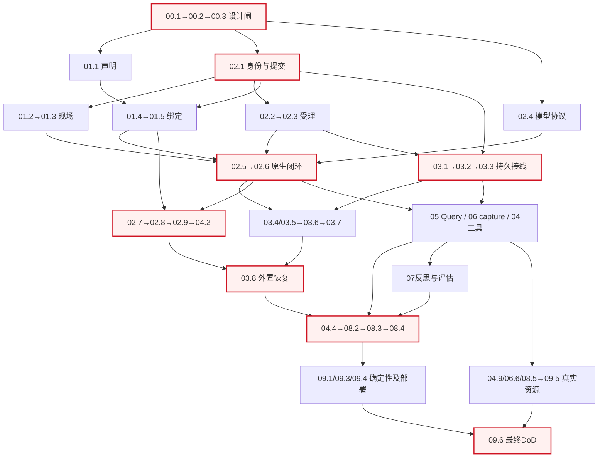

# runtime-rebuild 顶层编排账目

本层只编排，65 个实施叶任务仅在二级 tasks.md 记账；下列编号是域验收与收尾项，不是新增叶任务。
启动门：外部计划只读；本轮只创建规划与检查资产；产品实施须 G0–G3 和相应授权齐备。
波次仅为汇报分组，解锁以叶任务前置实际集成为准（本分支 next，不自动切 main），不等待整域完成。
预期档（[expectations.md](expectations.md) 的 O/KR）与复用导航（[trpc-reuse.md](trpc-reuse.md)）为对照索引，内容不在本层重复。

## 1. 域级验收

- [ ] 1.1 验收 [00-foundation](changes/00-foundation/tasks.md)：00.1→00.2→00.3→00.4→00.5→00.6；检查器已生成不替代 G1 探针与旧门迁移。
- [ ] 1.2 验收 [01-state-binding](changes/01-state-binding/tasks.md)：01.1 等 00.3，01.2 等 02.1，01.4 等 01.1/02.1；声明、授权、mailbox、同代绑定及热读。
- [ ] 1.3 验收 [02-execution](changes/02-execution/tasks.md)：02.1/02.4 等 00.3；02.5 等 01.3/01.4/02.3/02.4；原生闭环、转交和真实排空。
- [ ] 1.4 验收 [03-history](changes/03-history/tasks.md)：03.1 等 02.1，03.3 等 02.2/03.2，03.8 等 03.7/04.2；持久屏障、原文与副本恢复。
- [ ] 1.5 验收 [04-capabilities](changes/04-capabilities/tasks.md)：04.1/04.5 等 02.6，04.2 等 02.9/01.5，04.4 等 02.9/03.8，04.7 等 03.4/03.5/04.5；04.9 单列真实资源。
- [ ] 1.6 验收 [05-inspection](changes/05-inspection/tasks.md)：05.1 等 01.3/01.5/02.2，05.3 等 02.6/05.2，05.4 等 03.3/04.2/05.3；只读运行总图。
- [ ] 1.7 验收 [06-learning](changes/06-learning/tasks.md)：06.1 等 02.5，06.4 等 03.3/06.3，06.8 等 01.5/06.7；06.6 必须真实 SFT 制品消费。
- [ ] 1.8 验收 [07-evolution](changes/07-evolution/tasks.md)：07.1 等 04.7/05.4，07.2 等 03.3/01.6，07.3 等 07.2/05.3；07.4 只等 01.5/02.4，不等反思调度。
- [ ] 1.9 验收 [08-host](changes/08-host/tasks.md)：08.1 等 02.9/05.2，08.2 等 08.1/04.4/04.5，08.4 等 06.8/07.1/07.3/07.4/08.3；08.5 另需明确发送授权。
- [ ] 1.10 验收 [09-acceptance](changes/09-acceptance/tasks.md)：09.1 汇合确定性实施，09.2 可提前随 03.3/03.5 就绪，09.5 按资源子项独立验收，09.6 等 09.1–09.5。

完整无环边集见 [task-graph.json](task-graph.json)。下图只展示**关键汇合**，不能据图省略 JSON 中的叶级前置；红色表示高风险集成路径，不表示已经测得工期。
**图的节点摘要不作派发图**：图中每个节点（如 `01.4→01.5 绑定`、`03.1→03.2→03.3 持久接线`）只表示一个汇合段，**不表示段内各任务互为派发前置**。就本例而言，`01.4` 就绪（其 `depends_on=[01.1,02.1]` 满足）即**可独立派发**，`01.5` **不构成 `01.4` 的前置**；`02.5` 只等 `01.3/01.4`，不等 `01.5`。一切叶级前置**以 `task-graph.json` 为准**。

## 2. 一级收尾（非65叶任务）

- [ ] 2.1 F1 核对冻结合同差异：以实施开工登记的 golden 摘要为基线，逐项核对修改授权、delta 和负控；保护面与外部计划摘要不变。未登记基线不得称零改动。
- [ ] 2.2 F2 复跑 09.3 两 module 全量门禁及 09.1 值/消息/关系对拍；记录每条原始退出码，不能只汇总 PASS。
- [ ] 2.3 F3 按 09.4/09.5/09.6 核对部署、真实资源、SFT、微信、未决项与正式消费者；逐项证据齐全才完成 DoD。
- [ ] 2.4 F4 请求独立归档授权；获准后按单一能力责任标准同步嵌套 delta、校验主规格及导览。当前不提交、不归档。

操作合同与本轮证据只在 [ORCHESTRATION.md](ORCHESTRATION.md) 维护；结构有效不等于产品通过，全部叶任务维持 planned。
