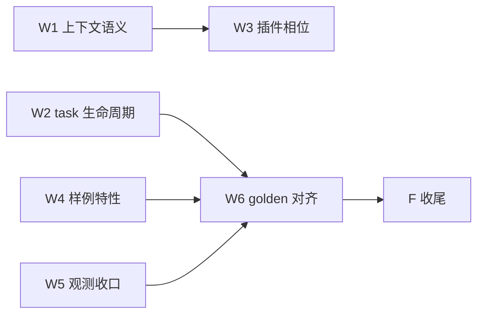

# Tasks：spec-conformance（只编排）

> 启动门：主循环保持现状（裁定）；三龄段=段龄轴（D1）。波次语义：解锁=依赖入 main。

## W1 上下文语义主干（关键路径）
- [x] W1.1 映射序列记录：commitFact 后 projection.Append＋装配期 AttachReplay（产品接线） —— 验证：`go test ./tests/integration/history ./tests/integration/host -run "Projection|RequestBoundary" -count=1`＋负锚（未 attach 时上下文=静态+transcript 不变）
- [x] W1.2 三龄段：段龄划分＋体积阈值＋三级产生（新→中、中+老→老）复用 age 规则 —— 验证：`go test ./memory/replay/... ./tests/integration/history -count=1`＋阈值触发用例＋负锚（阈值不达不折）
- [x] W1.3 动态环境块：system prompt/tool·skill·MCP 面/异步任务状态——**置于上下文最下方**（前缀缓存友好） —— 验证：`go test ./tests/integration/host -run "Environment|RequestBoundary" -count=1`＋顺序断言（环境块在末）＋负锚（无任务时块仍存在但空表）

## W2 task 生命周期
- [x] W2.1 逻辑状态：stable/suspect/watch（长期不变更识别）＋TTL/执行超时 —— 验证：`go test ./runtime/task/... -count=1`＋超时转异步用例＋负锚（活跃任务不误判）
- [x] W2.2 progress 回调进 Backflow（通知面扩） —— 验证：`go test ./runtime/agent/... ./tests/integration/state -count=1`＋progress 事件到达用例

## W3 插件相位（摘要触发/环境注入）
- [x] W3.1 摘要触发相位（压缩请求→策展消费经插件面）＋环境注入相位 —— 验证：`go test ./api/plugin/... ./evolution/meditation/... -count=1`＋相位执行用例＋负锚（越界相位拒绝保留）

## W4 样例特性回归
- [x] W4.1 subagent tool 形态（`agent:` 引用→call_subagent 预设接线） —— 验证：`cd examples/wechat-bot && go test ./... -count=1`＋委派用例＋负锚（未声明 agent 拒绝）
- [x] W4.2 recall 读面注入（Embedder/Table/Originals/Trace）＋模型消费层（规则+模型两段） —— 验证：`go test ./tool/recall/... ./tests/integration/capabilities -count=1`＋四工具真可用用例＋负锚（缺读面具名拒绝保留）
- [x] W4.3 knowledge 工具面（skill_search/skill_load/read_file——复用 trpc skill/file 面） —— 验证：同上＋knowledge 委派用例

## W5 观测收口
- [x] W5.1 chat span 去重（保留框架侧，删本仓重复 span） —— 验证：`go test ./api/model/... ./tests/integration/host -count=1`＋Langfuse 单 generation 断言
- [x] W5.2 五机制观测（压缩/委派/审批/持久化/恢复——每事件一条，旁路不阻断；冥想面归 W3.1） —— 验证：正锚 `go test ./memory ./runtime/agent ./evolution/governance ./runtime/state -run 'Observation' -count=1`＋负锚（logger panic 不改判定/落定/恢复）＋消费者锚 `go test ./tests/integration/history ./tests/integration/execution -run 'Observation' -count=1`

## W6 golden 对齐
- [x] W6.1 S13-S15 场景（上下文闭集/三龄段/环境块）＋S10 测试文件 —— 验证：`python3 scripts/run_runtime_scenarios.py --scope deterministic` match＋EXPECTED_SCENARIOS 同步
- [x] W6.2 f·g 语义（After 唯一化/未知投影具名拒绝/settled 角色统一） —— 验证：`go test ./api/plugin/... ./runtime/agent/... -count=1`＋负锚

## F 收尾
- [x] F1 契约零改动断言（golden 键变更已逐键申报）＋ F2 全量门禁（lint ok/36 包/deterministic 14 match/complete 15 match）＋ F3 DoD 逐项核验
- [ ] F4 archive（需明示）
