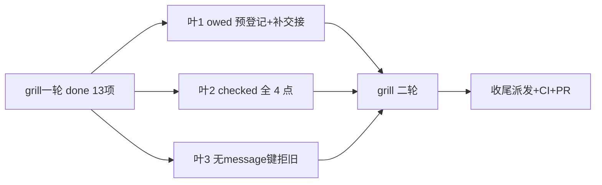

# 任务（grill 第一轮增补修订版）

- [ ] 1. owed 交付义务预登记+补交接（P1+#1#2#4#12）：新增 owed 态（恢复自动经 deliverOne 保 ruler）；deliverFresh 逐条正文登记 owed→发送→销账；driveSeat 落地即销前补登记 owed 再 consume；同 ID 状态迁移、销账幂等；恢复 switch 显式接 owed —— 验证：TestSettleDeliversAcrossKilledSender 判据（kill 前投递 0、重启后恰 1、Scan delivery: owed 归零、consume 恰一次）+ `go test ./tests/integration/host -run 'TestSettle|TestDelivery|TestFollowUp' -count=1`（全套 settle/delivery 锚不回归）
- [ ] 2. checked 全 4 点+at-least-once 边界（P2+#5#6#7#9）：recordDeliveryState 4 调用点失败具名上抛；noteDeliveryRefusal 同；Approve 发送前不销账、回执落盘销账、回执失败具名错误；spec 降级声明（无 tier=进程内）—— 验证：TestDeliveryStateCommitFailure（取消 ctx→Refuse 返错、内存态不变）+ TestApproveDeliveryReceiptFailure（回执失败→具名错误、义务不销）+ 既有 delivery_recovery/delivery_review 锚
- [x] 3. 无 message 键拒旧（P2+#10#11）：DecodeEventBody 顶层无 message 键→ErrEventBody（原始键存在性）；新测试字节样例 `{"key":…,"content":…,"summary":…}` —— 验证：TestDecodeEventBodyRefusesKeyContentSummaryShape + 既有 TestDecodeEventBodyLegacyRefused 不动
- [x] 4. final 归属与残余窗口明示（D6/D7）：spec 写明用户 turn 微窗口残余+理由、final 跨重启不承诺+ErrFinalOutputUnrecorded 归属 —— 验证：openspec validate --strict 通过
- [ ] 5. grill 二轮至无新有效问题（用户指令）—— 验证：终轮 grill 报告无新有效问题
- [ ] 6. F：全套门禁+push+远端 CI 绿+PR+merge（CI 不过不 merge）
