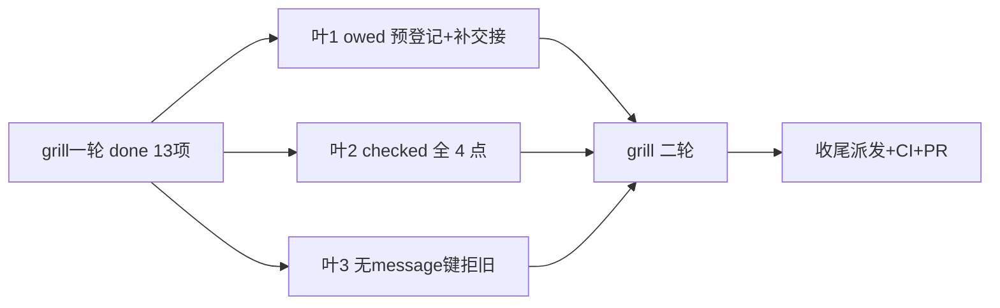

# 任务（grill 第一轮增补修订版）

- [x] 1. owed 交付义务预登记+补交接（P1+#1#2#4#12）：新增 owed 态（恢复自动经 deliverOne 保 ruler）；deliverFresh 逐条正文登记 owed→发送→销账；driveSeat 落地即销前补登记 owed 再 consume；同 ID 状态迁移、销账幂等；恢复 switch 显式接 owed —— 验证：TestSettleDeliversAcrossKilledSender 判据（kill 前投递 0、重启后恰 1、Scan delivery: owed 归零、consume 恰一次）+ `go test ./tests/integration/host -run 'TestSettle|TestDelivery|TestFollowUp' -count=1`（全套 settle/delivery 锚不回归）
- [x] 2. checked 全 4 点+at-least-once 边界（P2+#5#6#7#9）：recordDeliveryState 4 调用点失败具名上抛；noteDeliveryRefusal 同；Approve 发送前不销账、回执落盘销账、回执失败具名错误；spec 降级声明（无 tier=进程内）—— 验证：TestDeliveryStateCommitFailure（取消 ctx→Refuse 返错、内存态不变）+ TestApproveDeliveryReceiptFailure（回执失败→具名错误、义务不销）+ 既有 delivery_recovery/delivery_review 锚
- [x] 3. 无 message 键拒旧（P2+#10#11）：DecodeEventBody 顶层无 message 键→ErrEventBody（原始键存在性）；新测试字节样例 `{"key":…,"content":…,"summary":…}` —— 验证：TestDecodeEventBodyRefusesKeyContentSummaryShape + 既有 TestDecodeEventBodyLegacyRefused 不动
- [x] 4. final 归属与残余窗口明示（D6/D7）：spec 写明用户 turn 微窗口残余+理由、final 跨重启不承诺+ErrFinalOutputUnrecorded 归属 —— 验证：openspec validate --strict 通过
- [ ] 5. grill 二轮至无新有效问题（用户指令）—— 验证：终轮 grill 报告无新有效问题
- [ ] 6. F：全套门禁+push+远端 CI 绿+PR+merge（CI 不过不 merge）

## 叶 7-11（责任范围收缩五项并入，grill 一轮判据修订版）

- [ ] 7. A 去写权三分+枚举表：StatusProgress 删写权改派生读（running∧链含 progress 通知∧非终态；commit Status 重放语义写明）；Count 登记/Open 现算/Blocked 保留写权写依据；独立写权状态全枚举表（pendingDeliveries/answered/exitReason/Occupancy/delegate 投影逐行裁决）—— 验证：反事实判据测试+`go test ./runtime/task ./runtime/agent ./memory/... ./tests/integration/... -count=1`（StatusProgress 断言测试改写）
- [ ] 8. B 训练外移：Capture 全保（Snapshot 调用时固定）；Recorder Episode/Decision 删、Attempt 并入 Capture.Record；WithCallPass/CallPassFrom 迁 api/plugin、runtime/agent 去 features/evolution import —— 验证：黑名单 grep（Recorder 组织+features/* import 于 runtime 核心）零命中+白名单（event 身份）不受扰+`go test ./runtime/agent ./features/... -count=1`
- [ ] 9. C 端口压平：删九词汇常量、assemble 具名派发、EXTENSIONS.md:11/:28+skeleton_assert+误声明用例同步 —— 验证：全仓 grep `MaterialCall|MaterialRequest|MaterialFact|Product(Call|Ruling|Observation|View|Compression|Environment)` =0+六端口派发测试绿
- [ ] 10. D 热更新三档：字段映射表；tools/plugins 二档具名拒绝；storage/ReadRoot/Exec 二档 compatibleWith 具名拒绝；PublishUnchanged 锚 —— 验证：reload 三档测试（新代可变/越档具名拒绝/同指纹 PublishUnchanged）
- [ ] 11. E 越界检查+验收：清点表入库（runtime/task grep tmux|subagent|远程）；新工具验收测试（execution rig+NativeAgent.Tools，适配器只给执行/取消/恢复证据跑通受理→结算→投递，宿主零补偿）—— 验证：验收测试绿+清点零越界
- [ ] 12. F2 grill 循环至无新有效问题（含叶 7-11 实施后二/三轮复核：A-1/A-2 裁决落表、B 幸存面与 D11 一致、C 判据裁定、D 字段映射）—— 验证：终轮 grill 报告无新有效问题
- [ ] 13. F3 收尾：全套门禁+push+远端 CI 绿+PR+merge（CI 不过不 merge）
