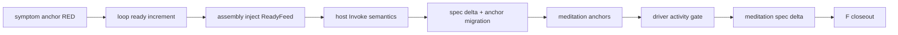

# 任务（只编排；孙任务见 changes/<域>/tasks.md）

头部三行：只编排 / 启动门=本域无跨 change 前置（规格现条款在 main）/ 波次仅为汇报分组，解锁=依赖入 main。

- [ ] 01 域 decision-boundary —— changes/01-decision-boundary/（叶 A1–A6）
- [ ] 02 域 meditation-activity —— changes/02-meditation-activity/（叶 B1–B3）
- [ ] F1 契约零改动断言 —— 验证：`git diff <base>..HEAD --stat -- openspec/specs` 输出**恰好两行**（persistent-event-loop/spec.md、meditation-idle-gating/spec.md 各一处 delta 落地），其余主规格零改动
- [ ] F2 全量门禁 —— 验证：`bash scripts/lint.sh` exit 0；`python3 scripts/scenarios/run_runtime_scenarios.py --contract golden/runtime/event_integrity_scenarios.json --scope event-short --repeat 1 --out $TMP/eis` verdict=match；`python3 scripts/gates/check_event_integrity_mutations.py --all --json --out $TMP/mut` gate.ok=true；双示例 module `go test ./... -count=1` 全 ok
- [ ] F3 DoD 核验 —— 验证：`go test ./tests/integration/execution -run '^TestMessageReachesTheNextDecisionOfAInFlightTurn$' -count=1` 绿；`go test ./tests/integration/evolution -run '^TestMeditationYieldsBesideAnActiveSession$' -count=1` 绿；完整回滚两域改动后同两条命令**必红**（两次证据入 notes）
- [ ] F4 archive+导览
