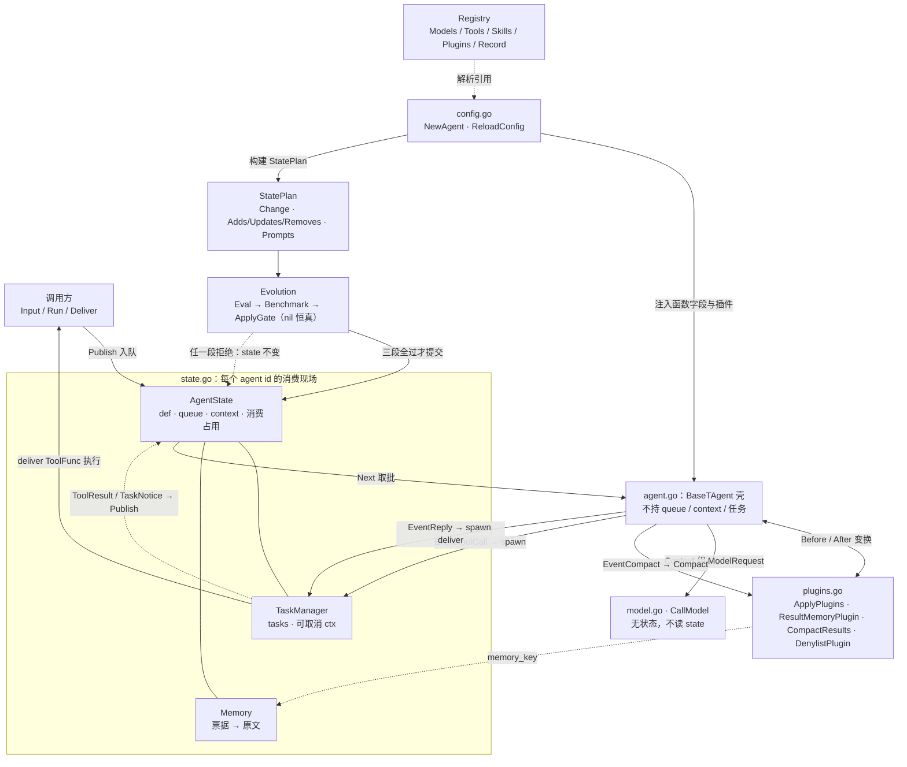
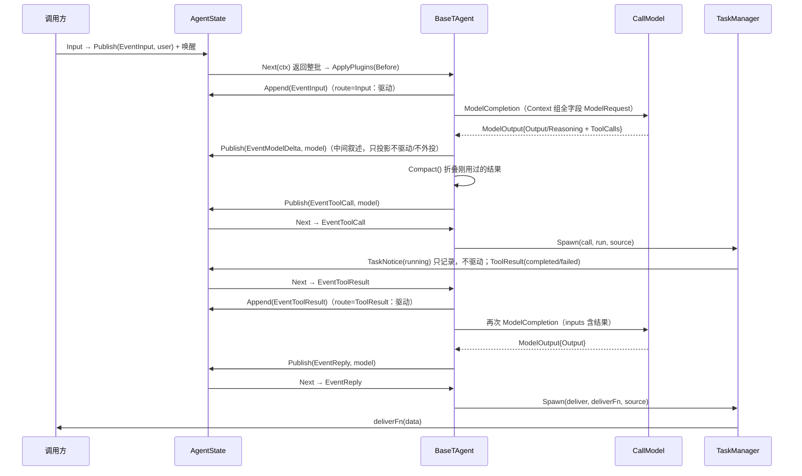

# prototype —— 事件驱动 agent 运行时原型

本包用 Go 标准库把「事件 → 任务 → 模型请求」的关系落成可运行骨架：核心只消费事件、按类型分派、
调用任务 API、构造完整模型请求并发布产出。目录内**没有独立 CLI**，一切经 `go test` 的 agent 集成
用例验证，不提供 `go run` 入口。

## 定位与契约

- **输入不折叠、不打票据**：`EventInput` 原样进入 `AgentState` 上下文，模型先读原文。
- **低密度结果选择性外置**：只有被插件选中的 `ToolResult` 存 `Memory` 得 `memory_key`；模型消费后
  `CompactResults` 把该条改成短预览 + `[memory:<key>]`，原文可经 `recall` 取回。
- **插件按 Kinds 闭包选择**：`Plugin{Kinds, Before, After}` 可改 `Data/Meta`，`Type=0` 丢弃；无默认
  全事件插件，核心类型分派不搬进插件。需要向模型展示 `TaskID/Status/Error` 时，由匹配该事件的
  呈现闭包加入 `Data`，核心不统一拼接事件属性。After 不会撤销已发生的任务派发；核心按 Before
  之后的 `Type` 路由。
- **中间叙述与 final 分流**：模型带工具调用时，`Output`/`Reasoning` 各作为一条 `EventModelDelta`
  （`Source="model"`）回送本管线进上下文投影，不驱动、不外投；仅无工具调用且 `Output` 非空才发
  `EventReply`（final）。
- **投递任务化**：`EventReply` 路由不直调 `Deliver`，而是经 owner 任务表 `Spawn` 一条 `deliver` 任务
  执行（`Deliver` 与 `ToolFunc` 同形 `func(ctx, string) (string, error)`）；成败以 ToolResult 通知回
  管线，循环不因投递失败终止（重投与否是模型决策域）。
- **治理插件**：`DenylistPlugin` 对命中名单的 `ToolCall` 在 Before 变换为 `denied` 的 `EventToolResult`
  （保留 Call/Data，置 `Status="denied"`、`Error`）——核心据 Before 后 Type 走结果路径，工具零执行、
  模型读到拒绝事实。HITL 是同机制接缝（变换前先问人），原型不实现。
- **输入规模边界**：原始输入持续保留，未承诺全局上下文有界。memory 票据在所属 agent 的 Memory 中解释，跨 owner 召回需另外显式接线。
- **任务不互相等待**：每个工具/子 agent 是所属 owner 的一条任务，`running` 与结果通知回到 owner 队列，不等待同批其他任务收齐。
- **任务通知条数窗**：`AgentConfig.TaskWindow`（0=即发）编译进 `TaskManager`；完成通知攒满 window 条
  批量投递、`Close` 前 flush 残余，无定时器；窗口不等待输入、不控制模型触发粒度（pull 自然聚合）。
- **state 以 agent id 持有现场**：队列、上下文、`TaskManager`、`Memory`、父子定义都在 `AgentState`；执行壳只引用 `State`，不自持这些状态。
- **config 与 state 一体双生**：config 是声明面（文件 `Config`），state 是生效面（定义 + 生效 prompt +
  队列 + 上下文 + 任务 + 记忆）；显式 `ReloadConfig` 驱动 config→plan→evolve→state，同 id 换装只更新
  定义与生效 prompt，现场不动。
- **三段管道只审配置变更**：变更先构 `StatePlan`，再经 `Evolution`：Eval→Benchmark→ApplyGate；nil 段
  恒真（原型默认全恒真，真实评估/基准是接缝），任一段拒绝则 state 保持旧态；普通工具调用不走此门。
- **JSON Reload 热加载**：显式 `ReloadConfig` 才重读文件，无 watcher；同 id 换壳保留原现场，晚到结果仍进原队列。
- **跨进程 JSON checkpoint**：`Save`/`LoadState` 只存可序列化现场；恢复时 running → `unknown`，缺
  owner 的现场与任务回收。`Complete(id, ...)` 是 mock 资源重挂的回报口，不假称重启了 goroutine。

## 组件与数据流



## 一条任务事件时序



## 文件职责

| 文件 | 职责 | 持有状态 | 边界（不做） |
| --- | --- | --- | --- |
| `contracts.go` | 数据契约：Event/EventType/ToolCall/ModelRequest/ModelOutput/ModelTrace/Plugin/Config/Change/StatePlan/Evolution/Registry/Task | 无 | 网络、凭据、持久格式迁移；快照不含函数 |
| `agent.go` | 事件壳 `BaseTAgent`：`Input`/`Publish`/`DefaultRun`/`DefaultOnEvents`/`invokeModel`/`spawn`；`Deliver` 为 `ToolFunc` 形态 | 只持 `State` 引用与函数字段 | 背压、流式、持久化、强杀；停止壳不关 owner 任务 |
| `task_manager.go` | owner 任务表：`Spawn`/`Complete`/`Snapshot`/`Restore`/`Close`；`AgentTask` 委派；持 owner 引用与条数窗 | `tasks`、可取消 `ctx`、`wg`、`pending` | 重试、TTL、强杀、跨进程重挂；不复制任务 ID |
| `state.go` | 现场权威：`AgentState`（含生效 `SystemPrompt()`）+ `State` 注册表 + `Apply(cfg, resolve, evo)`/`Close`/`Save`/`LoadState` | `def`/`prompt`/`queue`/`context`/占用；`Tasks`/`Memory` 引用 | WAL、事务、多代租约；不按年龄判僵尸；不序列化函数 |
| `config.go` | 配置描述与装配：`LoadConfig`/`ReloadConfig(path, state, registry, evo)`/`NewAgent`；注入 resolve 与演进 | 无（只构造闭包） | YAML、文件监听、循环体、真实 eval/基准、任务状态 |
| `memory.go` | 顺序票据 → 原文表：`Put`/`Recall`/`Snapshot`/`Restore` | `data map`、`seq` | 落盘、索引、淘汰、语义检索 |
| `model.go` | 无状态代理：`CallModel` 调用并按轨迹记录 | 无 | 调度、重试、缓存、provider 检测、system 组装 |
| `plugins.go` | 选择性变换：`ApplyPlugins`/`ResultMemoryPlugin`/`CompactResults`/`DenylistPlugin` | 无（`Memory` 由闭包引用） | 插件管理器、优先级、失败回滚；顺序由切片固定 |

## JSON 配置示例

字段用 Go 默认名；`Params` 为 `map[string]float64`。

```json
{
  "Agents": [
    {"ID": "root", "Model": "mock", "SystemPrompt": "你是根 agent。", "Params": {"temperature": 0.2},
     "TaskWindow": 4, "Skills": ["grep"], "Tools": ["recall", "echo", "agent:child"], "Plugins": ["result-memory"]},
    {"ID": "child", "ParentID": "root", "Model": "mock", "SystemPrompt": "你是子 agent。", "Tools": ["echo"]}
  ]
}
```

## Registry 注入

`Registry` 把配置里的名字解析为本进程执行能力；`Plugins` 是接收 owner 的工厂，便于结果外置接现场。
治理插件同理：`DenylistPlugin(owner, names...)` 把命中名单的 `ToolCall` 在 Before 变换为 `denied` 结果。

```go
reg := prototype.Registry{
    Models: map[string]prototype.ModelFunc{"mock": mockModel},
    Tools:  map[string]prototype.ToolFunc{"echo": echoTool}, Skills: map[string]string{"grep": "优先精确匹配……"},
    Plugins: map[string]func(*prototype.AgentState) prototype.Plugin{
        "result-memory": func(o *prototype.AgentState) prototype.Plugin {
            // 示例显式选 echo 结果外置，不以长度推断信息价值
            pick := func(e prototype.Event) bool { return e.Call.Name == "echo" }
            return prototype.ResultMemoryPlugin(o.Memory, pick)
        },
        "denylist": func(o *prototype.AgentState) prototype.Plugin {
            return prototype.DenylistPlugin(o, "rm", "shell") // 命中即拒绝，工具零执行
        },
    },
    Record: func(t prototype.ModelTrace) { /* 训练监控 */ },
}
```

## 组装、集成测试与 checkpoint

```go
st := prototype.NewState()
// Evolution 三段 nil 段恒真，原型默认全恒真（真实评估/基准是接缝）。任一段返回 error 即拒绝、state 不变。
evo := prototype.Evolution{}
// 拒绝示例（注释）：evo.Eval = func(p prototype.StatePlan) error { return errors.New("慢变不达标") }
prototype.ReloadConfig("agents.json", st, reg, evo) // 注入 resolve → 构建 StatePlan → 三段演进 → 提交
root, _ := prototype.NewAgent("root", st, reg, deliver)
runCtx, stop := context.WithCancel(ctx)
done := make(chan error, 1)
go func() { done <- root.Run(runCtx) }()
root.Input(ctx, "帮我查一下")

// 调用方确认本轮处理结束后停止消费壳；owner 任务仍由 st 持有。
stop()
<-done
st.Save("checkpoint.json")                              // 显式检查点，不承诺模型执行中间态的崩溃一致性。
// 另一进程重新提供 reg/evo/deliver，读取同一快照。
st2, _ := prototype.LoadState("checkpoint.json")        // 在途任务 → unknown + TaskNotice
prototype.ReloadConfig("agents.json", st2, reg, evo)    // 存在 owner 复用现场，缺 owner 回收
owner, _ := st2.Agent("root")
owner.Tasks.Complete(1, "外部资源结果", nil) // mock 重挂回报，不重跑副作用
```

```bash
# 仓库根执行；agent 集成用例覆盖八个目标场景（含真实子进程恢复）
GOPROXY=off go test ./prototype -run TestAgent -v
GOPROXY=off go test ./prototype -count=10
GOPROXY=off go test -race ./prototype -count=10
GOPROXY=off go vet ./prototype
```

## 能力 / 未实现 / 接缝

| 能力 | 状态 | 实现事实 | 未实现 / 接缝 |
| --- | --- | --- | --- |
| 事件分派 | 已实现 | `DefaultOnEvents` 按 `EventType` 路由（Before 之后取值）；`Input`/`ToolResult` 驱动模型一次，`TaskNotice`/`EventModelDelta`/`Reply` 不驱动 | 背压、优先队列——接 `AgentState.Next` |
| 工具/子 agent 任务 | 已实现（内存级） | `Spawn`/`Complete`；每条完成独立发通知与结果，不等同批；`AgentTask` 以首个子 Reply 收口 | 重试、TTL、强杀、并发配额——接 `Spawn` 执行处 |
| 任务归属与恢复 | 已实现 | 任务带 `OwnerID`/`TaskID`；`Restore` 把 running → unknown 并发通知 | 真实资源重挂——经 `Complete(id, ...)` 回报 |
| 生效 system prompt | 已实现 | Apply 经 resolve 写入 `AgentState`，模型请求读 state 保存值；快照 Save/Load 携带该值 | prompt 版本历史——未实现 |
| config→state 演进管道 | 已实现（三段恒真 mock） | `Apply` 依序 Eval→Benchmark→ApplyGate 审同一 `StatePlan`，nil 段恒真，全过才提交；任一段拒绝则 state 不变 | 真实 eval/benchmark——接 `Evolution` 各段 |
| 热加载 | 已实现 | `ReloadConfig(path, state, registry, evo)` 解析校验后 `Apply(cfg, resolve, evo)`；同 id 复用现场 | 文件 watcher、代际租约——接调用方 |
| 中间叙述投影 | 已实现 | 带工具调用时 `Output`/`Reasoning` 各发一条 `EventModelDelta` 进上下文投影，不驱动、不外投；无工具调用才发 `EventReply` | 叙述去重/裁剪——接 `Context` |
| 投递任务化 | 已实现 | `EventReply` 经 owner 任务表 `Spawn(deliver)` 执行；成败以 ToolResult 回管线，失败不终止循环 | 输出通道治理、重投策略——接调用方 |
| 任务通知条数窗 | 已实现 | `TaskWindow`>0 攒满 window 条批量投递、`Close` 前 flush 残余；0=即发；无定时器 | 定时/按输入聚合——本原型不做 |
| 治理插件 | 已实现（示例） | `DenylistPlugin` 把命中 `ToolCall` 在 Before 变 `denied` 结果，工具零执行、模型读到拒绝 | HITL 审批——同一 Before 接缝 |
| 输入原文 | 已实现 | `EventInput` 原样入上下文，不折叠 | token 预算、压缩——本原型不做 |
| 结果外置与召回 | 已实现 | `ResultMemoryPlugin` 存选中结果；`CompactResults` 折成预览 + 票据；`recall` 取回 | 落盘、索引、语义检索——接 `Memory` 方法 |
| 无状态代理 | 已实现（mock） | `CallModel` 记录完整请求/输出/错误，复制可变字段 | provider、流式、超时重试——接 `Registry.Models` |
| 跨进程 checkpoint | 已实现（演示） | `Save`/`LoadState` 存读 JSON；running → unknown；缺 owner 回收 | 崩溃一致性、WAL/事务——未实现 |
| 观察/反思 | 接缝 | 无冥想水位；反思即自定义 `Source` 的输入事件 | 调度器、授权——接输入调用方 |
| 独立 CLI | 未实现 | 目录无 `main`，不提供 `go run` | 需另建入口 |
